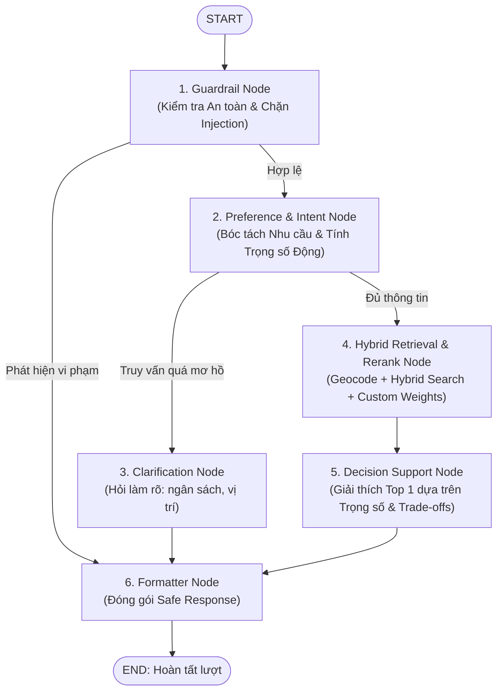

# 🤖 AGENT.MD — Hướng Dẫn Kiến Trúc & Ngữ Cảnh Dành Cho AI Agent

Tài liệu này được biên soạn để bất kỳ AI Agent hoặc lập trình viên nào khi bắt đầu phiên làm việc (new session) đều có thể nắm bắt ngay toàn bộ kiến trúc, trạng thái hiện tại và cách vận hành của hệ thống **Smart Housing Decision Support System (Homigo)**.

---

## 📌 1. Tổng Quan Dự Án
* **Tên đề tài:** Hệ thống hỗ trợ ra quyết định tìm kiếm phòng trọ thông minh (Smart Housing Decision Support System).
* **Đơn vị:** Đồ án tốt nghiệp — Trường Đại học Công nghệ Thông tin (UIT - ĐHQG TP.HCM).
* **Mục tiêu:** Hỗ trợ sinh viên và người thuê phòng tìm kiếm chỗ ở tối ưu bằng cách kết hợp:
  1. **Tìm kiếm lai (Hybrid Search)**: 70% Dense pgvector Embedding + 30% Sparse PostgreSQL Full-Text Search.
  2. **Trọng số thích ứng theo ý định (Intent-Aware Dynamic MCDM)**: Tự động phát hiện ý định ưu tiên (giá rẻ, gần trường, an ninh, tiện nghi) để boost hệ số nhân trọng số và chuẩn hoá L1.
  3. **Máy trạng thái điều phối LangGraph (State Machine Workflow)**: Kiểm soát 6 node từ Guardrail an toàn, Bóc tách nhu cầu tích lũy (Memory), Hỏi làm rõ (Clarification), Truy vấn lai & Rerank tuỳ biến, Phân tích ra quyết định (Decision Support & Trade-offs) đến Đóng gói phản hồi (Formatter).
  4. **Cố vấn quyết định bằng AI Agent**: Giải thích lý do lựa chọn & Phân tích đánh đổi trade-offs minh bạch.

---

## 🏗️ 2. Kiến Trúc Toàn Hệ Thống

```
┌────────────────────────────────────────────────────────────────────────┐
│                        FRONTEND (Next.js 14+)                          │
│   • Trang tìm kiếm AI: /tim-kiem-ai (3 Cột: Chat, Card List, Map)       │
│   • Interface dữ liệu phòng: RoomItem (id, rank, matchScore, lat, lng) │
└───────────────────▲────────────────────────────────▲───────────────────┘
                    │ (Text stream + RoomItem[])     │ (Direct API calls)
┌───────────────────▼────────────────────────┐       │
│        AI AGENT MODULE (ai-agent/)         │       │
│   • State Machine: LangGraph (graph.py)    │       │
│   • Dynamic MCDM: intent_weights.py        │       │
│   • Service: HousingAgentService           │       │
│   • Memory: SessionMemoryManager           │       │
│   • Schemas: AgentResponse, DecisionInsight│       │
└───────────────────▲────────────────────────┘       │
                    │ HTTP REST (housing_tools.py)   │
┌───────────────────▼────────────────────────────────▼───────────────────┐
│                        BACKEND (FastAPI + SQLA)                        │
│   • GET  /api/v1/geocode: Chuyển tên địa điểm thành (lat, lng)         │
│   • GET  /api/v1/locations/*: Tra cứu cây Tỉnh/Thành -> Quận -> Phường │
│   • POST /api/v1/listings/vector-search:                               │
│       - Nhận: query, amenities, weights (custom dynamic weights)       │
│       - Bước 1: Hybrid Search (70% Dense pgvector + 30% Sparse FTS)    │
│       - Bước 2: Rerank đa tiêu chí theo custom_weights (utils.py)      │
│       - Trả về: Listing + match_score + explain_match                  │
└────────────────────────────────────────────────────────────────────────┘
```

---

## 🔄 3. Luồng Điều Phối LangGraph State Machine (`ai-agent/graph.py`)

Hệ thống AI Agent được tổ chức dưới dạng một đồ thị máy trạng thái khép kín (LangGraph StateGraph) gồm 6 Node:



### Chi tiết 6 Node:
1. **`guardrail_node`**: Kiểm tra câu hỏi của người dùng. Nếu phát hiện Prompt Injection hoặc nội dung ngoài luồng $\rightarrow$ ngắt luồng và trả về câu trả lời an toàn lập tức (0 token cost).
2. **`preference_intent_node`**: Tích lũy các tiêu chí vào `UserPreferenceState` qua các lượt chat; quét từ khoá ý định để phát hiện hệ số nhân ưu tiên (`multipliers`) và tính vector trọng số chuẩn hoá `computed_weights`. Nếu người dùng chỉ nói câu quá ngắn/mơ hồ $\rightarrow$ bật cờ `needs_clarification`.
3. **`clarification_node`**: Sinh câu hỏi gợi mở thân thiện hướng dẫn người dùng cung cấp thêm ngân sách và khu vực mong muốn.
4. **`retrieval_node`**: Tự động gọi Geocoding để lấy `(lat, lng)`, gửi yêu cầu đến Backend `/listings/vector-search` kèm vector `custom_weights` vừa tính toán.
5. **`decision_node`**: Đọc `explain_match` của Top 1, tạo lý do lựa chọn minh bạch dựa trên đúng trọng số người dùng ưu tiên, lập bảng so sánh đối kháng Trade-off với Top 2 và đưa ra checklist khi đi xem phòng.
6. **`formatter_node`**: Đóng gói thành Pydantic `AgentResponse`, cập nhật Memory Session và trả về cho Client.

---

## 🎯 4. Cơ Chế Trọng Số Thích Ứng Theo Ý Định (`ai-agent/intent_weights.py`)

Đây là đóng góp cá nhân hoá thông minh quan trọng trong đề tài tốt nghiệp:

### 4.1 Quy tắc kích hoạt tiêu chí (Active Status)
* **Bắt buộc (Luôn bật):**
  * `price`: Giá phòng
  * `safety`: Điểm an ninh
  * `semantic`: Khớp ngữ nghĩa bài đăng
* **Động (Chỉ bật khi người dùng đề cập):**
  * `location`: Chỉ bật khi xác định được toạ độ `lat, lng` hoặc tên địa điểm
  * `amenity`: Chỉ bật khi người dùng yêu cầu tiện ích cụ thể (máy lạnh, gác, wifi...)

### 4.2 Hệ số nhân ưu tiên theo ý định (Intent Multipliers)
| Tiêu chí | Mẫu từ khóa nhận diện ý định ưu tiên | Hệ số nhân ($m_i$) |
| :--- | :--- | :---: |
| **Giá cả (`price`)** | `r"rẻ\s*nhất|giá\s*rẻ|tiết\s*kiệm|ngân\s*sách\s*(hẹp|thấp)|hạt\s*dẻ|rẻ\s*nữa"` | $\mathbf{\times 2.0}$ |
| **Vị trí (`location`)** | `r"sát\s*(bên|nách)|đi\s*bộ\s*được|ngay\s*cạnh|rất\s*gần|sát\s*trường|gần\s*uit"` | $\mathbf{\times 2.0}$ |
| **An ninh (`safety`)** | `r"an\s*ninh|an\s*toàn|nữ\s*ở\s*một\s*mình|sợ\s*trộm|khóa\s*vân\s*tay|bảo\s*vệ"` | $\mathbf{\times 2.0}$ |
| **Tiện nghi (`amenity`)** | `r"full\s*nội\s*thất|đầy\s*đủ\s*đồ|tiện\s*nghi\s*cao|nội\s*thất\s*xịn"` | $\mathbf{\times 1.8}$ |
| **Mặc định** | Không có từ khóa nhấn mạnh | $\mathbf{\times 1.0}$ |

### 4.3 Công thức chuẩn hoá L1 Normalization:
$$w_i = \frac{w_{base, i} \cdot m_i}{\sum_{k \in \text{active}} (w_{base, k} \cdot m_k)}$$

---

## 🧠 5. Cấu Trúc File Module `ai-agent/`

* **[`ai-agent/graph.py`](file:///c:/UIT/Lab/Đồ%20Án%20tốt%20nghiệp/ai-agent/graph.py)**: Toàn bộ StateGraph 6 node và State TypedDict.
* **[`ai-agent/intent_weights.py`](file:///c:/UIT/Lab/Đồ%20Án%20tốt%20nghiệp/ai-agent/intent_weights.py)**: Engine nhận diện Intent Boosters và tính toán L1 Normalized Weights.
* **[`ai-agent/service.py`](file:///c:/UIT/Lab/Đồ%20Án%20tốt%20nghiệp/ai-agent/service.py)**: `HousingAgentService` điều phối qua `housing_graph.invoke()`.
* **[`ai-agent/memory.py`](file:///c:/UIT/Lab/Đồ%20Án%20tốt%20nghiệp/ai-agent/memory.py)**: Multi-turn session state management & Context window compaction.
* **[`ai-agent/guardrails.py`](file:///c:/UIT/Lab/Đồ%20Án%20tốt%20nghiệp/ai-agent/guardrails.py)**: 2-layer defense (Prompt Injection & Off-topic filtering).
* **[`ai-agent/schemas.py`](file:///c:/UIT/Lab/Đồ%20Án%20tốt%20nghiệp/ai-agent/schemas.py)**: Pydantic models (`RoomItem`, `DecisionInsight`, `AgentResponse`).
* **[`ai-agent/tools/housing_tools.py`](file:///c:/UIT/Lab/Đồ%20Án%20tốt%20nghiệp/ai-agent/tools/housing_tools.py)**: Native LangChain tools (`search_rooms`, `geocode_location`, `get_location_hierarchy`, `get_listing_detail`).
* **[`ai-agent/prompts.py`](file:///c:/UIT/Lab/Đồ%20Án%20tốt%20nghiệp/ai-agent/prompts.py)**: Persona Homigo Decision Advisor prompt.
* **[`ai-agent/eval/`](file:///c:/UIT/Lab/Đồ%20Án%20tốt%20nghiệp/ai-agent/eval/)**: Bộ 30 benchmark test cases và script đánh giá RAG Grounding Triad.
* **[`ai-agent/tests/test_housing_agent.py`](file:///c:/UIT/Lab/Đồ%20Án%20tốt%20nghiệp/ai-agent/tests/test_housing_agent.py)**: 13 unit tests bao phủ toàn bộ hệ thống (100% Passed).

---

## 🚀 6. Hướng Dẫn Vận Hành & Lệnh Thường Dùng

### Môi trường ảo Python:
* Backend: `.venv` tại thư mục gốc
* AI Agent: `ai-agent/.venv`

### Chạy Unit Test AI Agent (13 tests):
```powershell
ai-agent\.venv\Scripts\pytest.exe ai-agent/tests/test_housing_agent.py -v
```

### Chạy Đánh Giá RAG Triad Grounding:
```powershell
ai-agent\.venv\Scripts\python.exe ai-agent/eval/rag_grounding_eval.py --limit 5
```

### Khởi chạy AI Agent trong mã Python:
```python
from service import HousingAgentService

service = HousingAgentService()
res = service.run("Em là nữ ở một mình, tìm phòng gần trường UIT giá khoảng 3 triệu khu an ninh nhé")

print("Câu trả lời:", res.text_reply)
print("Số phòng tìm được:", len(res.rooms))
if res.insights:
    print("Top 1 ID:", res.insights.selected_top_1_id)
    print("Lý do lựa chọn:", res.insights.top_1_reason)
```

---

## 📝 7. Hướng Dẫn Cho Các Session Tiếp Theo
1. **Frontend Integration**: Giao diện Next.js (`frontend/src/app/tim-kiem-ai`) kết nối trực tiếp với endpoint gọi `HousingAgentService.run()`. Nhận dữ liệu `AgentResponse` hiển thị `rooms` lên danh sách thẻ và ghim toạ độ lên bản đồ.
2. **Crawler ETL**: Bổ sung tính toán và lưu `price_score` (0.0 - 1.0) vào cột `price_score` trong bảng `listings` để tiêu chí giá trong Rerank đạt hiệu quả tối ưu nhất.
