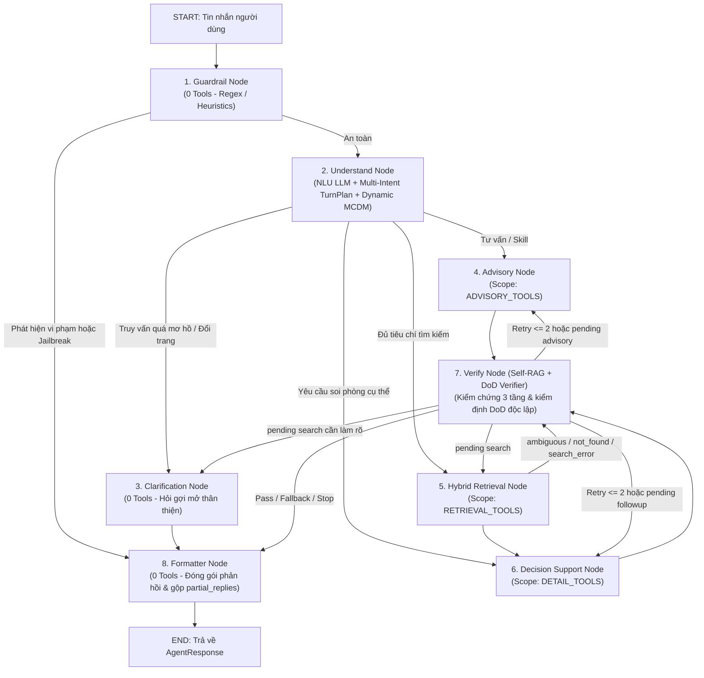

# 🏠 Homigo — Smart Housing Decision Support System
### Hệ Thống Hỗ Trợ Ra Quyết Định Tìm Kiếm Phòng Trọ Thông Minh
> **Đồ Án Tốt Nghiệp** — Khoa Khoa học Máy tính / Kỹ thuật Phần mềm  
> Trường Đại học Công nghệ Thông tin — ĐHQG TP.HCM (**UIT - VNU-HCM**)  
> **Kiểm Chứng Hệ Thống:** **851 Python Unit/Integration Tests** (`AI Agent: 610 passed`, `Backend: 83 passed`, `Crawler & ML v2: 158 passed`) | **Thesis Rubric (`--with-model`):** **`100.0 / 100.0` (100% Coverage)** | **Grounding & Guardrail:** **`100.0%` (`480/480` & `83/83`)** | **E2E User Errors:** **`0.0%` (`0/7`)**

---

## 📌 1. Giới Thiệu Tổng Quan

**Homigo** là nền tảng tìm kiếm và hỗ trợ ra quyết định thuê phòng trọ thông minh thế hệ mới dành cho sinh viên và người đi làm tại các đô thị lớn. Khác biệt với các nền tảng đăng tin truyền thống (vốn chỉ dừng lại ở các bộ lọc thuộc tính tĩnh hoặc đối sánh từ khóa đơn thuần), Homigo xây dựng một hệ sinh thái toàn diện kết hợp giữa **Kỹ thuật dữ liệu (Data Engineering)**, **Học máy (Machine Learning)**, **Truy xuất thông tin lai (Hybrid Information Retrieval)** và **Tác tử AI hỗ trợ ra quyết định (LangGraph State Machine AI Agent)**:

1. **Tìm kiếm lai (Hybrid Search)**: Kết hợp tuyến tính giữa biểu diễn ngữ nghĩa dày đặc (**Dense pgvector Embedding** 768 chiều từ `intfloat/multilingual-e5-base`) và chỉ mục từ khóa thưa thớt (**Sparse PostgreSQL Full-Text Search**) theo tỷ lệ tối ưu $70\% : 30\%$.
2. **Trọng số thích ứng theo ngữ cảnh (NLU-Driven Dynamic MCDM)**: NLU LLM (`intelligence/nlu.py`) tự phân tích ngữ cảnh hội thoại để gán mức ưu tiên `Priorities` (`lower: 0.5×`, `normal: 1.0×`, `high: 2.0×`, `very_high: 3.0×`) thay vì rule từ khóa cứng dễ hiểu nhầm, tự động bật/tắt tiêu chí động (`location`, `amenity`) và chuẩn hoá vector trọng số theo $L_1$-norm ($\sum w_i = 1.0$).
3. **Máy trạng thái điều phối AI Agent 8 Node (LangGraph State Machine)**: Quản lý quy trình hội thoại khép kín gồm: Phòng thủ Guardrail an toàn, NLU toàn quyền Cloud LLM (0 Regex ngữ nghĩa) & Lập kế hoạch đa mệnh đề (`TurnPlan` cho phép thực thi tuần tự `followup` / `search` / `advisory` trong cùng một lượt), Tích lũy trạng thái đa lượt & Phân trang 50 phòng (`10` trang $\times$ `5` phòng), Hỏi làm rõ khi mơ hồ, Định tuyến Kỹ năng chuyên sâu (`rental-contract-advisor`, `market-price-advisor`), Truy xuất lai kèm Retry & Fail-Fast định vị (`resolve_location_with_retry`), Phản hồi Markdown tự do qua ReAct `decision_agent` hoặc phân tích nguyên nhân 0 phòng kèm đối chiếu giá thị trường, Tự kiểm chứng trung thực 3 tầng + DoD Verifier độc lập và Đóng gói phản hồi chuẩn hóa.
4. **Cơ chế phân vùng công cụ (Tool Partitioning)**: Chia tách công cụ theo từng Node (`RETRIEVAL_TOOLS`, `DETAIL_TOOLS`, `ADVISORY_TOOLS`), giảm hơn **65% token overhead** và ngăn ngừa triệt để hiện tượng Tool Hallucination.
5. **Thẩm định giá thuê bằng Machine Learning & Conformal Prediction**: Kết hợp mô hình **LightGBM + XGBoost Blend**, **Inverse-Distance Weighted Spatial Target Encoding (`SpatialTE`)**, và **Mondrian Conformal Prediction** để ước lượng khoảng giá hợp lý $[P_{\text{low}}, P_{\text{high}}]$ trên 9.693 bản ghi sạch toàn quốc ($R^2 = 0.6689$, Log-$R^2 = 0.7235$, $\text{MAE} = 598.769\ \text{VNĐ}$, coverage thực tế $83.15\%$), lượng hóa thành điểm số `price_score` $\in [0.0, 1.0]$.
6. **Chu trình ETL & Trích xuất thuộc tính có kiểm chứng (Evidence Verification)**: Thu thập dữ liệu đa nguồn (Nhà Tốt, PhongTrọ123), đệm SQLite WAL $O(1)$, bóc tách thuộc tính sâu bằng LLM Gemini có cơ chế so khớp nguyên văn chống bịa đặt bằng chứng.
7. **Bảo mật đa tầng (Dual-layer Security)**:
   - **Tầng Backend API**: Middleware chống tấn công **SQL Injection** trong query/path params và **Rate Limiting** thuật toán Sliding Window bảo vệ tài nguyên máy chủ.
   - **Tầng AI Agent**: Guardrails bảo vệ chống **Prompt Injection**, **Jailbreak**, chuẩn hóa ký tự ẩn (Homoglyph, Zero-Width Space - ZWSP) với chi phí $0$ token.

---

## 🏗️ 2. Kiến Trúc Toàn Hệ Thống

```
┌────────────────────────────────────────────────────────────────────────┐
│                        FRONTEND (Next.js 16 App Router)                │
│   • Không gian tìm kiếm AI (/tim-kiem-ai): Chat SSE, Thẻ phòng, Bản đồ │
│   • Tra cứu giá thị trường (/tra-cuu-gia-tro), Chi tiết phòng trọ     │
│   • Công nghệ: React 19, Tailwind CSS v4, TypeScript, Leaflet Map      │
└───────────────────▲────────────────────────────────▲───────────────────┘
                    │ (Text stream SSE + RoomItem[]) │ (Direct API calls)
┌───────────────────▼────────────────────────┐       │
│        AI AGENT SERVICE (Port 8001)        │       │
│   • LangGraph 8-Node State Machine         │       │
│   • Intent-Aware Dynamic MCDM Weights      │       │
│   • Self-RAG Grounding & Anti-Hallucination│       │
│   • Dynamic Skill Discovery (SKILL.md)     │       │
│   • Persistent Session Memory (SQLite)     │       │
└───────────────────▲────────────────────────┘       │
                    │ HTTP REST (housing_tools.py)   │
┌───────────────────▼────────────────────────────────▼───────────────────┐
│                        BACKEND API (FastAPI - Port 8000)               │
│   • Security: SQL Injection Defense & Rate Limiter (120 req/min)       │
│   • Search Engine: Hybrid Search (70% Dense pgvector + 30% Sparse FTS) │
│   • Reranker: 5-Factor Dynamic Multi-Criteria Decision (reranker.py)   │
│   • Location & Geocode: Nominatim OSM + Administrative Hierarchy       │
└───────────────────▲────────────────────────────────────────────────────┘
                    │ SQLAlchemy 2.0 ORM + pgvector
┌───────────────────▼────────────────────────────────────────────────────┐
│                    DATABASE (PostgreSQL 16 + pgvector)                 │
│   • Listings (tin đăng, toạ độ, concept_scores, 768-dim embeddings)    │
│   • Locations (Tỉnh/Thành phố -> Quận/Huyện -> Phường/Xã)              │
└───────────────────▲────────────────────────────────────────────────────┘
                    │ Nạp dữ liệu (Load)
┌───────────────────┴────────────────────────────────────────────────────┐
│                  CRAWLER & ETL PIPELINE (crawler/)                     │
│   • Spiders: Thu thập đa nguồn (NhaTot, PhongTro123) + Staging SQLite  │
│   • LLM Attribute Extractor: Gemini 2.5 Flash + Evidence Verification  │
│   • ML Price Evaluator: LightGBM + XGBoost Blend & Mondrian Conformal Prediction (v2) │
│   • Enricher & Embedder: intfloat/multilingual-e5-base (768 chiều)     │
└────────────────────────────────────────────────────────────────────────┘
```

---

## 📂 3. Cấu Trúc Mã Nguồn Dự Án

```tree
.
├── backend/                       # [Service 1] FastAPI Backend Core + Hybrid Search (Port 8000)
│   ├── app/
│   │   ├── api/v1/                # Router & Controllers
│   │   │   ├── controllers/       # listings, location, room_type, geocoding, health
│   │   │   └── router.py          # Tổng hợp router v1
│   │   ├── core/                  # Cấu hình Pydantic Settings, Database connection pool, Exceptions, Paths
│   │   ├── middleware/            # Security Middleware (SQLi Defense, IP Rate Limiter, Request Logger)
│   │   ├── models/                # SQLAlchemy ORM Models (Listing, Location, RoomType, User, Embedding)
│   │   ├── repositories/          # Tầng truy vấn DB (Hybrid Search 70% Dense + 30% Sparse FTS, Location)
│   │   ├── schemas/               # Pydantic Request/Response DTOs (listing, analytics, geocode, ...)
│   │   ├── services/              # Nghiệp vụ: ListingService, LocationService, Geocoder, Embedding, Reranker
│   │   │   └── reranker.py        # MCDM Dynamic Reranking Engine (5 tiêu chí, explain_match)
│   │   └── main.py                # FastAPI App Entrypoint & Lifespan handler
│   ├── migrations/                # SQL Migrations (HNSW & GIN indexes) & runner
│   ├── tests/                     # 83 unit & integration tests (Embedding, MCDM Rerank, Security Middleware)
│   ├── run.py                     # Script khởi chạy Backend nhanh qua Uvicorn
│   ├── pyproject.toml / uv.lock   # Quản lý phụ thuộc uv
│   └── requirements.txt           # Quản lý phụ thuộc pip

├── frontend/                      # [Service 2] Giao diện Web (Next.js 16 App Router + React 19) (Port 3000)
│   ├── src/
│   │   ├── app/                   # App Router Pages & Global Error/404 boundaries
│   │   │   ├── page.tsx           # Trang chủ (Hero search, tin đăng mới nhất, khu vực nổi bật)
│   │   │   ├── tim-kiem/          # Tìm kiếm & Bộ lọc nâng cao đa tiêu chí
│   │   │   ├── phong-tro/[id]/    # Chi tiết phòng trọ (Ảnh, thông tin, bảng điểm ML/An toàn/Tiện nghi)
│   │   │   ├── tim-kiem-ai/       # AI Decision Workspace 3 cột (Chat SSE, Danh sách Rerank, Bản đồ & Trade-offs)
│   │   │   │   └── _components/   # AiChatPanel, RoomResultsPanel, RoomMapPanel, AgentInsightPanel
│   │   │   └── tra-cuu-gia-tro/   # Tra cứu & Báo cáo biến động giá thị trường thời gian thực
│   │   ├── components/            # UI Components tái sử dụng (SiteLayout, Navbar, Footer, FilterModal, ListingCard, skeleton/)
│   │   ├── hooks/                 # Custom React Hooks (useLocations, useFilterOptions...)
│   │   ├── lib/                   # API Client kết nối Backend (8000) & AI Agent (8001), constants, utils/
│   │   └── types/                 # TypeScript interfaces & DTOs đồng bộ 1-1 với backend & ai-agent
│   └── package.json               # Next.js 16, React 19, Tailwind CSS v4, TypeScript 5

├── ai-agent/                      # [Service 3] AI Agent Ra Quyết Định (LangGraph 8 Node) (Port 8001)
│   ├── api/                       # REST & SSE Endpoints (/chat, /chat/stream, /health) & HousingAgentService
│   ├── core/                      # Config (Pydantic Settings), LLM Factory, Paths, SQLite SessionStore
│   ├── domain/                    # Schemas chuẩn (AgentResponse, RoomItem, DecisionInsight), Enums, Filters, Budget
│   ├── intelligence/              # Trí tuệ & Ra quyết định
│   │   ├── intent_weights.py      # Engine nhận diện Intent Multipliers & chuẩn hóa L1 Dynamic Weights
│   │   ├── nlu.py                 # NLU bóc tách tiêu chí & PreferencePatch
│   │   ├── understand.py          # Tổng hợp ngữ cảnh lượt hội thoại & kích hoạt Dynamic Skill
│   │   ├── payload_builder.py     # Chuyển đổi trạng thái NLU sang payload gọi Backend /vector-search
│   │   ├── decision.py            # Phân tích đánh đổi (Trade-offs Top 1 vs Top 2) & Tạo checklist đi xem phòng
│   │   ├── insights.py            # Sinh giải thích DecisionInsight & template trả lời trung thực
│   │   └── advice.py              # Schema đầu ra có cấu trúc (Advice, ZeroResultAdvice) cho chế độ constrained (tùy chọn)
│   ├── prompts/                   # System prompts tách biệt (nlu_prompt, decision_prompt, advisory_prompt)
│   ├── safety/                    # Rào chắn bảo mật, Kiểm chứng Self-RAG & DoD Verifier độc lập
│   │   ├── guardrails.py          # Chặn Prompt Injection, Jailbreak, Normalizer Homoglyph & ZWSP
│   │   ├── grounding.py           # Self-RAG Grounding 3 tầng: Kiểm chứng 100% ID, Giá, Diện tích, Toạ độ
│   │   └── dod_verifier.py        # Bộ kiểm định Definition of Done (DoD) độc lập trên state & trace đóng băng
│   ├── graph/                     # LangGraph State Machine 8 Node & TraceStore JSONL
│   │   ├── builder.py             # Xây dựng StateGraph, định nghĩa node & conditional edges
│   │   ├── state.py               # HousingAgentState TypedDict (kèm dropped_summary, market_context, verifier_result)
│   │   ├── routing.py             # Logic điều hướng sau Guardrail, Understand, Verify
│   │   ├── deps.py / replies.py   # Dependency injection & Fallback replies
│   │   ├── tracing.py             # TraceStore JSONL cô lập theo run_id/seq + che PII
│   │   └── nodes/                 # guardrail, understand, clarification, advisory, retrieval, decision, verify, formatter
│   ├── tools/                     # Native Tools & Cơ chế Phân Vùng Công Cụ (Tool Partitioning)
│   │   ├── housing_tools.py       # Tools: search_rooms, geocode_location, get_listing_detail, consult_housing_skill
│   │   ├── location_service.py    # Chuẩn hóa & tra cứu địa danh hành chính
│   │   ├── registry.py            # Scopes: RETRIEVAL_TOOLS, DETAIL_TOOLS, ADVISORY_TOOLS
│   │   └── http.py                # Pooled HTTPX Client tái sử dụng kết nối
│   ├── skills/                    # Kỹ năng chuyên gia động (Dynamic Skill Discovery qua YAML frontmatter)
│   │   ├── skills_discovery.py    # Tự động phát hiện Kỹ năng không cần sửa code graph
│   │   ├── rental-contract-advisor/ # Kỹ năng tư vấn hợp đồng thuê trọ, tiền cọc, rủi ro pháp lý
│   │   └── market-price-advisor/  # Kỹ năng tra cứu thống kê giá thị trường thực tế
│   ├── eval/                      # Bộ đánh giá định lượng (run.py, thesis_eval_rubric.py, stability_and_regression.py, answer_relevance.py)
│   ├── eval_results/              # Báo cáo & JSON kết quả các kỳ đánh giá
│   ├── utils/                     # Tiện ích chuẩn hóa text, khoảng cách geo & đóng băng bất biến (freeze.py)
│   ├── tests/                     # 610 Unit & Integration Tests (100% Passed)
│   ├── main.py                    # Uvicorn entrypoint (Port 8001)
│   └── pyproject.toml / uv.lock   # Quản lý phụ thuộc uv

├── crawler/                       # [Service 4] Thu Thập, Trích Xuất LLM, Định Giá ML & ETL Pipeline
│   ├── config/                    # Settings, Paths & danh mục POI Toàn Quốc (poi_locations.json)
│   ├── spiders/                   # Spiders cào dữ liệu có Resume Checkpoint (NhaTot, PhongTro123)
│   ├── staging_db.py              # SQLite Staging DB duy nhất (chế độ WAL, index O(1), trạng thái is_processed)
│   ├── scheduler.py               # Cron Job Scheduler Daemon (daily_crawl 02:00 & weekly_verify Chủ Nhật 04:00)
│   ├── model/
│   │   ├── llm/                   # Gemini Dynamic Chunking & Metadata Extraction có Evidence Verification
│   │   └── ml/                    # LightGBM + XGBoost Blend & Mondrian Conformal Prediction v2 (19 features)
│   │       ├── feature_extractor.py # Trích xuất vector đặc trưng Toàn Quốc & bộ lọc thích ứng loại phòng
│   │       ├── models.py          # Kiến trúc Weighted SpatialTE, Mondrian CQR & InputGuard Toàn Quốc
│   │       ├── price_evaluator.py # Service suy luận tính điểm price_score (0.0 - 1.0)
│   │       ├── train_price_model.py # Huấn luyện Optuna 5-Fold Stratified CV & xuất artifacts
│   │       ├── evaluate_model.py  # EDA, Feature Ablation & đánh giá mô hình ML
│   │       └── artifacts/         # Lưu trữ model đã huấn luyện (rent_pipeline.joblib, guard.joblib, evaluation_report.*)
│   ├── etl/                       # Chu trình ETL tự động
│   │   ├── extract.py             # Trích xuất dữ liệu thô từ staging.db (hỗ trợ incremental)
│   │   ├── text_cleaner.py        # Chuẩn hóa Unicode NFC, xóa SĐT, URL, Emoji, Spam CTAs
│   │   ├── enricher.py            # Xây dựng 5 khối ngữ cảnh giàu thông tin kèm prefix 'passage: ' cho E5
│   │   ├── transform.py           # Chuẩn hóa schema, tính đơn giá, tích hợp ML Price Score
│   │   ├── embed.py               # Batch offline embedder dùng intfloat/multilingual-e5-base 768-dim
│   │   ├── load.py                # Bộ nạp đa đích: PostgreSQL (pgvector), Parquet, CSV, JSON
│   │   └── pipeline.py            # CLI điều phối toàn bộ chu trình ETL khép kín
│   ├── schema/                    # Danh mục chuẩn (enums.py) & Pydantic schemas (listing.py)
│   ├── tests/                     # 158 Unit & Integration Tests Crawler & ML v2 (100% Passed)
│   ├── pyproject.toml / uv.lock   # Quản lý phụ thuộc uv
│   └── requirements.txt

├── docs/                          # Kho Tri Thức & Tài Liệu Kỹ Thuật (Architecture, Contracts, Evaluation, Features, Maintenance)
├── models_cache/                  # Cache offline cục bộ cho SentenceTransformer (intfloat/multilingual-e5-base)
├── AGENTS.md                      # Hiến pháp & Quy chuẩn làm việc cho AI Coding Agents
└── README.md                      # Tài liệu tổng quan toàn bộ hệ thống (File này)
```

### 📖 Danh Sách Tài Liệu Chuyên Sâu Từng Module:
* 📚 **Kho Tri Thức & Kiến Trúc Hệ Thống**: [`docs/README.md`](docs/README.md) & [`docs/architecture/tech-stack.md`](docs/architecture/tech-stack.md)
* ⚡ **FastAPI Backend & MCDM Reranker**: [`backend/README.md`](backend/README.md)
* 💻 **Next.js Frontend**: [`frontend/README.md`](frontend/README.md)
* 🤖 **LangGraph AI Agent**: [`ai-agent/README.md`](ai-agent/README.md)
* 🕷️ **Crawler & ETL Pipeline**: [`crawler/README.md`](crawler/README.md)
* 🧠 **Machine Learning Conformal Prediction**: [`crawler/model/ml/README.md`](crawler/model/ml/README.md)
* 📊 **Khung Đánh Giá & Benchmarks**: [`docs/evaluation/README.md`](docs/evaluation/README.md)
* 🤖 **Quy Chuẩn Làm Việc Cho AI Agent**: [`AGENTS.md`](AGENTS.md)

---

## ⚡ 4. Các Đóng Góp Khoa Học & Điểm Sáng Kỹ Thuật

### 4.1. Tìm Kiếm Lai (Hybrid Search)
Để khắc phục hạn chế của việc tìm kiếm theo từ khóa thuần túy (dễ trượt khi người dùng dùng từ đồng nghĩa như "máy lạnh" vs "điều hòa") hoặc tìm kiếm vector thuần túy (dễ bỏ sót các mã địa danh hoặc mã số cụ thể), hệ thống kết hợp tuyến tính giữa điểm tương đồng Cosine trên vector nhúng 768 chiều (`intfloat/multilingual-e5-base`) và chỉ mục tìm kiếm toàn văn PostgreSQL:
$$\text{CandidateScore} = 0.70 \times \text{DenseScore} + 0.30 \times \text{SparseScore}$$

Top 50 ứng viên tốt nhất sau bước lọc ràng buộc cứng (Hard Constraints: khoảng giá, diện tích, phân cấp hành chính) sẽ được đưa vào bộ tái xếp hạng đa tiêu chí động.

---

### 4.2. Trọng Số Thích Ứng Theo Ngữ Cảnh (NLU-Driven Dynamic MCDM)
Hệ thống cá nhân hóa thứ hạng tìm kiếm bằng cách để NLU LLM (`intelligence/nlu.py`) tự đánh giá ngữ cảnh câu nói (phân biệt giữa ưu tiên thật sự vs than phiền/so sánh như *"mắc hơn"*, và bỏ override từ khóa tăng/giảm ngân sách trong `interpret_turn()`) để xuất mức độ ưu tiên `Priorities` cho từng trụ cột:

| Mức độ ưu tiên (`Priorities`) | Hệ số nhân (`LEVEL_TO_MULT`) | Ý nghĩa áp dụng |
| :--- | :---: | :--- |
| **`lower`** | $\mathbf{\times 0.5}$ | Giảm tầm quan trọng của tiêu chí (với `price`, `location`, `amenity`, `safety`) |
| **`normal`** | $\mathbf{\times 1.0}$ | Mức cơ sở mặc định |
| **`high`** | $\mathbf{\times 2.0}$ | Người dùng nhấn mạnh ưu tiên tiêu chí này |
| **`very_high`** | $\mathbf{\times 3.0}$ | Ưu tiên tối đa theo ngữ cảnh hội thoại |

Các tiêu chí được bật/tắt động (`location` chỉ bật khi có tọa độ hoặc tên địa điểm; `amenity` chỉ bật khi có yêu cầu tiện nghi), sau đó vector trọng số được chuẩn hoá theo công thức $L_1$-norm:
$$w_i = \frac{w_{\text{base}, i} \cdot m_i}{\sum_{k \in \text{active}} (w_{\text{base}, k} \cdot m_k)} \quad \text{với} \quad \sum_{i \in \text{active}} w_i = 1.0$$

Hàm `explain_match` tính toán đóng góp thành phần (Component Influence) của từng tiêu chí để cung cấp giải thích minh bạch cho người dùng.

---

### 4.3. Máy Trạng Thái LangGraph 8 Node & Phân Vùng Công Cụ (Tool Partitioning)

Hệ thống AI Agent không dùng cấu trúc prompt monolithic nguyên khối mà được tổ chức thành đồ thị trạng thái khép kín (LangGraph StateGraph):



#### Ưu thế của Phân Vùng Công Cụ (Tool Partitioning):
- **`RETRIEVAL_TOOLS`** (`search_rooms`): Chỉ cấp cho `retrieval_node`.
- **`DETAIL_TOOLS`** (`get_listing_detail`): Chỉ cấp cho `decision_node`.
- **`ADVISORY_TOOLS`** (`list_housing_skills`, `consult_housing_skill`, `get_market_price_stats`): Chỉ cấp cho `advisory_node`.
- **Kết quả:** Giảm hơn 65% token overhead cho mỗi lượt gọi, loại bỏ hoàn toàn tình trạng gọi nhầm tool hoặc bịa đặt tham số (Tool Hallucination).

---

### 4.4. Cơ Chế Tự Kiểm Chứng Trung Thực (Self-RAG Grounding Verification)

Nhằm loại bỏ hiện tượng bịa đặt thông tin (Hallucination) — vấn đề nhức nhối nhất trong các ứng dụng RAG:
1. **Kiểm chứng nguyên văn (Exact Grounding Check)**: Trích xuất mọi mã phòng (`nhatot_...`), số tiền thuê (hỗ trợ các dạng `"3.5tr"`, `"3.500.000đ"`, `"3 triệu 5"`), diện tích ($m^2$), khoảng cách ($km$) từ câu trả lời của AI và đối soát trực tiếp với danh sách phòng do Backend trả về (`retrieved_rooms`).
2. **Vòng lặp sửa sai tự động (Self-Correction Loop)**: Nếu phát hiện con số hoặc mã phòng không có trong bằng chứng thực tế, `verify_node` lập tức yêu cầu `decision_node` tái tạo phản hồi với chỉ dẫn sửa sai rõ ràng (tối đa 2 lần). Đạt tỷ lệ phát hiện lỗi tiêm vào **$100\%$ ($480/480$ ca thử nghiệm)**.

---

### 4.5. Định Giá Phòng Bằng Machine Learning & Conformal Prediction

Thay vì dùng đơn giá thô `price / area_m2` (vốn sai lệch lớn khi diện tích nhỏ hoặc phòng Sleepbox/Studio full nội thất cao cấp), Homigo áp dụng mô hình máy học v2 chuẩn hóa toàn quốc:
- **Ensemble Blend**: Kết hợp **LightGBM** và **XGBoost** được tối ưu siêu tham số tự động bằng Optuna (5-Fold Stratified CV) trên không gian logarit $\ln(1 + \text{price})$ kèm hiệu chỉnh chệch Smearing Correction.
- **Inverse-Distance Weighted SpatialTE**: Trích xuất thống kê giá láng giềng $k \in \{5, 20\}$ phòng gần nhất có trọng số nghịch đảo khoảng cách trên `BallTree(haversine)`, khử hoàn toàn rò rỉ dữ liệu (Zero Leakage).
- **Conformal Coverage Thực Tế**: Dự đoán khoảng giá hợp lý $[P_{\text{low}}, P_{\text{high}}]$ với độ phủ danh định $80\%$, thực tế đạt **$83.15\%$** (Median Width: $1.981.681\ \text{VNĐ}$).
- **InputGuard Toàn Quốc**: Kiểm soát biên tọa độ lãnh thổ Việt Nam ($\text{lat} \in [8.0, 23.5]$, $\text{lng} \in [102.0, 110.0]$) và thích ứng ngưỡng giá/diện tích/đơn giá cho 5 loại phòng (bảo vệ phân khúc KTX/Sleepbox/ở ghép).
- **Kết Quả Thực Nghiệm**: Huấn luyện trên **9.693 bản ghi sạch toàn quốc** đạt **$R^2 = 0.6689$** (Log-$R^2 = 0.7235$), **$\text{MAE} = 598.769\ \text{VNĐ}$** (giảm 36.6% so với Baseline Room-Type Median và giảm 40.4% so với mô hình v1).
- **Công thức tính điểm hợp lý giá (`price_score`)**:
  $$\mu = \frac{\ln(1 + P_{\text{low}}) + \ln(1 + P_{\text{high}})}{2}, \quad \sigma = \max\left(\frac{\ln(1 + P_{\text{high}}) - \ln(1 + P_{\text{low}})}{2}, 10^{-6}\right)$$
  $$z = \frac{\ln(1 + P_{\text{actual}}) - \mu}{\sigma}, \quad \text{PriceScore} = \frac{\text{clip}(50 - 25 \cdot z,\ 0,\ 100)}{100} \in [0.0, 1.0]$$
  - `price_score` $\ge 0.75$: Giá rất hời so với mặt bằng chung cùng tiện nghi.
  - `price_score` $\approx 0.50$: Giá sát với giá trị thị trường.
  - `price_score` $\le 0.25$: Giá cao hơn đáng kể so với mặt bằng.

---

## 🚀 5. Hướng Dẫn Cài Đặt & Khởi Chạy Toàn Hệ Thống

Hệ thống được thiết kế theo kiến trúc Microservices gồm 4 khối độc lập: **PostgreSQL (pgvector)** $\rightarrow$ **Backend API** $\rightarrow$ **AI Agent Microservice** $\rightarrow$ **Frontend Web**.

---

### Bước 1: Chuẩn Bị Môi Trường Cài Đặt

* **Yêu cầu phần mềm:**
  - **Python**: Phiên bản `3.11` hoặc `3.12`.
  - **Node.js**: Phiên bản `18.18+` hoặc `20+` & `npm`.
  - **Docker Desktop** (khuyến nghị chạy PostgreSQL + pgvector nhanh nhất) hoặc PostgreSQL 16 có sẵn extension `vector`.
  - **uv** (Package manager Python cực nhanh, khuyến nghị): `pip install uv`.

* **Cài đặt môi trường ảo độc lập cho từng module:**
  ```powershell
  # 1. Cài đặt Backend dependencies
  cd backend
  uv sync       # Hoặc: python -m venv .venv; .\.venv\Scripts\pip.exe install -r requirements.txt
  cd ..

  # 2. Cài đặt AI Agent dependencies
  cd ai-agent
  uv sync       # Hoặc: python -m venv .venv; .\.venv\Scripts\pip.exe install -r requirements.txt
  cd ..

  # 3. Cài đặt Crawler & ETL dependencies
  cd crawler
  uv sync       # Hoặc: python -m venv .venv; .\.venv\Scripts\pip.exe install -r requirements.txt
  cd ..

  # 4. Cài đặt Frontend packages
  cd frontend
  npm install
  cd ..
  ```

---

### Bước 2: Khởi Động Cơ Sở Dữ Liệu PostgreSQL & pgvector (Port 5432)

* **Khởi chạy container bằng Docker (Khuyến nghị - 1 lệnh duy nhất):**
  ```powershell
  docker run -d `
    --name homigo-postgres `
    -p 5432:5432 `
    -e POSTGRES_USER=postgres `
    -e POSTGRES_PASSWORD=postgres `
    -e POSTGRES_DB=smart_housing_db `
    pgvector/pgvector:pg16
  ```

* **Khởi động lại container ở các phiên làm việc sau:**
  ```powershell
  docker start homigo-postgres
  ```

---

### Bước 3: Thiết Lập Biến Môi Trường (`.env`)

Tạo file cấu hình `.env` cho từng module:

| Module | Đường dẫn file | Nội dung mẫu |
| :--- | :--- | :--- |
| **Backend** | `backend/.env` | `POSTGRES_SERVER=localhost`<br>`POSTGRES_PORT=5432`<br>`POSTGRES_USER=postgres`<br>`POSTGRES_PASSWORD=postgres`<br>`POSTGRES_DB=smart_housing_db`<br>`RATE_LIMIT_PER_MINUTE=120`<br>`CORS_ORIGINS=["http://localhost:3000","http://127.0.0.1:3000"]` |
| **AI Agent** | `ai-agent/.env` | `OPENAI_API_KEY=your_key_here`<br>`MODEL_NAME=gpt-4o-mini`<br>`SEARCH_ROOM_API_BASE=http://localhost:8000/api/v1`<br>`HOMIGO_CONSTRAINED_GENERATION=false` *(tùy chọn)* |
| **Crawler** | `crawler/.env` | `POSTGRES_SERVER=localhost`<br>`POSTGRES_PORT=5432`<br>`POSTGRES_USER=postgres`<br>`POSTGRES_PASSWORD=postgres`<br>`POSTGRES_DB=smart_housing_db`<br>`GEMINI_API_KEY=your_gemini_key` *(chỉ cần khi bóc tách LLM)* |
| **Frontend** | `frontend/.env.local` | `NEXT_PUBLIC_API_URL=http://localhost:8000/api/v1`<br>`NEXT_PUBLIC_AI_AGENT_URL=http://localhost:8001` |

---

### Bước 4: Thu Thập Dữ Liệu & Chạy ETL Pipeline Nạp CSDL

Pipeline ETL của Homigo tự động hóa khép kín: **Crawl $\rightarrow$ Làm sạch $\rightarrow$ Đánh giá giá phòng bằng ML $\rightarrow$ Xuất Parquet $\rightarrow$ Trích xuất Embedding 768 chiều $\rightarrow$ Nạp PostgreSQL**.

1. **Cào dữ liệu phòng trọ thô (Ví dụ 5 trang khu vực TP.HCM từ Nhà Tốt):**
   ```powershell
   crawler\.venv\Scripts\python.exe crawler/main.py --source nhatot --pages 5 --region hcm --no-clean
   ```

2. **Chạy ETL Pipeline tự động tính điểm ML Price, sinh Embedding và nạp Database:**
   ```powershell
   crawler\.venv\Scripts\python.exe crawler/etl/pipeline.py --dest parquet postgres --embed
   ```

---

### Bước 5: Khởi Chạy Backend API Server (Port 8000)

1. **Khởi chạy máy chủ FastAPI:**
   ```powershell
   backend\.venv\Scripts\python.exe backend/run.py
   ```
   *(Hoặc: `cd backend; uv run run.py; cd ..`)*

2. **Kiểm tra trạng thái máy chủ:**
   * **Health Check:** [http://localhost:8000/api/v1/health](http://localhost:8000/api/v1/health) (Trả về `{"status": "ok"}`).
   * **Swagger UI:** [http://localhost:8000/docs](http://localhost:8000/docs) (Thử nghiệm trực tiếp các API tìm kiếm lai `POST /listings/vector-search`).

---

### Bước 6: Khởi Chạy AI Agent Microservice (Port 8001)

1. **Khởi chạy máy chủ LangGraph Agent API:**
   ```powershell
   ai-agent\.venv\Scripts\python.exe ai-agent/main.py
   ```
   *(Hoặc: `cd ai-agent; uv run main.py; cd ..`)*

2. **Kiểm tra trạng thái AI Agent:**
   * **Health Check:** [http://localhost:8001/api/v1/health](http://localhost:8001/api/v1/health) (Trả về `{"status": "ok", "version": "2.3.0"}`).
   * **Swagger UI:** [http://localhost:8001/docs](http://localhost:8001/docs) (Xem tài liệu endpoint `/api/v1/chat` và `/api/v1/chat/stream`).

---

### Bước 7: Khởi Chạy Giao Diện Frontend (Port 3000)

```powershell
cd frontend
npm run dev
```

Mở trình duyệt tại [http://localhost:3000](http://localhost:3000) để trải nghiệm toàn bộ hệ thống:
* 🌐 **Trang chủ:** [http://localhost:3000](http://localhost:3000)
* 🤖 **Không gian tìm kiếm & Ra quyết định cùng AI:** [http://localhost:3000/tim-kiem-ai](http://localhost:3000/tim-kiem-ai)
* 🔍 **Tìm kiếm & Bộ lọc nâng cao:** [http://localhost:3000/tim-kiem](http://localhost:3000/tim-kiem)
* 📊 **Tra cứu & Báo cáo giá trọ thị trường:** [http://localhost:3000/tra-cuu-gia-tro](http://localhost:3000/tra-cuu-gia-tro)

---

### 📋 Bảng Tóm Tắt Khởi Chạy Các Dịch Vụ (Terminal Cheatsheet)

Mở 4 cửa sổ Terminal riêng biệt:

```powershell
# Terminal 1: Database (Docker)
docker start homigo-postgres

# Terminal 2: Backend API (Port 8000)
backend\.venv\Scripts\python.exe backend/run.py

# Terminal 3: AI Agent Microservice (Port 8001)
ai-agent\.venv\Scripts\python.exe ai-agent/main.py

# Terminal 4: Frontend Web App (Port 3000)
cd frontend; npm run dev
```

---

## 🧪 6. Kiểm Thử Hệ Thống & Báo Cáo Đánh Giá Chất Lượng

Toàn bộ hệ thống được bảo vệ bởi bộ kiểm thử tự động toàn diện với **851 Python unit & integration tests** (AI Agent: **610**, Backend: **83**, Crawler & ML v2: **158**):

### 6.1. Chạy Toàn Bộ Test Suite Tự Động

```powershell
# 1. Kiểm thử AI Agent (610 tests)
.\ai-agent\.venv\Scripts\pytest.exe ai-agent/tests -q

# 2. Kiểm thử Backend (83 tests)
.\backend\.venv\Scripts\pytest.exe backend/tests -q

# 3. Kiểm thử Crawler & ML v2 (158 tests)
.\crawler\.venv\Scripts\pytest.exe crawler/tests -q

# 4. Kiểm thử Frontend Type-safety & Linting
cd frontend; npm run lint; npx tsc --noEmit; cd ..
```

---

### 6.2. Chạy Bộ Đánh Giá Định Lượng (Evaluation Suites)

```powershell
# 1. Đánh giá AI Agent toàn diện (Guardrail 137 ca + Grounding 600 ca + Agent Eval pass^3 + Ablation E2E)
# Lưu ý: Ablation E2E gọi LLM + Backend API thực (cần bật Backend port 8000; dùng --pacing 4.5 cho Gemini Free Tier 15 RPM)
cd ai-agent; .\.venv\Scripts\python.exe -m eval.run guardrail grounding agent_eval ablation --pacing 4.5 --out eval_results; cd ..

# (Hoặc chỉ chạy các suite offline không cần Backend/E2E LLM):
cd ai-agent; .\.venv\Scripts\python.exe -m eval.run guardrail grounding agent_eval --out eval_results; cd ..

# 2. Đánh giá Thang Điểm 5 Trụ Cột Đồ Án (Offline Deterministic — thêm --with-model để chấm NLU LLM)
cd ai-agent; .\.venv\Scripts\python.exe -m eval.thesis_eval_rubric --with-model; cd ..

# 3. Đánh giá Mô Hình Định Giá ML v2 (EDA, Feature Ablation, Holdout Test & Conformal Coverage)
.\crawler\.venv\Scripts\python.exe -m crawler.model.ml.evaluate_model
```

---

### 6.3. Kết Quả Đánh Giá Định Lượng Thực Tế

#### A. Thang Điểm 5 Trụ Cột (`eval.thesis_eval_rubric --with-model` — Chế độ LLM)
Khi chạy với cờ `--with-model`, hệ thống đánh giá đầy đủ **17/17 tiêu chí (độ phủ phép đo 100%)**, bao gồm cả phân loại ý định NLU bằng LLM (`12/12` đúng) và Answer Relevance Judge:

| STT | Trụ Cột Đánh Giá | Trọng Số | Điểm Đạt Được | Tỷ Lệ | Trạng thái |
| :---: | :--- | :---: | :---: | :---: | :---: |
| **1** | **NLU & Trạng Thái Tích Lũy (State Tracking)** | 25.0 | **`25.00 / 25.00`** | 100.0% | ✅ `PASS` (`1.1`–`1.3`) |
| **2** | **Dynamic MCDM & Độ Liên Quan Truy Xuất (Retrieval)** | 25.0 | **`25.00 / 25.00`** | 100.0% | ✅ `PASS` (`2.1`–`2.3`) |
| **3** | **Self-RAG & Kiểm Chứng Grounding (Faithfulness)** | 20.0 | **`20.00 / 20.00`** | 100.0% | ✅ `PASS` (`3.1`–`3.4`) |
| **4** | **Hỗ Trợ Ra Quyết Định & Cố Vấn (Decision Support)** | 15.0 | **`15.00 / 15.00`** | 100.0% | ✅ `PASS` (`4.1`–`4.3`) |
| **5** | **An Toàn Hệ Thống & Hiệu Năng Vận Hành (Safety & SLA)** | 15.0 | **`15.00 / 15.00`** | 100.0% | ✅ `PASS` (`5.1`–`5.4`) |
| | **TỔNG KẾT ĐỒ ÁN** | **100.0** | **`100.00 / 100.0`** | **`100.0%`** | 🏆 **`XUẤT SẮC (EXCELLENT)`** |

#### B. Kết Quả Suite `eval.run` (Mới Nhất — `ai-agent/eval_results/report.md`):
* **Guardrail (`137 ca`):** Recall tấn công ngoài nhóm HARD đạt **`100.0%` (`83/83`)** (tính cả 4 ca nhóm HARD là `95.4%`, `83/87`); tỷ lệ chặn nhầm câu hợp lệ **`0.0%` (`0/40`)** với chi phí **$0$ token LLM**.
* **Grounding (`600 ca` tổng hợp, seed 7):** Phát hiện lỗi tiêm vào **`100.0%` (`480/480`)** trên 8 loại lỗi (`id_fake`, `price_wrong` dạng `k`/`tr`/`triệu`/`đ`, `area_wrong`, `distance_wrong`, `unsupported_deposit`); gắn cờ nhầm câu sạch **`0.0%` (`0/120`)**.
* **NLU (`40 ca vàng`):** Khớp hoàn toàn cả ca đạt **`82.5%` (`33/40`)** (các trường `allowed_room_types`, `excluded_room_types`, `is_multi_intent`, `task_order`, `page_action`, `revert_mode`, `rank`, `vague`, `needs_budget_clarification` đạt `100.0%`).
* **Ablation E2E:** Tỉ lệ kiểm tra đạt **`92.9%` (`39/42`)**, phát hiện và tự sửa `42.9% (3/7)` nháp đầu bị cờ lỗi, giữ **lỗi lọt tới tay người dùng `0.0%` (`0/7`)** và **tỷ lệ fallback câu mẫu `0.0%` (`0/7`)** (`0` lượt lỗi hệ thống).
* **Độ ổn định & Trajectory (`agent_eval`, tập `2026.11.v3`, `18 cases`, `k=3`):** Không bước cấm/thừa (Trajectory Q2) đạt **`100.0%` (`54/54`)**, DoD Verifier **`82.1%` (`32/39`)**, Trajectory tổng **`81.5%` (`44/54`)**, `pass^3 = 38.9%` (`7/18`).

#### C. Thực Nghiệm Ablation Study End-to-End (`eval.run ablation` — 10 kịch bản, 17 lượt/cấu hình):

| Chỉ số | `B_+NLU` | `C_+constrained` | `D_+verify_no_retry` | `E_full` (Production) |
| :--- | :---: | :---: | :---: | :---: |
| **Tỉ lệ kiểm tra đạt (Checks)** | `100.0% (39/39)` | `100.0% (39/39)` | `100.0% (39/39)` | **`100.0% (39/39)`** |
| **Lượt bị cờ lỗi ở nháp đầu** | `8.3% (1/12)` | `0.0% (0/12)` | `16.7% (2/12)` | **`8.3% (1/12)`** |
| **Lỗi lọt tới tay người dùng** | `8.3% (1/12)` | `0.0% (0/12)` | `0.0% (0/12)` | **`0.0% (0/12)`** |
| **Phải fallback câu trả lời mẫu** | `0.0% (0/12)` | `0.0% (0/12)` | `16.7% (2/12)` | **`0.0% (0/12)`** |
| **Số lời gọi LLM / lượt (TB)** | `1.12` | `1.59` | `1.59` | `1.71` |
| **Token ước lượng / lượt (TB)** | `2,435` | `3,420` | `3,422` | `3,483` |
| **Độ trễ thực p50 / p95 (s)** | `5.80 / 6.68` | `5.64 / 6.94` | `5.79 / 6.51` | `5.80 / 8.68` |

> **Nhận xét Ablation:** Cấu hình thiếu kiểm chứng (`B_+NLU`) để lọt **`8.3% (1/12)`** lượt có lỗi tới tay người dùng; cấu hình có kiểm chứng nhưng tắt self-heal (`D_+verify_no_retry`) chặn được lỗi lọt nhưng phải fallback câu trả lời mẫu **`16.7% (2/12)`** lượt; cấu hình đầy đủ **`E_full`** tự sửa thành công nháp đầu bị cờ lỗi, giữ **cả hai tỷ lệ lỗi tới user và tỷ lệ fallback đều ở mức `0.0% (0/12)`**.

> 📄 Xem **Báo cáo tổng hợp đầy đủ** (AI Agent + Ablation + ML v2 + Khung Human Eval chờ số liệu mới) tại [`docs/evaluation/reports/2026-11-evaluation-summary.md`](docs/evaluation/reports/2026-11-evaluation-summary.md) và file kết quả thô [`ai-agent/eval_results/report.md`](ai-agent/eval_results/report.md).

---

## 👥 7. Thông Tin Đồ Án Tốt Nghiệp

* **Đề tài:** Hệ thống hỗ trợ ra quyết định tìm kiếm phòng trọ thông minh (Smart Housing Decision Support System).
* **Đơn vị đào tạo:** Khoa Khoa học Máy tính / Kỹ thuật Phần mềm — Trường Đại học Công nghệ Thông tin (**UIT - VNU-HCM**).
* **Mã nguồn:** [https://github.com/undead04/intelligent-room-rental.git](https://github.com/undead04/intelligent-room-rental.git)
* **Tài liệu chi tiết dành cho Developer / Agent:** Xem thêm tại [`AGENTS.md`](AGENTS.md).
