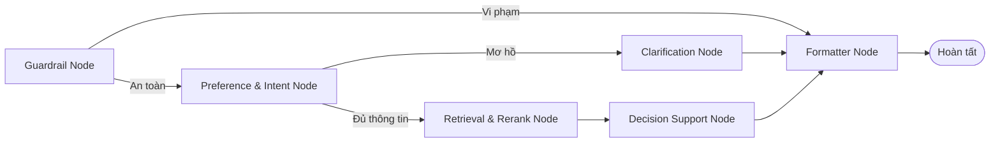

# 🏠 Homigo — Smart Housing Decision Support System
### Hệ Thống Hỗ Trợ Ra Quyết Định Tìm Kiếm Phòng Trọ Thông Minh
> **Đồ Án Tốt Nghiệp** — Khoa Khoa học Máy tính / Kỹ thuật Phần mềm  
> Trường Đại học Công nghệ Thông tin — ĐHQG TP.HCM (**UIT - VNU-HCM**)

---

## 📌 1. Giới Thiệu Tổng Quan

**Homigo** là nền tảng tìm kiếm và hỗ trợ ra quyết định thuê phòng trọ thông minh dành cho sinh viên và người đi làm. Khác với các website đăng tin truyền thống chỉ lọc theo từ khóa cứng nhắc, Homigo tích hợp:
1. **Tìm kiếm lai (Hybrid Search)**: Kết hợp biểu diễn ngữ nghĩa dày đặc (**Dense pgvector Embedding**) và tìm kiếm từ khóa thưa thớt (**Sparse PostgreSQL Full-Text Search**) với tỷ lệ $70\% : 30\%$.
2. **Trọng số thích ứng theo ý định (Intent-Aware Dynamic MCDM)**: Tự động phân tích câu nói người dùng để kích hoạt các hệ số nhân ưu tiên (giá rẻ, gần trường, an ninh cao, full tiện nghi) và chuẩn hoá vector trọng số theo $L_1$-norm.
3. **Máy trạng thái điều phối AI Agent (LangGraph State Machine)**: Quản lý quy trình 6 node từ phòng thủ an toàn, tích lũy nhu cầu đa lượt (Multi-turn Memory), hỏi làm rõ khi mơ hồ, truy vấn dữ liệu đến phân tích đối sánh đánh đổi (**Trade-off Analysis**) và lập checklist kiểm tra thực tế.
4. **Bảo mật đa tầng (Dual-layer Security)**:
   - **Tầng Backend**: Middleware phát hiện tấn công **SQL Injection** và **Rate Limiting** bảo vệ tài nguyên API.
   - **Tầng AI Agent**: Guardrails chặn **Prompt Injection**, **Jailbreak** và lọc câu hỏi ngoài luồng (Off-topic).

---

## 🏗️ 2. Kiến Trúc Toàn Hệ Thống

```
┌────────────────────────────────────────────────────────────────────────┐
│                        FRONTEND (Next.js 14+)                          │
│   • Giao diện tìm kiếm AI (/tim-kiem-ai): Chat, Thẻ phòng, Bản đồ      │
│   • Framework: React 18, TypeScript, TailwindCSS, Leaflet Map          │
└───────────────────▲────────────────────────────────▲───────────────────┘
                    │ (Text stream + RoomItem[])     │ (Direct API calls)
┌───────────────────▼────────────────────────┐       │
│        AI AGENT MODULE (ai-agent/)         │       │
│   • LangGraph Workflow (graph.py)          │       │
│   • Intent-Aware MCDM (intent_weights.py)  │       │
│   • Memory & State (memory.py)             │       │
│   • Guardrails Defense (guardrails.py)     │       │
└───────────────────▲────────────────────────┘       │
                    │ HTTP REST (housing_tools.py)   │
┌───────────────────▼────────────────────────────────▼───────────────────┐
│                        BACKEND API (FastAPI)                           │
│   • Security: SQL Injection Protection & Rate Limiting Middleware      │
│   • Search Engine: Hybrid Search (70% Dense pgvector + 30% Sparse FTS) │
│   • Reranker: 5-Factor Dynamic Multi-Criteria Decision (utils.py)      │
│   • Location & Geocode: Nominatim OSM + Administrative Hierarchy       │
└───────────────────▲────────────────────────────────────────────────────┘
                    │ SQLAlchemy ORM + pgvector
┌───────────────────▼────────────────────────────────────────────────────┐
│                    DATABASE (PostgreSQL 15+ / pgvector)                │
│   • Listings (tin đăng, toạ độ, concept_scores, 768-dim embeddings)    │
│   • Locations (Tỉnh/Thành phố -> Quận/Huyện -> Phường/Xã)              │
└────────────────────────────────────────────────────────────────────────┘
```

---

## 📂 3. Cấu Trúc Dự Án

```tree
.
├── backend/                       # [Service 1] FastAPI Backend Core + Hybrid Search
│   ├── app/
│   │   ├── api/v1/controllers/    # API Controllers (listings, locations, geocode, health)
│   │   ├── core/                  # Cấu hình, Database Session, Security Middlewares
│   │   ├── models/                # SQLAlchemy ORM Models (Listing, Location, User)
│   │   ├── repositories/          # Tầng truy vấn DB (Hybrid Search 70% Dense + 30% FTS)
│   │   ├── schemas/               # Pydantic Request/Response DTOs
│   │   ├── services/              # Nghiệp vụ (ListingService, Geocoder, Embedding)
│   │   │   └── reranker.py        # MCDM Dynamic Reranking Engine (5-factor rerank, explain_match)
│   │   └── utils/                 # Tiện ích tương thích ngược (utils.py)
│   ├── scripts/                   # Script khởi tạo schema DB (init_db.py)
│   ├── tests/                     # Unit tests bảo mật & Rerank (14 tests passed)
│   ├── run.py                     # Script khởi chạy backend
│   └── requirements.txt           # Thư viện phụ thuộc backend
│
├── frontend/                      # [Service 2] Giao diện Web (Next.js 15 App Router + React 19)
│   ├── src/
│   │   ├── app/                   # App Router Pages (/tim-kiem-ai, /phong-tro/[id], ...)
│   │   │   └── tim-kiem-ai/
│   │   │       └── _components/   # Modular components (RoomMapPanel, roomMapUtils.ts...)
│   │   ├── components/            # UI Components (Cards, ChatBox, Map, Navbar)
│   │   ├── hooks/                 # React Hooks (useAiChat.ts, useLocations.ts)
│   │   └── lib/                   # API Client, hằng số, tiện ích lọc
│   └── package.json
│
├── ai-agent/                      # [Service 3] AI Agent Ra Quyết Định (LangGraph + Streamlit)
│   ├── tools/                     # Native LangChain Tools & Tool Scoping Registry
│   │   ├── housing_tools.py       # Tools (search_rooms, geocode, detail, skills)
│   │   └── registry.py            # Phân vùng công cụ (RETRIEVAL, DETAIL, ADVISORY)
│   ├── skills/                    # Kỹ năng chuyên sâu (rental-contract-advisor)
│   ├── graph.py                   # Máy trạng thái LangGraph 8 node với Corrective Self-RAG
│   ├── skills_discovery.py        # Engine khám phá kỹ năng động qua YAML triggers
│   ├── intent_weights.py          # Engine nhận diện Intent Multipliers & L1 Dynamic Weights
│   ├── memory.py                  # Bộ nhớ phiên & Tích lũy tiêu chí người dùng
│   ├── guardrails.py              # Lớp bảo vệ Prompt Injection & Off-topic
│   ├── grounding.py               # Tự kiểm chứng trung thực RAG Grounding & Retry Loop
│   ├── service.py                 # FastAPI microservice (Port 8001) phục vụ Frontend (React Agent & LangGraph)
│   ├── app.py                     # Streamlit Observability & Debug Console (Port 8501)
│   ├── observer.py                # Middleware chụp snapshot Context Window & Tool calls
│   ├── trace.py                   # Ghi log sự kiện ra file JSONL
│   ├── schemas.py                 # Schemas chuẩn (RoomItem, DecisionInsight, AgentResponse)
│   ├── eval/                      # Bộ 30 benchmark test cases & RAG Triad Grounding
│   └── tests/                     # 30 unit tests AI Agent (100% Passed)
│
├── crawler/                       # [Service 4] Thu thập & ETL Dữ Liệu Phòng Trọ
│   ├── spiders/                   # Spiders cào dữ liệu & verify trạng thái (Nhà Tốt, PhongTro123)
│   ├── staging_db.py              # SQLite Staging DB (Kiến trúc Two-Tier Storage)
│   ├── model/
│   │   ├── llm/                   # Gemini Dynamic Chunking & Metadata Extraction
│   │   └── ml/                    # CatBoost + Ridge Blend & Conformal Prediction định giá
│   ├── data/                      # Lưu raw SQLite DB và processed (listings_clean.parquet)
│   ├── etl/                       # Pipeline ETL (Extract -> Transform -> Embed -> Load DB)
│   ├── schema/                    # Danh mục chuẩn (enums.py) & Shim tương thích (enum.py)
│   └── tests/                     # 25 unit tests Crawler & ETL (100% Passed)
│
├── models_cache/                  # Cache offline cục bộ cho SentenceTransformer (BAAI/bge-m3)
├── AGENT.md                       # Tài liệu kỹ thuật chi tiết dành cho AI Agents
├── run_backend.bat                # Phím tắt 1-click khởi chạy Backend trên Windows
├── run_crawler.bat                # Menu tương tác 1-click chạy Crawler & ETL trên Windows
└── README.md                      # Tài liệu tổng quan toàn bộ dự án (File này)
```

### 📖 Tài Liệu Chi Tiết Từng Module
- 🕷️ **Crawler & ETL Pipeline**: [`crawler/README.md`](crawler/README.md)
- 🧠 **Machine Learning Price Evaluator**: [`crawler/model/ml/README.md`](crawler/model/ml/README.md)
- ⚡ **FastAPI Backend & MCDM Reranker**: [`backend/README.md`](backend/README.md)
- 🤖 **LangGraph AI Agent**: [`ai-agent/README.md`](ai-agent/README.md)
- 💻 **Next.js Frontend**: [`frontend/README.md`](frontend/README.md)

---

## ⚡ 4. Tính Năng & Điểm Nổi Bật Kỹ Thuật

### 4.1 Hybrid Search (Tìm Kiếm Lai)
Kết hợp tuyến tính giữa điểm tương đồng góc Cosine trên vector nhúng 768 chiều (`keepitreal/vietnamese-sbert`) và chỉ mục tìm kiếm toàn văn (`tsvector`/`tsquery`):
$$\text{CandidateScore} = 0.70 \times \text{DenseScore} + 0.30 \times \text{SparseScore}$$

### 4.2 Intent-Aware Dynamic MCDM (Trọng Số Thích Ứng Theo Ý Định)
Khi người dùng chat, hệ thống tự động phát hiện các từ khóa nhấn mạnh để kích hoạt **Intent Multipliers ($m_i$)**:
* **Giá rẻ / Tiết kiệm**: $m_{price} = 2.0\times$
* **Gần trường / Đi bộ được**: $m_{loc} = 2.0\times$
* **An ninh / Nữ ở một mình**: $m_{safe} = 2.0\times$
* **Full nội thất / Tiện nghi**: $m_{amen} = 1.8\times$

Sau đó chuẩn hoá trọng số theo công thức $L_1$-norm:
$$w_i = \frac{w_{base, i} \cdot m_i}{\sum_{k \in \text{active}} (w_{base, k} \cdot m_k)}$$

*Quy tắc kích hoạt:* Tiêu chí `price`, `safety`, `semantic` luôn bắt buộc; tiêu chí `location` chỉ kích hoạt khi có toạ độ địa lý; tiêu chí `amenity` chỉ kích hoạt khi người dùng yêu cầu tiện nghi cụ thể.

### 4.3 Máy Trạng Thái LangGraph


### 4.4 Bảo Mật API & Chống Tấn Công
* **`SQLInjectionMiddleware`**: Quét toàn bộ query string và URL path để ngăn chặn các mẫu injection nguy hiểm (`UNION SELECT`, `' OR 1=1`, `DROP TABLE`, `;--`).
* **`RateLimitMiddleware`**: Áp dụng thuật toán Sliding Window giới hạn 120 requests/phút theo IP, chống DoS và càn quét dữ liệu tự động.
* **`Guardrails`**: Chặn đứng các kỹ thuật Jailbreak, trích xuất system prompt và các câu hỏi ngoài phạm vi nhà ở.

---

---

## 🚀 5. Hướng Dẫn Khởi Chạy Dự Án Từ Đầu Đến Cuối (End-to-End Guide)

Hệ thống được thiết kế theo kiến trúc Microservices tách biệt gồm 4 khối: **Database (PostgreSQL + pgvector)** $\rightarrow$ **Crawler & ETL** $\rightarrow$ **Backend API** $\rightarrow$ **AI Agent** $\rightarrow$ **Frontend Web**. Dưới đây là quy trình khởi chạy từng bước từ A đến Z.

---

### Bước 1: Chuẩn Bị Môi Trường & Môi Trường Ảo

* **Yêu cầu cài đặt:**
  * Python 3.10+ (Khuyến nghị Python 3.11 hoặc 3.12).
  * Node.js 18+ & npm.
  * Docker Desktop (Khuyến nghị để chạy PostgreSQL + pgvector nhanh nhất) hoặc PostgreSQL 15+ cài sẵn pgvector.

* **Khởi tạo 2 môi trường ảo Python độc lập:**
  ```powershell
  # 1. Môi trường ảo chính (Dành cho Backend & Crawler/ETL)
  python -m venv .venv
  .\.venv\Scripts\Activate.ps1
  pip install -r backend/requirements.txt
  pip install -r crawler/requirements.txt

  # 2. Môi trường ảo cho AI Agent (Dành cho LangGraph, FastAPI Agent Service & Streamlit Debug)
  cd ai-agent
  python -m venv .venv
  .\.venv\Scripts\Activate.ps1
  pip install -r requirements.txt
  cd ..
  ```

---

### Bước 2: Khởi Động Cơ Sở Dữ Liệu PostgreSQL & pgvector

* **Cách 1: Khởi chạy bằng Docker (Nhanh nhất - 1 dòng lệnh):**
  ```powershell
  docker run -d `
    --name homigo-postgres `
    -p 5432:5432 `
    -e POSTGRES_USER=postgres `
    -e POSTGRES_PASSWORD=postgres `
    -e POSTGRES_DB=smart_housing_db `
    pgvector/pgvector:pg16
  ```

* **Cách 2: Sử dụng PostgreSQL cài cục bộ:**
  Tạo database `smart_housing_db` và bật extension `vector`:
  ```sql
  CREATE DATABASE smart_housing_db;
  \c smart_housing_db
  CREATE EXTENSION IF NOT EXISTS vector;
  ```

---

### Bước 3: Thiết Lập Biến Môi Trường (`.env`)

Tạo các file cấu hình `.env` cho từng module tương ứng:

| Module | Đường dẫn file | Các biến môi trường thiết yếu |
| :--- | :--- | :--- |
| **Backend** | `backend/.env` | `POSTGRES_SERVER=localhost`, `POSTGRES_PORT=5432`, `POSTGRES_USER=postgres`, `POSTGRES_PASSWORD=postgres`, `POSTGRES_DB=smart_housing_db`, `RATE_LIMIT_PER_MINUTE=120`, `CORS_ORIGINS=["http://localhost:3000"]` |
| **Crawler** | `crawler/.env` | `POSTGRES_SERVER=localhost`, `POSTGRES_PORT=5432`, `POSTGRES_USER=postgres`, `POSTGRES_PASSWORD=postgres`, `POSTGRES_DB=smart_housing_db`, `GEMINI_API_KEY=your_key` *(chỉ cần khi chạy `--extract-llm`)* |
| **AI Agent** | `ai-agent/.env` | `OPENAI_API_KEY=your_key` *(hoặc `GEMINI_API_KEY`), `MODEL_NAME=gpt-4o-mini`, `BACKEND_API_URL=http://localhost:8000/api/v1` |
| **Frontend** | `frontend/.env.local` | `NEXT_PUBLIC_API_URL=http://localhost:8000/api/v1`, `NEXT_PUBLIC_AI_AGENT_URL=http://localhost:8001` |

> [!TIP]
> Bạn có thể sao chép nhanh từ các file mẫu có sẵn: `cp backend/.env.example backend/.env` và `cp ai-agent/.env.example ai-agent/.env`.

---

### Bước 4: Thu Thập Dữ Liệu & Chạy ETL Pipeline Nạp CSDL

Pipeline ETL của Homigo xử lý khép kín: **Crawl $\rightarrow$ Làm sạch $\rightarrow$ Đánh giá giá phòng bằng ML $\rightarrow$ Xuất Parquet $\rightarrow$ Trích xuất Embedding 768 chiều $\rightarrow$ Nạp PostgreSQL**.

1. **Cào dữ liệu thô (ví dụ: cào 5 trang khu vực TP.HCM từ Nhà Tốt):**
   ```powershell
   .\.venv\Scripts\python.exe crawler/main.py --source nhatot --pages 5 --region hcm --no-clean
   ```

2. **Chạy ETL Pipeline tự động làm sạch, tính điểm ML và nạp vào CSDL:**
   ```powershell
   # Tự động: Đánh giá ML Price -> Lưu Parquet -> Tạo BGE-M3 Embeddings -> Nạp thẳng vào PostgreSQL
   .\.venv\Scripts\python.exe crawler/etl/pipeline.py --dest parquet postgres --embed
   ```

   *Tuỳ chọn nâng cao:* Thêm cờ `--extract-llm` nếu muốn Gemini bóc tách sâu metadata an ninh, giờ giấc tự do, gác lửng từ văn bản mô tả.

---

### Bước 5: Khởi Chạy Backend API Server (Port 8000)

1. **Khởi chạy máy chủ FastAPI:**
   * **Cách 1 (Nhanh nhất trên Windows):** Nhấp đúp vào file [`run_backend.bat`](file:///c:/UIT/Lab/Đồ%20Án%20tốt%20nghiệp/run_backend.bat) hoặc gõ:
     ```powershell
     .\run_backend.bat
     ```
   * **Cách 2 (Bằng Python):**
     ```powershell
     .\.venv\Scripts\python.exe backend/run.py
     ```

2. **Kiểm tra trạng thái máy chủ:**
   * **Health Check:** [http://localhost:8000/api/v1/health](http://localhost:8000/api/v1/health) (Trả về `{"status": "ok"}`).
   * **Swagger UI:** [http://localhost:8000/docs](http://localhost:8000/docs) (Xem tài liệu và test trực tiếp các API tìm kiếm lai `POST /listings/vector-search`).

---

### Bước 6: Khởi Chạy AI Agent (Microservice & Debug Console)

Bạn có 2 chế độ chạy phục vụ 2 mục đích:

* **Chế độ 1: Khởi chạy Microservice API (Port 8001) để Frontend Next.js gọi:**
  ```powershell
  cd ai-agent
  .\.venv\Scripts\uvicorn.exe service:app --host 0.0.0.0 --port 8001 --reload
  ```
  *(Service này nhận câu hỏi của người dùng từ giao diện Next.js, điều phối LangGraph và trả kết quả phòng + trade-offs).*

* **Chế độ 2: Khởi chạy Streamlit Observability Console (Port 8501) để Debug:**
  ```powershell
  cd ai-agent
  .\.venv\Scripts\streamlit.exe run app.py
  ```
  *Mở trình duyệt tại [http://localhost:8501](http://localhost:8501)*: Giúp lập trình viên soi chi tiết **từng bước gọi Tool**, tham số arguments, latency `ms`, xem snapshot **Context Window** và kiểm soát số lượng token tiêu thụ.

---

### Bước 7: Khởi Chạy Giao Diện Frontend (Next.js - Port 3000)

1. **Cài đặt thư viện và khởi chạy:**
   ```powershell
   cd frontend
   npm install
   npm run dev
   ```

2. **Trải nghiệm ứng dụng:**
   * **Trang chủ:** [http://localhost:3000](http://localhost:3000)
   * **Giao diện tìm kiếm AI & Bản đồ:** [http://localhost:3000/tim-kiem-ai](http://localhost:3000/tim-kiem-ai)
   * **Trang tra cứu giá thị trường:** [http://localhost:3000/tra-cuu-gia-tro](http://localhost:3000/tra-cuu-gia-tro)

---

### 📋 Bảng Tóm Tắt Các Lệnh Thường Dùng (Cheat Sheet)

```powershell
# 1. Chạy CSDL Docker (nếu chưa có)
docker start homigo-postgres

# 2. Khởi chạy Backend (Terminal 1)
.\run_backend.bat

# 3. Khởi chạy AI Agent REST Service (Terminal 2)
cd ai-agent; .\.venv\Scripts\uvicorn.exe service:app --port 8001 --reload; cd ..

# 4. Khởi chạy Frontend Next.js (Terminal 3)
cd frontend; npm run dev; cd ..

# 5. Khởi chạy Streamlit Debug Console (Khi cần soi Tool calls & Context Window)
cd ai-agent; .\.venv\Scripts\streamlit.exe run app.py; cd ..
```

---

## 🧪 6. Kiểm Thử & Đánh Giá Chất Lượng

### 6.1 Chạy Toàn Bộ Unit Tests

* **Kiểm thử AI Agent (30 tests):**
  ```powershell
  ai-agent\.venv\Scripts\pytest.exe ai-agent/tests -v
  ```
  *Bao phủ: Tools, Schemas, Guardrails, Memory State, Intent Weights, Multi-turn Accumulation, LangGraph 8-node State Machine, Health API, Guardrail Blocking, Stream SSE và Service Routing.*

* **Kiểm thử Backend & Crawler (39 tests):**
  ```powershell
  .venv\Scripts\pytest.exe backend/tests crawler/tests -v
  ```
  *Bao phủ: Embedding Prefix & Models, 5-Factor MCDM Dynamic Reranking, Vietnamese Diacritic Amenities, SQL Injection Defense, Rate Limiter Middleware, Staging DB, Parquet Transformer, E5 Embedder Batch, và LLM Signal Validator.*

* **Kiểm thử Frontend Static Analysis:**
  ```powershell
  cd frontend; npm run lint; npx tsc --noEmit; cd ..
  ```
  *Bao phủ: TypeScript strict typechecking (0 errors) và Next.js ESLint (0 errors, 0 warnings).*

### 6.2 Đánh Giá Độc Lập RAG Triad Grounding
Chạy script đo lường chất lượng sinh nội dung dựa trên bộ ba tiêu chuẩn RAG:
```powershell
ai-agent\.venv\Scripts\python.exe ai-agent/eval/rag_grounding_eval.py --limit 10
```
* **Context Relevance**: Độ liên quan giữa câu hỏi người dùng và ngữ cảnh phòng trọ thu thập được.
* **Groundedness (Faithfulness)**: Mức độ trung thực của câu trả lời (không bịa đặt giá, tiện ích hoặc toạ độ).
* **Answer Relevance**: Mức độ đáp ứng đúng và đủ yêu cầu của người dùng.

---

## 👥 7. Thông Tin Đồ Án Tốt Nghiệp

* **Sinh viên thực hiện:** Khoá luận tốt nghiệp ngành Kỹ thuật Phần mềm / Khoa học Máy tính
* **Trường:** Trường Đại học Công nghệ Thông tin — ĐHQG TP.HCM (**UIT**)
* **Repository Git:** [https://github.com/undead04/intelligent-room-rental.git](https://github.com/undead04/intelligent-room-rental.git)
* **Tài liệu chi tiết dành cho Agent:** Xem thêm tại file [`AGENT.md`](AGENT.md).
