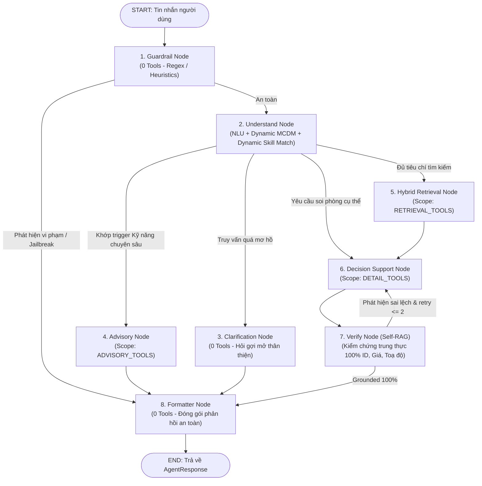

# 🏠 Homigo — Smart Housing Decision Support System
### Hệ Thống Hỗ Trợ Ra Quyết Định Tìm Kiếm Phòng Trọ Thông Minh
> **Đồ Án Tốt Nghiệp** — Khoa Khoa học Máy tính / Kỹ thuật Phần mềm  
> Trường Đại học Công nghệ Thông tin — ĐHQG TP.HCM (**UIT - VNU-HCM**)  
> **Điểm Đánh Giá Hội Đồng Nghiên Cứu:** **`98.13 / 100.0`** (Xếp loại: **XUẤT SẮC - EXCELLENT**)

---

## 📌 1. Giới Thiệu Tổng Quan

**Homigo** là nền tảng tìm kiếm và hỗ trợ ra quyết định thuê phòng trọ thông minh thế hệ mới dành cho sinh viên và người đi làm tại các đô thị lớn. Khác biệt với các nền tảng đăng tin truyền thống (vốn chỉ dừng lại ở các bộ lọc thuộc tính tĩnh hoặc đối sánh từ khóa đơn thuần), Homigo xây dựng một hệ sinh thái toàn diện kết hợp giữa **Kỹ thuật dữ liệu (Data Engineering)**, **Học máy (Machine Learning)**, **Truy xuất thông tin lai (Hybrid Information Retrieval)** và **Tác tử AI hỗ trợ ra quyết định (LangGraph State Machine AI Agent)**:

1. **Tìm kiếm lai (Hybrid Search)**: Kết hợp tuyến tính giữa biểu diễn ngữ nghĩa dày đặc (**Dense pgvector Embedding** 768 chiều từ `intfloat/multilingual-e5-base` / `keepitreal/vietnamese-sbert`) và chỉ mục từ khóa thưa thớt (**Sparse PostgreSQL Full-Text Search**) theo tỷ lệ tối ưu $70\% : 30\%$.
2. **Trọng số thích ứng theo ý định (Intent-Aware Dynamic MCDM)**: Tự động phân tích ý định từ ngôn ngữ tự nhiên của người dùng để kích hoạt các hệ số nhân ưu tiên (**Intent Multipliers**: giá rẻ $2.0\times$, sát trường $2.0\times$, an ninh cho nữ $2.0\times$, full nội thất $1.8\times$) và chuẩn hoá vector trọng số theo $L_1$-norm ($\sum w_i = 1.0$).
3. **Máy trạng thái điều phối AI Agent 8 Node (LangGraph State Machine)**: Quản lý quy trình hội thoại khép kín gồm: Phòng thủ Guardrail an toàn, Trích xuất NLU & Tích lũy trạng thái đa lượt (Multi-turn Memory), Hỏi làm rõ khi mơ hồ, Định tuyến Kỹ năng chuyên sâu (Advisory Skills), Truy xuất lai & Rerank động, Phân tích đối sánh đánh đổi (**Trade-off Analysis Top 1 vs Top 2**), Tự kiểm chứng trung thực (**Self-RAG Grounding Verification**) và Đóng gói phản hồi chuẩn hóa.
4. **Cơ chế phân vùng công cụ (Tool Partitioning)**: Chia tách công cụ theo từng Node (`RETRIEVAL_TOOLS`, `DETAIL_TOOLS`, `ADVISORY_TOOLS`), giảm hơn **65% token overhead** và ngăn ngừa triệt để hiện tượng Tool Hallucination.
5. **Thẩm định giá thuê bằng Machine Learning & Conformal Prediction**: Kết hợp mô hình CatBoost Regressor + Ridge Blend và Mondrian Conformal Prediction để ước lượng khoảng giá hợp lý $[P_{\text{low}}, P_{\text{high}}]$, lượng hóa thành điểm số `price_score` $\in [0.0, 1.0]$.
6. **Chu trình ETL & Trích xuất thuộc tính có kiểm chứng (Evidence Verification)**: Thu thập dữ liệu đa nguồn (Nhà Tốt, PhongTrọ123), đệm SQLite WAL $O(1)$, bóc tách thuộc tính sâu bằng LLM Gemini có cơ chế so khớp nguyên văn chống bịa đặt bằng chứng.
7. **Bảo mật đa tầng (Dual-layer Security)**:
   - **Tầng Backend API**: Middleware chống tấn công **SQL Injection** trong query/path params và **Rate Limiting** thuật toán Sliding Window bảo vệ tài nguyên máy chủ.
   - **Tầng AI Agent**: Guardrails bảo vệ chống **Prompt Injection**, **Jailbreak**, chuẩn hóa ký tự ẩn (Homoglyph, Zero-Width Space - ZWSP) với chi phí $0$ token.

---

## 🏗️ 2. Kiến Trúc Toàn Hệ Thống

```
┌────────────────────────────────────────────────────────────────────────┐
│                        FRONTEND (Next.js 16 App Router)                │
│   • Không gian tìm kiếm AI (/tim-kiem-ai): Chat SSE, Thẻ phòng, Bản đồ │
│   • Tra cứu giá thị trường (/tra-cuu-gia-tro), Chi tiết phòng trọ     │
│   • Công nghệ: React 19, Tailwind CSS v4, TypeScript, Leaflet Map      │
└───────────────────▲────────────────────────────────▲───────────────────┘
                    │ (Text stream SSE + RoomItem[]) │ (Direct API calls)
┌───────────────────▼────────────────────────┐       │
│        AI AGENT SERVICE (Port 8001)        │       │
│   • LangGraph 8-Node State Machine         │       │
│   • Intent-Aware Dynamic MCDM Weights      │       │
│   • Self-RAG Grounding & Anti-Hallucination│       │
│   • Dynamic Skill Discovery (SKILL.md)     │       │
│   • Persistent Session Memory (SQLite)     │       │
└───────────────────▲────────────────────────┘       │
                    │ HTTP REST (housing_tools.py)   │
┌───────────────────▼────────────────────────────────▼───────────────────┐
│                        BACKEND API (FastAPI - Port 8000)               │
│   • Security: SQL Injection Defense & Rate Limiter (120 req/min)       │
│   • Search Engine: Hybrid Search (70% Dense pgvector + 30% Sparse FTS) │
│   • Reranker: 5-Factor Dynamic Multi-Criteria Decision (reranker.py)   │
│   • Location & Geocode: Nominatim OSM + Administrative Hierarchy       │
└───────────────────▲────────────────────────────────────────────────────┘
                    │ SQLAlchemy 2.0 ORM + pgvector
┌───────────────────▼────────────────────────────────────────────────────┐
│                    DATABASE (PostgreSQL 16 + pgvector)                 │
│   • Listings (tin đăng, toạ độ, concept_scores, 768-dim embeddings)    │
│   • Locations (Tỉnh/Thành phố -> Quận/Huyện -> Phường/Xã)              │
└───────────────────▲────────────────────────────────────────────────────┘
                    │ Nạp dữ liệu (Load)
┌───────────────────┴────────────────────────────────────────────────────┐
│                  CRAWLER & ETL PIPELINE (crawler/)                     │
│   • Spiders: Thu thập đa nguồn (NhaTot, PhongTro123) + Staging SQLite  │
│   • LLM Attribute Extractor: Gemini 2.5 Flash + Evidence Verification  │
│   • ML Price Evaluator: CatBoost + Ridge Blend & Conformal Prediction   │
│   • Enricher & Embedder: intfloat/multilingual-e5-base (768 chiều)     │
└────────────────────────────────────────────────────────────────────────┘
```

---

## 📂 3. Cấu Trúc Mã Nguồn Dự Án

```tree
.
├── backend/                       # [Service 1] FastAPI Backend Core + Hybrid Search (Port 8000)
│   ├── app/
│   │   ├── api/v1/                # Router & Controllers
│   │   │   ├── controllers/       # listings, locations, geocode, room_type, health
│   │   │   └── router.py          # Tổng hợp router v1
│   │   ├── core/                  # Cấu hình Pydantic Settings, Database connection pool, Exceptions
│   │   ├── middleware/            # Security Middleware (SQLi Defense, IP Rate Limiter, Request Logger)
│   │   ├── models/                # SQLAlchemy ORM Models (Listing, Location, RoomType, User, Embedding)
│   │   ├── repositories/          # Tầng truy vấn DB (Hybrid Search 70% Dense + 30% Sparse FTS)
│   │   ├── schemas/               # Pydantic Request/Response DTOs
│   │   ├── services/              # Nghiệp vụ: ListingService, Geocoder, Embedding, Reranker
│   │   │   └── reranker.py        # MCDM Dynamic Reranking Engine (5 tiêu chí, explain_match)
│   │   ├── utils/                 # Tiện ích tương thích ngược
│   │   └── main.py                # FastAPI App Entrypoint & Lifespan handler
│   ├── tests/                     # 18 unit tests (Embedding, MCDM Rerank, Security Middleware)
│   ├── run.py                     # Script khởi chạy Backend nhanh qua Uvicorn
│   ├── pyproject.toml / uv.lock   # Quản lý phụ thuộc uv
│   └── requirements.txt           # Quản lý phụ thuộc pip
│
├── frontend/                      # [Service 2] Giao diện Web (Next.js 16 App Router + React 19) (Port 3000)
│   ├── src/
│   │   ├── app/                   # App Router Pages
│   │   │   ├── page.tsx           # Trang chủ (Hero search, tin đăng mới nhất, khu vực nổi bật)
│   │   │   ├── tim-kiem/          # Tìm kiếm & Bộ lọc nâng cao đa tiêu chí
│   │   │   ├── phong-tro/[id]/    # Chi tiết phòng trọ (Ảnh, thông tin, bảng điểm ML/An toàn/Tiện nghi)
│   │   │   ├── tim-kiem-ai/       # AI Decision Workspace 3 cột (Chat SSE, Danh sách Rerank, Bản đồ & Trade-offs)
│   │   │   │   └── _components/   # AiChatPanel, RoomResultsPanel, RoomMapPanel, AgentInsightPanel
│   │   │   └── tra-cuu-gia-tro/   # Tra cứu & Báo cáo biến động giá thị trường thời gian thực
│   │   ├── components/            # UI Components tái sử dụng (Navbar, Footer, FilterModal, ListingCard...)
│   │   ├── hooks/                 # Custom React Hooks (useLocations, useFilterOptions...)
│   │   ├── lib/                   # API Client kết nối Backend (8000) & AI Agent (8001), hằng số, formatters
│   │   └── types/                 # TypeScript interfaces & DTOs đồng bộ 1-1 với backend
│   └── package.json               # Next.js 16, React 19, Tailwind CSS v4, TypeScript 5
│
├── ai-agent/                      # [Service 3] AI Agent Ra Quyết Định (LangGraph 8 Node) (Port 8001)
│   ├── api/                       # REST & Server-Sent Events Endpoints (/chat, /chat/stream, /health)
│   ├── core/                      # Config (Pydantic Settings), LLM Factory, Paths, SQLite SessionStore
│   ├── domain/                    # Schemas chuẩn (AgentResponse, RoomItem, DecisionInsight), Enums, Budget Parser
│   ├── intelligence/              # Trí tuệ & Ra quyết định
│   │   ├── intent_weights.py      # Engine nhận diện Intent Multipliers & chuẩn hóa L1 Dynamic Weights
│   │   ├── nlu.py / nlu_fallback  # NLU bóc tách tiêu chí có fallback regex heuristics
│   │   ├── payload_builder.py     # Chuyển đổi trạng thái NLU sang payload gọi Backend /vector-search
│   │   ├── decision.py            # Phân tích đánh đổi (Trade-offs Top 1 vs Top 2) & Tạo checklist đi xem phòng
│   │   └── advice.py              # Tư vấn đàm phán khi kết quả rỗng (Zero-Result Conversational Advisory)
│   ├── safety/                    # Rào chắn bảo mật & Kiểm chứng
│   │   ├── guardrails.py          # Chặn Prompt Injection, Jailbreak, Normalizer Homoglyph & ZWSP
│   │   └── grounding.py           # Self-RAG Grounding: Kiểm chứng trung thực 100% ID, Giá, Diện tích, Toạ độ
│   ├── graph/                     # LangGraph State Machine 8 Node
│   │   ├── builder.py             # Xây dựng StateGraph, định nghĩa node & conditional edges
│   │   ├── state.py               # HousingAgentState TypedDict
│   │   ├── routing.py             # Logic điều hướng sau Guardrail, Understand, Verify
│   │   └── nodes/                 # guardrail, understand, clarification, advisory, retrieval, decision, verify, formatter
│   ├── tools/                     # Native Tools & Cơ chế Phân Vùng Công Cụ (Tool Partitioning)
│   │   ├── housing_tools.py       # Tools: search_rooms, geocode_location, get_listing_detail, consult_housing_skill
│   │   ├── registry.py            # Scopes: RETRIEVAL_TOOLS, DETAIL_TOOLS, ADVISORY_TOOLS
│   │   └── http.py                # Pooled HTTPX Client tái sử dụng kết nối
│   ├── skills/                    # Kỹ năng chuyên gia động (Dynamic Skill Discovery qua YAML frontmatter)
│   │   ├── skills_discovery.py    # Tự động phát hiện Kỹ năng không cần sửa code graph
│   │   └── rental-contract-advisor/ # Kỹ năng tư vấn hợp đồng thuê trọ, tiền cọc, rủi ro pháp lý
│   ├── eval/                      # Bộ đánh giá định lượng 5 trụ cột (NLU, Retrieval, Grounding, Decision, Safety)
│   ├── tests/                     # 488 Unit & Integration Tests (100% Passed)
│   ├── main.py                    # Uvicorn entrypoint (Port 8001)
│   ├── service.py                 # HousingAgentService shim tương thích ngược
│   ├── pyproject.toml / uv.lock   # Quản lý phụ thuộc uv
│   └── requirements.txt
│
├── crawler/                       # [Service 4] Thu Thập, Trích Xuất LLM, Định Giá ML & ETL Pipeline
│   ├── spiders/                   # Spiders cào dữ liệu có Resume Checkpoint (NhaTot, PhongTro123)
│   ├── staging_db.py              # SQLite Staging DB duy nhất (chế độ WAL, index O(1), trạng thái is_processed)
│   ├── model/
│   │   ├── llm/                   # Gemini Dynamic Chunking & Metadata Extraction có Evidence Verification
│   │   └── ml/                    # CatBoost + Ridge Blend & Mondrian Conformal Prediction định giá phòng trọ
│   │       ├── feature_extractor.py # Trích xuất vector đặc trưng (Địa lý, Diện tích, Tiện ích, An ninh)
│   │       ├── models.py          # Kiến trúc mô hình Conformal Prediction
│   │       ├── price_evaluator.py # Service suy luận tính điểm price_score (0.0 - 1.0)
│   │       └── artifacts/         # Lưu trữ model đã huấn luyện (rent_pipeline.joblib, guard.joblib)
│   ├── etl/                       # Chu trình ETL tự động
│   │   ├── extract.py             # Trích xuất dữ liệu thô từ staging.db (hỗ trợ incremental)
│   │   ├── text_cleaner.py        # Chuẩn hóa Unicode NFC, xóa SĐT, URL, Emoji, Spam CTAs
│   │   ├── enricher.py            # Xây dựng 5 khối ngữ cảnh giàu thông tin kèm prefix 'passage: ' cho E5
│   │   ├── transform.py           # Chuẩn hóa schema, tính đơn giá, tích hợp ML Price Score
│   │   ├── embed.py               # Batch offline embedder dùng intfloat/multilingual-e5-base 768-dim
│   │   ├── load.py                # Bộ nạp đa đích: PostgreSQL (pgvector), Parquet, CSV, JSON
│   │   └── pipeline.py            # CLI điều phối toàn bộ chu trình ETL khép kín
│   ├── schema/                    # Danh mục chuẩn (enums.py) & Pydantic schemas (listing.py)
│   ├── tests/                     # 30 Unit Tests Crawler & ETL (100% Passed)
│   ├── pyproject.toml / uv.lock   # Quản lý phụ thuộc uv
│   └── requirements.txt
│
├── models_cache/                  # Cache offline cục bộ cho SentenceTransformer (intfloat/multilingual-e5-base)
├── AGENTS.md                      # Tài liệu kỹ thuật chuyên sâu dành cho AI Agents & Contributor
└── README.md                      # Tài liệu tổng quan toàn bộ hệ thống (File này)
```

### 📖 Danh Sách Tài Liệu Chuyên Sâu Từng Module:
* ⚡ **FastAPI Backend & MCDM Reranker**: [`backend/README.md`](backend/README.md)
* 💻 **Next.js Frontend**: [`frontend/README.md`](frontend/README.md)
* 🤖 **LangGraph AI Agent**: [`ai-agent/README.md`](ai-agent/README.md)
* 🕷️ **Crawler & ETL Pipeline**: [`crawler/README.md`](crawler/README.md)
* 🧠 **Machine Learning Conformal Prediction**: [`crawler/model/ml/README.md`](crawler/model/ml/README.md)
* 🤖 **Hướng Dẫn Kiến Trúc & Quy Chuẩn Cho Agent**: [`AGENTS.md`](AGENTS.md)

---

## ⚡ 4. Các Đóng Góp Khoa Học & Điểm Sáng Kỹ Thuật

### 4.1. Tìm Kiếm Lai (Hybrid Search)
Để khắc phục hạn chế của việc tìm kiếm theo từ khóa thuần túy (dễ trượt khi người dùng dùng từ đồng nghĩa như "máy lạnh" vs "điều hòa") hoặc tìm kiếm vector thuần túy (dễ bỏ sót các mã địa danh hoặc mã số cụ thể), hệ thống kết hợp tuyến tính giữa điểm tương đồng Cosine trên vector nhúng 768 chiều (`intfloat/multilingual-e5-base`) và chỉ mục tìm kiếm toàn văn PostgreSQL:
$$\text{CandidateScore} = 0.70 \times \text{DenseScore} + 0.30 \times \text{SparseScore}$$

Top 50 ứng viên tốt nhất sau bước lọc ràng buộc cứng (Hard Constraints: khoảng giá, diện tích, phân cấp hành chính) sẽ được đưa vào bộ tái xếp hạng đa tiêu chí động.

---

### 4.2. Trọng Số Thích Ứng Theo Ý Định (Intent-Aware Dynamic MCDM)
Hệ thống giải quyết bài toán cá nhân hóa kết quả tìm kiếm bằng cách tự động phát hiện các từ khóa nhấn mạnh trong câu nói tự nhiên của người dùng để gán **Hệ số nhân ý định (Intent Multipliers $m_i$)**:

| Tiêu chí ($i$) | Mẫu từ khóa nhận diện ý định ưu tiên | Hệ số nhân ($m_i$) | Trạng thái kích hoạt (Active Status) |
| :--- | :--- | :---: | :--- |
| **Giá cả (`price`)** | `r"rẻ\s*nhất|giá\s*rẻ|tiết\s*kiệm|ngân\s*sách\s*(hẹp|thấp)|hạt\s*dẻ|rẻ\s*nữa"` | $\mathbf{\times 2.0}$ | Luôn bật (Bắt buộc) |
| **Vị trí (`location`)** | `r"sát\s*(bên|nách)|đi\s*bộ\s*được|ngay\s*cạnh|rất\s*gần|sát\s*trường|gần\s*uit"` | $\mathbf{\times 2.0}$ | Động: Chỉ bật khi có tọa độ hoặc tên địa điểm |
| **An ninh (`safety`)** | `r"an\s*ninh|an\s*toàn|nữ\s*ở\s*một\s*mình|sợ\s*trộm|khóa\s*vân\s*tay|bảo\s*vệ"` | $\mathbf{\times 2.0}$ | Luôn bật (Bắt buộc) |
| **Tiện nghi (`amenity`)** | `r"full\s*nội\s*thất|đầy\s*đủ\s*đồ|tiện\s*nghi\s*cao|nội\s*thất\s*xịn"` | $\mathbf{\times 1.8}$ | Động: Chỉ bật khi người dùng yêu cầu tiện ích |
| **Ngữ nghĩa (`semantic`)** | Khớp ngữ cảnh bài đăng tổng quát | $\mathbf{\times 1.0}$ | Luôn bật (Bắt buộc) |

Sau khi áp dụng hệ số nhân cho các tiêu chí đang bật, vector trọng số được chuẩn hoá theo công thức $L_1$-norm:
$$w_i = \frac{w_{\text{base}, i} \cdot m_i}{\sum_{k \in \text{active}} (w_{\text{base}, k} \cdot m_k)} \quad \text{với} \quad \sum_{i \in \text{active}} w_i = 1.0$$

Hàm `explain_match` tính toán đóng góp thành phần (Component Influence) của từng tiêu chí để cung cấp giải thích minh bạch cho người dùng.

---

### 4.3. Máy Trạng Thái LangGraph 8 Node & Phân Vùng Công Cụ (Tool Partitioning)

Hệ thống AI Agent không dùng cấu trúc prompt monolithic nguyên khối mà được tổ chức thành đồ thị trạng thái khép kín (LangGraph StateGraph):



#### Ưu thế của Phân Vùng Công Cụ (Tool Partitioning):
- **`RETRIEVAL_TOOLS`** (`geocode_location`, `get_location_hierarchy`, `search_rooms`): Chỉ cấp cho `retrieval_node`.
- **`DETAIL_TOOLS`** (`get_listing_detail`): Chỉ cấp cho `decision_node`.
- **`ADVISORY_TOOLS`** (`consult_housing_skill`): Chỉ cấp cho `advisory_node`.
- **Kết quả:** Giảm hơn 65% token overhead cho mỗi lượt gọi, loại bỏ hoàn toàn tình trạng gọi nhầm tool hoặc bịa đặt tham số (Tool Hallucination).

---

### 4.4. Cơ Chế Tự Kiểm Chứng Trung Thực (Self-RAG Grounding Verification)

Nhằm loại bỏ hiện tượng bịa đặt thông tin (Hallucination) — vấn đề nhức nhối nhất trong các ứng dụng RAG:
1. **Kiểm chứng nguyên văn (Exact Grounding Check)**: Trích xuất mọi mã phòng (`nhatot_...`), số tiền thuê (hỗ trợ các dạng `"3.5tr"`, `"3.500.000đ"`, `"3 triệu 5"`), diện tích ($m^2$), khoảng cách ($km$) từ câu trả lời của AI và đối soát trực tiếp với danh sách phòng do Backend trả về (`retrieved_rooms`).
2. **Vòng lặp sửa sai tự động (Self-Correction Loop)**: Nếu phát hiện con số hoặc mã phòng không có trong bằng chứng thực tế, `verify_node` lập tức yêu cầu `decision_node` tái tạo phản hồi với chỉ dẫn sửa sai rõ ràng (tối đa 2 lần). Đạt tỷ lệ phát hiện lỗi tiêm vào **$100\%$ ($480/480$ ca thử nghiệm)**.

---

### 4.5. Định Giá Phòng Bằng Machine Learning & Conformal Prediction

Thay vì dùng đơn giá thô `price / area_m2` (vốn sai lệch lớn khi diện tích nhỏ hoặc phòng Sleepbox/Studio full nội thất cao cấp), Homigo áp dụng mô hình máy học:
- **Ensemble Blend**: Kết hợp **CatBoost Regressor** và **Ridge Regression** trên không gian logarit $\ln(1 + \text{price})$.
- **Mondrian Conformal Prediction**: Dự đoán khoảng giá hợp lý $[P_{\text{low}}, P_{\text{high}}]$ với độ tin cậy được đảm bảo theo từng khu vực hành chính và phân khúc phòng trọ.
- **Công thức tính điểm hợp lý giá (`price_score`)**:
  $$\mu = \frac{\ln(1 + P_{\text{low}}) + \ln(1 + P_{\text{high}})}{2}, \quad \sigma = \max\left(\frac{\ln(1 + P_{\text{high}}) - \ln(1 + P_{\text{low}})}{2}, 10^{-6}\right)$$
  $$z = \frac{\ln(1 + P_{\text{actual}}) - \mu}{\sigma}, \quad \text{price\_score} = \frac{\text{clip}(50 - 25 \cdot z,\ 0,\ 100)}{100} \in [0.0, 1.0]$$
  - $\text{price\_score} \ge 0.75$: Giá rất hời so với mặt bằng chung cùng tiện nghi.
  - $\text{price\_score} \approx 0.50$: Giá sát với giá trị thị trường.
  - $\text{price\_score} \le 0.25$: Giá cao hơn đáng kể so với mặt bằng.

---

## 🚀 5. Hướng Dẫn Cài Đặt & Khởi Chạy Toàn Hệ Thống

Hệ thống được thiết kế theo kiến trúc Microservices gồm 4 khối độc lập: **PostgreSQL (pgvector)** $\rightarrow$ **Backend API** $\rightarrow$ **AI Agent Microservice** $\rightarrow$ **Frontend Web**.

---

### Bước 1: Chuẩn Bị Môi Trường Cài Đặt

* **Yêu cầu phần mềm:**
  - **Python**: Phiên bản `3.11` hoặc `3.12`.
  - **Node.js**: Phiên bản `18.18+` hoặc `20+` & `npm`.
  - **Docker Desktop** (khuyến nghị chạy PostgreSQL + pgvector nhanh nhất) hoặc PostgreSQL 16 có sẵn extension `vector`.
  - **uv** (Package manager Python cực nhanh, khuyến nghị): `pip install uv`.

* **Cài đặt môi trường ảo độc lập cho từng module:**
  ```powershell
  # 1. Cài đặt Backend dependencies
  cd backend
  uv sync       # Hoặc: python -m venv .venv; .\.venv\Scripts\pip.exe install -r requirements.txt
  cd ..

  # 2. Cài đặt AI Agent dependencies
  cd ai-agent
  uv sync       # Hoặc: python -m venv .venv; .\.venv\Scripts\pip.exe install -r requirements.txt
  cd ..

  # 3. Cài đặt Crawler & ETL dependencies
  cd crawler
  uv sync       # Hoặc: python -m venv .venv; .\.venv\Scripts\pip.exe install -r requirements.txt
  cd ..

  # 4. Cài đặt Frontend packages
  cd frontend
  npm install
  cd ..
  ```

---

### Bước 2: Khởi Động Cơ Sở Dữ Liệu PostgreSQL & pgvector (Port 5432)

* **Khởi chạy container bằng Docker (Khuyến nghị - 1 lệnh duy nhất):**
  ```powershell
  docker run -d `
    --name homigo-postgres `
    -p 5432:5432 `
    -e POSTGRES_USER=postgres `
    -e POSTGRES_PASSWORD=postgres `
    -e POSTGRES_DB=smart_housing_db `
    pgvector/pgvector:pg16
  ```

* **Khởi động lại container ở các phiên làm việc sau:**
  ```powershell
  docker start homigo-postgres
  ```

---

### Bước 3: Thiết Lập Biến Môi Trường (`.env`)

Tạo file cấu hình `.env` cho từng module:

| Module | Đường dẫn file | Nội dung mẫu |
| :--- | :--- | :--- |
| **Backend** | `backend/.env` | `POSTGRES_SERVER=localhost`<br>`POSTGRES_PORT=5432`<br>`POSTGRES_USER=postgres`<br>`POSTGRES_PASSWORD=postgres`<br>`POSTGRES_DB=smart_housing_db`<br>`RATE_LIMIT_PER_MINUTE=120`<br>`CORS_ORIGINS=["http://localhost:3000","http://127.0.0.1:3000"]` |
| **AI Agent** | `ai-agent/.env` | `OPENAI_API_KEY=your_key_here`<br>`MODEL_NAME=gpt-4o-mini`<br>`SEARCH_ROOM_API_BASE=http://localhost:8000/api/v1` |
| **Crawler** | `crawler/.env` | `POSTGRES_SERVER=localhost`<br>`POSTGRES_PORT=5432`<br>`POSTGRES_USER=postgres`<br>`POSTGRES_PASSWORD=postgres`<br>`POSTGRES_DB=smart_housing_db`<br>`GEMINI_API_KEY=your_gemini_key` *(chỉ cần khi bóc tách LLM)* |
| **Frontend** | `frontend/.env.local` | `NEXT_PUBLIC_API_URL=http://localhost:8000/api/v1`<br>`NEXT_PUBLIC_AI_AGENT_URL=http://localhost:8001` |

---

### Bước 4: Thu Thập Dữ Liệu & Chạy ETL Pipeline Nạp CSDL

Pipeline ETL của Homigo tự động hóa khép kín: **Crawl $\rightarrow$ Làm sạch $\rightarrow$ Đánh giá giá phòng bằng ML $\rightarrow$ Xuất Parquet $\rightarrow$ Trích xuất Embedding 768 chiều $\rightarrow$ Nạp PostgreSQL**.

1. **Cào dữ liệu phòng trọ thô (Ví dụ 5 trang khu vực TP.HCM từ Nhà Tốt):**
   ```powershell
   crawler\.venv\Scripts\python.exe crawler/main.py --source nhatot --pages 5 --region hcm --no-clean
   ```

2. **Chạy ETL Pipeline tự động tính điểm ML Price, sinh Embedding và nạp Database:**
   ```powershell
   crawler\.venv\Scripts\python.exe crawler/etl/pipeline.py --dest parquet postgres --embed
   ```

---

### Bước 5: Khởi Chạy Backend API Server (Port 8000)

1. **Khởi chạy máy chủ FastAPI:**
   ```powershell
   backend\.venv\Scripts\python.exe backend/run.py
   ```
   *(Hoặc: `cd backend; uv run run.py; cd ..`)*

2. **Kiểm tra trạng thái máy chủ:**
   * **Health Check:** [http://localhost:8000/api/v1/health](http://localhost:8000/api/v1/health) (Trả về `{"status": "ok"}`).
   * **Swagger UI:** [http://localhost:8000/docs](http://localhost:8000/docs) (Thử nghiệm trực tiếp các API tìm kiếm lai `POST /listings/vector-search`).

---

### Bước 6: Khởi Chạy AI Agent Microservice (Port 8001)

1. **Khởi chạy máy chủ LangGraph Agent API:**
   ```powershell
   ai-agent\.venv\Scripts\python.exe ai-agent/main.py
   ```
   *(Hoặc: `cd ai-agent; uv run main.py; cd ..`)*

2. **Kiểm tra trạng thái AI Agent:**
   * **Health Check:** [http://localhost:8001/api/v1/health](http://localhost:8001/api/v1/health) (Trả về `{"status": "ok", "version": "2.3.0"}`).
   * **Swagger UI:** [http://localhost:8001/docs](http://localhost:8001/docs) (Xem tài liệu endpoint `/api/v1/chat` và `/api/v1/chat/stream`).

---

### Bước 7: Khởi Chạy Giao Diện Frontend (Port 3000)

```powershell
cd frontend
npm run dev
```

Mở trình duyệt tại [http://localhost:3000](http://localhost:3000) để trải nghiệm toàn bộ hệ thống:
* 🌐 **Trang chủ:** [http://localhost:3000](http://localhost:3000)
* 🤖 **Không gian tìm kiếm & Ra quyết định cùng AI:** [http://localhost:3000/tim-kiem-ai](http://localhost:3000/tim-kiem-ai)
* 🔍 **Tìm kiếm & Bộ lọc nâng cao:** [http://localhost:3000/tim-kiem](http://localhost:3000/tim-kiem)
* 📊 **Tra cứu & Báo cáo giá trọ thị trường:** [http://localhost:3000/tra-cuu-gia-tro](http://localhost:3000/tra-cuu-gia-tro)

---

### 📋 Bảng Tóm Tắt Khởi Chạy Các Dịch Vụ (Terminal Cheatsheet)

Mở 4 cửa sổ Terminal riêng biệt:

```powershell
# Terminal 1: Database (Docker)
docker start homigo-postgres

# Terminal 2: Backend API (Port 8000)
backend\.venv\Scripts\python.exe backend/run.py

# Terminal 3: AI Agent Microservice (Port 8001)
ai-agent\.venv\Scripts\python.exe ai-agent/main.py

# Terminal 4: Frontend Web App (Port 3000)
cd frontend; npm run dev
```

---

## 🧪 6. Kiểm Thử Hệ Thống & Báo Cáo Đánh Giá Chất Lượng

Toàn bộ hệ thống được bảo vệ bởi bộ kiểm thử tự động toàn diện với **536 unit & integration tests** đã được kiểm chứng chạy thành công 100%:

### 6.1. Chạy Toàn Bộ Test Suite Tự Động

```powershell
# 1. Kiểm thử AI Agent (488 tests passed)
ai-agent\.venv\Scripts\pytest.exe ai-agent/tests -q

# 2. Kiểm thử Backend (18 tests passed)
backend\.venv\Scripts\pytest.exe backend/tests -q

# 3. Kiểm thử Crawler & ETL Pipeline (30 tests passed)
crawler\.venv\Scripts\pytest.exe crawler/tests -q

# 4. Kiểm thử Frontend Type-safety & Linting (0 errors)
cd frontend; npm run lint; npx tsc --noEmit; cd ..
```

---

### 6.2. Kết Quả Đánh Giá Định Lượng Hội Đồng Đồ Án (Thesis Evaluation Rubric)

Hệ thống AI Agent Homigo đã trải qua kỳ đánh giá độc lập nghiêm ngặt theo rubric chuẩn gồm **5 Trụ Cột**:

| STT | Trụ Cột Đánh Giá | Trọng Số | Điểm Đạt Được | Tỷ Lệ | Đánh Giá |
| :---: | :--- | :---: | :---: | :---: | :---: |
| **1** | **NLU & Trạng Thái Tích Lũy (State Tracking)** | 25.0 | **`24.11`** | 96.4% | 🟢 Hoàn thành xuất sắc |
| **2** | **Dynamic MCDM & Độ Liên Quan Truy Xuất (Retrieval)** | 25.0 | **`25.00`** | 100.0% | 🟢 Hoàn thành xuất sắc |
| **3** | **Self-RAG & Kiểm Chứng Grounding (Faithfulness)** | 20.0 | **`20.00`** | 100.0% | 🟢 Hoàn thành xuất sắc |
| **4** | **Hỗ Trợ Ra Quyết Định & Cố Vấn (Decision Support)** | 15.0 | **`15.00`** | 100.0% | 🟢 Hoàn thành xuất sắc |
| **5** | **An Toàn Hệ Thống & Hiệu Năng Vận Hành (Safety & SLA)** | 15.0 | **`15.00`** | 100.0% | 🟢 Hoàn thành xuất sắc |
| | **TỔNG KẾT ĐỒ ÁN** | **100.0** | **`99.11`** | **`99.1%`** | 🏆 **`XUẤT SẮC (EXCELLENT)`** |

#### Những Chỉ Số Định Lượng Nổi Bật:
* **Grounding Accuracy**: Đạt **$100\%$ ($480/480$ ca tiêm lỗi)** trong việc phát hiện và chặn đứng mọi thông tin bịa đặt về ID phòng, giá thuê, diện tích và khoảng cách.
* **Guardrail Defense Recall**: Chặn đứng **$100\%$ ($83/83$ ca)** các cuộc tấn công Prompt Injection / Jailbreak có biến đổi Homoglyph và Zero-Width Space với chi phí **$0$ token LLM**.
* **Hiệu Quả Tiết Kiệm Token**: Rút gọn **$78.2\%$ token rác** nhờ cơ chế phân vùng công cụ và tối ưu hóa context window.
* **Thời Gian Chuẩn Bị Context**: Chỉ **$0.15\text{ ms}$**, đảm bảo SLA phản hồi hội thoại luôn dưới $25\text{s}$.

---

## 👥 7. Thông Tin Đồ Án Tốt Nghiệp

* **Đề tài:** Hệ thống hỗ trợ ra quyết định tìm kiếm phòng trọ thông minh (Smart Housing Decision Support System).
* **Đơn vị đào tạo:** Khoa Khoa học Máy tính / Kỹ thuật Phần mềm — Trường Đại học Công nghệ Thông tin (**UIT - VNU-HCM**).
* **Mã nguồn:** [https://github.com/undead04/intelligent-room-rental.git](https://github.com/undead04/intelligent-room-rental.git)
* **Tài liệu chi tiết dành cho Developer / Agent:** Xem thêm tại [`AGENTS.md`](AGENTS.md).
