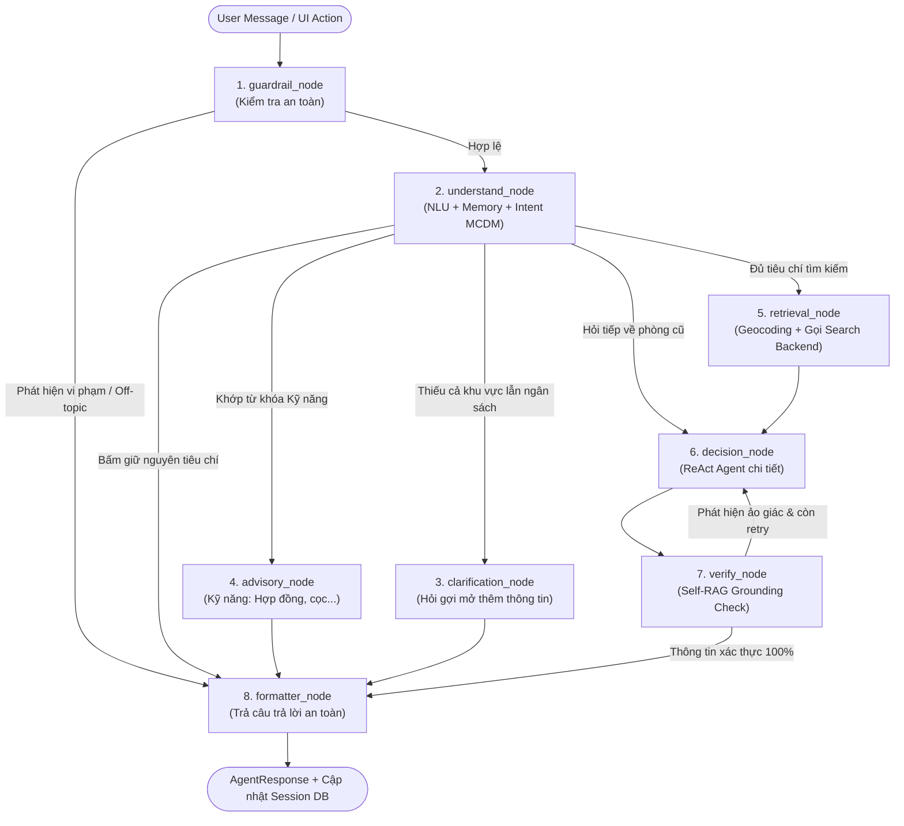

# 🧠 CẨM NANG TOÀN TẬP VỀ SOURCE CODE AI-AGENT (`ai-agent/`)
### Kiến Trúc 6 Tầng, Luồng 8-Node LangGraph & Hướng Dẫn Tinh Chỉnh Chi Tiết

Tài liệu này được thiết kế dành riêng cho bạn — người đã tự xây dựng Backend, Frontend và Crawler — để bạn nắm bắt trọn vẹn 100% "bộ não" **`ai-agent/`**, hiểu được từng module đang làm gì và biết chính xác nơi cần mở ra để sửa chữa, tinh chỉnh.

---

## 🏛️ 1. Kiến Trúc 6 Tầng Của `ai-agent/`

Module `ai-agent` được thiết kế theo nguyên lý **Clean Layered Architecture** (Kiến trúc phân tầng sạch) để không bị phụ thuộc vòng tròn (circular import) và cực kỳ dễ viết unit test:

```text
ai-agent/
├── 1. core/            # Hạ tầng: Cấu hình Pydantic, LLM Factory, SQLite SessionStore
├── 2. domain/          # Nghiệp vụ: Schemas Pydantic, Enums, tính toán Budget
├── 3. intelligence/    # Trí tuệ: NLU Parsing, Intent Multipliers (MCDM), Decision Logic
├── 4. safety/          # Rào chắn: Guardrails bảo vệ, Self-RAG Grounding chống ảo giác
├── 5. tools/           # Công cụ: Geocoding, Gọi Backend REST API (Phân vùng theo Scope)
├── 6. graph/           # Điều phối: Máy trạng thái LangGraph 8 Node (State, Routing, Nodes)
├── skills/             # Kỹ năng động: Dynamic Skill Discovery qua YAML triggers
├── prompts/            # Toàn bộ System Prompts tập trung
├── api/                # FastAPI Endpoints & SSE Streaming
└── tests/              # 30+ file test tự động (Pytest)
```

---

## 🔄 2. Luồng Điều Phối Máy Trạng Thái LangGraph 8-Node

Đồ thị nằm tại [`graph/builder.py`](file:///c:/UIT/Lab/Đồ%20Án%20tốt%20nghiệp/ai-agent/graph/builder.py), trạng thái luân chuyển qua `HousingAgentState` gồm 8 node:



---

## 📖 3. Lộ Trình Đọc Code Khuyên Dùng (Reading Roadmap)

Để nắm trọn code chỉ trong vòng 1-2 tiếng, hãy mở file theo thứ tự sau:

### 📍 Giai đoạn 1: Nền tảng State & Hợp đồng dữ liệu
1. **[`domain/schemas.py`](file:///c:/UIT/Lab/Đồ%20Án%20tốt%20nghiệp/ai-agent/domain/schemas.py)**:
   - `UserPreferenceState`: Nhu cầu tích lũy xuyên suốt phiên chat (`location_text`, `lat`, `lng`, `min_price`, `max_price`, `amenities`...).
   - `AgentResponse`: Chuẩn dữ liệu trả về cho Frontend (`text_reply`, `rooms`, `insights`, `needs_clarification`, `proposed_budget`...).
   - `DecisionInsight`: Cấu trúc chứa `top_1_reason`, `trade_off_analysis`, `verification_checklist`.
2. **[`graph/state.py`](file:///c:/UIT/Lab/Đồ%20Án%20tốt%20nghiệp/ai-agent/graph/state.py)**:
   - `HousingAgentState`: TypedDict chứa mọi biến chạy xuyên suốt từ Node 1 đến Node 8.
3. **[`graph/deps.py`](file:///c:/UIT/Lab/Đồ%20Án%20tốt%20nghiệp/ai-agent/graph/deps.py)**:
   - Đọc cấu trúc `Deps`. Toàn bộ LLM, cấu hình và kết nối I/O đều được gom vào đây để tiêm (Dependency Injection) vào các Node.

---

### 📍 Giai đoạn 2: Trí tuệ NLU & Trọng số thích ứng (MCDM)
1. **[`intelligence/nlu.py`](file:///c:/UIT/Lab/Đồ%20Án%20tốt%20nghiệp/ai-agent/intelligence/nlu.py)**:
   - Hàm `analyze_turn`: Gọi mô hình ngôn ngữ (hoặc parser) để bóc tách câu nói của người dùng thành cấu trúc `TurnAnalysis` gồm: `intent`, `patch` (các trường người dùng muốn đổi/thêm), `priorities` (mức độ ưu tiên giá/vị trí/an ninh).
2. **[`intelligence/intent_weights.py`](file:///c:/UIT/Lab/Đồ%20Án%20tốt%20nghiệp/ai-agent/intelligence/intent_weights.py)**:
   - Hàm `compute_normalized_weights`: Tính vector trọng số 5 tiêu chí:
     $$w_i = \frac{w_{\text{base}, i} \cdot m_i}{\sum_{k \in \text{active}} (w_{\text{base}, k} \cdot m_k)}$$
   - Chỉ bật `location` khi có toạ độ, chỉ bật `amenity` khi người dùng đòi hỏi tiện ích cụ thể.
3. **[`intelligence/understand.py`](file:///c:/UIT/Lab/Đồ%20Án%20tốt%20nghiệp/ai-agent/intelligence/understand.py)**:
   - Hàm `interpret_turn`: Hợp nhất nhu cầu cũ trong Session với thông tin mới vừa bóc tách, sinh ra `TurnPlan`.
   - Hàm `route_after_understand`: Quyết định câu chat sẽ đi tiếp tới Node nào (`clarification`, `advisory`, `decision` hay `retrieval`).

---

### 📍 Giai đoạn 3: Khám phá các Node trong Đồ thị (`graph/nodes/`)
1. **[`graph/nodes/guardrail.py`](file:///c:/UIT/Lab/Đồ%20Án%20tốt%20nghiệp/ai-agent/graph/nodes/guardrail.py)**:
   - Kiểm tra Prompt Injection (chuỗi tấn công, ký tự ẩn zero-width space) và Off-topic (hỏi chuyện ngoài lề không liên quan thuê trọ) bằng Regex / Heuristics cực nhanh (0 token cost).
2. **[`graph/nodes/retrieval.py`](file:///c:/UIT/Lab/Đồ%20Án%20tốt%20nghiệp/ai-agent/graph/nodes/retrieval.py)**:
   - Tự động gọi Geocoding chuyển địa danh thành toạ độ `lat, lng`.
   - Gửi request sang Backend `/api/v1/listings/vector-search` với vector trọng số động `computed_weights`.
   - Cơ chế tự nới bộ lọc nếu không tìm thấy phòng (Corrective RAG).
3. **[`graph/nodes/decision.py`](file:///c:/UIT/Lab/Đồ%20Án%20tốt%20nghiệp/ai-agent/graph/nodes/decision.py)**:
   - Đọc kết quả từ Backend.
   - Gọi LLM sinh nhận định khách quan (`generate_advice`) dựa trên Prompt tại [`prompts/decision_prompt.py`](file:///c:/UIT/Lab/Đồ%20Án%20tốt%20nghiệp/ai-agent/prompts/decision_prompt.py).
   - Tự động xây dựng bảng so sánh Trade-off giữa căn Top 1 và Top 2.
4. **[`graph/nodes/verify.py`](file:///c:/UIT/Lab/Đồ%20Án%20tốt%20nghiệp/ai-agent/graph/nodes/verify.py)** & **[`safety/grounding.py`](file:///c:/UIT/Lab/Đồ%20Án%20tốt%20nghiệp/ai-agent/safety/grounding.py)**:
   - **Self-RAG Grounding**: Quét câu trả lời của AI. Đối chiếu từng con số giá tiền và mã ID phòng với dữ liệu thực tế từ Backend. Nếu phát hiện bịa số $\rightarrow$ kích hoạt retry để sửa lại câu trả lời.
5. **[`graph/nodes/formatter.py`](file:///c:/UIT/Lab/Đồ%20Án%20tốt%20nghiệp/ai-agent/graph/nodes/formatter.py)**:
   - Đóng gói toàn bộ kết quả vào `AgentResponse`, lưu lịch sử và tiêu chí vào SQLite `sessions.db`.

---

### 📍 Giai đoạn 4: API & Server-Sent Events (SSE)
1. **[`api/routes.py`](file:///c:/UIT/Lab/Đồ%20Án%20tốt%20nghiệp/ai-agent/api/routes.py)**:
   - Các endpoint FastAPI: `POST /chat`, `POST /chat/stream`, `GET /health`, `GET /session/{id}`.
2. **[`api/sse.py`](file:///c:/UIT/Lab/Đồ%20Án%20tốt%20nghiệp/ai-agent/api/sse.py)**:
   - Bắn sự kiện streaming về frontend: `token` (từng chữ), `trace` (node đang chạy), `rooms` (danh sách phòng), `insights` (lời khuyên), `done`.

---

## 🛠️ 4. Vị Trí Cần Sửa Khi Bạn Muốn Tinh Chỉnh

Dưới đây là các nhu cầu bạn thường sẽ can thiệp nhất:

### 🎯 1. Muốn đổi Giọng Điệu Tư Vấn (Tone of Voice) & Quy Tắc Trả Lời
* **File:** [`prompts/decision_prompt.py`](file:///c:/UIT/Lab/Đồ%20Án%20tốt%20nghiệp/ai-agent/prompts/decision_prompt.py)
* **Chỗ sửa:**
  - Hằng số `ADVICE_RULES`: Định nghĩa phong cách tư vấn của Cố vấn Homigo AI.
  - Hằng số `DECISION_RULES`: Định nghĩa cách ReAct Agent trả lời khi người dùng hỏi sâu về 1 phòng cụ thể (hỏi tiền điện nước, nuôi thú cưng, tiền cọc...).
* **Lưu ý quan trọng:** Prompt tuân thủ quy tắc **Constrained Qualitative Output** (tức LLM chỉ nhận xét định tính, các con số giá tiền đã do hệ thống tự điền để triệt tiêu hoàn toàn ảo giác hallucination).

---

### 🎯 2. Muốn tinh chỉnh Trọng Số Ý Định (Intent MCDM Weights)
* **File:** [`intelligence/intent_weights.py`](file:///c:/UIT/Lab/Đồ%20Án%20tốt%20nghiệp/ai-agent/intelligence/intent_weights.py)
* **Chỗ sửa:**
  - Hàm `detect_intent_multipliers`:
    - Thêm từ khóa tiếng Việt (không dấu / có dấu) vào `price_kws`, `loc_kws`, `safety_kws`, `amenity_kws`.
    - Điều chỉnh hệ số nhân: Mặc định giá rẻ là `2.0`, vị trí gần là `2.0`, an ninh là `2.0`, full nội thất là `1.8`. Bạn có thể nâng lên `2.5` nếu muốn tiêu chí đó áp đảo hoàn toàn các tiêu chí còn lại.

---

### 🎯 3. Muốn chỉnh các Ngưỡng Đề Xuất Nới Bộ Lọc (Conversational Negotiation)
Khi người dùng tìm phòng với ngân sách quá thấp hoặc khu vực không có phòng, hệ thống tự động phân tích thị trường và gợi ý nới lỏng ngân sách/khu vực lân cận qua đối thoại tự nhiên.
* **File:** [`intelligence/understand.py`](file:///c:/UIT/Lab/Đồ%20Án%20tốt%20nghiệp/ai-agent/intelligence/understand.py)
* **Chỗ sửa:** Dictionary `HITL_TUNING`:
  ```python
  HITL_TUNING = {
      "relax_budget_factor": 1.15,   # Nới ngân sách lên 15%
      "relax_price_mult": 1.5,       # Hệ số nhân giá khi nới
      "dormitory_price_mult": 1.8,   # Hệ số nhân khi chuyển sang KTX/Sleepbox
      "default_budget": 3_000_000.0, # Mức ngân sách mặc định nếu người dùng chưa nêu
  }
  ```

---

### 🎯 4. Muốn thêm một Kỹ Năng Mới (Dynamic Skill Discovery)
Hệ thống có cơ chế tự nạp kỹ năng mà **không cần sửa một dòng code nào trong StateGraph**:
* **Bước 1:** Tạo thư mục `ai-agent/skills/<tên-kỹ-năng>/`.
* **Bước 2:** Tạo file `ai-agent/skills/<tên-kỹ-năng>/SKILL.md` với định dạng:
  ```markdown
  ---
  name: "phap-ly-nha-tro"
  description: "Tư vấn về đăng ký tạm trú, bồi thường đồ đạc và quy định pháp luật thuê nhà"
  triggers:
    - "tạm trú"
    - "công an phường"
    - "hộ khẩu"
    - "pháp lý"
    - "đăng ký tạm vắng"
  ---
  # Cẩm nang kiến thức pháp lý
  Khi người dùng hỏi về đăng ký tạm trú:
  - Chủ nhà trọ có trách nhiệm đăng ký trong vòng 30 ngày...
  ```
* Module [`skills/skills_discovery.py`](file:///c:/UIT/Lab/Đồ%20Án%20tốt%20nghiệp/ai-agent/skills/skills_discovery.py) sẽ tự quét và kích hoạt `advisory_node` mỗi khi câu nói người dùng chứa các từ trong `triggers`!

---

### 🎯 5. Muốn đổi Mô Hình LLM hoặc Cấu Hình Endpoint
* **File:** [`core/config.py`](file:///c:/UIT/Lab/Đồ%20Án%20tốt%20nghiệp/ai-agent/core/config.py) & [`core/llm.py`](file:///c:/UIT/Lab/Đồ%20Án%20tốt%20nghiệp/ai-agent/core/llm.py)
* **Chỗ sửa:**
  - `ai-agent/.env`:
    ```env
    OPENAI_API_KEY=sk-...
    MODEL_NAME=gpt-4o-mini
    FAST_MODEL_NAME=gpt-4o-mini
    TEMPERATURE=0.2
    SEARCH_ROOM_API_BASE=http://localhost:8000/api/v1
    ```
  - Trong `core/llm.py`: Hàm `get_llm("main")` và `get_llm("fast")` dùng để phân loại tác vụ nặng (như ra quyết định) và tác vụ nhẹ (như trích xuất NLU).

---

### 🎯 6. Muốn tinh chỉnh Rào Chắn An Toàn (Guardrails)
* **File:** [`safety/guardrails.py`](file:///c:/UIT/Lab/Đồ%20Án%20tốt%20nghiệp/ai-agent/safety/guardrails.py)
* **Chỗ sửa:**
  - `INJECTION_PATTERNS`: Danh sách các mẫu regex chặn prompt injection (bỏ qua chỉ dẫn hệ thống, lộ system prompt...).
  - `OFF_TOPIC_PATTERNS`: Mẫu nhận diện các câu hỏi không liên quan đến nhà trọ (viết code python, giải bài tập toán...).

---

## 🧪 5. Sổ Tay Chạy Thử & Debug (Developer Playbook)

### 1. Chạy Unit Test
Mọi chức năng của `ai-agent` đều có test tương ứng trong `tests/`:
```powershell
# Chạy toàn bộ test
ai-agent\.venv\Scripts\pytest.exe ai-agent/tests -v

# Test riêng phần NLU hiểu câu chat
ai-agent\.venv\Scripts\pytest.exe ai-agent/tests/test_nlu.py -v

# Test riêng phần tính trọng số MCDM
ai-agent\.venv\Scripts\pytest.exe ai-agent/tests/test_intent_weights.py -v

# Test riêng phần Grounding chống ảo giác
ai-agent\.venv\Scripts\pytest.exe ai-agent/tests/test_verify_node.py -v
```

### 2. Chạy Thử Trực Tiếp Không Cần Bật Server
Tạo một file scratch hoặc test nhanh bằng Python:
```python
import sys
sys.path.append("ai-agent")

from service import HousingAgentService

service = HousingAgentService()
res = service.run("Tìm phòng trọ gần Đại học Bách Khoa dưới 4 triệu an ninh tốt")

print("AI Nói:", res.text_reply)
print("Số phòng tìm được:", len(res.rooms))
if res.insights:
    print("Top 1 Lý do:", res.insights.top_1_reason)
    print("Trade-off:", res.insights.trade_off_analysis)
```

### 3. Khởi Chạy Server AI Agent (FastAPI Port 8001)
```powershell
cd ai-agent
..\ai-agent\.venv\Scripts\python.exe main.py
```
Server sẽ chạy tại `http://localhost:8001`, có Swagger docs tại `http://localhost:8001/docs`.

---

## 📋 6. Bảng Tra Cứu Nhanh Chức Năng Của Từng Thư Mục

| Thư mục | Trách nhiệm chính | File then chốt |
| :--- | :--- | :--- |
| `ai-agent/graph/` | Định nghĩa luồng LangGraph & các Node | [`builder.py`](file:///c:/UIT/Lab/Đồ%20Án%20tốt%20nghiệp/ai-agent/graph/builder.py), [`state.py`](file:///c:/UIT/Lab/Đồ%20Án%20tốt%20nghiệp/ai-agent/graph/state.py), [`deps.py`](file:///c:/UIT/Lab/Đồ%20Án%20tốt%20nghiệp/ai-agent/graph/deps.py) |
| `ai-agent/graph/nodes/` | Code thực thi của từng bước trong 8 node | [`understand.py`](file:///c:/UIT/Lab/Đồ%20Án%20tốt%20nghiệp/ai-agent/graph/nodes/understand.py), [`decision.py`](file:///c:/UIT/Lab/Đồ%20Án%20tốt%20nghiệp/ai-agent/graph/nodes/decision.py), [`verify.py`](file:///c:/UIT/Lab/Đồ%20Án%20tốt%20nghiệp/ai-agent/graph/nodes/verify.py) |
| `ai-agent/intelligence/` | Thuật toán bóc tách NLU, trọng số MCDM | [`intent_weights.py`](file:///c:/UIT/Lab/Đồ%20Án%20tốt%20nghiệp/ai-agent/intelligence/intent_weights.py), [`nlu.py`](file:///c:/UIT/Lab/Đồ%20Án%20tốt%20nghiệp/ai-agent/intelligence/nlu.py), [`understand.py`](file:///c:/UIT/Lab/Đồ%20Án%20tốt%20nghiệp/ai-agent/intelligence/understand.py) |
| `ai-agent/safety/` | Rào chắn an toàn & Self-RAG Grounding | [`guardrails.py`](file:///c:/UIT/Lab/Đồ%20Án%20tốt%20nghiệp/ai-agent/safety/guardrails.py), [`grounding.py`](file:///c:/UIT/Lab/Đồ%20Án%20tốt%20nghiệp/ai-agent/safety/grounding.py) |
| `ai-agent/prompts/` | Nơi tập trung toàn bộ System Prompts | [`decision_prompt.py`](file:///c:/UIT/Lab/Đồ%20Án%20tốt%20nghiệp/ai-agent/prompts/decision_prompt.py), [`nlu_prompt.py`](file:///c:/UIT/Lab/Đồ%20Án%20tốt%20nghiệp/ai-agent/prompts/nlu_prompt.py) |
| `ai-agent/skills/` | Quản lý & phát hiện kỹ năng chuyên gia | [`skills_discovery.py`](file:///c:/UIT/Lab/Đồ%20Án%20tốt%20nghiệp/ai-agent/skills/skills_discovery.py) |
| `ai-agent/domain/` | Các mô hình dữ liệu Pydantic & Enums | [`schemas.py`](file:///c:/UIT/Lab/Đồ%20Án%20tốt%20nghiệp/ai-agent/domain/schemas.py), [`enums.py`](file:///c:/UIT/Lab/Đồ%20Án%20tốt%20nghiệp/ai-agent/domain/enums.py) |
| `ai-agent/core/` | Quản lý kết nối LLM & CSDL SQLite phiên | [`llm.py`](file:///c:/UIT/Lab/Đồ%20Án%20tốt%20nghiệp/ai-agent/core/llm.py), [`session_store.py`](file:///c:/UIT/Lab/Đồ%20Án%20tốt%20nghiệp/ai-agent/core/session_store.py) |
| `ai-agent/tools/` | Phân vùng công cụ & gọi API Backend | [`registry.py`](file:///c:/UIT/Lab/Đồ%20Án%20tốt%20nghiệp/ai-agent/tools/registry.py), [`housing_tools.py`](file:///c:/UIT/Lab/Đồ%20Án%20tốt%20nghiệp/ai-agent/tools/housing_tools.py) |
| `ai-agent/api/` | Endpoint REST & SSE phục vụ Frontend | [`routes.py`](file:///c:/UIT/Lab/Đồ%20Án%20tốt%20nghiệp/ai-agent/api/routes.py), [`sse.py`](file:///c:/UIT/Lab/Đồ%20Án%20tốt%20nghiệp/ai-agent/api/sse.py) |
