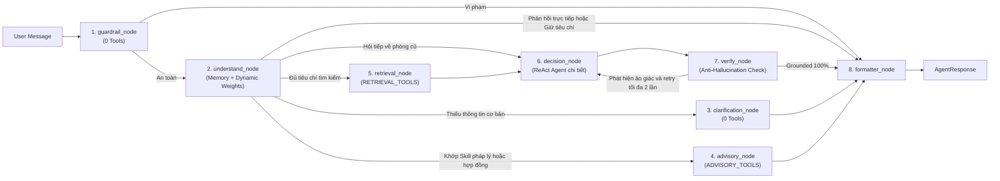

# 🤖 AI Agent Module — Smart Housing Decision Support (`ai-agent/`)

Module **AI Agent (`ai-agent/`)** đóng vai trò là bộ não tư vấn và hỗ trợ ra quyết định của hệ thống **Homigo**. Được xây dựng trên nền tảng **LangGraph 8-Node State Machine**, kết hợp mô hình **Intent-Aware Dynamic MCDM (Ra quyết định đa tiêu chí thích ứng theo ý định)**, **Multi-Turn Preference Memory**, **Dynamic Skill Discovery** và **Guardrails Security**.

---

## 🏗️ 1. Kiến Trúc Máy Trạng Thái 8-Node (`graph/builder.py` & `safety/grounding.py`)



### Điểm Nổi Bật Thiết Kế
1. **Self-RAG Grounding, DoD Verifier & Trace Cô Lập (`safety/` & `graph/tracing.py`)**:
   - **Tầng Retrieval (`verify_context_grounding`)**: Lọc cứng bằng code kiểm tra ràng buộc ngân sách, diện tích và tiện ích bắt buộc. Nếu không có phòng thỏa mãn, hệ thống tra cứu số liệu thị trường thực tế (giá sàn, giá trung bình) gắn vào `market_context` trong `HousingAgentState` để `decision_node` / `replies.py` đóng vai trò Cố vấn đối thoại tự nhiên (`ZeroResultAdvice`) và kích hoạt `is_market_gap` khi `user_max < market.min_price`.
   - **Tầng Generation (`verify_answer_grounding` / `verify_node`)**: Validation 3 tầng theo chi phí tăng dần (`schema_format` $\rightarrow$ `business_rule` $\rightarrow$ `external_cross_check`) đối chiếu mọi mã phòng (`nhatot_...`), khoảng cách và con số giá tiền với `retrieved_rooms`. Nếu phát hiện ảo giác sẽ quay lại `decision_node` để tự sửa sai (tối đa 2 lần).
   - **DoD Verifier độc lập (`safety/dod_verifier.py`) & `TraceStore` (`graph/tracing.py`)**: Mọi model call, tool call (kèm `state_before`/`state_after`) và quyết định verifier được ghi nối tiếp dạng JSONL theo `run_id`/`seq` độc lập ngoài State; `verify_dod` kiểm chứng trên bản chụp bất biến và buộc thực thi hành vi thoát xác định (`retry`, `ask_user`, `fallback_template`, `stop_and_report`) khi `passed = False`.
2. **Tool Partitioning (`tools/registry.py`)**: Phân vùng công cụ theo từng Node (`RETRIEVAL_TOOLS`, `DETAIL_TOOLS`, `ADVISORY_TOOLS`), giúp giảm thiểu token overhead và ngăn LLM gọi nhầm tool.
3. **Intent-Aware Dynamic Weighting (`intent_weights.py`)**:
   - Phát hiện ý định ưu tiên từ câu nói tự nhiên để kích hoạt hệ số nhân (`price: 2.0x`, `location: 2.0x`, `safety: 2.0x`, `amenity: 1.8x`).
   - Tự động bật/tắt tiêu chí động (`location` chỉ bật khi có tọa độ/địa điểm; `amenity` chỉ bật khi có yêu cầu tiện nghi) và chuẩn hóa $L_1$-norm ($\sum w_i = 1.0$).
4. **Multi-Turn Memory & State Management (`core/session_store.py`)**:
   - Tích lũy tiêu chí (`location_text`, `lat`, `lng`, `min_price`, `max_price`, `amenities`, `special_requirements`) xuyên suốt nhiều lượt hội thoại trong SQLite `sessions.db`.
   - Tự động reset tọa độ `lat`/`lng` khi người dùng chuyển sang khu vực mới để kích hoạt Geocoding lại chính xác.
5. **Dynamic Skill Discovery (`skills/skills_discovery.py`)**:
   - Tự động quét thư mục `ai-agent/skills/*/SKILL.md` (ví dụ: `rental-contract-advisor`) và định tuyến thẳng các câu hỏi về hợp đồng/tiền cọc sang `advisory_node` mà không tốn tài nguyên truy vấn phòng.
6. **Decision Insights & Trade-off Analysis (`intelligence/decision.py`)**:
   - Giải thích rõ vì sao phòng Top 1 đạt điểm cao nhất dựa trên `explain_match` từ Backend, phân tích đánh đổi (Trade-off) với Top 2 và sinh danh sách kiểm tra thực tế (`verification_checklist`).

---

## 📂 2. Cấu Trúc Thư Mục (Layered Architecture 6 Tầng)

```text
ai-agent/
├── api/                         # FastAPI Endpoints (/chat, /chat/stream SSE, /health, /session)
├── core/                        # Cấu hình Pydantic Settings, LLM Factory, Paths, SQLite SessionStore
├── domain/                      # Schemas chuẩn (AgentResponse, RoomItem, DecisionInsight), Enums, Budget
├── intelligence/                # Logic NLU, Intent Multipliers & L1 Dynamic MCDM, Trade-offs & Checklist
├── safety/                      # Guardrails, Self-RAG Grounding 3 tầng & DoD Verifier độc lập (dod_verifier.py)
├── graph/                       # LangGraph State Machine 8 Node & TraceStore JSONL (tracing.py)
│   ├── builder.py               # StateGraph construction & Conditional edges
│   ├── state.py                 # HousingAgentState TypedDict (kèm market_context, verifier_result)
│   ├── routing.py               # Dynamic Routing logic
│   ├── tracing.py               # TraceStore JSONL cô lập theo run_id/seq + che PII
│   └── nodes/                   # guardrail, understand, clarification, advisory, retrieval, decision, verify, formatter
├── tools/                       # Native LangChain Tools & Phân vùng Scopes (RETRIEVAL, DETAIL, ADVISORY)
├── skills/                      # Dynamic Skill Discovery qua YAML triggers (rental-contract-advisor)
├── eval/                        # Đánh giá Agent toàn diện (agent_eval_set.py, trajectory.py, stability_and_regression.py)
├── tests/                       # 575 Unit & Integration Tests (100% Passed)
├── main.py                      # Uvicorn entrypoint (Port 8001)
└── pyproject.toml / uv.lock     # Quản lý phụ thuộc uv
```

---

## 🚀 3. Hướng Dẫn Cài Đặt & Sử Dụng

### 3.1. Cài Đặt Môi Trường
```powershell
cd ai-agent
uv sync
```
Hoặc sử dụng môi trường ảo có sẵn tại `ai-agent/.venv`. Thiết lập file `ai-agent/.env`:
```env
OPENAI_API_KEY=your_api_key
MODEL_NAME=gpt-4o-mini
SEARCH_ROOM_API_BASE=http://localhost:8000/api/v1
```

### 3.2. Gọi `HousingAgentService` Trong Python
```python
from api.routes import HousingAgentService

service = HousingAgentService()
res = service.run(
    user_message="Tìm phòng trọ gần ĐH CNTT (UIT) dưới 3 triệu có máy lạnh, gác lửng",
    session_id="user_session_01",
)

print(res.text_reply)
print("Số phòng phù hợp:", len(res.rooms))
if res.insights:
    print("Lý do chọn Top 1:", res.insights.top_1_reason)
```

---

## 🧪 4. Chạy Kiểm Thử (Unit Tests)

Chạy toàn bộ 575 unit & integration tests của Homigo AI Agent (100% Passed):
```powershell
.\ai-agent\.venv\Scripts\pytest.exe ai-agent/tests -q
```
