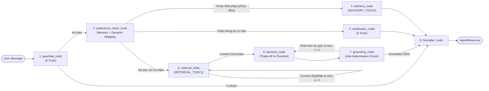

# 🤖 AI Agent Module — Smart Housing Decision Support (`ai-agent/`)

Module **AI Agent (`ai-agent/`)** đóng vai trò là bộ não tư vấn và hỗ trợ ra quyết định của hệ thống **Homigo**. Được xây dựng trên nền tảng **LangGraph 7-Node State Machine**, kết hợp mô hình **Intent-Aware Dynamic MCDM (Ra quyết định đa tiêu chí thích ứng theo ý định)**, **Multi-Turn Preference Memory**, **Dynamic Skill Discovery** và **Guardrails Security**.

---

## 🏗️ 1. Kiến Trúc Máy Trạng Thái 8-Node (`graph.py` & `grounding.py`)



### Điểm Nổi Bật Thiết Kế
1. **Corrective RAG & Self-RAG Grounding (`grounding.py`)**:
   - **Tầng Retrieval (`verify_context_grounding`)**: Nếu không tìm thấy phòng hoặc `matchScore` quá thấp do bộ lọc cứng quá chặt, hệ thống tự động kích hoạt **Corrective Retry** (Lần 1: nới biên độ ngân sách $\pm 15\%$; Lần 2: mở rộng tìm kiếm ngữ nghĩa kết hợp chấm điểm mềm MCDM).
   - **Tầng Generation (`verify_answer_grounding` / `grounding_node`)**: Đối chiếu mọi mã phòng (`nhatot_...`) và con số giá tiền trong câu trả lời với `retrieved_rooms`. Chỉ khi `is_grounded = True` mới chuyển qua `formatter_node`; nếu phát hiện ảo giác sẽ tự động quay lại `decision_node` để tái tạo câu trả lời chuẩn xác.
2. **Tool Partitioning (`tools/registry.py`)**: Phân vùng công cụ theo từng Node (`RETRIEVAL_TOOLS`, `DETAIL_TOOLS`, `ADVISORY_TOOLS`), giúp giảm thiểu token overhead và ngăn LLM gọi nhầm tool.
2. **Intent-Aware Dynamic Weighting (`intent_weights.py`)**:
   - Phát hiện ý định ưu tiên từ câu nói tự nhiên để kích hoạt hệ số nhân (`price: 2.0x`, `location: 2.0x`, `safety: 2.0x`, `amenity: 1.8x`).
   - Tự động bật/tắt tiêu chí động (`location` chỉ bật khi có tọa độ/địa điểm; `amenity` chỉ bật khi có yêu cầu tiện nghi) và chuẩn hóa $L_1$-norm ($\sum w_i = 1.0$).
3. **Multi-Turn Memory & State Management (`memory.py`)**:
   - Tích lũy tiêu chí (`location_text`, `lat`, `lng`, `min_price`, `max_price`, `amenities`, `special_requirements`) xuyên suốt nhiều lượt hội thoại.
   - Tự động reset tọa độ `lat`/`lng` khi người dùng chuyển sang khu vực mới để kích hoạt Geocoding lại chính xác.
4. **Dynamic Skill Discovery (`skills_discovery.py`)**:
   - Tự động quét thư mục `workspace/skills/*/SKILL.md` (ví dụ: `rental-contract-advisor`) và định tuyến thẳng các câu hỏi về hợp đồng/tiền cọc sang `advisory_node` mà không tốn tài nguyên truy vấn phòng.
5. **Decision Insights & Trade-off Analysis (`schemas.py`, `graph.py`)**:
   - Giải thích rõ vì sao phòng Top 1 đạt điểm cao nhất dựa trên `explain_match` từ Backend, phân tích đánh đổi (Trade-off) với Top 2 và sinh danh sách kiểm tra thực tế (`verification_checklist`).

---

## 📂 2. Cấu Trúc Thư Mục (Layered Architecture 6 Tầng)

```text
ai-agent/
├── api/                         # FastAPI Endpoints (/chat, /chat/stream SSE, /health, /session)
├── core/                        # Cấu hình Pydantic Settings, LLM Factory, Paths, SQLite SessionStore
├── domain/                      # Schemas chuẩn (AgentResponse, RoomItem, DecisionInsight), Enums, Budget
├── intelligence/                # Logic NLU, Intent Multipliers & L1 Dynamic MCDM, Trade-offs & Checklist
├── safety/                      # Guardrails (Prompt Injection, Homoglyph/ZWSP) & Self-RAG Grounding Check
├── graph/                       # LangGraph State Machine 8 Node
│   ├── builder.py               # StateGraph construction & Conditional edges
│   ├── state.py                 # HousingAgentState TypedDict
│   ├── routing.py               # Dynamic Routing logic
│   └── nodes/                   # guardrail, understand, clarification, advisory, retrieval, decision, verify, formatter
├── tools/                       # Native LangChain Tools & Phân vùng Scopes (RETRIEVAL, DETAIL, ADVISORY)
├── skills/                      # Dynamic Skill Discovery qua YAML triggers (rental-contract-advisor)
├── eval/                        # Bộ benchmark đánh giá định lượng 5 trụ cột (NLU, Retrieval, Grounding...)
├── tests/                       # 488 Unit & Integration Tests (100% Passed)
├── main.py                      # Uvicorn entrypoint (Port 8001)
├── service.py                   # HousingAgentService shim tương thích ngược
├── pyproject.toml / uv.lock     # Quản lý phụ thuộc uv
└── requirements.txt
```

---

## 🚀 3. Hướng Dẫn Cài Đặt & Sử Dụng

### 3.1. Cài Đặt Môi Trường
```powershell
cd ai-agent
uv sync
```
Hoặc sử dụng môi trường ảo có sẵn tại `ai-agent/.venv`. Thiết lập file `ai-agent/.env`:
```env
OPENAI_API_KEY=your_api_key
MODEL_NAME=gpt-4o-mini
SEARCH_ROOM_API_BASE=http://localhost:8000/api/v1
```

### 3.2. Gọi `HousingAgentService` Trong Python
```python
from service import HousingAgentService

service = HousingAgentService()
res = service.run(
    user_message="Tìm phòng trọ gần ĐH CNTT (UIT) dưới 3 triệu có máy lạnh, gác lửng",
    session_id="user_session_01",
)

print(res.text_reply)
print("Số phòng phù hợp:", len(res.rooms))
if res.insights:
    print("Lý do chọn Top 1:", res.insights.top_1_reason)
```

---

## 🧪 4. Chạy Kiểm Thử (Unit Tests)

Chạy toàn bộ 488 unit & integration tests của Homigo AI Agent (100% Passed):
```powershell
.\ai-agent\.venv\Scripts\pytest.exe ai-agent/tests -q
```
