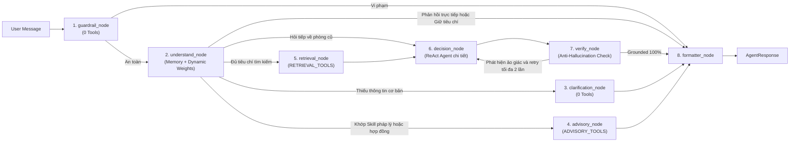

# 🤖 AI Agent Module — Smart Housing Decision Support (`ai-agent/`)

Module **AI Agent (`ai-agent/`)** đóng vai trò là bộ não tư vấn và hỗ trợ ra quyết định của hệ thống **Homigo**. Được xây dựng trên nền tảng **LangGraph 8-Node State Machine**, kết hợp mô hình **Intent-Aware Dynamic MCDM (Ra quyết định đa tiêu chí thích ứng theo ý định)**, **Multi-Turn Preference Memory**, **Dynamic Skill Discovery** và **Guardrails Security**.

---

## 🏗️ 1. Kiến Trúc Máy Trạng Thái 8-Node (`graph/builder.py` & `safety/grounding.py`)



### Điểm Nổi Bật Thiết Kế
1. **Self-RAG Grounding, DoD Verifier & Trace Cô Lập (`safety/` & `graph/tracing.py`)**:
   - **Tầng Retrieval (`verify_context_grounding` & `retrieval_node`)**: Lọc cứng bằng code kiểm tra ràng buộc ngân sách, diện tích và tiện ích bắt buộc (không tự ý nới lỏng tiêu chí lọc khi kết quả rỗng). Nếu có phòng bị loại ở bước hậu kiểm, `retrieval_node` tóm tắt tối đa 5 ứng viên kèm lý do loại vào `dropped_summary`, đồng thời tra cứu số liệu thị trường thực tế (giá sàn, giá trung bình) vào `market_context`.
   - **Tầng Generation & Free-form Decision (`decision_node` & `verify_node`)**: Mặc định `HOMIGO_CONSTRAINED_GENERATION=false` (trong `default_deps()`), cho phép ReAct `decision_agent` (`DETAIL_TOOLS`) tự do soạn câu trả lời Markdown linh hoạt cho cả lượt tìm mới và lượt hỏi tiếp; ở nhánh `0` phòng, LLM nhận đầy đủ `UserPreferenceState`, bán kính quét (`radius_km`), `dropped_summary`, `market_context` và khu vực lân cận (`neighbor_bullets`) để tự phân tích nguyên nhân và gợi ý hướng điều chỉnh (ghi bằng chứng vào `tool_evidence`; giữ `reply_when_no_rooms` làm fallback xác định và `ZeroResultAdvice` khi bật chế độ constrained). Validation 3 tầng (`schema_format` $\rightarrow$ `business_rule` $\rightarrow$ `external_cross_check`) đối chiếu mọi mã phòng, khoảng cách và giá tiền; nếu phát hiện ảo giác sẽ quay lại `decision_node` để tự sửa sai (tối đa 2 lần).
   - **DoD Verifier độc lập (`safety/dod_verifier.py`) & `TraceStore` (`graph/tracing.py`)**: Mọi model call, tool call (kèm `state_before`/`state_after`) và quyết định verifier được ghi nối tiếp dạng JSONL theo `run_id`/`seq` độc lập ngoài State; `verify_dod` kiểm chứng trên bản chụp bất biến và buộc thực thi hành vi thoát xác định (`retry`, `ask_user`, `fallback_template`, `stop_and_report`) khi `passed = False`.
2. **Tool Partitioning (`tools/registry.py`)**: Phân vùng công cụ theo từng Node (`RETRIEVAL_TOOLS`, `DETAIL_TOOLS`, `ADVISORY_TOOLS`), giúp giảm thiểu token overhead và ngăn LLM gọi nhầm tool.
3. **NLU Contextual Priorities & L1 Dynamic Weighting (`intelligence/nlu.py`, `intent_weights.py`)**:
   - NLU LLM tự suy luận mức độ ưu tiên theo ngữ cảnh (`Priorities`: `lower: 0.5x`, `normal: 1.0x`, `high: 2.0x`, `very_high: 3.0x` qua `LEVEL_TO_MULT`) kèm `priority_reasons`, không ép cứng hệ số bằng từ khóa tăng/giảm ngân sách dễ hiểu nhầm ngữ cảnh (như *"mắc hơn"*).
   - Tự động bật/tắt tiêu chí động (`location` chỉ bật khi có tọa độ/địa điểm; `amenity` chỉ bật khi có yêu cầu tiện nghi) và chuẩn hóa $L_1$-norm ($\sum w_i = 1.0$).
4. **Multi-Turn Memory & State Management (`core/session_store.py`)**:
   - Tích lũy tiêu chí (`location_text`, `lat`, `lng`, `min_price`, `max_price`, `amenities`, `special_requirements`) xuyên suốt nhiều lượt hội thoại trong SQLite `sessions.db`.
   - Tự động reset tọa độ `lat`/`lng` khi người dùng chuyển sang khu vực mới để kích hoạt Geocoding lại chính xác.
5. **Dynamic Skill Discovery (`skills/skills_discovery.py`)**:
   - Tự động quét thư mục `ai-agent/skills/*/SKILL.md` (ví dụ: `rental-contract-advisor`) và định tuyến thẳng các câu hỏi về hợp đồng/tiền cọc sang `advisory_node` mà không tốn tài nguyên truy vấn phòng.
6. **Decision Insights & Trade-off Analysis (`intelligence/decision.py`)**:
   - Giải thích rõ vì sao phòng Top 1 đạt điểm cao nhất dựa trên `explain_match` từ Backend, phân tích đánh đổi (Trade-off) với Top 2 và sinh danh sách kiểm tra thực tế (`verification_checklist`).

---

## 📂 2. Cấu Trúc Thư Mục (Layered Architecture 6 Tầng)

```text
ai-agent/
├── api/                         # FastAPI Endpoints (/chat, /chat/stream SSE, /health, /session)
├── core/                        # Cấu hình Pydantic Settings, LLM Factory, Paths, SQLite SessionStore
├── domain/                      # Schemas chuẩn (AgentResponse, RoomItem, DecisionInsight), Enums, Budget
├── intelligence/                # NLU, Intent Multipliers & L1 Dynamic MCDM, Trade-offs, Insights & Advice
├── prompts/                     # System Prompts tách biệt (nlu_prompt.py, decision_prompt.py, advisory_prompt.py)
├── safety/                      # Guardrails, Self-RAG Grounding 3 tầng & DoD Verifier độc lập (dod_verifier.py)
├── graph/                       # LangGraph State Machine 8 Node & TraceStore JSONL (tracing.py)
│   ├── builder.py               # StateGraph construction & Conditional edges
│   ├── state.py                 # HousingAgentState TypedDict (kèm dropped_summary, market_context, verifier_result)
│   ├── routing.py               # Dynamic Routing logic
│   ├── tracing.py               # TraceStore JSONL cô lập theo run_id/seq + che PII
│   └── nodes/                   # guardrail, understand, clarification, advisory, retrieval, decision, verify, formatter
├── tools/                       # Native LangChain Tools & Phân vùng Scopes (RETRIEVAL, DETAIL, ADVISORY)
├── skills/                      # Dynamic Skill Discovery qua YAML triggers (rental-contract-advisor)
├── eval/                        # Bộ đánh giá (run.py, thesis_eval_rubric.py, stability_and_regression.py, answer_relevance.py, stats_analyzer.py)
├── eval_results/                # Báo cáo & JSON kết quả đánh giá (report.md, thesis_evaluation_report.md, ...)
├── utils/                       # Tiện ích text, geo & đóng băng bất biến (freeze.py)
├── tests/                       # 585 Unit & Integration Tests (100% Passed)
├── main.py                      # Uvicorn entrypoint (Port 8001)
└── pyproject.toml / uv.lock     # Quản lý phụ thuộc uv
```

---

## 🚀 3. Hướng Dẫn Cài Đặt & Sử Dụng

### 3.1. Cài Đặt Môi Trường
```powershell
cd ai-agent
uv sync
```
Hoặc sử dụng môi trường ảo có sẵn tại `ai-agent/.venv`. Thiết lập file `ai-agent/.env`:
```env
OPENAI_API_KEY=your_api_key
MODEL_NAME=gpt-4o-mini
SEARCH_ROOM_API_BASE=http://localhost:8000/api/v1
# Tùy chọn: đặt true để ép output theo JSON schema (Advice/ZeroResultAdvice), mặc định false để Agent viết phản hồi Markdown tự do
HOMIGO_CONSTRAINED_GENERATION=false
```

### 3.2. Gọi `HousingAgentService` Trong Python
```python
from api.routes import HousingAgentService

service = HousingAgentService()
res = service.run(
    user_message="Tìm phòng trọ gần ĐH CNTT (UIT) dưới 3 triệu có máy lạnh, gác lửng",
    session_id="user_session_01",
)

print(res.text_reply)
print("Số phòng phù hợp:", len(res.rooms))
if res.insights:
    print("Lý do chọn Top 1:", res.insights.top_1_reason)
```

---

## 🧪 4. Chạy Kiểm Thử & Đánh Giá (Unit Tests & Evaluation)

Chạy toàn bộ 585 unit & integration tests của Homigo AI Agent (100% Passed):
```powershell
.\ai-agent\.venv\Scripts\pytest.exe ai-agent/tests -q
```

Chạy các bộ đánh giá định lượng (Evaluation Suites):
```powershell
# 1. Chạy bộ đánh giá toàn diện (Guardrail 137 ca + Grounding 600 ca + Agent Eval pass^3 + Ablation E2E)
# Lưu ý: suite `ablation` gọi LLM + Backend API thực (bật Backend port 8000 trước; --pacing 4.5 cho Gemini Free Tier 15 RPM)
cd ai-agent; .\.venv\Scripts\python.exe -m eval.run guardrail grounding agent_eval ablation --pacing 4.5 --out eval_results

# (Hoặc chạy offline không cần Backend/LLM E2E):
.\.venv\Scripts\python.exe -m eval.run guardrail grounding agent_eval --out eval_results

# 2. Chạy thang điểm 5 trụ cột (offline deterministic; thêm --with-model để chấm NLU bằng LLM)
.\.venv\Scripts\python.exe -m eval.thesis_eval_rubric --with-model
```

Kết quả đo đạc mới nhất được xuất ra [`eval_results/report.md`](eval_results/report.md) và tổng hợp chung tại [`docs/evaluation/reports/2026-11-evaluation-summary.md`](../docs/evaluation/reports/2026-11-evaluation-summary.md) (điểm nổi bật: `E_full` đạt `100.0% (39/39)` checks, `0.0% (0/12)` lỗi tới tay người dùng và `0.0% (0/12)` fallback câu mẫu; `pass^3 = 100.0% (15/15)`).
