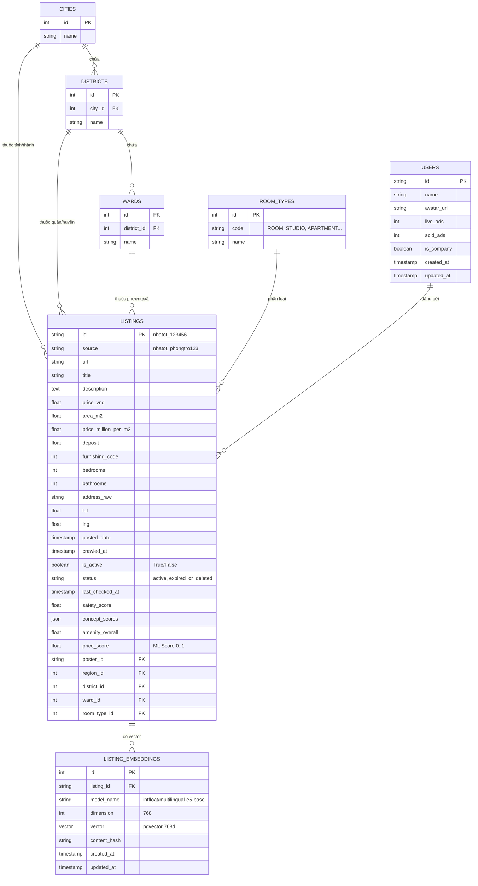

# 🗄️ Mô Hình Dữ Liệu (Data Models & Database Schema)

Tài liệu này mô tả chi tiết sơ đồ cơ sở dữ liệu quan hệ, các bảng PostgreSQL, bảng SQLite Staging DB và danh mục tiện ích chuẩn hóa của Homigo.

---

## 1. 📊 Sơ Đồ Quan Hệ Thực Thể (ERD - Entity Relationship Diagram)



---

## 2. 🗃 Chi Tiết Các Bảng PostgreSQL (Production Database)

### 2.1. Bảng `listings` (Bài Đăng Phòng Trọ)
Là bảng lưu trữ trung tâm của toàn bộ hệ thống:

| Cột | Kiểu Dữ Liệu | Ràng Buộc | Ý Nghĩa / Ghi Chú |
| :--- | :--- | :--- | :--- |
| `id` | `VARCHAR` | `PRIMARY KEY` | Khóa chính dạng `{source}_{original_id}` (ví dụ: `nhatot_135387045`). |
| `source` | `VARCHAR` | `DEFAULT 'nhatot'` | Nguồn cào dữ liệu (`nhatot`, `phongtro123`). |
| `url` | `VARCHAR` | `NULLABLE` | Đường link dẫn đến tin gốc. |
| `title` | `VARCHAR` | `NOT NULL` | Tiêu đề bài đăng phòng trọ. |
| `description` | `TEXT` | `NULLABLE` | Mô tả chi tiết của bài đăng đã qua làm sạch. |
| `price_vnd` | `FLOAT` | `INDEX` | Giá thuê tính theo VNĐ (ví dụ: `4500000.0`). |
| `area_m2` | `FLOAT` | `INDEX` | Diện tích phòng ($m^2$). |
| `price_million_per_m2`| `FLOAT` | `NULLABLE` | Đơn giá triệu/m2 (tính toán tự động). |
| `deposit` | `FLOAT` | `NULLABLE` | Tiền cọc (VNĐ). |
| `furnishing_code` | `INTEGER` | `NULLABLE` | Mã tình trạng nội thất (`0`: Trống, `1`: Cơ bản, `2`: Đầy đủ). |
| `bedrooms` | `INTEGER` | `INDEX, NULLABLE` | Số phòng ngủ (`> 0`, lấy từ raw parser hoặc LLM `numeric`). |
| `bathrooms` | `INTEGER` | `NULLABLE` | Số phòng vệ sinh (`> 0`, lấy từ raw parser hoặc LLM `numeric`). |
| `address_raw` | `VARCHAR` | `NULLABLE` | Địa chỉ thô người cho thuê nhập vào. |
| `lat` / `lng` | `FLOAT` | `NULLABLE` | Tọa độ địa lý (Vĩ độ / Kinh độ). |
| `posted_date` | `TIMESTAMP` | `NULLABLE` | Ngày người dùng đăng bài trên web gốc. |
| `crawled_at` | `TIMESTAMP` | `NULLABLE` | Thời điểm bot cào tin này về hệ thống. |
| `is_active` | `BOOLEAN` | `NOT NULL, DEFAULT TRUE, INDEX` | Cờ trạng thái: `True` = còn cho thuê, `False` = đã hết hạn/gỡ. |
| `status` | `VARCHAR(50)`| `NOT NULL, DEFAULT 'active'` | Trạng thái: `active`, `expired_or_deleted`. |
| `last_checked_at` | `TIMESTAMP` | `NULLABLE` | Thời điểm spider verify kiểm tra lần cuối. |
| `safety_score` | `FLOAT` | `NULLABLE` | Điểm an ninh tính từ camera, bảo vệ, vân tay (0.0 - 1.0). |
| `concept_scores` | `JSON` | `NULLABLE` | Object chứa điểm xác thực từng tiện ích (0.0 - 1.0). |
| `amenity_overall`| `FLOAT` | `NULLABLE` | Điểm tiện nghi tổng thể tích lũy theo trọng số (0.0 - 1.0). |
| `price_score` | `FLOAT` | `NULLABLE` | Điểm thẩm định giá từ mô hình Machine Learning (0.0 - 1.0). |
| `poster_id` | `VARCHAR` | `FK -> users.id, INDEX` | ID người đăng tin. |
| `region_id` | `INTEGER` | `FK -> cities.id, INDEX`| ID Tỉnh / Thành phố. |
| `district_id` | `INTEGER` | `FK -> districts.id, INDEX`| ID Quận / Huyện. |
| `ward_id` | `INTEGER` | `FK -> wards.id, INDEX`| ID Phường / Xã. |
| `room_type_id` | `INTEGER` | `FK -> room_types.id, INDEX`| ID loại hình phòng trọ. |

### 2.2. Bảng `listing_embeddings` (Vector Không Gian Ngữ Nghĩa)
Lưu trữ vector ngữ nghĩa phục vụ Dense Retrieval trong Hybrid Search:

| Cột | Kiểu Dữ Liệu | Ràng Buộc | Ý Nghĩa / Ghi Chú |
| :--- | :--- | :--- | :--- |
| `id` | `INTEGER` | `PRIMARY KEY, AUTOINCREMENT` | Khóa chính tự tăng. |
| `listing_id` | `VARCHAR(150)` | `FK -> listings.id, ON DELETE CASCADE, INDEX` | ID bài đăng tương ứng. |
| `model_name` | `VARCHAR(150)` | `NOT NULL, INDEX` | Tên model: `intfloat/multilingual-e5-base`. |
| `dimension` | `INTEGER` | `NOT NULL` | Số chiều vector: `768`. |
| `vector` | `VECTOR(768)` | `NOT NULL` | Vector kiểu pgvector hỗ trợ phép tính cosine distance `<=>`. |
| `content_hash`| `VARCHAR(64)` | `NULLABLE, INDEX` | Hash SHA-256 để phát hiện thay đổi nội dung cần re-embed. |
| `created_at` / `updated_at` | `TIMESTAMP` | `NOT NULL` | Thời gian khởi tạo / cập nhật vector. |

### 2.3. Các Chỉ Mục Tối Ưu Truy Vấn & Hybrid Search (PostgreSQL Indexes)
Để đảm bảo hiệu năng cao cho Hybrid Search 70/30 và bộ lọc đa chiều trên tập dữ liệu hàng chục nghìn bài đăng, PostgreSQL được cấu hình các chỉ mục chuyên dụng:

| Tên Chỉ Mục | Bảng | Kiểu Index | Cột / Biểu Thức Index | Mục Đích Tối Ưu Hóa |
| :--- | :--- | :--- | :--- | :--- |
| `idx_listing_embeddings_vector_hnsw` | `listing_embeddings` | **HNSW** (`vector_cosine_ops`, $m=16, ef=64$) | `vector` (`VECTOR(768)`) | Tối ưu hóa cực đại tốc độ Dense Vector Search bằng khoảng cách Cosine `<=>`. |
| `idx_listings_fts_full` | `listings` | **GIN** | `to_tsvector('simple', coalesce(title, '') \|\| ' ' \|\| coalesce(address_raw, '') \|\| ' ' \|\| coalesce(description, ''))` | Tối ưu hóa tốc độ Sparse Full-Text Search đa trường với toán tử immutable `\|\|`. |
| `idx_listings_is_active` | `listings` | **B-tree** | `is_active` | Lọc nhanh các bài đăng còn hiệu lực (`is_active = TRUE`). |
| `idx_listings_active_composite` | `listings` | **B-tree** (Partial) | `(region_id, district_id, room_type_id) WHERE is_active = TRUE` | Tăng tốc truy vấn kết hợp vùng địa lý và loại phòng khi lọc. |

> *Ghi chú: File migration khởi tạo và kiểm tra các chỉ mục trên được quản lý tập trung tại [`backend/migrations/001_add_hnsw_and_gin_indexes.sql`](file:///c:/UIT/Lab/Đồ%20Án%20tốt%20nghiệp/backend/migrations/001_add_hnsw_and_gin_indexes.sql) và thực thi qua [`backend/migrations/run_migration.py`](file:///c:/UIT/Lab/Đồ%20Án%20tốt%20nghiệp/backend/migrations/run_migration.py).*

---

## 3. 💾 Cấu Trúc Bảng SQLite Staging DB (`crawler/data/staging.db`)

Dùng làm vùng đệm cho Crawler trước khi ETL:

```sql
CREATE TABLE raw_listings (
    listing_id TEXT PRIMARY KEY,
    source TEXT NOT NULL,
    payload_json TEXT NOT NULL,
    crawled_at TIMESTAMP DEFAULT CURRENT_TIMESTAMP,
    is_processed INTEGER DEFAULT 0
);

CREATE INDEX idx_raw_unprocessed ON raw_listings(is_processed, source);
CREATE INDEX idx_raw_source ON raw_listings(source);
```

* `is_processed = 0`: Bài đăng mới cào hoặc vừa cập nhật qua verify, chưa được nạp sang PostgreSQL.
* `is_processed = 1`: Đã nạp thành công qua luồng ETL.

---

## 4. 🏷️ Danh Mục Tiện Ích Chuẩn Hóa (Canonical Taxonomy)

Hệ thống quy chuẩn 17 trường tiện ích & an ninh dạng `snake_case` khớp 1-1 giữa Schema LLM, Database, Backend DTO và Frontend UI:

### 4.1. Tiện ích cốt lõi (Core Amenities)
1. `private_wc`: Vệ sinh riêng, khép kín.
2. `aircon`: Máy lạnh, điều hòa.
3. `mezzanine`: Gác lửng, gác xép.
4. `kitchen`: Kệ bếp, khu nấu ăn riêng.
5. `fridge`: Tủ lạnh.
6. `washing_machine`: Máy giặt (riêng hoặc chung).
7. `window_balcony`: Cửa sổ hoặc ban công thoáng gió.
8. `furniture`: Nội thất đầy đủ (giường, tủ, bàn ghế).
9. `parking`: Chỗ để xe trong nhà, hầm xe.
10. `elevator`: Thang máy.

### 4.2. Quy định & Lối sống (Rules & Lifestyle)
11. `free_hours`: Giờ giấc tự do, không chung cổng giờ giới nghiêm.
12. `no_shared_landlord`: Không chung chủ.
13. `pet_allowed`: Cho phép nuôi thú cưng (chó, mèo).

### 4.3. An toàn & An ninh (Safety)
14. `fingerprint_lock`: Khóa cổng vân tay, thẻ từ thông minh.
15. `camera`: Camera giám sát an ninh 24/7.
16. `guard`: Bảo vệ trực cổng 24/7.
17. `safe_area`: Khu vực an ninh, trật tự tốt.

---

## 5. 🤝 Khế Ước Dữ Liệu & Schemas (API Data Contracts & DTOs)

### 5.1. `POST /api/v1/listings/vector-search` Request Body (`VectorSearchBody`):
Schema Pydantic đại diện payload truy vấn Hybrid Search từ AI Agent sang Backend:
```python
class VectorSearchBody(BaseModel):
    query: Optional[str] = None                     # Câu truy vấn ngữ nghĩa
    lat: Optional[float] = None                      # Vĩ độ điểm mốc tìm kiếm
    lng: Optional[float] = None                      # Kinh độ điểm mốc tìm kiếm
    min_price: Optional[float] = None                # Giá tối thiểu (VNĐ)
    max_price: Optional[float] = None                # Giá trần tối đa (VNĐ)
    min_area: Optional[float] = None                 # Diện tích tối thiểu (m2)
    max_area: Optional[float] = None                 # Diện tích tối đa (m2)
    min_bedrooms: Optional[int] = None               # Số phòng ngủ tối thiểu
    min_bathrooms: Optional[int] = None              # Số phòng vệ sinh tối thiểu
    amenities: Optional[list[str]] = None            # Tiện ích bắt buộc lọc cứng (AND)
    city_id: Optional[int] = None                    # ID Tỉnh/Thành phố
    district_id: Optional[int] = None                # ID Quận/Huyện
    ward_id: Optional[int] = None                    # ID Phường/Xã
    room_type: Optional[str | int | list[str | int]] = None # 1 loại hoặc danh sách nhiều loại phòng được phép (IN)
    excluded_room_types: Optional[list[str | int]] = None   # Loại phòng loại trừ (NOT IN)
    preferred_amenities: Optional[list[str]] = None  # Tiện ích ưu tiên mềm để Reranker chấm điểm
    max_distance_km: Optional[float] = None          # Bán kính lọc Haversine chính xác (km)
    limit: int = 10                                  # Số lượng kết quả cần lấy
    alpha: float = 0.7                               # Tỷ trọng Hybrid Search (Dense / Sparse)
    weights: Optional[dict[str, float]] = None       # Trọng số động MCDM 5 tiêu chí
    explain: bool = False                            # Bật giải thích phân rã điểm số Reranking
```

### 5.2. AI Agent Core Schemas (`UserPreferenceState` & `RoomItem`):
Các đối tượng trạng thái cốt lõi trao đổi giữa LangGraph State Machine, Backend và Frontend Next.js:

* **`UserPreferenceState` (Trạng thái tiêu chí người dùng tích lũy qua các lượt chat):**
  - `min_bedrooms: Optional[int]`: Số phòng ngủ tối thiểu người dùng yêu cầu rõ ràng (dùng cho tìm nhà nhiều phòng / ở ghép nhiều người).
  - `allowed_room_types: list[RoomType]`: Danh sách các loại phòng người dùng cho phép (1 hoặc nhiều loại, ví dụ `['STUDIO']` hoặc `['ROOM', 'STUDIO']`). Chuẩn hóa tự động qua `normalize_room_types`.
  - `excluded_room_types: list[RoomType]`: Danh sách loại phòng bị loại trừ (ví dụ cấm `SLEEPBOX`).
* **`RoomItem` (Thực thể phòng trọ chuẩn hóa trả về cho Frontend UI):**
  - `bedrooms: Optional[int]` / `bathrooms: Optional[int]`: Số phòng ngủ / phòng vệ sinh trích xuất từ Backend (bỏ qua nếu thiếu).
  - `@computed_field @property def room_type_id(self) -> Optional[int]`: Tự động suy ra mã ID loại phòng phục vụ render Badge / Icon trực tiếp trên Next.js.
  - `concept_scores: dict[str, float]`: Điểm số xác thực cho đủ 17 nhãn tiện ích chuẩn hóa.
  - `tags: list[str]`: Danh sách nhãn hiển thị trực quan tiếng Việt sinh động từ `_CONCEPT_TAGS`.

### 5.3. Bảng Ánh Xạ Nhãn Tiện Ích Chuẩn Hóa (`_CONCEPT_TAGS` - 17 Nhãn):
Bảng quy đổi 17 nhãn tiếng Việt chuẩn mực giữa mã kỹ thuật `snake_case` và văn bản hiển thị:

| Mã Tiện Ích (`amenity_key`) | Nhãn Tiếng Việt Chuẩn Hóa (`_CONCEPT_TAGS`) | Nhóm Phân Loại |
| :--- | :--- | :--- |
| `private_wc` | WC riêng | Tiện ích cốt lõi |
| `aircon` | Có máy lạnh | Tiện ích cốt lõi |
| `mezzanine` | Có gác lửng | Tiện ích cốt lõi |
| `kitchen` | Khu bếp | Tiện ích cốt lõi |
| `fridge` | Tủ lạnh | Tiện ích cốt lõi |
| `window_balcony` | Cửa sổ/ban công | Tiện ích cốt lõi |
| `furniture` | Nội thất | Tiện ích cốt lõi |
| `parking` | Chỗ để xe | Tiện ích cốt lõi |
| `elevator` | Thang máy | Tiện ích cốt lõi |
| `washing_machine` | Có máy giặt | Tiện ích cốt lõi |
| `free_hours` | Giờ tự do | Quy định & Lối sống |
| `no_shared_landlord` | Không chung chủ | Quy định & Lối sống |
| `pet_allowed` | Cho nuôi thú cưng | Quy định & Lối sống |
| `fingerprint_lock` | Khóa vân tay | An toàn & An ninh |
| `camera` | Camera an ninh | An toàn & An ninh |
| `guard` | Bảo vệ 24/7 | An toàn & An ninh |
| `safe_area` | Khu an ninh | An toàn & An ninh |

### 5.4. `GET /api/v1/listings/{id}` Response DTO:
```json
{
  "success": true,
  "status": 200,
  "data": {
    "id": "nhatot_135387045",
    "title": "Phòng trọ cao cấp có ban công",
    "price_vnd": 4200000.0,
    "area_m2": 30.0,
    "bedrooms": 2,
    "bathrooms": 1,
    "address_raw": "Đường Nguyễn Duy Trinh, Phường Long Trường, TP Thủ Đức",
    "lat": 10.802091,
    "lng": 106.812294,
    "is_active": false,
    "status": "expired_or_deleted",
    "last_checked_at": "2026-11-05T03:07:59Z",
    "is_expired": true,
    "status_notice": "Bài đăng này đã hết hạn hoặc được người cho thuê gỡ bài trên nguồn gốc.",
    "price_score": 0.373,
    "safety_score": 0.7,
    "concept_scores": {
      "private_wc": 1.0,
      "aircon": 1.0,
      "kitchen": 1.0
    }
  }
}
```

