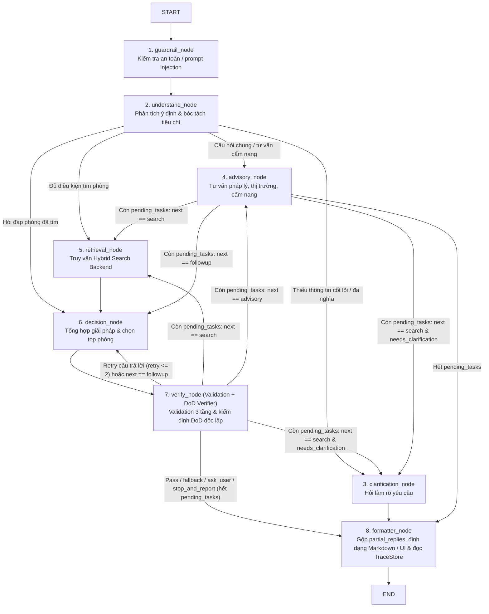

# 🤖 LangGraph Agent & An Toàn Chống Ảo Giác (AI Agent Graph Module)

Tài liệu này đặc tả chi tiết kiến trúc của phân hệ **AI Agent State Machine & Safety Guard** (`ai-agent/`).

---

## 1. LangGraph State Machine 8 Nodes

Đồ thị trạng thái hữu hạn điều phối luồng tư vấn và tìm kiếm:

### Thực Thi Tuần Tự Đa Mệnh Lệnh (Multi-Intent Plan & Execute):
* Khi `understand_node` phát hiện nhiều tác vụ độc lập (`followup`, `search`, `advisory`) trong cùng một câu, `TurnPlan` lập hàng đợi thông qua `current_task`, `pending_tasks` và `partial_replies` trong `HousingAgentState`, sắp xếp **theo đúng thứ tự xuất hiện của từng mệnh đề trong câu người dùng** (hỗ trợ mọi hoán vị kể cả `advisory -> search`, `advisory -> followup`, `search -> advisory -> followup`, v.v.):
  * Nếu `followup` đứng trước `search` (hoặc không có `search`), `understand_node` nạp sẵn `session.last_rooms` để `decision_node` đọc đúng phòng của lượt trước.
  * Nếu `search` đứng trước `followup`, `retrieval_node` tìm phòng mới trước và `verify_node` (hoặc `advisory_node` nằm giữa) giữ nguyên `retrieved_rooms` vừa truy xuất để `decision_node` kiểm tra đúng phòng Top $k$ mới (tự động bỏ qua `followup` nếu tìm được 0 phòng).
* Cả `verify_node` và `advisory_node` đều rẽ nhánh qua `_route_pending_task` trong `routing.py`: lưu kết quả bước hiện tại vào `partial_replies` và chuyển tiếp sang bước kế tiếp trong `pending_tasks`, giữ nguyên Tool Partitioning nghiêm ngặt.
* `formatter_node` ghép toàn bộ `partial_replies` + kết quả bước cuối thành một `AgentResponse` duy nhất trả về trong cùng lượt chat theo đúng thứ tự người dùng đã hỏi.

### Nguyên Tắc Phân Vùng Công Cụ (Tool Partitioning):
* `retrieval_node`: Chỉ được cấp `RETRIEVAL_TOOLS` (`search_listings_hybrid`, `get_nearby_locations`).
* `decision_node`: Chỉ được cấp `DETAIL_TOOLS` (`get_listing_detail`).
* `advisory_node`: Chỉ được cấp `ADVISORY_TOOLS` (`list_housing_skills`, `consult_housing_skill`, `get_market_price_stats`); hỗ trợ cả cẩm nang hợp đồng (`rental-contract-advisor`) và tra cứu thống kê giá thị trường thực tế theo khu vực (`market-price-advisor`) qua `skill_context` cô lập (không ghi đè `session.preferences`).
* `formatter_node` / `response_node`: Không có quyền gọi tools, triệt tiêu ảo giác tool calls.

### Trạng Thái Graph (`HousingAgentState`) & Quy Tắc Lệch Giá Thị Trường / Tự Chủ Phản Hồi:
* `HousingAgentState` (`ai-agent/graph/state.py`) truyền trực tiếp `location_not_found: bool`, `admin_not_found: bool`, `ambiguous_candidates`, `dropped_summary: list[str]` (tóm tắt các phòng bị `check_hard_constraints` loại kèm lý do), và `market_context: Optional[MarketContext]` (`area_name`, `user_budget`, `user_budget_str`, `market_min_price`, `market_min_price_str`, `market_avg_price`, `market_avg_price_str`, `is_market_gap`, `message`) từ `retrieval_node` sang `decision_node`, `verify_node`, `formatter_node` và `replies.py` (`reply_when_no_rooms`).
* **Chính sách Fail-Fast cho vị trí chưa phân giải được (`admin_not_found` / `location_not_found`):** Khi `resolve_location` trả `unresolved_point` hoặc `admin_not_found`, `retrieval_node` dừng trước bước gọi `search_rooms` (`rooms = []`), dọn sạch `location_text` lỗi khỏi `session.preferences` và snapshot mới nhất (nhưng giữ nguyên ngân sách, diện tích, loại phòng, tiện ích) để tránh tái lỗi ở lượt sau, đồng thời bật `need_clarification = True` trong `formatter_node` và gắn `skipped_pre_search_location_issue` trong `DoD Verifier`.
* **Quyền tự chủ NLU & sinh câu trả lời tự do có hậu kiểm:**
  - `understand.py` tôn trọng hoàn toàn `Priorities` và `priority_reasons` do NLU LLM suy luận theo ngữ cảnh, không dùng từ khóa cứng (`"mắc hơn"`, `"rẻ hơn"`) để tự động ghi đè `multipliers`.
  - `default_deps()` mặc định `constrained_generation = False` (có thể bật lại qua `HOMIGO_CONSTRAINED_GENERATION=true`) để `decision_agent` tự do viết câu trả lời cho cả lượt tìm mới lẫn hỏi tiếp (chỉ prefetch `get_listing_detail` và gắn `<focus>` khi `is_followup=True`), sau đó vẫn đi qua `verify_node` hậu kiểm số liệu.
* **Nhánh 0 phòng (tự phân tích & phản hồi tự do, không tự ý nới tìm kiếm):** Khi `retrieval_node` tìm được 0 phòng hợp lệ ở trạng thái `ok`, `propose_budget()` kích hoạt `is_market_gap = True` khi `user_max < market.min_price` (nếu cỡ mẫu đủ lớn). `decision_node` nhận đầy đủ `UserPreferenceState`, bán kính đã quét, `market_context`, `neighbor_bullets` và `dropped_summary` để LLM tự phân tích nguyên nhân gốc và viết câu trả lời tự nhiên (đưa các bằng chứng số liệu vào `tool_evidence` cho `verify_node`), đồng thời giữ `reply_when_no_rooms` làm fallback xác định khi LLM lỗi.

---

## 2. Các Cơ Chế Tối Ưu Hóa Trải Nghiệm (UX & Resilience)

1. **Proactive Search, Disambiguation Gate & Multi-Turn Ambiguous:**
   - Tự động bỏ qua hỏi lại khi truy vấn đã chứa trường ĐH/địa danh hoặc quận cụ thể (ví dụ: *"Bách Khoa CS1 Q10"*, *"Bến xe Miền Đông mới"*, *"KCN Amata Biên Hòa"*). Khi LLM NLU lỡ gắn `location_is_vague=true` cho tên POI cụ thể, `understand.py` tự động đối chiếu từ điển POI cục bộ (`find_poi_in_text`) để giải cứu sang tìm kiếm.
   - Khi địa danh trả `ambiguous` (nhiều cơ sở/cụm > 500m), `retrieval_node` lưu cả `pending_ambiguous_location` và `pending_ambiguous_candidates` vào `SessionData`; ở lượt kế tiếp, nếu người dùng chọn theo STT/tên chip thì `understand.py` gán thẳng tọa độ ứng viên, còn nếu trả lời ngắn quận/tỉnh/cơ sở thì tự ghép với `pending_ambiguous_location`.
   - `_infer_session_region_hint` kiểm soát chặt khi `intent == "new_search"` có địa điểm mới để không ép nhầm `region_hint` của lượt cũ sang tỉnh/thành mới.
2. **Adaptive Radius Retrieval (Bán kính thích ứng 2 pha):**
   - Với điểm đơn lẻ: khởi đầu $R = 2.5\text{ km}$, nếu số phòng hợp lệ < 3 và người dùng không cố định bán kính, tự động nới lỏng sang $3.5\text{ km} \rightarrow 5.0\text{ km}$.
   - Với khu vực/khuôn viên rộng (`_is_broad_area_location`: Làng Đại học, ĐHQG, KĐT, KCN/KCX/KCNC...): khởi đầu $R = 4.0\text{ km}$ và tự động nới lỏng sang $5.0\text{ km} \rightarrow 6.5\text{ km}$.
3. **Từ Điển POI Tùy Chọn & Direct TrackAsia Geocoding (`university_campuses.json`, `location_service.py`, `housing_tools.py`):**
   - Duy trì toạ độ viết tắt Trường ĐH/KCN/Bến xe/Metro cốt lõi cho **6 vùng hỗ trợ** (có thể bật/tắt qua `HOMIGO_USE_LOCAL_POI=false`, ưu tiên nhường các KĐT/vùng rộng cho TrackAsia giải quyết tự động thay vì hardcode tay).
   - Khi miss từ điển POI (hoặc khi tắt POI cục bộ), `geocode_point()` gọi thẳng Backend `/geocode(query, hint)` (`0 LLM`), tuyệt đối **không tự bỏ `hint`**.
4. **Dual-Mode LLM Compatibility:**
   - Tương thích song song cả LM Studio cục bộ (bảo toàn payload `thinking`) và Google Gemini / OpenAI Cloud (xóa `thinking` tránh lỗi 400).
5. **Rate Limit Resilience:**
   - Phân biệt Fast-fail cạn Quota ngày (`RESOURCE_EXHAUSTED` / 500 RPD) vs Exponential Backoff cho Rate Limit phút (15 RPM).

---

## 3. Cơ Chế Chống Ảo Giác, Trace Cô Lập & DoD Verifier

1. **Tầng 2A - Lọc Ràng Buộc Cứng Bằng Mã Lệnh (`check_hard_constraints`):**
   - 100% bằng code Python thuần (ngân sách $\pm 2\%$, diện tích, khoảng cách Haversine mặt cầu, bộ lọc 2 trường loại phòng `allowed_room_types` & `excluded_room_types`, tiện ích bắt buộc).
   - Loại bỏ phòng vi phạm ngay lập tức kèm ghi nhận lý do cụ thể.
2. **Trace Cô Lập Append-Only (`ai-agent/graph/tracing.py` — `TraceStore`):**
   - **Tách khỏi `HousingAgentState`:** `trace_events` không còn nằm trong State có thể sửa của Agent; mọi Node ghi nối tiếp vào `TraceStore` qua `ContextVar` / `TraceSink` (`bind_trace_store`, `resolve_trace_target`).
   - **Định dạng JSONL đầy đủ:** Mỗi span có `run_id`, `seq` tăng đơn điệu, `ts`, `type`, `versions` (`prompt`, `skill`, `model`), và `case_id` (khi chạy eval).
   - **Bao quanh bằng code ứng dụng:** `tool_event` ghi đầy đủ `args`/`result` (không cắt bớt), `error`, `duration_ms`, cùng `state_before`/`state_after` cho tool làm đổi trạng thái; `traced_call` / `TraceCollector` ghi `input`, `output`, `tokens_in`, `tokens_out`, `duration_ms`. API key và PII (SĐT, email, CCCD) được che tự động bởi `redact_sensitive_data`.
3. **Validation 3 Tầng Theo Chi Phí Tăng Dần (`verify_answer_grounding`):**
   - **Tầng 1 (`schema_format`):** Kiểm tra kiểu chuỗi, rỗng, vi phạm bảng Markdown (`|...|`) / đường kẻ ngang (`---`). Sai thì dừng ngay (*short-circuit*).
   - **Tầng 2 (`business_rule`):** Kiểm tra ràng buộc cứng từng phòng và Scope Binding (chống tráo giá/diện tích giữa Top phòng). Sai thì dừng ngay trước Tầng 3.
   - **Tầng 3 (`external_cross_check`):** Đối chiếu mã phòng, VND, $m^2$, khoảng cách với DB/`tool_evidence`, và chỉ gọi LLM Critic (`critic_answer_validation`) khi cả 3 tầng code đã qua.
   - Mọi lỗi dùng cấu trúc `ValidationIssue` nêu rõ *trường sai*, *giá trị nhận được*, *dạng mong đợi* để vòng tự sửa có giới hạn (`max_answer_retries = 2`) điều chỉnh.
4. **DoD & Independent Verifier (`ai-agent/safety/dod_verifier.py` + `verify_node`):**
   - `derive_dod_spec` suy các điều kiện DoD từ yêu cầu (`intent`, `preferences`, `matched_skill`), gắn rõ `verifier_type` (`state_code` | `trace_code` | `rubric` | `human`), toán tử, ngưỡng + đơn vị đo (hoặc `unverifiable_reason`).
   - `verify_dod` đóng băng đầu vào bằng `deep_freeze` (`MappingProxyType`, `tuple`, `@dataclass(frozen=True)`), đọc trực tiếp trạng thái hệ thống + `trace_store.frozen_snapshot()`, không tin lời tự báo thành công của Agent, và trả định dạng cố định `{"passed": bool, "failures": [...]}`.
   - `verify_node` ghi riêng một span `verifier_decision` vào `TraceStore` (kèm `verifier_output` và `next_decision`). Khi `passed = false`, hệ thống thực thi hành vi xác định (`retry`, `ask_user`, `fallback_template` thay thế nội dung kể cả luồng follow-up, hoặc `stop_and_report`), tuyệt đối không ghi log rồi vẫn gửi câu báo thành công giả.
5. **KV-Cache Prefix Protection (`nlu_prompt.py`):**
   - Toàn bộ quy tắc NLU (gồm Quy tắc số 10 cho `allowed_room_types`, `excluded_room_types`) nằm trong khối tĩnh `NLU_RULES` trước `skills_part` động.

---

## 4. Hệ Thống Đánh Giá Agent Toàn Diện (`ai-agent/eval/`)

1. **Bộ Eval Set Bất Biến (`eval/datasets/agent_eval_set.py`):**
   - Định nghĩa chuẩn các nhóm ca (`normal`, `boundary`, `missing_info`, `conflict`, `tool_error`, `out_of_scope`) với trạng thái hệ thống ban đầu (`InitialSystemState`), giả lập lỗi (`FaultInjection`) và kỳ vọng trạng thái/hành vi, được khóa bằng `compute_eval_set_digest()` khi so sánh giữa 2 phiên bản.
2. **Chấm Điểm Trajectory Không Ép Chuỗi (`eval/trajectory.py`):**
   - Chỉ chấm khi trace đủ 3 thông tin cho mọi tool call (`seq`, `tool`, `args`). Đánh giá độc lập hai tiêu chí: đã đủ bước bắt buộc (`sufficient_required_steps`) và không có bước cấm/thừa (`no_forbidden_or_redundant_steps`).
3. **Chạy Lặp $pass^k$, Trace Diff & Regression Gate (`eval/stability_and_regression.py`):**
   - Công bố sẵn $k$ và ngưỡng đạt trước khi chạy, báo tỉ lệ đạt đủ cả $k$ lần (`pass_all_k_rate`) cùng danh sách `unstable_cases` và bước phân kỳ đầu tiên giữa 2 trace (`diff_traces_first_divergence`).
   - So sánh Baseline vs Current kèm danh sách case **Đạt $\rightarrow$ Rớt** và **Rớt $\rightarrow$ Đạt**; buộc **REJECT** nếu xuất hiện bất kỳ case nào chuyển từ Đạt sang Rớt, đồng thời quy chiếu về `versions` (`prompt`, `skill`, `model`) gắn trong trace.

