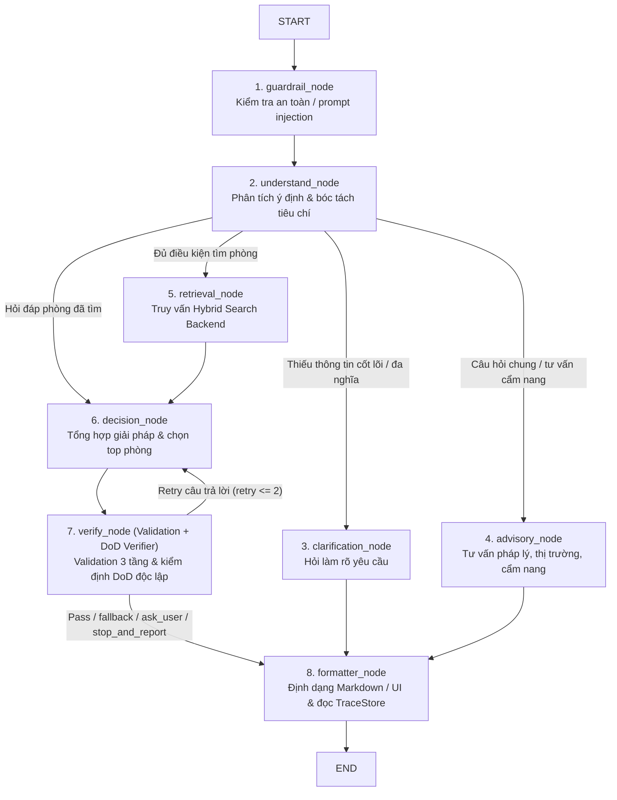

# 🤖 LangGraph Agent & An Toàn Chống Ảo Giác (AI Agent Graph Module)

Tài liệu này đặc tả chi tiết kiến trúc của phân hệ **AI Agent State Machine & Safety Guard** (`ai-agent/`).

---

## 1. LangGraph State Machine 8 Nodes

Đồ thị trạng thái hữu hạn điều phối luồng tư vấn và tìm kiếm:

### Nguyên Tắc Phân Vùng Công Cụ (Tool Partitioning):
* `retrieval_node`: Chỉ được cấp `RETRIEVAL_TOOLS` (`search_listings_hybrid`, `get_nearby_locations`).
* `decision_node`: Chỉ được cấp `DETAIL_TOOLS` (`get_listing_detail`).
* `advisory_node`: Chỉ được cấp `ADVISORY_TOOLS` (`get_market_price_stats`).
* `formatter_node` / `response_node`: Không có quyền gọi tools, triệt tiêu ảo giác tool calls.

### Trạng Thái Graph (`HousingAgentState`) & Quy Tắc Lệch Giá Thị Trường:
* `HousingAgentState` (`ai-agent/graph/state.py`) truyền trực tiếp `market_context: Optional[MarketContext]` (`area_name`, `user_budget`, `user_budget_str`, `market_min_price`, `market_min_price_str`, `market_avg_price`, `market_avg_price_str`, `is_market_gap`, `message`) từ `retrieval_node` sang `decision_node`, `verify_node` và `replies.py` (`reply_when_no_rooms`). Các field dư thừa (`proposed_budget`, `proposed_budget_str`, `is_contract_query`, `retry_count`) đã được loại bỏ hoàn toàn.
* Khi `retrieval_node` tìm được 0 phòng hợp lệ và khu vực có thống kê thị trường đáng tin cậy (`total_listings >= 20` hoặc không rõ cỡ mẫu), `propose_budget()` kích hoạt **`is_market_gap = True` ngay khi `user_max < market.min_price`** và truyền thẳng giá sàn thực tế (`market_min_price`, `market_min_price_str`) qua `market_context` để tư vấn người dùng.

---

## 2. Các Cơ Chế Tối Ưu Hóa Trải Nghiệm (UX & Resilience)

1. **Proactive Search & Disambiguation Gate:**
   - Tự động bỏ qua hỏi lại khi truy vấn đã chứa trường ĐH hoặc quận cụ thể (ví dụ: *"Bách Khoa CS1 Q10"*).
   - Chỉ hỏi lại khi địa danh thực sự đa nghĩa (ví dụ: *"ĐH Bách Khoa"* không rõ Hà Nội hay TP.HCM).
2. **Adaptive Radius Retrieval (Bán kính thích ứng 2 pha):**
   - Khởi đầu với $R = 2.5$ km. Nếu số phòng hợp lệ < 3 và người dùng không cố định bán kính, tự động nới lỏng sang $3.5$ km $\rightarrow$ $5.0$ km.
3. **Từ Điển POI Trường Đại Học 0 ms (Local Campus Dictionary):**
   - Duy trì toạ độ chuẩn của các trường ĐH lớn tại TP.HCM/Hà Nội trong `university_campuses.json`, giải mã tức thì không tốn quota Geocoding.
4. **Dual-Mode LLM Compatibility:**
   - Tương thích song song cả LM Studio cục bộ (bảo toàn payload `thinking`) và Google Gemini / OpenAI Cloud (xóa `thinking` tránh lỗi 400).
5. **Rate Limit Resilience:**
   - Phân biệt Fast-fail cạn Quota ngày (`RESOURCE_EXHAUSTED` / 500 RPD) vs Exponential Backoff cho Rate Limit phút (15 RPM).

---

## 3. Cơ Chế Chống Ảo Giác, Trace Cô Lập & DoD Verifier

1. **Tầng 2A - Lọc Ràng Buộc Cứng Bằng Mã Lệnh (`check_hard_constraints`):**
   - 100% bằng code Python thuần (ngân sách $\pm 2\%$, diện tích, khoảng cách Haversine mặt cầu, bộ lọc 2 trường loại phòng `allowed_room_types` & `excluded_room_types`, tiện ích bắt buộc).
   - Loại bỏ phòng vi phạm ngay lập tức kèm ghi nhận lý do cụ thể.
2. **Trace Cô Lập Append-Only (`ai-agent/graph/tracing.py` — `TraceStore`):**
   - **Tách khỏi `HousingAgentState`:** `trace_events` không còn nằm trong State có thể sửa của Agent; mọi Node ghi nối tiếp vào `TraceStore` qua `ContextVar` / `TraceSink` (`bind_trace_store`, `resolve_trace_target`).
   - **Định dạng JSONL đầy đủ:** Mỗi span có `run_id`, `seq` tăng đơn điệu, `ts`, `type`, `versions` (`prompt`, `skill`, `model`), và `case_id` (khi chạy eval).
   - **Bao quanh bằng code ứng dụng:** `tool_event` ghi đầy đủ `args`/`result` (không cắt bớt), `error`, `duration_ms`, cùng `state_before`/`state_after` cho tool làm đổi trạng thái; `traced_call` / `TraceCollector` ghi `input`, `output`, `tokens_in`, `tokens_out`, `duration_ms`. API key và PII (SĐT, email, CCCD) được che tự động bởi `redact_sensitive_data`.
3. **Validation 3 Tầng Theo Chi Phí Tăng Dần (`verify_answer_grounding`):**
   - **Tầng 1 (`schema_format`):** Kiểm tra kiểu chuỗi, rỗng, vi phạm bảng Markdown (`|...|`) / đường kẻ ngang (`---`). Sai thì dừng ngay (*short-circuit*).
   - **Tầng 2 (`business_rule`):** Kiểm tra ràng buộc cứng từng phòng và Scope Binding (chống tráo giá/diện tích giữa Top phòng). Sai thì dừng ngay trước Tầng 3.
   - **Tầng 3 (`external_cross_check`):** Đối chiếu mã phòng, VND, $m^2$, khoảng cách với DB/`tool_evidence`, và chỉ gọi LLM Critic (`critic_answer_validation`) khi cả 3 tầng code đã qua.
   - Mọi lỗi dùng cấu trúc `ValidationIssue` nêu rõ *trường sai*, *giá trị nhận được*, *dạng mong đợi* để vòng tự sửa có giới hạn (`max_answer_retries = 2`) điều chỉnh.
4. **DoD & Independent Verifier (`ai-agent/safety/dod_verifier.py` + `verify_node`):**
   - `derive_dod_spec` suy các điều kiện DoD từ yêu cầu (`intent`, `preferences`, `matched_skill`), gắn rõ `verifier_type` (`state_code` | `trace_code` | `rubric` | `human`), toán tử, ngưỡng + đơn vị đo (hoặc `unverifiable_reason`).
   - `verify_dod` đóng băng đầu vào bằng `deep_freeze` (`MappingProxyType`, `tuple`, `@dataclass(frozen=True)`), đọc trực tiếp trạng thái hệ thống + `trace_store.frozen_snapshot()`, không tin lời tự báo thành công của Agent, và trả định dạng cố định `{"passed": bool, "failures": [...]}`.
   - `verify_node` ghi riêng một span `verifier_decision` vào `TraceStore` (kèm `verifier_output` và `next_decision`). Khi `passed = false`, hệ thống thực thi hành vi xác định (`retry`, `ask_user`, `fallback_template` thay thế nội dung kể cả luồng follow-up, hoặc `stop_and_report`), tuyệt đối không ghi log rồi vẫn gửi câu báo thành công giả.
5. **KV-Cache Prefix Protection (`nlu_prompt.py`):**
   - Toàn bộ quy tắc NLU (gồm Quy tắc số 10 cho `allowed_room_types`, `excluded_room_types`) nằm trong khối tĩnh `NLU_RULES` trước `skills_part` động.

---

## 4. Hệ Thống Đánh Giá Agent Toàn Diện (`ai-agent/eval/`)

1. **Bộ Eval Set Bất Biến (`eval/datasets/agent_eval_set.py`):**
   - Định nghĩa chuẩn các nhóm ca (`normal`, `boundary`, `missing_info`, `conflict`, `tool_error`, `out_of_scope`) với trạng thái hệ thống ban đầu (`InitialSystemState`), giả lập lỗi (`FaultInjection`) và kỳ vọng trạng thái/hành vi, được khóa bằng `compute_eval_set_digest()` khi so sánh giữa 2 phiên bản.
2. **Chấm Điểm Trajectory Không Ép Chuỗi (`eval/trajectory.py`):**
   - Chỉ chấm khi trace đủ 3 thông tin cho mọi tool call (`seq`, `tool`, `args`). Đánh giá độc lập hai tiêu chí: đã đủ bước bắt buộc (`sufficient_required_steps`) và không có bước cấm/thừa (`no_forbidden_or_redundant_steps`).
3. **Chạy Lặp $pass^k$, Trace Diff & Regression Gate (`eval/stability_and_regression.py`):**
   - Công bố sẵn $k$ và ngưỡng đạt trước khi chạy, báo tỉ lệ đạt đủ cả $k$ lần (`pass_all_k_rate`) cùng danh sách `unstable_cases` và bước phân kỳ đầu tiên giữa 2 trace (`diff_traces_first_divergence`).
   - So sánh Baseline vs Current kèm danh sách case **Đạt $\rightarrow$ Rớt** và **Rớt $\rightarrow$ Đạt**; buộc **REJECT** nếu xuất hiện bất kỳ case nào chuyển từ Đạt sang Rớt, đồng thời quy chiếu về `versions` (`prompt`, `skill`, `model`) gắn trong trace.

