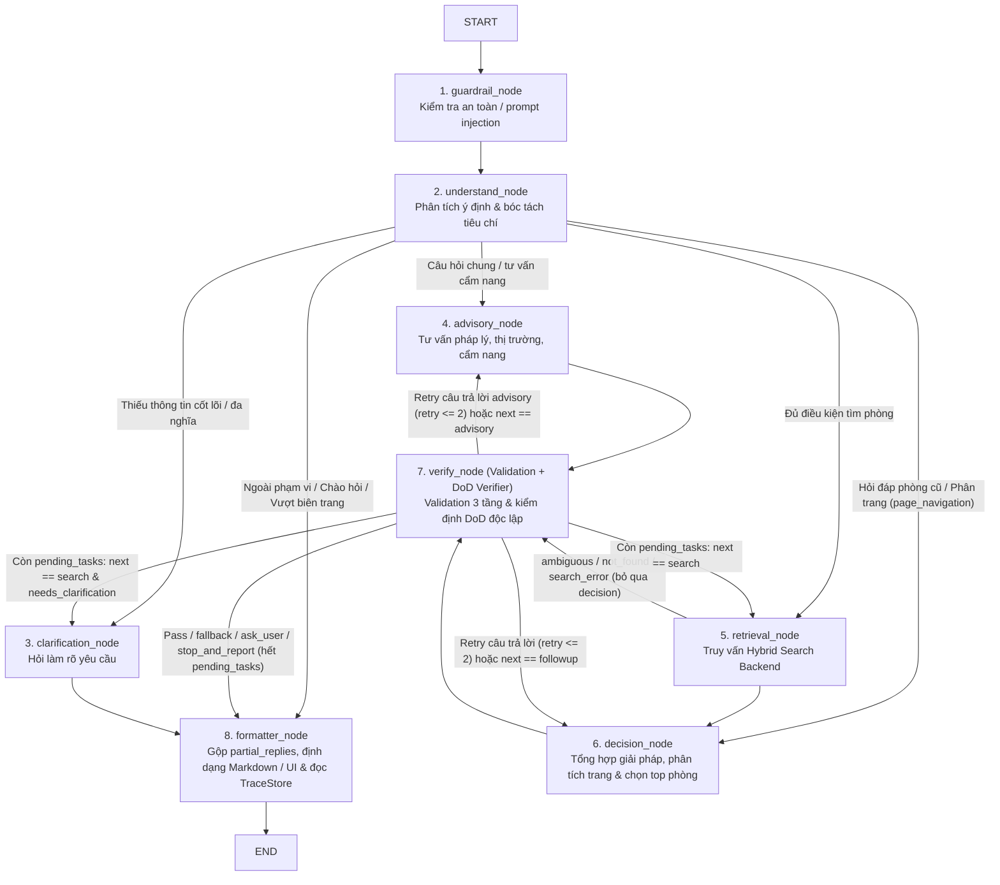

# 🤖 LangGraph Agent & An Toàn Chống Ảo Giác (AI Agent Graph Module)

Tài liệu này đặc tả chi tiết kiến trúc của phân hệ **AI Agent State Machine & Safety Guard** (`ai-agent/`).

---

## 1. LangGraph State Machine 8 Nodes

Đồ thị trạng thái hữu hạn điều phối luồng tư vấn và tìm kiếm:

### Thực Thi Tuần Tự Đa Mệnh Lệnh (Multi-Intent Plan & Execute):
* Khi `understand_node` phát hiện nhiều tác vụ độc lập (`followup`, `search`, `advisory`) trong cùng một câu, `TurnPlan` lập hàng đợi thông qua `current_task`, `pending_tasks` và `partial_replies` trong `HousingAgentState`, sắp xếp **theo đúng thứ tự xuất hiện của từng mệnh đề trong câu người dùng** (hỗ trợ mọi hoán vị kể cả `advisory -> search`, `advisory -> followup`, `search -> advisory -> followup`, v.v.):
  * Nếu `followup` đứng trước `search` (hoặc không có `search`), `understand_node` nạp sẵn `session.last_rooms` để `decision_node` đọc đúng phòng của lượt trước.
  * Nếu `search` đứng trước `followup`, `retrieval_node` tìm phòng mới trước và `verify_node` (hoặc `advisory_node` nằm giữa) giữ nguyên `retrieved_rooms` vừa truy xuất để `decision_node` kiểm tra đúng phòng Top $k$ mới (tự động bỏ qua `followup` nếu tìm được 0 phòng).
* Cả `decision_node` và `advisory_node` đều đi qua `verify_node` trước khi rẽ nhánh qua `_route_pending_task` trong `routing.py`: lưu kết quả bước hiện tại vào `partial_replies` và chuyển tiếp sang bước kế tiếp trong `pending_tasks`, giữ nguyên Tool Partitioning nghiêm ngặt.
* `formatter_node` ghép toàn bộ `partial_replies` + kết quả bước cuối thành một `AgentResponse` duy nhất trả về trong cùng lượt chat theo đúng thứ tự người dùng đã hỏi.

### Nguyên Tắc Phân Vùng Công Cụ (Tool Partitioning):
* `retrieval_node`: Chỉ được cấp `RETRIEVAL_TOOLS` (`search_listings_hybrid`, `get_nearby_locations`).
* `decision_node`: Chỉ được cấp `DETAIL_TOOLS` (`get_listing_detail`).
* `advisory_node`: Chỉ được cấp `ADVISORY_TOOLS` (`list_housing_skills`, `consult_housing_skill`, `get_market_price_stats`); hỗ trợ tham vấn đơn hoặc đa kỹ năng (`skill_slugs` / `matched_skills`, ví dụ gộp cả cẩm nang hợp đồng `rental-contract-advisor` và tra cứu thống kê giá thị trường thực tế `market-price-advisor`) qua `skill_context` cô lập (không ghi đè `session.preferences`), và có thể tự gọi tool `get_market_price_stats` qua `bind_tools` khi NLU chưa trích được `location_text`. Cơ chế `is_market_only_patch` trong `nlu.py` / `understand.py` chặn việc coi nhầm `patch.location_text` của `market-price-advisor` thành tác vụ `search`, và `DoD Verifier` kiểm định `cond_skill_trace`, `cond_market_stats_trace`, `cond_no_unrequested_search` cho lượt `skill_advice`.
* `formatter_node` / `response_node`: Không có quyền gọi tools, triệt tiêu ảo giác tool calls.

### Trạng Thái Graph (`HousingAgentState`) & Quy Tắc Lệch Giá Thị Trường / Tự Chủ Phản Hồi:
* `HousingAgentState` (`ai-agent/graph/state.py`) truyền trực tiếp `location_not_found: bool`, `admin_not_found: bool`, `ambiguous_candidates`, `dropped_summary: list[str]` (tóm tắt các phòng bị `check_hard_constraints` loại kèm lý do), và `market_context: Optional[MarketContext]` (`area_name`, `user_budget`, `user_budget_str`, `market_min_price`, `market_min_price_str`, `market_avg_price`, `market_avg_price_str`, `is_market_gap`, `message`) từ `retrieval_node` sang `decision_node`, `verify_node`, `formatter_node` và `replies.py` (`reply_when_no_rooms`).
* **Chính sách Retry & Fail-Fast cho định vị (`resolve_location_with_retry`):** Khi `resolve_location` trả `unresolved_point` hoặc `admin_not_found`, hệ thống thử lại tối đa 2 lần (`RESOLVE_LOCATION_MAX_RETRIES = 2`: Retry 1 biến thể cấu trúc chuỗi, Retry 2 dùng Cloud LLM viết lại tên địa danh chính thức) và ghi trace chi tiết. Nếu vẫn không phân giải được, `retrieval_node` Fail-Fast dừng trước `search_rooms` (`rooms = []`), dọn sạch `location_text` lỗi khỏi `session.preferences` và snapshot mới nhất (nhưng giữ nguyên ngân sách, diện tích, loại phòng, tiện ích), bật `need_clarification = True` trong `formatter_node` và gắn `skipped_pre_search_location_issue` trong `DoD Verifier`.
* **Quyền tự chủ NLU hoàn toàn (0 Regex ngữ nghĩa) & sinh câu trả lời có hậu kiểm:**
  - `nlu.py` và `understand.py` giao 100% quyền phân tích ngữ nghĩa (`patch.clear`, loại trừ `SLEEPBOX`, `task_order` đa mệnh lệnh, `page_action`/`target_page`, `revert_mode`/`revert_turn`, `is_location_pivot`, `Priorities`) cho Cloud LLM qua structured output `TurnAnalysis`; code chỉ điều phối workflow và giữ bất biến cấu trúc/an toàn.
  - NLU gọi 1 Cloud model duy nhất với `temperature = 0.0` ở lần đầu và tự nâng `0.3` khi retry; các node sinh văn bản (`decision_node`, `advisory_node`, `clarification_node`) dùng mặc định `temperature = 0.3`.
  - `default_deps()` mặc định `constrained_generation = False` (có thể bật lại qua `HOMIGO_CONSTRAINED_GENERATION=true`) để `decision_agent` tự do viết câu trả lời cho cả lượt tìm mới lẫn hỏi tiếp. Ngay từ bước `search_rooms`, `RoomItem` lưu sẵn `description` (rút gọn tối đa 1500 ký tự), `deposit`, `contact_name` (nhưng `compact_room()` ẩn khỏi `<rooms_data>` chung để tối ưu token). Khi `is_followup=True`, `decision_node` chỉ nạp chi tiết khi câu hỏi cần thông tin sâu qua `_needs_deep_listing_detail`, ưu tiên trích trực tiếp từ `RoomItem` đã lưu trong state (`_detail_from_room_item` $\rightarrow$ `0` gọi HTTP `get_listing_detail`) hoặc tái sử dụng `SessionData.room_details_cache`, chỉ fallback `get_listing_detail` khi `RoomItem` thiếu dữ liệu gốc; các câu hỏi bề mặt (giá, diện tích, khoảng cách, địa chỉ) hoặc so sánh nhiều phòng trả lời thẳng từ `<rooms_data>`. Khi `search` còn `followup` chờ sau, bước `search` tách phạm vi câu hỏi để không gọi sớm `get_listing_detail`, sau đó đi qua `verify_node` hậu kiểm số liệu kèm `cond_no_premature_detail_on_search` và `cond_no_duplicate_detail_call`.
  - **Chặn yêu cầu ngoài khả năng Workflow (`off_topic` / Out-of-Scope Guard — 0 Regex):** Dựa hoàn toàn vào phân loại ngữ nghĩa của Cloud LLM qua `INTENT_GUIDE` (`nlu_prompt.py`) đối với câu hỏi địa danh thuần túy không gắn nhu cầu thuê phòng (vd: *"đại học UIT ở đâu"*, *"chỉ đường..."*), giao dịch mua bán nhà đất/sang nhượng mặt bằng, và các tác vụ chưa hỗ trợ (đăng/sửa/xóa tin, đặt/giữ phòng/chuyển cọc hộ, gọi/nhắn chủ trọ, tìm bạn ở ghép). Khi LLM chọn `intent="off_topic"` hoặc `"prompt_injection"`, `_postprocess` (`nlu.py`) và `understand.py` thực thi bất biến cấu trúc dọn sạch `patch`, `page_action`, `semantic_query` và trả `OFF_TOPIC_QUERY` / `PROMPT_INJECTION_DETECTED` ở `0 search_rooms`, `0 commit` vào `session.preferences`.
* **Nhánh 0 phòng (tự phân tích & phản hồi tự do, không tự ý nới tìm kiếm):** Khi `retrieval_node` tìm được 0 phòng hợp lệ ở trạng thái `ok`, `propose_budget()` kích hoạt `is_market_gap = True` khi `user_max < market.min_price` (nếu cỡ mẫu đủ lớn). `decision_node` nhận đầy đủ `UserPreferenceState`, bán kính đã quét, `market_context`, `neighbor_bullets` và `dropped_summary` để LLM tự phân tích nguyên nhân gốc và viết câu trả lời tự nhiên (đưa các bằng chứng số liệu vào `tool_evidence` cho `verify_node`), đồng thời giữ `reply_when_no_rooms` làm fallback xác định khi LLM lỗi.

---

## 2. Các Cơ Chế Tối Ưu Hóa Trải Nghiệm (UX & Resilience)

1. **Proactive Search, Disambiguation Gate & Multi-Turn Ambiguous:**
   - Tự động bỏ qua hỏi lại khi truy vấn đã chứa trường ĐH/địa danh hoặc quận cụ thể (ví dụ: *"Bách Khoa CS1 Q10"*, *"Bến xe Miền Đông mới"*, *"KCN Amata Biên Hòa"*). Khi LLM NLU lỡ gắn `location_is_vague=true` cho tên POI cụ thể, `understand.py` tự động đối chiếu từ điển POI cục bộ (`find_poi_in_text`) để giải cứu sang tìm kiếm.
   - Khi người dùng yêu cầu tăng/giảm/nới ngân sách nhưng chưa nêu số cụ thể (`needs_budget_clarification=true`), `understand` đặt `needs_clarification=true` để rẽ qua `clarification_node` hỏi lại mức trần mong muốn kèm gợi ý mức giá tiếp theo thay vì tự suy đoán số tiền.
   - Khi địa danh trả `ambiguous` (nhiều cơ sở/cụm > 500m), `retrieval_node` lưu cả `pending_ambiguous_location` và `pending_ambiguous_candidates` vào `SessionData`; ở lượt kế tiếp, nếu người dùng chọn theo STT/tên chip thì `understand.py` gán thẳng tọa độ ứng viên, còn nếu trả lời ngắn quận/tỉnh/cơ sở thì tự ghép với `pending_ambiguous_location`.
   - `_infer_session_region_hint` kiểm soát chặt khi `intent == "new_search"` có địa điểm mới để không ép nhầm `region_hint` của lượt cũ sang tỉnh/thành mới.
2. **Adaptive Radius Retrieval (Bán kính thích ứng 2 pha):**
   - Với điểm đơn lẻ: khởi đầu $R = 3.0\text{ km}$, nếu số phòng hợp lệ < 3 và người dùng không cố định bán kính, tự động nới lỏng sang $5.0\text{ km} \rightarrow 7.0\text{ km}$.
   - Với khu vực/khuôn viên rộng (`_is_broad_area_location`: Làng Đại học, ĐHQG, KĐT, KCN/KCX/KCNC...): khởi đầu $R = 4.0\text{ km}$ và tự động nới lỏng sang $5.0\text{ km} \rightarrow 6.5\text{ km}$.
3. **Từ Điển POI Tùy Chọn & Direct TrackAsia Geocoding (`university_campuses.json`, `location_service.py`, `housing_tools.py`):**
   - Duy trì toạ độ viết tắt Trường ĐH/KCN/Bến xe/Metro cốt lõi cho **6 vùng hỗ trợ** (có thể bật/tắt qua `HOMIGO_USE_LOCAL_POI=false`, ưu tiên nhường các KĐT/vùng rộng cho TrackAsia giải quyết tự động thay vì hardcode tay).
   - Khi miss từ điển POI (hoặc khi tắt POI cục bộ), `geocode_point()` gọi thẳng Backend `/geocode(query, hint)` (`0 LLM`), tuyệt đối **không tự bỏ `hint`**.
4. **Cloud-Native LLM & HTTP Transient Retry:**
   - Vận hành thuần trên 1 Cloud model duy nhất qua `core/llm.py` (`core/config.py` làm SSOT).
   - `tools/http.py` tự động retry tối đa `HTTP_MAX_RETRIES = 1` lần khi gặp lỗi kết nối/timeout hoặc HTTP `502/503/504` (không retry `4xx`/404).
5. **Rate Limit Resilience:**
   - Phân biệt Fast-fail cạn Quota ngày (`RESOURCE_EXHAUSTED` / 500 RPD) vs Exponential Backoff cho Rate Limit phút (15 RPM).
6. **Phân Trang 10 Trang (`paged_rooms`, `MAX = 50` phòng), Chuyển Trang Kép & Tra Cứu Rank Toàn Cục:**
   - **Pre-fetch 1 lần theo phiên (`retrieval.py`, `session_store.py`):** `retrieval_node` gọi `search_rooms` với `limit = 50` (không dùng `offset`), lưu tối đa `MAX_PAGED_ROOMS = 50` phòng (`10` trang × `5` phòng/trang) vào `SessionData.paged_rooms` (persist trong SQLite qua `PersistentSessionStore`), đồng thời chỉ nạp `5` phòng của trang hiện tại vào `decision_node` và `formatter_node` (`AgentResponse` gồm thêm `page`, `page_size`, `total_rooms`, `total_pages`).
   - **Hai kênh chuyển trang không gọi lại Vector Search:**
     - *UI Pagination:* Frontend gọi `GET /api/v1/session/{session_id}/rooms?page=X&page_size=5` (`SessionRoomsPageResponse`, kèm `insights` động của trang mới qua `build_decision_insights`) để đổi trang trực tiếp ở `0 LLM`.
     - *Chat Navigation (`intent="page_navigation"`, `intelligence/pagination.py`):* Khi người dùng nhắn yêu cầu chuyển trang (ví dụ *"cần những phòng khác"*, *"qua trang 3"*, *"trang thứ 5 đi"*, *"di chuyển tới trang 4"*) mà **không** kèm tiêu chí lọc/ưu tiên mới:
       1) **LLM-Driven NLU & Bất Biến Cấu Trúc (`nlu.py` + `pagination.py`):** Cloud LLM quyết định `intent="page_navigation"`, `page_action` (`"next"`, `"prev"`, `"first"`, `"last"`, `"goto"`) và `target_page` qua `INTENT_GUIDE` & Quy tắc số 11 (`nlu_prompt.py`, **0 Regex ngữ nghĩa**). Tầng `_postprocess` (`nlu.py`) và `is_effective_patch_empty_for_pagination` / `parse_page_navigation` (`intelligence/pagination.py`) thực thi bất biến cấu trúc: dọn sạch nhiễu mặc định `ROOM`/`SLEEPBOX` hoặc `reset_priorities`, và chỉ chuyển trang khi không phát sinh tiêu chí tìm kiếm mới.
       2) **Cắt lát `offset` & Dùng Chung 100% Luồng/Prompt `decision_node` (`understand_node -> decision_node -> verify_node -> formatter_node`):** `understand_node` gọi `plan_page_navigation()` (`intelligence/pagination.py`) tính `offset = (target_page - 1) * page_size`, cắt lát `paged_rooms[offset : offset + page_size]` (5 phòng trang mục tiêu) và đặt `intent="page_navigation"`, `page_switched=True` (KHÔNG qua `retrieval_node`, **`0` gọi `search_rooms`**). Sau đó, lượt chuyển trang chảy trực tiếp vào **cùng 1 luồng chuẩn, cùng System/User Prompt (`build_decision_prompt` / `build_advice_prompt`) và cùng cấu trúc input (`<criteria>` + `<rooms_data>`) của `decision_node`** giống hệt lượt tìm kiếm (`offset = 0`), không duy trì prompt hay nhánh decision phân trang riêng; đi qua `verify_node` (`DoD Verifier` kiểm `cond_no_unrequested_search`, fallback chung `template_reply`) rồi mới qua `formatter_node` xuất `AgentResponse` + `DecisionInsight` trang mới. Riêng các ca vượt biên trang hoặc `paged_rooms` rỗng sẽ `direct_reply` tức thì về `formatter_node`. Nếu câu nói có thêm điều kiện mới (*"những phòng khác rẻ hơn"*), hệ thống vẫn đi qua `retrieval_node` tìm lại bình thường.
   - **Tra cứu `rank` toàn cục khi `room_followup`:** Khi đứng ở bất kỳ trang nào (ví dụ Trang 3 hiển thị `Top 11..15`), hỏi đích danh *"phòng top 1"* hoặc *"phòng số 12"* sẽ đối chiếu `room.rank` trên toàn `session.paged_rooms` thay vì chỉ lấy chỉ số mảng của trang hiện tại; còn *"phòng đầu tiên trang này"* mặc định bám theo trang đang hiển thị.

---

## 3. Cơ Chế Chống Ảo Giác, Trace Cô Lập & DoD Verifier

1. **Tầng 2A - Lọc Ràng Buộc Cứng Bằng Mã Lệnh (`check_hard_constraints`):**
   - 100% bằng code Python thuần (ngân sách $\pm 2\%$, diện tích, khoảng cách Haversine mặt cầu, bộ lọc 2 trường loại phòng `allowed_room_types` & `excluded_room_types`, tiện ích bắt buộc).
   - Loại bỏ phòng vi phạm ngay lập tức kèm ghi nhận lý do cụ thể.
2. **Trace Cô Lập Append-Only (`ai-agent/graph/tracing.py` — `TraceStore`):**
   - **Tách khỏi `HousingAgentState`:** `trace_events` không còn nằm trong State có thể sửa của Agent; mọi Node ghi nối tiếp vào `TraceStore` qua `ContextVar` / `TraceSink` (`bind_trace_store`, `resolve_trace_target`).
   - **Định dạng JSONL đầy đủ:** Mỗi span có `run_id`, `seq` tăng đơn điệu, `ts`, `type`, `versions` (`prompt`, `skill`, `model`), và `case_id` (khi chạy eval).
   - **Bao quanh bằng code ứng dụng:** `tool_event` ghi đầy đủ `args`/`result` (không cắt bớt), `error`, `duration_ms`, cùng `state_before`/`state_after` cho tool làm đổi trạng thái; `traced_call` / `TraceCollector` ghi `input`, `output`, `tokens_in`, `tokens_out`, `duration_ms`. API key và PII (SĐT, email, CCCD) được che tự động bởi `redact_sensitive_data`.
3. **Validation 3 Tầng Theo Chi Phí Tăng Dần (`verify_answer_grounding`):**
   - **Tầng 1 (`schema_format`):** Kiểm tra kiểu chuỗi, rỗng, vi phạm bảng Markdown (`|...|`) / đường kẻ ngang (`---`). Sai thì dừng ngay (*short-circuit*).
   - **Tầng 2 (`business_rule`):** Kiểm tra ràng buộc cứng từng phòng và Scope Binding (chống tráo giá/diện tích giữa Top phòng). Sai thì dừng ngay trước Tầng 3.
   - **Tầng 3 (`external_cross_check`):** Đối chiếu mã phòng, VND, $m^2$, khoảng cách với DB/`tool_evidence`, và chỉ gọi LLM Critic (`critic_answer_validation`) khi cả 3 tầng code đã qua.
   - Mọi lỗi dùng cấu trúc `ValidationIssue` nêu rõ *trường sai*, *giá trị nhận được*, *dạng mong đợi* để vòng tự sửa có giới hạn (`max_answer_retries = 2`) điều chỉnh.
4. **DoD & Independent Verifier (`ai-agent/safety/dod_verifier.py` + `verify_node`):**
   - `derive_dod_spec` suy các điều kiện DoD từ yêu cầu (`intent`, `preferences`, `matched_skill`), gắn rõ `verifier_type` (`state_code` | `trace_code` | `rubric` | `human`), toán tử, ngưỡng + đơn vị đo (hoặc `unverifiable_reason`).
   - `verify_dod` đóng băng đầu vào bằng `deep_freeze` (`MappingProxyType`, `tuple`, `@dataclass(frozen=True)`), đọc trực tiếp trạng thái hệ thống + `trace_store.frozen_snapshot()`, không tin lời tự báo thành công của Agent, và trả định dạng cố định `{"passed": bool, "failures": [...]}`.
   - `verify_node` ghi riêng một span `verifier_decision` vào `TraceStore` (kèm `verifier_output` và `next_decision`). Khi `passed = false`, hệ thống thực thi hành vi xác định (`retry`, `ask_user`, `fallback_template` thay thế nội dung kể cả luồng follow-up, hoặc `stop_and_report`), tuyệt đối không ghi log rồi vẫn gửi câu báo thành công giả.
5. **KV-Cache Prefix Protection (`nlu_prompt.py`):**
   - Toàn bộ quy tắc NLU (gồm Quy tắc số 10 cho `allowed_room_types`, `excluded_room_types`) nằm trong khối tĩnh `NLU_RULES` trước `skills_part` động.

---

## 4. Hệ Thống Đánh Giá Agent Toàn Diện (`ai-agent/eval/`)

1. **Bộ Eval Set Bất Biến (`eval/datasets/agent_eval_set.py`):**
   - Định nghĩa chuẩn các nhóm ca (`normal`, `boundary`, `missing_info`, `conflict`, `tool_error`, `out_of_scope`) với trạng thái hệ thống ban đầu (`InitialSystemState`), giả lập lỗi (`FaultInjection`) và kỳ vọng trạng thái/hành vi, được khóa bằng `compute_eval_set_digest()` khi so sánh giữa 2 phiên bản.
2. **Chấm Điểm Trajectory Không Ép Chuỗi (`eval/trajectory.py`):**
   - Chỉ chấm khi trace đủ 3 thông tin cho mọi tool call (`seq`, `tool`, `args`). Đánh giá độc lập hai tiêu chí: đã đủ bước bắt buộc (`sufficient_required_steps`) và không có bước cấm/thừa (`no_forbidden_or_redundant_steps`).
3. **Chạy Lặp $pass^k$, Trace Diff & Regression Gate (`eval/stability_and_regression.py`):**
   - Công bố sẵn $k$ và ngưỡng đạt trước khi chạy, báo tỉ lệ đạt đủ cả $k$ lần (`pass_all_k_rate`) cùng danh sách `unstable_cases` và bước phân kỳ đầu tiên giữa 2 trace (`diff_traces_first_divergence`).
   - So sánh Baseline vs Current kèm danh sách case **Đạt $\rightarrow$ Rớt** và **Rớt $\rightarrow$ Đạt**; buộc **REJECT** nếu xuất hiện bất kỳ case nào chuyển từ Đạt sang Rớt, đồng thời quy chiếu về `versions` (`prompt`, `skill`, `model`) gắn trong trace.

