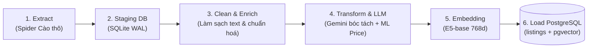
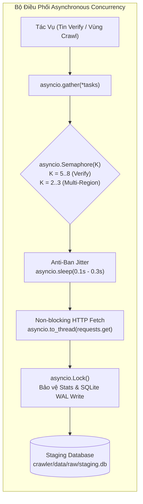

# 🔄 Pipeline Thu Thập & Xử Lý Dữ Liệu (ETL Pipeline Module)

Tài liệu này đặc tả chi tiết kiến trúc của phân hệ **Crawler & Ingestion Pipeline** (`crawler/`).

---

## 1. Luồng ETL Dữ Liệu 6 Bước (Crawler $\rightarrow$ Database)

Mọi dữ liệu phòng trọ từ nguồn ngoài (Nhà Tốt, PhongTrọ123...) đều bắt buộc đi qua luồng ETL tiêu chuẩn:

1. **Extract:** Spider thu thập JSON/HTML thô, lưu trữ nguyên trạng vào SQLite `raw_listings`.
2. **Clean & Enrich:** Loại bỏ HTML tag, chuẩn hóa Unicode NFC, xử lý dấu câu, hợp nhất tiêu đề + mô tả.
3. **LLM Extraction & Anti-Hallucination:**
   - Dùng Gemini 2.5 trích xuất thuộc tính cấu trúc (`ListingExtraction`).
   - Bắt buộc chạy hàm `verify_evidence`: Bằng chứng của tiện ích/an toàn không có trong văn bản gốc $\rightarrow$ Hạ về `unknown`.
4. **Transform & ML Pricing:**
   - Áp dụng mô hình CatBoost/LightGBM/XGBoost (Mondrian Conformal Prediction) để tính toán điểm hợp lý của giá (`price_score`) và khoảng tin cậy.
5. **Semantic Embedding:**
   - Tạo chuỗi văn bản giàu ngữ cảnh (`enriched_embedding_text`) và sinh vector 768 chiều bằng `intfloat/multilingual-e5-base`.
6. **Load:** Nạp UPSERT vào PostgreSQL production (`listings` và `listing_embeddings`).

---

## 2. Cơ Chế Lập Lịch Tự Động (Scheduler)

Hệ thống sử dụng tiến trình nền Python-native (`crawler/scheduler.py`) với cơ chế Non-overlapping Lock và Graceful Shutdown:
- **Daily Ingestion Job (02:00 AM hàng ngày):** Tự động cào tin mới (`--mode update --pages 3 --full`), chạy qua toàn bộ pipeline 6 bước nạp vào PostgreSQL.
- **Weekly Verification Job (04:00 AM Chủ Nhật):** Quét kiểm tra trạng thái các tin cũ (`--mode verify --limit 100`), đồng bộ `is_active = False` cho tin đã gỡ/hết hạn.
- **On-Demand Demo (`--run-now`):** Cho phép kích hoạt chạy ngay một lượt cào/verify tức thì phục vụ báo cáo và kiểm thử.

---

## 3. Kiến Trúc Bất Đồng Bộ Kiểm Soát Tải (Asynchronous Concurrency)

Áp dụng mô hình Worker Pool bất đồng bộ không cần cài đặt thêm thư viện ngoài (dùng `asyncio` chuẩn của Python 3.13):

1. **Verify Bất Đồng Bộ Tốc Độ Cao (`async_verify`):**
   - Vòng lặp `asyncio.gather(*tasks)` kết hợp `asyncio.Semaphore(max_concurrency=5..8)`.
   - **Anti-ban Jitter** ngẫu nhiên (0.1s – 0.3s) giữa các request để phân tán xung nhịp tải.
   - Dùng `asyncio.Lock()` bảo vệ từ điển `stats` và bọc ghi SQLite qua `asyncio.to_thread` (tránh lỗi `database is locked`).
   - Rút ngắn thời gian quét 100 tin từ **~150 giây (2.5 phút)** xuống còn **~12 – 15 giây** (tăng tốc gấp 10 lần).
2. **Cào Song Song Đa Vùng Độc Lập (`async_crawl_regions`):**
   - Hỗ trợ cào đồng thời nhiều tỉnh thành qua `Semaphore(max_concurrent_regions=2..3)`.
   - Mỗi vùng duy trì file Checkpoint riêng biệt (`checkpoint_nhatot_{region}.json`).
3. **Tương Thích Ngược 100% (Backward Compatibility):**
   - Cung cấp shim wrapper an toàn cho `verify()` và `crawl()` cũ bằng `ThreadPoolExecutor` khi môi trường đã có event loop sẵn.

