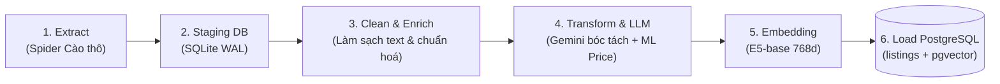
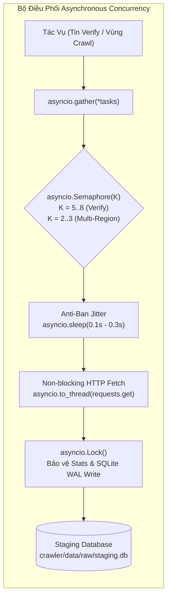

# 🔄 Pipeline Thu Thập & Xử Lý Dữ Liệu (ETL Pipeline Module)

Tài liệu này đặc tả chi tiết kiến trúc của phân hệ **Crawler & Ingestion Pipeline** (`crawler/`).

---

## 1. Luồng ETL Dữ Liệu 6 Bước (Crawler $\rightarrow$ Database)

Mọi dữ liệu phòng trọ từ nguồn ngoài (Nhà Tốt, PhongTrọ123...) đều bắt buộc đi qua luồng ETL tiêu chuẩn:

1. **Extract:** Spider thu thập JSON/HTML thô, lưu trữ nguyên trạng vào SQLite `raw_listings`.
2. **Clean & Enrich:** Loại bỏ HTML tag, chuẩn hóa Unicode NFC, xử lý dấu câu, hợp nhất tiêu đề + mô tả.
3. **LLM Extraction & Anti-Hallucination:**
   - Dùng Gemini 2.5 trích xuất thuộc tính cấu trúc (`ListingExtraction`).
   - Bắt buộc chạy hàm `verify_evidence`: Bằng chứng của tiện ích/an toàn không có trong văn bản gốc $\rightarrow$ Hạ về `unknown`.
4. **Transform & ML Pricing:**
   - Áp dụng mô hình CatBoost/LightGBM/XGBoost (Mondrian Conformal Prediction) để tính toán điểm hợp lý của giá (`price_score`) và khoảng tin cậy.
5. **Semantic Embedding:**
   - Tạo chuỗi văn bản giàu ngữ cảnh (`enriched_embedding_text`) và sinh vector 768 chiều bằng `intfloat/multilingual-e5-base`.
6. **Load:** Nạp UPSERT vào PostgreSQL production (`listings` và `listing_embeddings`).

### Chạy Tách Module Độc Lập Qua File Trung Gian (`JSONL`) & Quy Tắc Chuẩn Hóa Transform:
- Ngoài chế độ chạy trọn gói qua `crawler/etl/pipeline.py` (mặc định cho `scheduler.py`, hỗ trợ thêm cờ `--save-intermediate`), từng giai đoạn ETL có thể chạy tách rời qua file trung gian JSONL (`crawler/etl/io_utils.py`, mặc định lưu tại `crawler/data/processed/listings_transformed.jsonl`):
  1. `python -m crawler.etl.extract --unprocessed-only --output crawler/data/processed/listings_raw.jsonl`
  2. `python -m crawler.etl.transform [--input ...] [--llm] [--eval-price] [--embed] --output crawler/data/processed/listings_transformed.jsonl`
  3. `python -m crawler.etl.embed --input crawler/data/processed/listings_transformed.jsonl` *(tùy chọn nếu chưa bật `--embed` ở bước Transform)*
  4. `python -m crawler.etl.load --input crawler/data/processed/listings_transformed.jsonl [--mark-processed]` *(khôi phục `datetime` từ ISO string trước khi UPSERT và chỉ đánh dấu `is_processed = 1` khi nạp PostgreSQL thành công)*.
- **Quy tắc chuẩn hóa & chấm điểm trong `ListingTransformer.clean_record` (`crawler/etl/transform.py`):**
  1. Lưu `raw_furnishing_code` gốc từ crawler, sau đó nếu `furnishing_code` hiện tại là `None` và kết quả trích xuất LLM (hoặc `concept_scores`) xác nhận có nội thất (`furniture = yes`), tự động điền `furnishing_code = 2` (*Nội thất đầy đủ*, không ghi đè nếu tin thô đã có mã `1/2/3`).
  2. Nếu `0 < price_vnd < 1_000_000` (dưới 1 triệu VNĐ), hoặc tiêu đề KTX/Sleepbox ($\le 3.5\text{M}$) / tìm người ở ghép ($\le 3.0\text{M}$), ép loại phòng về `SLEEPBOX` (`room_type_id = 4`); tin `ROOM` có tiêu đề `Studio`/`CHDV`/`Duplex` ($\ge 3.5\text{M}$) chuẩn hóa thành `STUDIO` (`room_type_id = 2`) trước khi sinh `embedding_text`, chấm điểm chất lượng và định giá ML.
  3. **Chặn dữ liệu rác ngay tại `ListingTransformer.transform()` (`_is_valid_transformed_record`):** Loại bỏ tin thiếu giá hoặc thiếu diện tích (`price_vnd <= 0 or area_m2 <= 0`), tin có tọa độ ngoài biên Việt Nam, tin vượt ngưỡng diện tích/giá/đơn giá theo từng `room_type_id`, và tin phi nhà ở (kho/xưởng/mặt bằng/ki-ốt/cho thục) hoặc thuê theo ngày/giờ.
  4. **Chấm điểm v2 (`safety_score` & `amenity_overall`) sau Bước 9** (trên `room_type` đã chốt và `raw_furnishing_code` gốc, tại [`crawler/schema/listing.py`](../../../crawler/schema/listing.py)):
     - **`safety_score` v2 (Concave Bell-Curve):** kết hợp điểm nền nhẹ theo loại phòng (`0.26..0.40`) + bằng chứng an ninh (`fingerprint_lock`, `camera`, `guard`, `safe_area`, thu hồi deterministic khi `unknown` và thưởng `PCCC` / `khóa cổng riêng`, tuyệt đối không ghi đè `"no"`) qua hàm suy giảm cận biên $0.62 \cdot \min(1, E/0.85)^{0.68}$.
     - **`amenity_overall` v2:** chuẩn hóa 100 điểm theo từng `room_type`, suy luận mặc định cấu trúc hiển nhiên khi `unknown` (không đè `"no"`), áp dụng sàn chung `80%` cho cụm 4 thiết bị nội thất khi `raw_furnishing_code in (1, 2)` hoặc mô tả *"full nội thất"* (trừ `SLEEPBOX`), cộng điểm thưởng vượt chuẩn tối đa `10đ`.
  5. **Bảo toàn điểm ML khi nạp (`crawler/etl/load.py`):** Khi UPSERT vào PostgreSQL (`python -m crawler.etl.pipeline --all` không kèm `--price`), nếu `price_score` mới là `None`, giữ nguyên `price_score` đã chấm trước đó trong DB.

---

## 2. Cơ Chế Lập Lịch Tự Động (Scheduler)

Hệ thống sử dụng tiến trình nền Python-native (`crawler/scheduler.py`) với cơ chế Non-overlapping Lock và Graceful Shutdown:
- **Daily Ingestion Job (02:00 AM hàng ngày):** Tự động cào tin mới (`--mode update --pages 3 --full`), chạy qua toàn bộ pipeline 6 bước nạp vào PostgreSQL.
- **Weekly Verification Job (04:00 AM Chủ Nhật):** Quét kiểm tra trạng thái các tin cũ (`--mode verify --limit 100`), đồng bộ `is_active = False` cho tin đã gỡ/hết hạn.
- **On-Demand Demo (`--run-now`):** Cho phép kích hoạt chạy ngay một lượt cào/verify tức thì phục vụ báo cáo và kiểm thử.

---

## 3. Kiến Trúc Bất Đồng Bộ Kiểm Soát Tải (Asynchronous Concurrency)

Áp dụng mô hình Worker Pool bất đồng bộ không cần cài đặt thêm thư viện ngoài (dùng `asyncio` chuẩn của Python 3.13):

1. **Verify Bất Đồng Bộ Tốc Độ Cao (`async_verify`):**
   - Vòng lặp `asyncio.gather(*tasks)` kết hợp `asyncio.Semaphore(settings.VERIFY_MAX_CONCURRENCY)` (mặc định `5`).
   - **Anti-ban Jitter** ngẫu nhiên (0.1s – 0.3s) giữa các request để phân tán xung nhịp tải.
   - Dùng `asyncio.Lock()` bảo vệ từ điển `stats` và `StagingDatabase._write_lock` (`threading.RLock`) bảo vệ ghi SQLite WAL an toàn đa luồng.
   - Rút ngắn thời gian quét 100 tin từ **~150 giây (2.5 phút)** xuống còn **~12 – 15 giây** (tăng tốc gấp 10 lần).
2. **Cào Song Song Đa Vùng Độc Lập (`async_crawl_regions`):**
   - `BaseSpider.run()` tự động kích hoạt `async_crawl` khi spider con ghi đè, giúp chế độ `--region all` chạy `async_crawl_regions` qua `asyncio.Semaphore(settings.CRAWL_MAX_CONCURRENT_REGIONS)` (mặc định `2`).
   - Mỗi vùng duy trì file Checkpoint riêng biệt (`checkpoint_nhatot_{region}.json`) ghi nguyên tử qua `os.replace` dưới `threading.Lock`.
   - Giai đoạn LLM Extraction (`crawler/model/llm/pipeline.py`) cố tình giữ **tuần tự** (sequential) để tránh vượt ngưỡng rate limit của Gemini API.
3. **Tương Thích Ngược & Khôi Phục Trường Số Phòng (`bedrooms`, `bathrooms`):**
   - `parse_chotot_item()` và `ListingTransformer.clean_record()` bóc tách đồng thời `bedrooms`/`bathrooms` (ưu tiên `LLM numeric` nếu hợp lệ `> 0`, fallback về raw parser) và nạp UPSERT xuống cột `bedrooms`, `bathrooms` của PostgreSQL `listings`.
   - Cung cấp shim wrapper `_run_coro_sync` an toàn cho `verify()` và `run()` khi môi trường đã có sẵn event loop.

