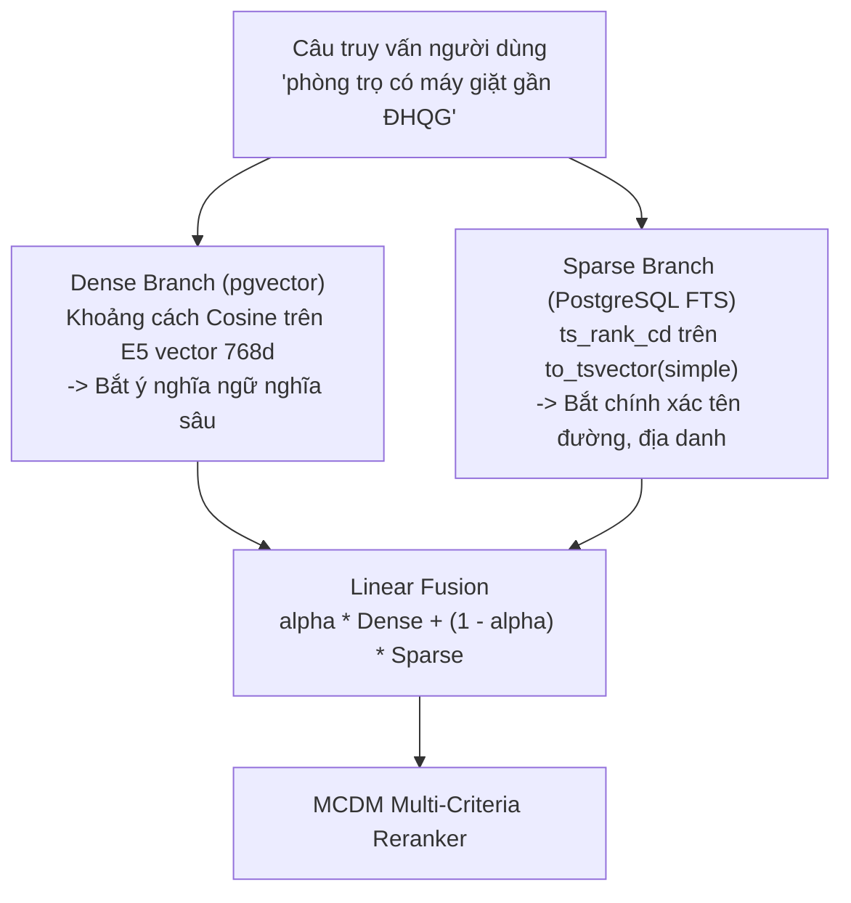

# 🔍 Tìm Kiếm & Tái Xếp Hạng Đa Tiêu Chí (Search & Ranking Module)

Tài liệu này đặc tả chi tiết kiến trúc của phân hệ **Hybrid Search & MCDM Reranker** (`backend/app/repositories/` & `backend/app/services/`).

---

## 1. Cơ Chế Tìm Kiếm Lai (Hybrid Search: Dense + Sparse FTS)

Hệ thống kết hợp 2 phương pháp tìm kiếm để bù trừ nhược điểm cho nhau:

$$\text{Hybrid Score} = \alpha \times \text{Dense Sim} + (1 - \alpha) \times \text{Sparse Rank}$$
*(Trong đó mặc định $\alpha = 0.6$ đến $0.7$)*

* **Dense Branch:** Đo lường Cosine Distance trên bảng `listing_embeddings` (`pgvector` HNSW index).
* **Sparse Branch:** Đánh giá độ khớp từ khóa chính xác trên `title`, `address_raw`, `description` qua PostgreSQL Full-Text Search (`ts_rank_cd`).

---

## 2. Cơ Chế Lọc Không Gian & Ràng Buộc Cứng (Spatial & Hard Filtering)

- **Spatial Pre-filter & Exact Haversine Filter (Lọc không gian 2 lớp):**
  1. *Lớp 1 (Bounding Box SQL Pre-filter):* Khung giới hạn toạ độ hộp chữ nhật (`lat BETWEEN lat_min AND lat_max`, `lng BETWEEN lng_min AND lng_max`) tại CSDL để loại bỏ nhanh các tin đăng ngoài vùng và tận dụng index B-tree.
  2. *Lớp 2 (Exact Haversine Great-Circle Filter):* Tính khoảng cách đường cong mặt cầu chính xác theo toạ độ địa lý (`haversine_km(lat, lng) <= max_distance_km`), loại bỏ triệt để các tin nằm ở 4 góc chéo của Bounding Box.
- **Lọc Tập Đa Loại Phòng (`room_types` / `allowed_room_types`):** Hỗ trợ tìm kiếm đồng thời nhiều loại hình phòng qua điều kiện SQL `Listing.room_type_id.in_(type_ids)` linh hoạt.
- **Ánh Xạ Ngữ Nghĩa Cho Tiện Ích Tổng Hợp:**
  - `safe_area`: Ánh xạ từ tổ hợp an ninh (`camera`, `guard`, `fingerprint_lock`) và khu dân trí cao.
  - `furniture`: Thỏa mãn khi có các tiện nghi thiết yếu (`bed`, `wardrobe`, `air_conditioner`).

---

## 3. Bộ Tái Xếp Hạng Đa Tiêu Chí (MCDM Reranker 5 Tiêu Chí)

Sắp xếp lại tập ứng viên ban đầu theo 5 trụ cột:

| Tiêu Chí | Trọng Số Cơ Sở Mặc Định | Cách Thức Đánh Giá |
| :--- | :--- | :--- |
| **Location Fit** | `0.25` | Khoảng cách đường chim bay (Haversine formula). Áp dụng suy giảm phi tuyến ($ratio^{1.5}$) trong khoảng `near_km = 0.8` đến `far_km = max_distance_km`. |
| **Price Fit** | `0.25` | Đánh giá mức độ hợp lý thị trường qua ML `price_score` kết hợp độ rẻ tiền danh nghĩa (`savings_ratio`). Đẩy lên 85% rẻ danh nghĩa khi người dùng tìm giá rẻ nhất. |
| **Safety Fit** | `0.20` | Điểm an ninh tổng hợp (`safety_score`) dựa trên camera, bảo vệ, khóa vân tay, an toàn PCCC. |
| **Amenity Fit** | `0.20` | Chấm độ khớp tiện ích mềm (`preferred_amenities`) 70% + điểm tổng thể (`amenity_overall`) 30%. |
| **Semantic Fit** | `0.10` | Điểm tương đồng ngữ nghĩa từ Hybrid Search (`similarity_score`). |

### Cơ Chế Trọng Số Động (Dynamic Weights & L1 Normalization):
- **Luôn kích hoạt:** `price`, `safety`, `semantic`.
- **Kích hoạt có điều kiện:** `location` (khi có tọa độ), `amenity` (khi có tiện ích mềm yêu cầu).
- **Chuẩn hoá L1:** Tổng trọng số các tiêu chí đang bật luôn được chuẩn hóa để $\sum w_i = 1.0$.

