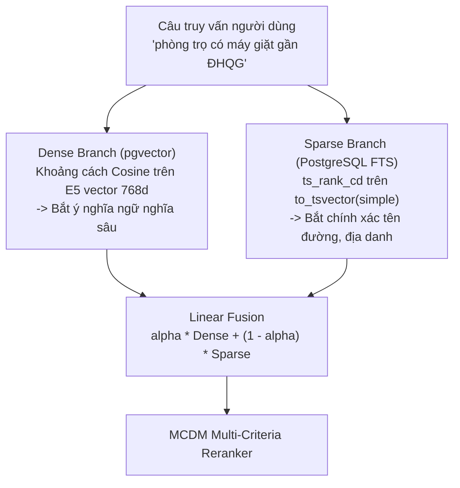

# 🔍 Tìm Kiếm & Tái Xếp Hạng Đa Tiêu Chí (Search & Ranking Module)

Tài liệu này đặc tả chi tiết kiến trúc của phân hệ **Hybrid Search & MCDM Reranker** (`backend/app/repositories/` & `backend/app/services/`).

---

## 1. Cơ Chế Tìm Kiếm Lai (Hybrid Search: Dense + Sparse FTS)

Hệ thống kết hợp 2 phương pháp tìm kiếm để bù trừ nhược điểm cho nhau:

$$\text{Hybrid Score} = \alpha \times \text{Dense Sim} + (1 - \alpha) \times \text{Sparse Rank}$$
*(Trong đó mặc định $\alpha = 0.6$ đến $0.7$)*

* **Dense Branch:** Đo lường Cosine Distance trên bảng `listing_embeddings` (`pgvector` HNSW index).
* **Sparse Branch:** Đánh giá độ khớp từ khóa chính xác trên `title`, `address_raw`, `description` qua PostgreSQL Full-Text Search (`ts_rank_cd`).

---

## 2. Cơ Chế Lọc Không Gian & Ràng Buộc Cứng (Spatial & Hard Filtering)

- **Spatial Pre-filter & Exact Haversine Filter (Lọc không gian 2 lớp):**
  1. *Lớp 1 (Bounding Box SQL Pre-filter):* Khung giới hạn toạ độ hộp chữ nhật (`lat BETWEEN lat_min AND lat_max`, `lng BETWEEN lng_min AND lng_max`) tại CSDL để loại bỏ nhanh các tin đăng ngoài vùng và tận dụng index B-tree.
  2. *Lớp 2 (Exact Haversine Great-Circle Filter):* Tính khoảng cách đường cong mặt cầu chính xác theo toạ độ địa lý (`haversine_km(lat, lng) <= max_distance_km`), loại bỏ triệt để các tin nằm ở 4 góc chéo của Bounding Box.
- **Lọc Tập Đa Loại Phòng (`room_type` / `allowed_room_types`):** Hỗ trợ tìm kiếm đồng thời nhiều loại hình phòng qua điều kiện SQL `Listing.room_type_id.in_(type_ids)` linh hoạt.
- **Ánh Xạ Ngữ Nghĩa Cho Tiện Ích Tổng Hợp:**
  - `safe_area`: Ánh xạ từ tổ hợp an ninh (`camera`, `guard`, `fingerprint_lock`) và khu dân trí cao.
  - `furniture`: Thỏa mãn khi có các tiện nghi thiết yếu (`bed`, `wardrobe`, `air_conditioner`).

---

## 3. Bộ Tái Xếp Hạng Đa Tiêu Chí (MCDM Reranker 5 Tiêu Chí)

Sắp xếp lại tập ứng viên ban đầu theo 5 trụ cột:

| Tiêu Chí | Trọng Số Cơ Sở Mặc Định | Cách Thức Đánh Giá |
| :--- | :--- | :--- |
| **Location Fit** | `0.25` | Khoảng cách đường chim bay (Haversine formula). Áp dụng suy giảm phi tuyến ($ratio^{1.5}$) trong khoảng `near_km = 0.8` đến `far_km = max_distance_km`. |
| **Price Fit** | `0.25` | Đánh giá mức độ hợp lý thị trường qua ML `price_score` kết hợp độ rẻ tiền danh nghĩa (`savings_ratio`). Mặc định ưu tiên giá trị hời theo thị trường (`80%` `ml_score` + `20%` `savings_ratio`); chỉ đẩy lên `85%` rẻ danh nghĩa khi bật tường minh `prefer_cheapest=True` (`multipliers['price'] > 1.0`). |
| **Safety Fit** | `0.20` | Điểm an ninh tổng hợp (`safety_score`) dựa trên camera, bảo vệ, khóa vân tay, an toàn PCCC. |
| **Amenity Fit** | `0.20` | Chấm độ khớp tiện ích mềm (`preferred_amenities`) 70% + điểm tổng thể (`amenity_overall`) 30%. Khi nói chung chung (không có tiện ích mềm), vẫn bật nền nhẹ (`0.10` ở Backend / `BASELINE_AMENITY_SCALE = 0.5` ở Agent) theo `amenity_overall` (tin thiếu dữ liệu nhận `0.0`). |
| **Semantic Fit** | `0.10` | Điểm tương đồng ngữ nghĩa từ Hybrid Search (`similarity_score`). |

### Cơ Chế Trọng Số Động (Dynamic Weights & L1 Normalization):
- **Luôn kích hoạt:** `price`, `safety`, `semantic`, và `amenity` (`amenity` dùng mức nền nhẹ theo `amenity_overall` khi người dùng nói chung chung hoặc chỉ có tiện ích bắt buộc; nâng lên mức đầy đủ khi có `preferred_amenities`, `include_amenity_overall`, hoặc nhấn mạnh tiện nghi).
- **Kích hoạt có điều kiện:** `location` (chỉ bật khi có tọa độ điểm mốc).
- **Chuẩn hoá L1:** Tổng trọng số các tiêu chí đang bật luôn được chuẩn hóa để $\sum w_i = 1.0$. Không dùng trọng số `price` sau chuẩn hóa L1 để suy diễn `prefer_cheapest`.

---

## 4. Dịch Vụ Định Vị Tọa Độ Backend (`GET /api/v1/geocode/`)

Phân hệ Geocoding (`backend/app/services/geocoder.py`, `schemas/geocode.py`, `controllers/geocoding_controller.py`) phân giải tên địa điểm đầu vào kèm `hint` khu vực thành tọa độ chính xác hoặc danh sách ứng viên đa nghĩa:

- **Region Bounding-Box Guard (`REGION_BBOXES`):** Khai báo khung tọa độ cho 6 vùng hỗ trợ (`TP.HCM`, `Hà Nội`, `Đà Nẵng`, `Bình Dương`, `Đồng Nai`, `Cần Thơ`, giữ vùng giao thoa quanh Làng ĐH Thủ Đức – Dĩ An). Khi `hint` xác định được vùng, mọi ứng viên nằm ngoài vùng bị loại bỏ thay vì trả nhầm tỉnh khác.
- **Top-5, TrackAsia & Gom Cụm Đa Cơ Sở (`AMBIGUOUS_CLUSTER_KM = 0.5`, `BROAD_AREA_CLUSTER_KM = 3.5`):** Khi có `TRACKASIA_API_KEY`, ưu tiên **TrackAsia Place Text Search v2** (`new_admin=true`, `include_old_admin=true`), sau đó fallback sang **OpenStreetMap Nominatim**. Mọi ứng viên đều đi qua bộ lọc độ khớp token định danh riêng (`_is_candidate_relevant`) để loại bỏ kết quả rác khi tìm địa danh không tồn tại. Các điểm cách nhau $\le 500\text{ m}$ (hoặc $\le 3.5\text{ km}$ đối với khu đô thị/KCN/làng đại học rộng) được gộp thành 1 điểm; nếu còn $\ge 2$ cụm phân tán, hệ thống trả `ambiguous = True` kèm `candidates`.
- **Persistent SQLite Cache (`GeocodeCache`):** Lưu bền vững kết quả thành công trên đĩa (`backend/data/geocode_cache.sqlite`, chế độ SQLite WAL) theo khóa chuẩn hóa `(query_norm, hint_norm)` với TTL cấu hình được (`GEOCODE_CACHE_TTL_SECONDS`, mặc định 30 ngày), thay thế cho `@lru_cache` trên RAM.

