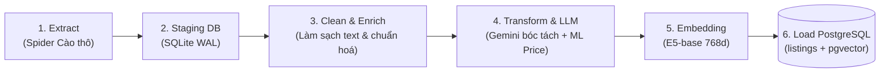
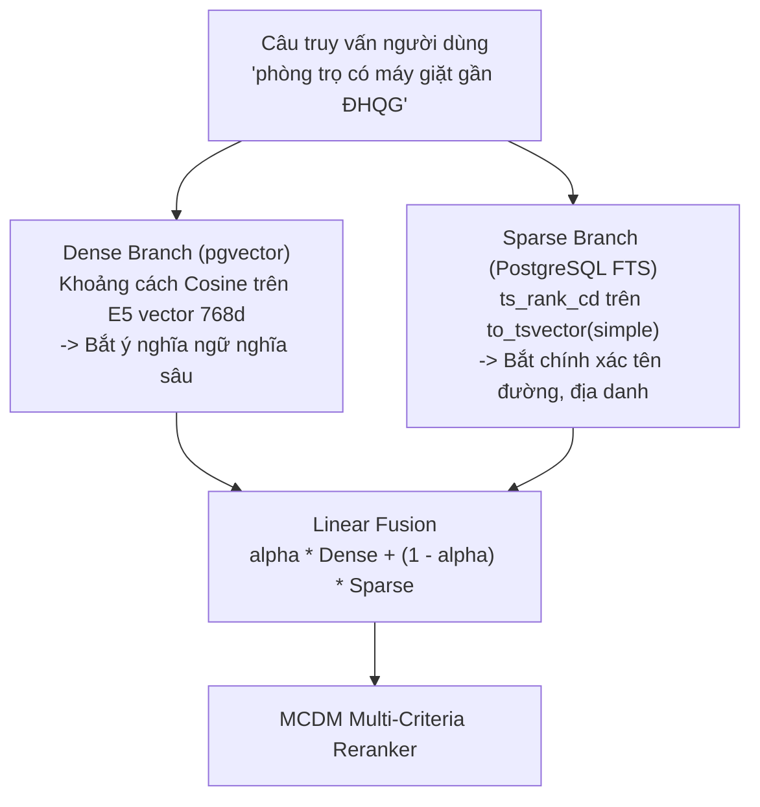
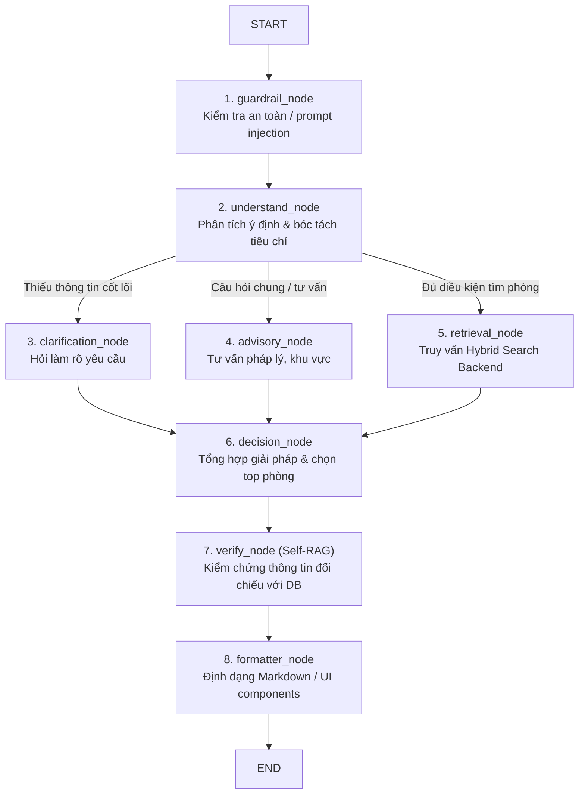
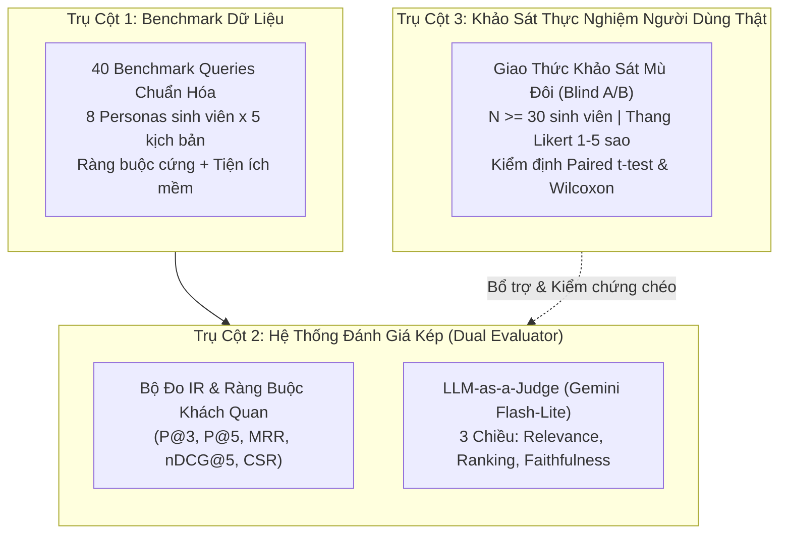

# 🏛️ Các Nguyên Tắc Thiết Kế Hệ Thống (System Principles)

Tài liệu này quy định các nguyên lý kiến trúc, thuật toán và luồng xử lý dữ liệu cốt lõi trong toàn bộ hệ thống Homigo.

---

## 1. 🧩 Nguyên Tắc Phân Tách Dịch Vụ (Service Isolation & Loose Coupling)

1. **4 Microservices độc lập:** Mỗi dịch vụ có `.venv` / `node_modules`, dependencies và tệp cấu hình `.env` riêng biệt. Không gọi chéo import code giữa các repo dịch vụ, chỉ giao tiếp qua mạng:
   - Frontend $\leftrightarrow$ Backend (REST API qua HTTP/JSON).
   - Frontend $\leftrightarrow$ AI Agent (REST + SSE Streaming).
   - AI Agent $\rightarrow$ Backend (REST API client chuyên dụng với connection pooling).
2. **Dùng chung tài nguyên thông minh (Shared Cache):**
   - Thư mục `models_cache/` được mount chung cho cả `backend` và `crawler` để tránh tải lại mô hình embedding E5 kích thước lớn.
   - Cơ sở dữ liệu Staging SQLite (`staging.db`) dùng làm vùng đệm độc lập với PostgreSQL Production để việc cào dữ liệu không làm nghẽn CSDL chính.

---

## 2. 🔄 Pipeline ETL Dữ Liệu 6 Bước (Crawler $\rightarrow$ Database)

Mọi dữ liệu phòng trọ từ nguồn ngoài (Nhà Tốt, PhongTrọ123...) đều bắt buộc đi qua luồng ETL tiêu chuẩn:

1. **Extract:** Spider thu thập JSON/HTML thô, lưu trữ nguyên trạng vào SQLite `raw_listings`.
2. **Clean & Enrich:** Loại bỏ HTML tag, chuẩn hóa Unicode NFC, xử lý dấu câu, hợp nhất tiêu đề + mô tả.
3. **LLM Extraction & Anti-Hallucination:**
   - Dùng Gemini 2.5 trích xuất thuộc tính cấu trúc (`ListingExtraction`).
   - Bắt buộc chạy hàm `verify_evidence`: Bằng chứng của tiện ích/an toàn không có trong văn bản gốc $\rightarrow$ Hạ về `unknown`.
4. **Transform & ML Pricing:**
   - Áp dụng mô hình CatBoost/LightGBM/XGBoost (Mondrian Conformal Prediction) để tính toán điểm hợp lý của giá (`price_score`) và khoảng tin cậy.
5. **Semantic Embedding:**
   - Tạo chuỗi văn bản giàu ngữ cảnh (`enriched_embedding_text`) và sinh vector 768 chiều bằng `intfloat/multilingual-e5-base`.
6. **Load:** Nạp UPSERT vào PostgreSQL production (`listings` và `listing_embeddings`).

### Cơ chế Lập lịch Tự động (Automated Ingestion & Verification Scheduler):
Hệ thống sử dụng tiến trình nền Python-native (`crawler/scheduler.py`) với cơ chế Non-overlapping Lock và Graceful Shutdown:
- **Daily Ingestion Job (02:00 AM hàng ngày):** Tự động cào tin mới (`--mode update --pages 3 --full`), chạy qua toàn bộ pipeline 6 bước nạp vào PostgreSQL.
- **Weekly Verification Job (04:00 AM Chủ Nhật):** Quét kiểm tra trạng thái các tin cũ (`--mode verify --limit 100`), đồng bộ `is_active = False` cho tin đã gỡ/hết hạn.
- **On-Demand Demo (`--run-now`):** Cho phép kích hoạt chạy ngay một lượt cào/verify tức thì phục vụ báo cáo và kiểm thử.

---

## 3. 🔍 Cơ Chế Tìm Kiếm Lai (Hybrid Search: Dense + Sparse FTS)

Hệ thống kết hợp 2 phương pháp tìm kiếm để bù trừ nhược điểm cho nhau:

$$\text{Hybrid Score} = \alpha \times \text{Dense Sim} + (1 - \alpha) \times \text{Sparse Rank}$$
*(Trong đó mặc định $\alpha = 0.6$ đến $0.7$)*

* **Dense Branch:** Đo lường Cosine Distance trên bảng `listing_embeddings` giúp hiểu được các nhu cầu ẩn (ví dụ: "chỗ ở thoáng mát cho sinh viên").
* **Sparse Branch:** Đánh giá độ khớp từ khóa chính xác trên `title`, `address_raw`, `description` qua PostgreSQL Full-Text Search (`ts_rank_cd`), đảm bảo bắt chính xác tên trường đại học, tên quận, tên đường.

---

## 4. ⚖️ Bộ Tái Xếp Hạng Đa Tiêu Chí (MCDM Reranker 5 Tiêu Chí)

Sau khi Hybrid Search trả về tập ứng viên ban đầu (khoảng 30 - 50 phòng), hệ thống kích hoạt **MCDM Reranker** (`backend/app/services/reranker.py`) để sắp xếp lại theo 5 tiêu chí:

| Tiêu Chí | Trọng Số Cơ Sở Mặc Định | Cách Thức Đánh Giá |
| :--- | :--- | :--- |
| **Price Fit** | `0.20` | Đánh giá mức độ hợp lý thị trường qua ML `price_score` (Conformal Prediction) kết hợp tỷ lệ tiết kiệm ngân sách (`savings_ratio`) nếu có `max_price`. |
| **Location Fit** | `0.20` | Khoảng cách đường chim bay (Haversine formula) đến toạ độ mong muốn của người dùng (1km $\rightarrow$ 1.0, 10km $\rightarrow$ 0.0). |
| **Amenity Fit** | `0.20` | Tiện ích bắt buộc đã lọc cứng tại SQL/Grounding (không chấm lặp). Chấm độ khớp tiện ích mềm (`preferred_amenities`) 70% + điểm tổng thể (`amenity_overall`) 30%. |
| **Safety Fit** | `0.20` | Điểm an ninh tổng hợp (`safety_score`) dựa trên camera, bảo vệ, khóa vân tay, khu vực an ninh từ dữ liệu làm giàu của Crawler. |
| **Semantic Fit** | `0.20` | Điểm tương đồng ngữ nghĩa từ Hybrid Search (`similarity_score` kết hợp Dense Cosine E5-base và Sparse PostgreSQL FTS). |

### Cơ chế Trọng số Động (Dynamic Weights & L1 Normalization):
- **Luôn kích hoạt:** `price`, `safety`, `semantic`.
- **Kích hoạt có điều kiện:**
  - `location`: Chỉ bật khi người dùng truyền toạ độ (`lat` & `lng`).
  - `amenity`: Chỉ bật khi người dùng có tiện ích ưu tiên mềm (`preferred_amenities`), hoặc bật `include_amenity_overall`, hoặc caller chủ động truyền trọng số explicit.
- **Chuẩn hoá L1:** Tổng trọng số các tiêu chí đang bật luôn được chuẩn hóa để $\sum w_i = 1.0$.

---

## 5. 🤖 LangGraph State Machine & Tool Partitioning (AI Agent)

Hệ thống AI Agent được thiết kế theo mô hình **Đồ thị trạng thái hữu hạn (Finite State Graph)** với 8 nodes:

### Nguyên tắc Phân Vùng Công Cụ (Tool Partitioning):
Để triệt tiêu tình trạng LLM gọi nhầm công cụ hoặc rò rỉ context:
* `retrieval_node`: Chỉ được cấp `RETRIEVAL_TOOLS` (`search_listings_hybrid`, `get_nearby_locations`).
* `decision_node`: Chỉ được cấp `DETAIL_TOOLS` (`get_listing_detail`).
* `advisory_node`: Chỉ được cấp `ADVISORY_TOOLS` (`get_market_price_stats`).

---

## 6. 🛡️ Cơ Chế Chống Ảo Giác Hai Tầng (Anti-Hallucination)

1. **Tầng 1 (Data Ingestion — Crawler):**
   * Hàm `verify_evidence`: LLM khi trích xuất bất kỳ tiện ích nào đều phải trích nguyên văn câu làm bằng chứng. Nếu câu đó không khớp trong bài viết gốc $\rightarrow$ Tự động hạ về `unknown`.
2. **Tầng 2 (Response Generation — AI Agent):**
   * Node `verify_node` (Self-RAG Grounding): Trước khi câu trả lời được chuyển sang `formatter_node`, Agent đối chiếu từng phát biểu của câu trả lời với dữ liệu thực tế từ Backend. Nếu phát hiện AI tự bịa tiện ích (ví dụ: phòng không có máy lạnh mà nói có) $\rightarrow$ Yêu cầu đính chính ngay lập tức.

---

## 7. ⏱️ Vòng Đời Tin Đăng & Cơ Chế Đồng Bộ (Lifecycle Sync)

1. **Spider Mode Verify:** Quét định kỳ kiểm tra mã HTTP 404 hoặc status bài đăng trên nguồn gốc.
2. **Auto Fast Sync:** Cập nhật ngay `is_active = False` và `status = "expired_or_deleted"` từ SQLite sang PostgreSQL trong vài giây.
3. **Backend Exclude:** Mọi query Search, Vector Search, Nearby Locations đều tự động lọc `Listing.is_active == True`.
4. **Detail Access:** Người dùng có ID cũ vẫn truy cập được chi tiết bài đăng nhưng nhận thông báo cảnh báo hết hạn màu vàng cam, đồng thời hệ thống vô hiệu hóa nút liên hệ.

---

## 8. 📊 Chuẩn Đánh Giá Định Lượng Độ Phù Hợp Gợi Ý (Housing Recommendation Evaluation Framework)

Để chứng minh tính hiệu quả và đóng góp khoa học của hệ thống gợi ý Homigo trong Luận văn Tốt nghiệp, kiến trúc đánh giá được xây dựng dựa trên **Mô hình 3 Trụ Cột Độc Lập (Three-Pillar Evaluation Framework)**:

### 8.1. Trụ Cột 1: 40 Benchmark Queries Đa Persona & Ràng Buộc Cứng
- **Tập dữ liệu chuẩn hóa:** [`ai-agent/eval/datasets/recommendation_benchmark.py`](file:///c:/UIT/Lab/Đồ Án tốt nghiệp/ai-agent/eval/datasets/recommendation_benchmark.py) gồm 40 kịch bản truy vấn bao phủ 8 nhóm đối tượng sinh viên (Personas):
  1. *Tân sinh viên năm nhất:* Ưu tiên gần trường ĐHQG, an ninh, có gác lửng, ngân sách dưới 3.5 triệu.
  2. *Sinh viên ở ghép (Roommates):* Cần phòng rộng $\ge 25\text{m}^2$, có kệ bếp, máy giặt, 2 chỗ để xe.
  3. *Sinh viên năm cuối / Đồ án:* Cần không gian yên tĩnh, wifi mạnh, máy lạnh, ban công/cửa sổ.
  4. *Sinh viên làm thêm / Tự lập:* Ngân sách eo hẹp ($\le 2.5$ triệu), không chung chủ, giờ giấc tự do.
  5. *Sinh viên nữ quan tâm an toàn:* Camera, bảo vệ, khóa vân tay, hẻm xe hơi.
  6. *Sinh viên trường thành viên (Bách Khoa, KHTN, Kinh Tế):* Bán kính di chuyển cụ thể theo từng cơ sở.
  7. *Sinh viên nuôi thú cưng:* Tiện ích mềm cho phép nuôi pet, thoáng mát.
  8. *Truy vấn đa tiêu chí phức tạp:* Kết hợp ràng buộc phủ định và khoảng giá hẹp.
- **Mỗi query chuẩn hóa đi kèm cấu trúc `GroundTruthExpectation`:** Khai báo cụ thể `hard_max_price`, `max_distance_km`, `target_coordinates`, `required_amenities`, `preferred_amenities`, `required_room_types`.

### 8.2. Trụ Cột 2: Hệ Thống Đánh Giá Kép (Dual Evaluator)
Kết hợp đo lường khách quan bằng thuật toán Information Retrieval và đo lường bán tự động bằng mô hình ngôn ngữ lớn:

1. **Bộ đo IR Metrics & Constraint Satisfaction Rate (CSR):**
   - Triển khai tại [`ai-agent/eval/ir_metrics.py`](file:///c:/UIT/Lab/Đồ Án tốt nghiệp/ai-agent/eval/ir_metrics.py):
     - $P@3, P@5$ (Precision@K): Tỷ lệ phòng hoàn toàn thỏa mãn mọi tiêu chí cứng trong Top $K$.
     - $\text{MRR}$ (Mean Reciprocal Rank): Vị trí đảo ngược của phòng đầu tiên đạt chuẩn ($1 / \text{rank}_1$).
     - $\text{nDCG}@5$: Chuẩn hóa độ suy giảm lũy tích theo 4 mức độ liên quan ($0 \rightarrow 3$).
     - $\text{CSR}$ (Constraint Satisfaction Rate): Tỷ lệ phòng vi phạm 0 ràng buộc cứng, kèm phân rã tuân thủ từng tiêu chí ($\text{CSR}_{\text{price}}, \text{CSR}_{\text{distance}}, \text{CSR}_{\text{amenity}}$).

2. **Gemini Flash-Lite LLM-as-a-Judge 3 Chiều:**
   - Triển khai tại [`ai-agent/eval/llm_judge.py`](file:///c:/UIT/Lab/Đồ Án tốt nghiệp/ai-agent/eval/llm_judge.py) qua schema Pydantic `RecommendationJudgeReport`:
     - **Relevance Score ($1.0 - 5.0$):** Độ phù hợp ngữ nghĩa và nhu cầu sinh hoạt của các phòng được đề xuất.
     - **Ranking Score ($1.0 - 5.0$):** Chất lượng xếp hạng logic — phòng Top 1 có thực sự vượt trội hơn các phòng sau hay không?
     - **Faithfulness Score ($1.0 - 5.0$):** Tính trung thực số liệu, kiểm chứng đối chiếu (Grounding Verification) không bịa đặt tiện ích hay giá trị sai lệch thực tế.

### 8.3. Trụ Cột 3: Khung Khảo Sát Người Dùng Thật & Kiểm Định Thống Kê
- **Giao thức khảo sát mù đôi (Blind A/B Testing):** Chi tiết tại [`docs/evaluation/human-eval-protocol.md`](file:///c:/UIT/Lab/Đồ Án tốt nghiệp/docs/evaluation/human-eval-protocol.md). Khảo sát $N \ge 30$ sinh viên ẩn danh so sánh Phương án A (Keyword + SQL Filter) và Phương án B (Homigo Agent).
- **Thang đo Likert 1 - 5 sao** trên 4 câu hỏi nghiên cứu:
  - $Q_1$: Độ phù hợp & Thỏa mãn nhu cầu (Relevance).
  - $Q_2$: Tính hữu ích của phần giải thích Top 1 & Phân tích Trade-offs (Explanation Transparency).
  - $Q_3$: Độ tin cậy thông tin để ra quyết định liên hệ thuê (Decision Confidence).
  - $Q_4$: Mức độ tiết kiệm thời gian tìm kiếm so với lướt web thủ công (Time Saving).
- **Module Phân Tích Thống Kê Suy Diễn:** Triển khai tại [`ai-agent/eval/stats_analyzer.py`](file:///c:/UIT/Lab/Đồ Án tốt nghiệp/ai-agent/eval/stats_analyzer.py):
  - Kiểm định tham số **Paired Samples $t$-test** đo lường $\Delta \text{Mean}$ và khoảng tin cậy $CI_{95\%}$.
  - Kiểm định phi tham số **Wilcoxon Signed-Rank Test** với hiệu chỉnh liên tục cho thang đo Likert thứ bậc.
  - Tự động xuất biểu đồ ASCII Boxplot và báo cáo Markdown chứng minh ý nghĩa thống kê ($p < 0.001$).

