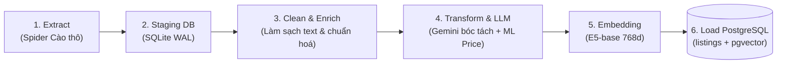
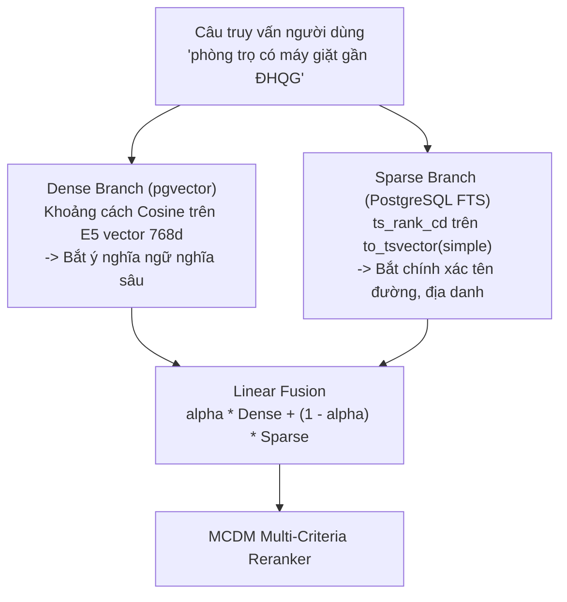
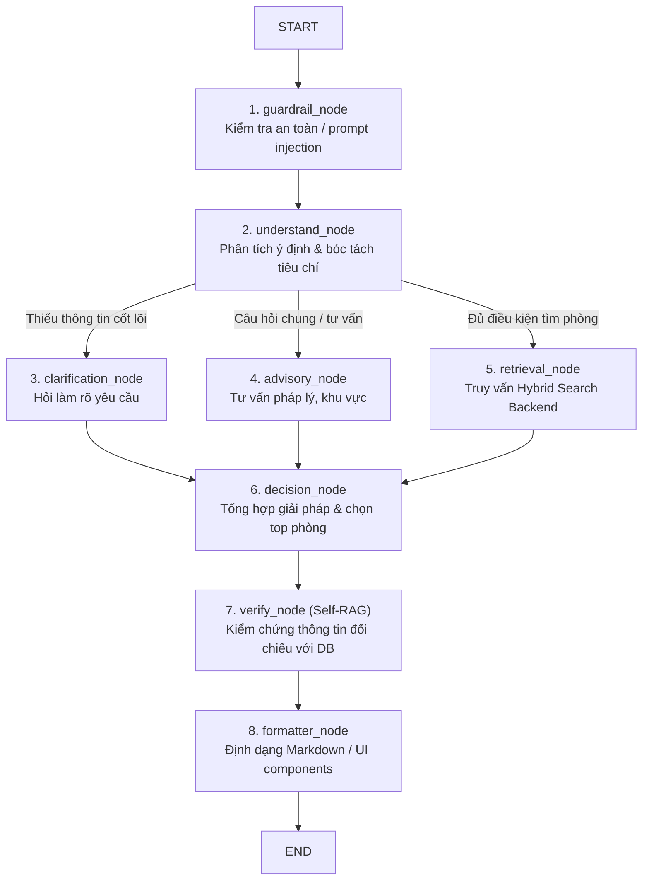

# 🏛️ Các Nguyên Tắc Thiết Kế Hệ Thống (System Principles)

Tài liệu này quy định các nguyên lý kiến trúc, thuật toán và luồng xử lý dữ liệu cốt lõi trong toàn bộ hệ thống Homigo.

---

## 1. 🧩 Nguyên Tắc Phân Tách Dịch Vụ (Service Isolation & Loose Coupling)

1. **4 Microservices độc lập:** Mỗi dịch vụ có `.venv` / `node_modules`, dependencies và tệp cấu hình `.env` riêng biệt. Không gọi chéo import code giữa các repo dịch vụ, chỉ giao tiếp qua mạng:
   - Frontend $\leftrightarrow$ Backend (REST API qua HTTP/JSON).
   - Frontend $\leftrightarrow$ AI Agent (REST + SSE Streaming).
   - AI Agent $\rightarrow$ Backend (REST API client chuyên dụng với connection pooling).
2. **Dùng chung tài nguyên thông minh (Shared Cache):**
   - Thư mục `models_cache/` được mount chung cho cả `backend` và `crawler` để tránh tải lại mô hình embedding E5 kích thước lớn.
   - Cơ sở dữ liệu Staging SQLite (`staging.db`) dùng làm vùng đệm độc lập với PostgreSQL Production để việc cào dữ liệu không làm nghẽn CSDL chính.

---

## 2. 🔄 Pipeline ETL Dữ Liệu 6 Bước (Crawler $\rightarrow$ Database)

Mọi dữ liệu phòng trọ từ nguồn ngoài (Nhà Tốt, PhongTrọ123...) đều bắt buộc đi qua luồng ETL tiêu chuẩn:

1. **Extract:** Spider thu thập JSON/HTML thô, lưu trữ nguyên trạng vào SQLite `raw_listings`.
2. **Clean & Enrich:** Loại bỏ HTML tag, chuẩn hóa Unicode NFC, xử lý dấu câu, hợp nhất tiêu đề + mô tả.
3. **LLM Extraction & Anti-Hallucination:**
   - Dùng Gemini 2.5 trích xuất thuộc tính cấu trúc (`ListingExtraction`).
   - Bắt buộc chạy hàm `verify_evidence`: Bằng chứng của tiện ích/an toàn không có trong văn bản gốc $\rightarrow$ Hạ về `unknown`.
4. **Transform & ML Pricing:**
   - Áp dụng mô hình CatBoost/LightGBM/XGBoost (Mondrian Conformal Prediction) để tính toán điểm hợp lý của giá (`price_score`) và khoảng tin cậy.
5. **Semantic Embedding:**
   - Tạo chuỗi văn bản giàu ngữ cảnh (`enriched_embedding_text`) và sinh vector 768 chiều bằng `intfloat/multilingual-e5-base`.
6. **Load:** Nạp UPSERT vào PostgreSQL production (`listings` và `listing_embeddings`).

---

## 3. 🔍 Cơ Chế Tìm Kiếm Lai (Hybrid Search: Dense + Sparse FTS)

Hệ thống kết hợp 2 phương pháp tìm kiếm để bù trừ nhược điểm cho nhau:

$$\text{Hybrid Score} = \alpha \times \text{Dense Sim} + (1 - \alpha) \times \text{Sparse Rank}$$
*(Trong đó mặc định $\alpha = 0.6$ đến $0.7$)*

* **Dense Branch:** Đo lường Cosine Distance trên bảng `listing_embeddings` giúp hiểu được các nhu cầu ẩn (ví dụ: "chỗ ở thoáng mát cho sinh viên").
* **Sparse Branch:** Đánh giá độ khớp từ khóa chính xác trên `title`, `address_raw`, `description` qua PostgreSQL Full-Text Search (`ts_rank_cd`), đảm bảo bắt chính xác tên trường đại học, tên quận, tên đường.

---

## 4. ⚖️ Bộ Tái Xếp Hạng Đa Tiêu Chí (MCDM Reranker 5 Tiêu Chí)

Sau khi Hybrid Search trả về tập ứng viên ban đầu (khoảng 30 - 50 phòng), hệ thống kích hoạt **MCDM Reranker** (`backend/app/services/reranker.py`) để sắp xếp lại theo 5 tiêu chí:

| Tiêu Chí | Trọng Số Mặc Định | Cách Thức Đánh Giá |
| :--- | :--- | :--- |
| **Price Fit** | `0.30` | So sánh giá phòng thực tế với ngân sách người dùng và điểm định giá ML `price_score`. |
| **Location Fit** | `0.25` | Khoảng cách đường chim bay (Haversine formula) đến toạ độ mong muốn của người dùng. |
| **Amenity Fit** | `0.20` | Độ khớp giữa tiện ích bắt buộc / ưu tiên với `concept_scores` của phòng. |
| **Safety Fit** | `0.15` | Điểm an ninh dựa trên camera, bảo vệ, khóa vân tay, khu vực an ninh (`safety_score`). |
| **Listing Quality** | `0.10` | Đầy đủ hình ảnh, độ dài mô tả, độ tin cậy của người cho thuê. |

---

## 5. 🤖 LangGraph State Machine & Tool Partitioning (AI Agent)

Hệ thống AI Agent được thiết kế theo mô hình **Đồ thị trạng thái hữu hạn (Finite State Graph)** với 8 nodes:

### Nguyên tắc Phân Vùng Công Cụ (Tool Partitioning):
Để triệt tiêu tình trạng LLM gọi nhầm công cụ hoặc rò rỉ context:
* `retrieval_node`: Chỉ được cấp `RETRIEVAL_TOOLS` (`search_listings_hybrid`, `get_nearby_locations`).
* `decision_node`: Chỉ được cấp `DETAIL_TOOLS` (`get_listing_detail`).
* `advisory_node`: Chỉ được cấp `ADVISORY_TOOLS` (`get_market_price_stats`).

---

## 6. 🛡️ Cơ Chế Chống Ảo Giác Hai Tầng (Anti-Hallucination)

1. **Tầng 1 (Data Ingestion — Crawler):**
   * Hàm `verify_evidence`: LLM khi trích xuất bất kỳ tiện ích nào đều phải trích nguyên văn câu làm bằng chứng. Nếu câu đó không khớp trong bài viết gốc $\rightarrow$ Tự động hạ về `unknown`.
2. **Tầng 2 (Response Generation — AI Agent):**
   * Node `verify_node` (Self-RAG Grounding): Trước khi câu trả lời được chuyển sang `formatter_node`, Agent đối chiếu từng phát biểu của câu trả lời với dữ liệu thực tế từ Backend. Nếu phát hiện AI tự bịa tiện ích (ví dụ: phòng không có máy lạnh mà nói có) $\rightarrow$ Yêu cầu đính chính ngay lập tức.

---

## 7. ⏱️ Vòng Đời Tin Đăng & Cơ Chế Đồng Bộ (Lifecycle Sync)

1. **Spider Mode Verify:** Quét định kỳ kiểm tra mã HTTP 404 hoặc status bài đăng trên nguồn gốc.
2. **Auto Fast Sync:** Cập nhật ngay `is_active = False` và `status = "expired_or_deleted"` từ SQLite sang PostgreSQL trong vài giây.
3. **Backend Exclude:** Mọi query Search, Vector Search, Nearby Locations đều tự động lọc `Listing.is_active == True`.
4. **Detail Access:** Người dùng có ID cũ vẫn truy cập được chi tiết bài đăng nhưng nhận thông báo cảnh báo hết hạn màu vàng cam, đồng thời hệ thống vô hiệu hóa nút liên hệ.

