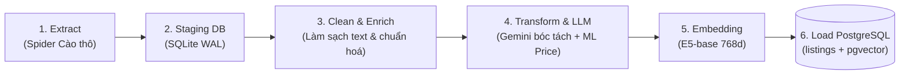
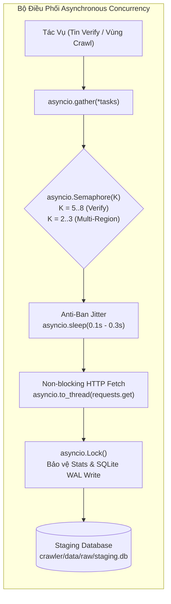
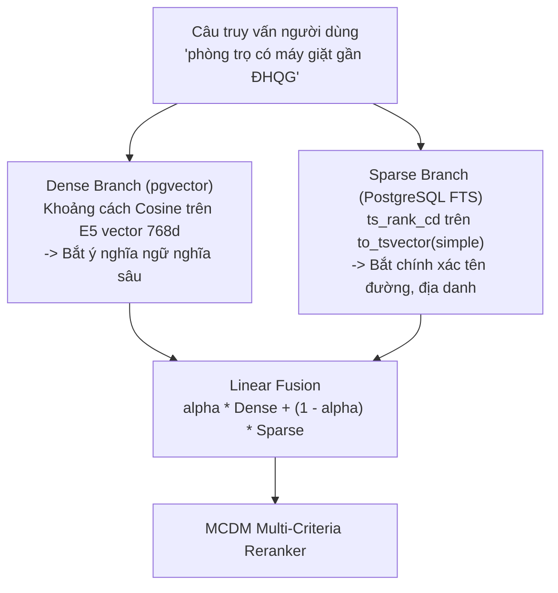
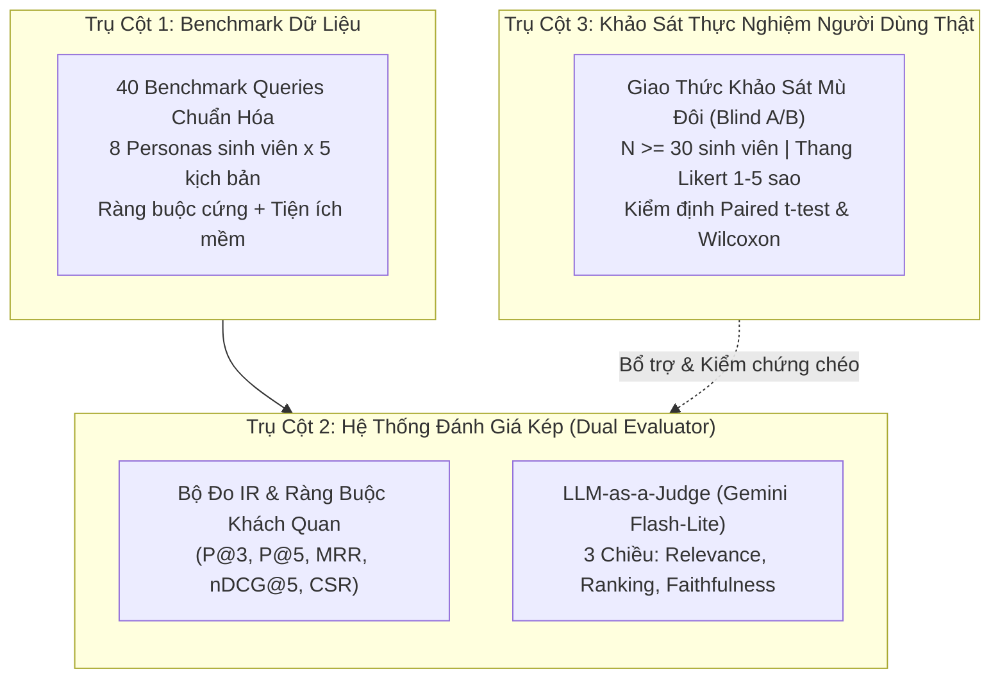

# 🏛️ Các Nguyên Tắc Thiết Kế Hệ Thống (System Principles)

Tài liệu này quy định các nguyên lý kiến trúc, thuật toán và luồng xử lý dữ liệu cốt lõi trong toàn bộ hệ thống Homigo.

---

## 1. 🧩 Nguyên Tắc Phân Tách Dịch Vụ (Service Isolation & Loose Coupling)

1. **4 Microservices độc lập:** Mỗi dịch vụ có `.venv` / `node_modules`, dependencies và tệp cấu hình `.env` riêng biệt. Không gọi chéo import code giữa các repo dịch vụ, chỉ giao tiếp qua mạng:
   - Frontend $\leftrightarrow$ Backend (REST API qua HTTP/JSON).
   - Frontend $\leftrightarrow$ AI Agent (REST + SSE Streaming).
   - AI Agent $\rightarrow$ Backend (REST API client chuyên dụng với connection pooling).
2. **Dùng chung tài nguyên thông minh (Shared Cache):**
   - Thư mục `models_cache/` được mount chung cho cả `backend` và `crawler` để tránh tải lại mô hình embedding E5 kích thước lớn.
   - Cơ sở dữ liệu Staging SQLite (`staging.db`) dùng làm vùng đệm độc lập với PostgreSQL Production để việc cào dữ liệu không làm nghẽn CSDL chính.

---

## 2. 🔄 Pipeline ETL Dữ Liệu 6 Bước (Crawler $\rightarrow$ Database)

Mọi dữ liệu phòng trọ từ nguồn ngoài (Nhà Tốt, PhongTrọ123...) đều bắt buộc đi qua luồng ETL tiêu chuẩn:



1. **Extract:** Spider thu thập JSON/HTML thô, lưu trữ nguyên trạng vào SQLite `raw_listings`.
2. **Clean & Enrich:** Loại bỏ HTML tag, chuẩn hóa Unicode NFC, xử lý dấu câu, hợp nhất tiêu đề + mô tả.
3. **LLM Extraction & Anti-Hallucination:**
   - Dùng Gemini 2.5 trích xuất thuộc tính cấu trúc (`ListingExtraction`).
   - Bắt buộc chạy hàm `verify_evidence`: Bằng chứng của tiện ích/an toàn không có trong văn bản gốc $\rightarrow$ Hạ về `unknown`.
4. **Transform & ML Pricing:**
   - Áp dụng mô hình CatBoost/LightGBM/XGBoost (Mondrian Conformal Prediction) để tính toán điểm hợp lý của giá (`price_score`) và khoảng tin cậy.
5. **Semantic Embedding:**
   - Tạo chuỗi văn bản giàu ngữ cảnh (`enriched_embedding_text`) và sinh vector 768 chiều bằng `intfloat/multilingual-e5-base`.
6. **Load:** Nạp UPSERT vào PostgreSQL production (`listings` và `listing_embeddings`).

### Cơ chế Lập lịch Tự động (Automated Ingestion & Verification Scheduler):
Hệ thống sử dụng tiến trình nền Python-native (`crawler/scheduler.py`) với cơ chế Non-overlapping Lock và Graceful Shutdown:
- **Daily Ingestion Job (02:00 AM hàng ngày):** Tự động cào tin mới (`--mode update --pages 3 --full`), chạy qua toàn bộ pipeline 6 bước nạp vào PostgreSQL.
- **Weekly Verification Job (04:00 AM Chủ Nhật):** Quét kiểm tra trạng thái các tin cũ (`--mode verify --limit 100`), đồng bộ `is_active = False` cho tin đã gỡ/hết hạn.
- **On-Demand Demo (`--run-now`):** Cho phép kích hoạt chạy ngay một lượt cào/verify tức thì phục vụ báo cáo và kiểm thử.

### Kiến Trúc Bất Đồng Bộ Kiểm Soát Tải (Asynchronous Concurrency: Semaphore + Gather):
Để giải quyết nút thắt cổ chai I/O mạng khi cào và kiểm tra hàng nghìn tin đăng, phân hệ Crawler áp dụng mô hình Worker Pool bất đồng bộ không cần cài đặt thêm thư viện ngoài (Zero New Dependencies, dùng `asyncio` chuẩn của Python 3.13):



1. **Verify Bất Đồng Bộ Tốc Độ Cao (`async_verify`):**
   - Thay thế vòng lặp tuần tự cũ bằng `asyncio.gather(*tasks)` kết hợp `asyncio.Semaphore(max_concurrency=5..8)`.
   - Bổ sung **Anti-ban Jitter** ngẫu nhiên (0.1s – 0.3s) giữa các request để phân tán xung nhịp tải, tránh bị Gateway Chợ Tốt khóa IP.
   - Sử dụng `asyncio.Lock()` bảo vệ cập nhật đồng bộ từ điển thống kê `stats` và bọc thao tác ghi SQLite qua `asyncio.to_thread(self.staging_db.save_listing)` (triệt tiêu race condition và lỗi `database is locked` trên chế độ WAL).
   - Tốc độ xử lý: Rút ngắn thời gian quét 100 tin từ **~150 giây (2.5 phút)** xuống còn **~12 – 15 giây** (tăng tốc gấp 10 lần).
2. **Cào Song Song Đa Vùng Độc Lập (`async_crawl_regions`):**
   - Hỗ trợ cào đồng thời nhiều tỉnh thành (`hcm`, `hanoi`, `danang`, `binhduong`...) qua `Semaphore(max_concurrent_regions=2..3)`.
   - Mỗi vùng duy trì file Checkpoint riêng biệt (`checkpoint_nhatot_{region}.json`) và cơ chế Dừng sớm (Early Stop) độc lập khi gặp trang toàn tin cũ.
3. **Tương Thích Ngược 100% (Backward Compatibility):**
   - Các hàm đồng bộ cũ `verify()` và `crawl()` được chuyển thành **Shim Wrapper** gọi ngầm `asyncio.run()`, tự động phát hiện running event loop để fallback sang `ThreadPoolExecutor` an toàn khi chạy trong môi trường có loop sẵn (như test suite hoặc scheduler).

---

## 3. 🔍 Cơ Chế Tìm Kiếm Lai (Hybrid Search: Dense + Sparse FTS)

Hệ thống kết hợp 2 phương pháp tìm kiếm để bù trừ nhược điểm cho nhau:

$$\text{Hybrid Score} = \alpha \times \text{Dense Sim} + (1 - \alpha) \times \text{Sparse Rank}$$
*(Trong đó mặc định $\alpha = 0.6$ đến $0.7$)*



* **Dense Branch:** Đo lường Cosine Distance trên bảng `listing_embeddings` giúp hiểu được các nhu cầu ẩn (ví dụ: "chỗ ở thoáng mát cho sinh viên").
* **Sparse Branch:** Đánh giá độ khớp từ khóa chính xác trên `title`, `address_raw`, `description` qua PostgreSQL Full-Text Search (`ts_rank_cd`), đảm bảo bắt chính xác tên trường đại học, tên quận, tên đường.

### Cơ Chế Lọc Không Gian & Ràng Buộc Cứng (Spatial & Hard Filtering Pipeline):
- **Spatial Pre-filter & Exact Haversine Filter:** Kết hợp lọc không gian 2 lớp:
  1. *Lớp 1 (Bounding Box SQL Pre-filter):* Tính toán khung giới hạn toạ độ hộp chữ nhật (`lat BETWEEN lat_min AND lat_max`, `lng BETWEEN lng_min AND lng_max`) tại CSDL để loại bỏ nhanh các tin đăng ngoài vùng và tận dụng index B-tree.
  2. *Lớp 2 (Exact Haversine Great-Circle Filter):* Tính khoảng cách đường cong mặt cầu chính xác theo toạ độ địa lý (`haversine_km(lat, lng) <= max_distance_km`), loại bỏ triệt để các tin nằm ở 4 góc chéo của Bounding Box nhưng thực tế vượt quá bán kính cho phép.
- **Lọc Tập Đa Loại Phòng (`room_types` / `allowed_room_types`):** Hỗ trợ tìm kiếm đồng thời nhiều loại hình phòng (ví dụ chấp nhận cả `"ROOM"` và `"STUDIO"`) thông qua điều kiện SQL `Listing.room_type_id.in_(type_ids)` linh hoạt thay vì chỉ cố định 1 loại duy nhất.
- **Ánh Xạ Ngữ Nghĩa Cho Tiện Ích Tổng Hợp (Composite Concept Mapping):**
  - `safe_area` (Khu an ninh): Được ánh xạ từ tổ hợp các tín hiệu an ninh (`camera`, `guard`, `fingerprint_lock`) và nhãn phân loại tin đăng trong khu dân cư an ninh, dân trí cao.
  - `furniture` (Nội thất cơ bản/đầy đủ): Được ánh xạ và thỏa mãn khi phòng trang bị các tiện nghi thiết yếu (`bed`, `wardrobe`, `air_conditioner`).

---

## 4. ⚖️ Bộ Tái Xếp Hạng Đa Tiêu Chí (MCDM Reranker 5 Tiêu Chí)

Sau khi Hybrid Search trả về tập ứng viên ban đầu (khoảng 30 - 50 phòng), hệ thống kích hoạt **MCDM Reranker** (`backend/app/services/reranker.py`) để sắp xếp lại theo 5 tiêu chí:

| Tiêu Chí | Trọng Số Cơ Sở Mặc Định | Cách Thức Đánh Giá |
| :--- | :--- | :--- |
| **Location Fit** | `0.25` | Khoảng cách đường chim bay (Haversine formula) đến toạ độ mong muốn của người dùng. Áp dụng suy giảm phi tuyến ($ratio^{1.5}$) trong khoảng `near_km = 0.8` đến `far_km = max_distance_km` (mặc định 5.0km), ưu tiên cao cho cự ly đi bộ. |
| **Price Fit** | `0.25` | Đánh giá mức độ hợp lý thị trường qua ML `price_score` (Conformal Prediction) kết hợp độ rẻ tiền danh nghĩa (`savings_ratio`). Khi người dùng ưu tiên giá rẻ (`prefer_cheapest` hoặc trọng số price > 0.28), tỷ trọng độ rẻ danh nghĩa được đẩy lên 85% (ML 15%) để căn giá rẻ thực sự thắng căn đắt deal hời; ở chế độ mặc định cân bằng 50% rẻ tiền + 50% hợp lý ML. |
| **Safety Fit** | `0.20` | Điểm an ninh tổng hợp (`safety_score`) dựa trên camera, bảo vệ, khóa vân tay, khu vực an ninh từ dữ liệu làm giàu của Crawler. |
| **Amenity Fit** | `0.20` | Tiện ích bắt buộc đã lọc cứng tại SQL/Grounding (không chấm lặp). Chấm độ khớp tiện ích mềm (`preferred_amenities`) 70% + điểm tổng thể (`amenity_overall`) 30%. |
| **Semantic Fit** | `0.10` | Điểm tương đồng ngữ nghĩa từ Hybrid Search (`similarity_score` kết hợp Dense Cosine E5-base và Sparse PostgreSQL FTS). |

### Cơ chế Trọng số Động (Dynamic Weights & L1 Normalization):
- **Luôn kích hoạt:** `price`, `safety`, `semantic`.
- **Kích hoạt có điều kiện:**
  - `location`: Chỉ bật khi người dùng truyền toạ độ (`lat` & `lng`).
  - `amenity`: Chỉ bật khi người dùng có tiện ích ưu tiên mềm (`preferred_amenities`), hoặc bật `include_amenity_overall`, hoặc caller chủ động truyền trọng số explicit.
- **Chuẩn hoá L1:** Tổng trọng số các tiêu chí đang bật luôn được chuẩn hóa để $\sum w_i = 1.0$.

---

## 5. 🤖 LangGraph State Machine & Tool Partitioning (AI Agent)

Hệ thống AI Agent được thiết kế theo mô hình **Đồ thị trạng thái hữu hạn (Finite State Graph)** với 8 nodes:

```mermaid
flowchart TD
    START --> guardrail_node["1. guardrail_node<br/>Kiểm tra an toàn / prompt injection"]
    
    guardrail_node --> understand_node["2. understand_node<br/>Phân tích ý định & bóc tách tiêu chí"]
    
    understand_node -->|Thiếu thông tin cốt lõi / đa nghĩa| clarification_node["3. clarification_node<br/>Hỏi làm rõ yêu cầu"]
    understand_node -->|Câu hỏi chung / tư vấn cẩm nang| advisory_node["4. advisory_node<br/>Tư vấn pháp lý, thị trường, cẩm nang"]
    understand_node -->|Đủ điều kiện tìm phòng| retrieval_node["5. retrieval_node<br/>Truy vấn Hybrid Search Backend"]
    understand_node -->|Hỏi đáp phòng đã tìm| decision_node["6. decision_node<br/>Tổng hợp giải pháp & chọn top phòng"]
    
    retrieval_node --> decision_node
    
    decision_node --> verify_node["7. verify_node (Self-RAG)<br/>Kiểm chứng thông tin đối chiếu với DB"]
    verify_node -->|Grounding fail (retry <= 2)| decision_node
    verify_node -->|Grounding pass / fallback| formatter_node["8. formatter_node<br/>Định dạng Markdown / UI components"]
    
    clarification_node --> formatter_node
    advisory_node --> formatter_node
    
    formatter_node --> END
```

### Nguyên tắc Phân Vùng Công Cụ (Tool Partitioning):
Để triệt tiêu tình trạng LLM gọi nhầm công cụ hoặc rò rỉ context:
* `retrieval_node`: Chỉ được cấp `RETRIEVAL_TOOLS` (`search_listings_hybrid`, `get_nearby_locations`).
* `decision_node`: Chỉ được cấp `DETAIL_TOOLS` (`get_listing_detail`).
* `advisory_node`: Chỉ được cấp `ADVISORY_TOOLS` (`get_market_price_stats`).

### 5.1. Cơ Chế Proactive Search & Phân Định Địa Danh Đa Nghĩa (Disambiguation Protocol):
Nhằm tối ưu hóa trải nghiệm người dùng và giảm thiểu lượt hỏi lại không cần thiết:
1. **Proactive Search (Chủ động tìm kiếm):** Khi câu truy vấn đã chứa trường đại học, cơ sở hoặc quận cụ thể (ví dụ: *"Bách Khoa CS1 Q10"*, *"ĐHQG Thủ Đức"*, *"Làng Đại học"*, *"Quận 10 dưới 3 triệu"*), `understand_node` tự động giải tỏa cờ mơ hồ sai lệch (`location_is_vague = False`), tự động suy ra `region_hint="Hồ Chí Minh"` và điều hướng thẳng sang `retrieval_node` để trả danh sách phòng ngay lập tức.
2. **Disambiguation Gate (Phân biệt đa nghĩa thực sự):** Nếu người dùng chỉ nói mốc liên vùng trơ trọi (ví dụ vỏn vẹn *"ĐH Bách Khoa"* không rõ Hà Nội hay TP.HCM), `geocode_point` trả về `{"ambiguous": True, "candidates": [...]}` để `clarification_node` hỏi lại người dùng một cách chính xác và ngắn gọn.
3. **Bán Kính Thích Ứng (Adaptive Radius Retrieval 2 Pha):** Khi `pref.has_point` có tọa độ mốc, khởi đầu tìm kiếm với bán kính cơ sở `base_radius = pref.max_distance_km or 2.5` km. Nếu số phòng hợp lệ sau bước lọc cứng < 3 và người dùng không cố định bán kính, hệ thống tự động nới lỏng sang bán kính 3.5km (và tối đa 5.0km nếu vẫn thiếu phòng), ghi nhận sự kiện `adaptive_radius_expansion` vào trace để câu trả lời cố vấn minh bạch. Khi người dùng chỉ định rõ `max_distance_km`, hệ thống tuân thủ nghiêm ngặt và không tự ý nới lỏng. Gửi kèm `district_id` khi tìm theo quận hành chính để chặn triệt để tình trạng gợi ý phòng Quận 5/Quận 10 cho sinh viên Thủ Đức.
4. **Từ Điển POI Trường Đại Học 0 ms (Local Campus Dictionary):** Tại [`ai-agent/data/university_campuses.json`](file:///c:/UIT/Lab/Đồ Án tốt nghiệp/ai-agent/data/university_campuses.json), hệ thống duy trì từ điển toạ độ chuẩn của các trường ĐH lớn tại TP.HCM (UIT, HCMUT CS1 & CS2, HCMUTE, UEH, USSH, HUTECH, KTX ĐHQG Khu A & B...), Hà Nội (HUST, NEU, VNU...), Đà Nẵng, Bình Dương. Hàm `lookup_university_poi` tại [`location_service.py`](file:///c:/UIT/Lab/Đồ Án tốt nghiệp/ai-agent/tools/location_service.py) giải mã toạ độ tức thì (0 ms) mà không cần gọi API geocoding bên ngoài.

### 5.2. Tương Thích Hai Chiều Payload LLM (Dual-Mode) & HTTP Resilience:
1. **Dual-Mode LLM Compatibility:** Tại [`ai-agent/core/llm.py`](file:///c:/UIT/Lab/Đồ Án tốt nghiệp/ai-agent/core/llm.py), hệ thống tự động phát hiện endpoint:
   - *Khi dùng LM Studio local (`localhost:1234`):* Bảo toàn 100% payload thinking đặc thù (`enable_thinking`, `chat_template_kwargs`, `reasoning_effort: "none"`).
   - *Khi dùng Google Gemini / Cloud OpenAI:* Tự động xóa bỏ các trường thinking khỏi body JSON để triệt tiêu lỗi `400 Bad Request: Unknown name "enable_thinking"`.
2. **HTTP Auto-Retry:** Decorator tại [`ai-agent/tools/http.py`](file:///c:/UIT/Lab/Đồ Án tốt nghiệp/ai-agent/tools/http.py) tự động thử lại tối đa 3 lần với exponential backoff (`0.5s` $\rightarrow$ `1.0s` $\rightarrow$ `2.0s`) khi gặp `httpx.ConnectError`, `httpx.TimeoutException`, hoặc mã lỗi `502, 503, 504`, bảo vệ đồ thị LangGraph không bị gãy trạng thái khi server Backend chập chờn.

### 5.3. Pre-Expansion Geocoding & Rate Limit Resilience Guard:
1. **Pre-Expansion Geocoding Tổng Quát:** Tại [`ai-agent/tools/housing_tools.py`](file:///c:/UIT/Lab/Đồ Án tốt nghiệp/ai-agent/tools/housing_tools.py), trước khi gửi truy vấn sang OpenStreetMap Nominatim, hàm `geocode_point` tự động kích hoạt `expand_location_with_llm` để mở rộng các tên viết tắt (như *ĐHQG TP.HCM*, *Làng Đại học*, *Bách Khoa CS2*, *UIT*...) thành tên chuẩn tự nhiên của cơ sở chính. Cơ chế ưu tiên thử `(expanded, hint)` và `(expanded, None)` trước khi fallback sang chuỗi gốc, loại bỏ hoàn toàn nhu cầu hardcode bảng từ điển hay overfit prompt NLU.
2. **Rate Limit Pacing, Quota Fast-Fail & Error Transparency:**
   - **Phân định Quota ngày (RPD) vs Rate Limit tạm thời (RPM):** Tại [`ai-agent/intelligence/nlu.py`](file:///c:/UIT/Lab/Đồ Án tốt nghiệp/ai-agent/intelligence/nlu.py), hệ thống sử dụng `is_daily_quota_exhausted` để nhận diện chính xác các mã lỗi cạn hạn mức ngày của Google Gemini / OpenAI (`RESOURCE_EXHAUSTED`, `GenerateRequestsPerDay`, `requests per day limit exceeded`).
   - **Fast-fail Quota ngày (< 0.1s):** Khi dính cạn hạn mức ngày (500 RPD), hệ thống hủy retry ngay lập tức, không ngủ chờ 12s-36s làm nghẽn luồng. Ném `LLMQuotaExceededError` để `understand_node` trả về `direct_reply=True` điều hướng thẳng sang `formatter_node` gửi thông báo rõ ràng cho người dùng thay vì nuốt lỗi.
   - **Adaptive backoff cho RPM:** Đối với Rate Limit theo phút thông thường (15 RPM), hàm áp dụng backoff ngắn (`2.0s` $\rightarrow$ `4.0s`).
   - **Trong `eval/run_recommendation_eval.py`:** Tích hợp bộ đệm pacing 3.0s giữa các query để bảo vệ hạn ngạch 15 RPM / 500 RPD của các nhà cung cấp LLM Free Tier.
   - **Minh bạch hóa lỗi tại SSE Stream & Frontend:** Payload lỗi tại `api/sse.py` và hook `useAiChat.ts` phân loại chính xác lỗi Quota 429 để hướng dẫn người dùng cập nhật `OPENAI_API_KEY` trong `.env`, phân biệt hoàn toàn với lỗi mất kết nối máy chủ Port 8001.

---

## 6. 🛡️ Cơ Chế Chống Ảo Giác & Lọc Ràng Buộc Đa Tầng (Anti-Hallucination)

1. **Tầng 1 (Data Ingestion — Crawler):**
   * Hàm `verify_evidence`: LLM khi trích xuất bất kỳ tiện ích nào đều phải trích nguyên văn câu làm bằng chứng. Nếu câu đó không khớp trong bài viết gốc $\rightarrow$ Tự động hạ về `unknown`.
2. **Tầng 2 (Hard-Constraints & Self-RAG Grounding — AI Agent):**
   * **Tầng 2A - Lọc Ràng Buộc Cứng Bằng Mã Lệnh (`check_hard_constraints`):** 100% bằng code Python thuần (loại bỏ phụ thuộc vào tính bất định của LLM) kiểm tra mọi phòng thu thập được:
     - *Ngân sách:* `priceNum <= max_price * 1.02` (dung sai kỹ thuật 2%) và `priceNum >= min_price * 0.98`.
     - *Diện tích:* `area_m2 >= min_area` và `area_m2 <= max_area`.
     - *Khoảng cách Haversine:* `dist <= max_distance_km` tính từ toạ độ mốc.
     - *Loại phòng:* Khớp với nhóm cho phép `allowed_room_types` / `room_type` và không thuộc nhóm cấm `excluded_room_types`.
     - *Tiện ích bắt buộc:* Khớp đủ mọi tiện ích trong `pref.amenities` dựa trên `concept_scores`.
     - Phòng vi phạm bị loại ngay lập tức kèm ghi nhận lý do cụ thể (`elimination_reasons`).
   * **Tầng 2B - Đối Chiếu Chéo Ngữ Cảnh & Scope Binding (`verify_context_grounding`):**
     - Node `verify_node` (Self-RAG Grounding): Trước khi câu trả lời được chuyển sang `formatter_node`, Agent đối chiếu từng phát biểu của câu trả lời với dữ liệu thực tế từ Backend. Nếu phát hiện AI tự bịa tiện ích (ví dụ: phòng không có máy lạnh mà nói có) $\rightarrow$ Yêu cầu `decision_node` tái tạo câu trả lời (tối đa 2 lần retry).
     - **Scope Binding Chặt Chẽ:** Hỗ trợ đối chiếu ràng buộc theo cả **Mã ID** lẫn **Nhãn Thứ Hạng** (`"Top 1"`, `"Top 2"`...). Mọi đặc tính tiện ích (máy lạnh, gác lửng, giá tiền...) khi được LLM phát ngôn về một phòng cụ thể phải được gán đúng vào phòng đó, triệt tiêu hoàn toàn lỗi hoán đổi tiện ích chéo giữa các phòng trong danh sách gợi ý.
3. **Phòng Thủ 3 Lớp Chặn Sleepbox / KTX Khi Tìm Phòng Riêng Khép Kín:**
   * *Lớp 1 (NLU Prompt & Guardrail Code):* Khi người dùng tìm phòng khép kín, có WC riêng, không chung chủ, studio, căn hộ, hoặc phòng cho 2 người, hệ thống tự động bổ sung `RoomType.SLEEPBOX` vào `room_types_exclude`.
   * *Lớp 2 (SQL Filter Backend):* API `/listings/vector-search` lọc cứng `Listing.room_type_id.notin_(excluded_ids)` triệt tiêu hộp ngủ ngay từ tầng cơ sở dữ liệu.
   * *Lớp 3 (Grounding Hard-Constraints):* Hàm `check_hard_constraints` đối soát kép cả `room_type == RoomType.SLEEPBOX` lẫn `room_type_id == 4` để loại trừ triệt để trước khi LLM phân tích.

---

## 7. ⏱️ Vòng Đời Tin Đăng & Cơ Chế Đồng Bộ (Lifecycle Sync)

1. **Spider Mode Verify:** Quét định kỳ kiểm tra mã HTTP 404 hoặc status bài đăng trên nguồn gốc.
2. **Auto Fast Sync:** Cập nhật ngay `is_active = False` và `status = "expired_or_deleted"` từ SQLite sang PostgreSQL trong vài giây.
3. **Backend Exclude:** Mọi query Search, Vector Search, Nearby Locations đều tự động lọc `Listing.is_active == True`.
4. **Detail Access:** Người dùng có ID cũ vẫn truy cập được chi tiết bài đăng nhưng nhận thông báo cảnh báo hết hạn màu vàng cam, đồng thời hệ thống vô hiệu hóa nút liên hệ.

---

## 8. 📊 Chuẩn Đánh Giá Định Lượng Độ Phù Hợp Gợi Ý (Housing Recommendation Evaluation Framework)

Để chứng minh tính hiệu quả và đóng góp khoa học của hệ thống gợi ý Homigo trong Luận văn Tốt nghiệp, kiến trúc đánh giá được xây dựng dựa trên **Mô hình 3 Trụ Cột Độc Lập (Three-Pillar Evaluation Framework)**:



### 8.1. Trụ Cột 1: 40 Benchmark Queries Đa Persona & Ràng Buộc Cứng
- **Tập dữ liệu chuẩn hóa:** [`ai-agent/eval/datasets/recommendation_benchmark.py`](file:///c:/UIT/Lab/Đồ Án tốt nghiệp/ai-agent/eval/datasets/recommendation_benchmark.py) gồm 40 kịch bản truy vấn bao phủ 8 nhóm đối tượng sinh viên (Personas):
  1. *Tân sinh viên năm nhất:* Ưu tiên gần trường ĐHQG, an ninh, có gác lửng, ngân sách dưới 3.5 triệu.
  2. *Sinh viên ở ghép (Roommates):* Cần phòng rộng $\ge 25\text{m}^2$, có kệ bếp, máy giặt, 2 chỗ để xe.
  3. *Sinh viên năm cuối / Đồ án:* Cần không gian yên tĩnh, wifi mạnh, máy lạnh, ban công/cửa sổ.
  4. *Sinh viên làm thêm / Tự lập:* Ngân sách eo hẹp ($\le 2.5$ triệu), không chung chủ, giờ giấc tự do.
  5. *Sinh viên nữ quan tâm an toàn:* Camera, bảo vệ, khóa vân tay, hẻm xe hơi.
  6. *Sinh viên trường thành viên (Bách Khoa, KHTN, Kinh Tế):* Bán kính di chuyển cụ thể theo từng cơ sở.
  7. *Sinh viên nuôi thú cưng:* Tiện ích mềm cho phép nuôi pet, thoáng mát.
  8. *Truy vấn đa tiêu chí phức tạp:* Kết hợp ràng buộc phủ định và khoảng giá hẹp.
- **Mỗi query chuẩn hóa đi kèm cấu trúc `GroundTruthExpectation`:** Khai báo cụ thể `hard_max_price`, `max_distance_km`, `target_coordinates`, `required_amenities`, `preferred_amenities`, `required_room_types`.

### 8.2. Trụ Cột 2: Hệ Thống Đánh Giá Kép (Dual Evaluator)
Kết hợp đo lường khách quan bằng thuật toán Information Retrieval và đo lường bán tự động bằng mô hình ngôn ngữ lớn:

1. **Bộ đo IR Metrics & Constraint Satisfaction Rate (CSR):**
   - Triển khai tại [`ai-agent/eval/ir_metrics.py`](file:///c:/UIT/Lab/Đồ Án tốt nghiệp/ai-agent/eval/ir_metrics.py):
     - $P@3, P@5$ (Precision@K): Tỷ lệ phòng hoàn toàn thỏa mãn mọi tiêu chí cứng trong Top $K$.
     - $\text{MRR}$ (Mean Reciprocal Rank): Vị trí đảo ngược của phòng đầu tiên đạt chuẩn ($1 / \text{rank}_1$).
     - $\text{nDCG}@5$: Chuẩn hóa độ suy giảm lũy tích theo 4 mức độ liên quan ($0 \rightarrow 3$).
     - $\text{CSR}$ (Constraint Satisfaction Rate): Tỷ lệ phòng vi phạm 0 ràng buộc cứng, kèm phân rã tuân thủ từng tiêu chí ($\text{CSR}_{\text{price}}, \text{CSR}_{\text{distance}}, \text{CSR}_{\text{amenity}}$).

2. **Gemini Flash-Lite LLM-as-a-Judge 3 Chiều:**
   - Triển khai tại [`ai-agent/eval/llm_judge.py`](file:///c:/UIT/Lab/Đồ Án tốt nghiệp/ai-agent/eval/llm_judge.py) qua schema Pydantic `RecommendationJudgeReport`:
     - **Relevance Score ($1.0 - 5.0$):** Độ phù hợp ngữ nghĩa và nhu cầu sinh hoạt của các phòng được đề xuất.
     - **Ranking Score ($1.0 - 5.0$):** Chất lượng xếp hạng logic — phòng Top 1 có thực sự vượt trội hơn các phòng sau hay không?
     - **Faithfulness Score ($1.0 - 5.0$):** Tính trung thực số liệu, kiểm chứng đối chiếu (Grounding Verification) không bịa đặt tiện ích hay giá trị sai lệch thực tế.

### 8.3. Trụ Cột 3: Khung Khảo Sát Người Dùng Thật & Kiểm Định Thống Kê
- **Giao thức khảo sát mù đôi (Blind A/B Testing):** Chi tiết tại [`docs/evaluation/human-eval-protocol.md`](file:///c:/UIT/Lab/Đồ Án tốt nghiệp/docs/evaluation/human-eval-protocol.md). Khảo sát $N \ge 30$ sinh viên ẩn danh so sánh Phương án A (Keyword + SQL Filter) và Phương án B (Homigo Agent).
- **Thang đo Likert 1 - 5 sao** trên 4 câu hỏi nghiên cứu:
  - $Q_1$: Độ phù hợp & Thỏa mãn nhu cầu (Relevance).
  - $Q_2$: Tính hữu ích của phần giải thích Top 1 & Phân tích Trade-offs (Explanation Transparency).
  - $Q_3$: Độ tin cậy thông tin để ra quyết định liên hệ thuê (Decision Confidence).
  - $Q_4$: Mức độ tiết kiệm thời gian tìm kiếm so với lướt web thủ công (Time Saving).
- **Module Phân Tích Thống Kê Suy Diễn:** Triển khai tại [`ai-agent/eval/stats_analyzer.py`](file:///c:/UIT/Lab/Đồ Án tốt nghiệp/ai-agent/eval/stats_analyzer.py):
  - Kiểm định tham số **Paired Samples $t$-test** đo lường $\Delta \text{Mean}$ và khoảng tin cậy $CI_{95\%}$.
  - Kiểm định phi tham số **Wilcoxon Signed-Rank Test** với hiệu chỉnh liên tục cho thang đo Likert thứ bậc.
  - Tự động xuất biểu đồ ASCII Boxplot và báo cáo Markdown chứng minh ý nghĩa thống kê ($p < 0.001$).


