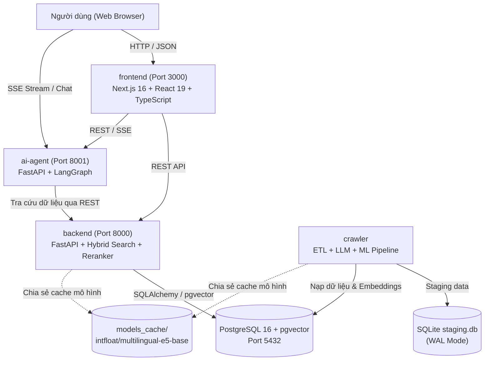

# 🛠️ Kiến Trúc Công Nghệ (Tech Stack)

Tài liệu này tổng hợp toàn bộ công nghệ, thư viện, cổng giao tiếp và môi trường runtime của 4 dịch vụ độc lập trong hệ thống **Homigo — Hỗ trợ Ra quyết định Tìm kiếm Phòng trọ Thông minh**.

---

## 1. 🌐 Tổng Quan 4 Dịch Vụ Độc Lập



---

## 2. 📦 Chi Tiết Từng Dịch Vụ

### 2.1. `backend/` — Core API & Hybrid Search Service
* **Cổng (Port):** `8000`
* **Môi trường ảo:** `backend/.venv` (Python 3.11+)
* **Framework:** FastAPI, Uvicorn, Pydantic v2 (`pydantic-settings`).
* **Cơ sở dữ liệu & Tìm kiếm:**
  * PostgreSQL 16 kết hợp extension `pgvector`
  * SQLAlchemy 2.0 (kèm connection pooling `QueuePool`)
  * `psycopg2-binary`
* **AI & Machine Learning:**
  * `sentence-transformers` (`intfloat/multilingual-e5-base`)
  * PyTorch
* **Kiến trúc mã nguồn:**  
  `controllers` $\rightarrow$ `services` (bao gồm `reranker.py` MCDM 5 tiêu chí) $\rightarrow$ `repositories` (Hybrid Search 70% Dense + 30% Sparse FTS) $\rightarrow$ `models` / `schemas`.

---

### 2.2. `ai-agent/` — LangGraph Decision Support Agent
* **Cổng (Port):** `8001`
* **Môi trường ảo:** `ai-agent/.venv` (Python 3.11+)
* **Framework & Agent:**
  * FastAPI (hỗ trợ REST API & Server-Sent Events - SSE Streaming)
  * `langgraph` (State Machine 8 nodes)
  * `langchain`, `langchain-openai`
* **Lưu trữ & Mạng:**
  * SQLite (`sessions.db` - lưu vết hội thoại đa phiên)
  * HTTPX (`AsyncClient` có connection pool)
  * Pydantic v2, PyYAML
* **Khởi tạo LLM:**
  * Tập trung duy nhất qua `core/llm.py`: `get_llm("main")` và `get_llm("fast")`.

---

### 2.3. `frontend/` — Giao Diện Người Dùng (User Interface)
* **Cổng (Port):** `3000`
* **Môi trường:** Node.js 20+, npm
* **Framework & Thư viện UI:**
  * Next.js 16 (App Router, Turbopack)
  * React 19, TypeScript 5
  * Tailwind CSS v4
  * Leaflet & React-Leaflet (Bản đồ tương tác tìm kiếm phòng)
* **Nguyên tắc Type-safety:**
  * Định nghĩa DTO trong `src/types/dto/` khớp 1-1 với Schema của `backend` và `ai-agent`. Tuyệt đối không dùng kiểu `any` bừa bãi.

---

### 2.4. `crawler/` — Thu Thập Dữ Liệu, ML Định Giá & ETL Pipeline
* **Môi trường ảo:** `crawler/.venv` (Python 3.13+)
* **Cơ sở dữ liệu Staging:** SQLite (`crawler/data/staging.db`, chế độ WAL mode + Normal Synchronous).
* **AI & Machine Learning:**
  * Google GenAI SDK (Gemini 2.5) trích xuất đặc trưng bài đăng chống ảo giác (`verify_evidence`).
  * CatBoost / LightGBM / XGBoost kèm Mondrian Conformal Prediction (Thẩm định giá thuê & khoảng tin cậy).
  * `sentence-transformers` sinh vector ngữ nghĩa 768 chiều.
  * Pandas, NumPy, PyArrow.
* **Cơ chế dùng chung:**
  * Tận dụng chung thư mục cache mô hình tại `models_cache/` với `backend` để tránh tải lại model.

---

## 3. ⚡ Bảng Lệnh Khởi Chạy Chuẩn

```powershell
# 1. Khởi chạy CSDL PostgreSQL (Docker)
docker start homigo-postgres

# 2. Khởi chạy Backend API (Port 8000)
.\backend\.venv\Scripts\python.exe backend/run.py

# 3. Khởi chạy AI Agent Service (Port 8001)
.\ai-agent\.venv\Scripts\python.exe ai-agent/main.py

# 4. Khởi chạy Frontend UI (Port 3000)
cd frontend; npm run dev
```

