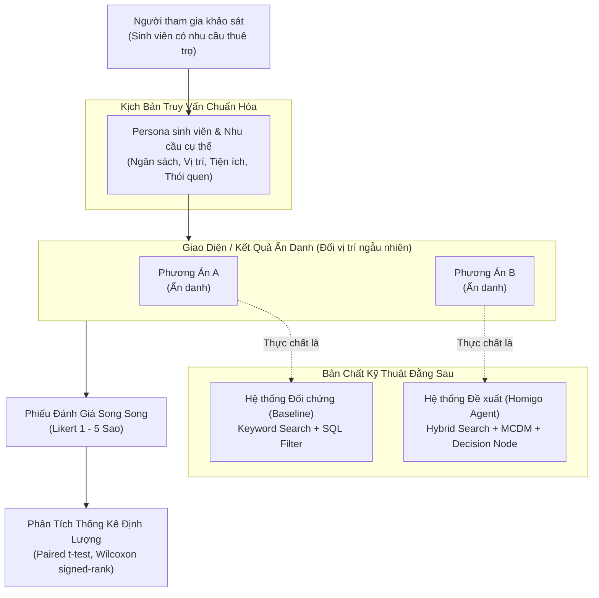

# 📋 Giao Thức Khảo Sát Người Dùng Thật (Human Evaluation Protocol)
## Đánh Giá Trải Nghiệm & Độ Phù Hợp Gợi Ý Của Hệ Thống Homigo

*Tài liệu phương pháp luận nghiên cứu thực nghiệm phục vụ Khóa luận Tốt nghiệp.*

---

## 1. 🎯 Mục Tiêu Nghiên Cứu Thực Nghiệm

Mục tiêu cốt lõi của nghiên cứu thực nghiệm là **đánh giá định lượng trải nghiệm người dùng thực tế và chất lượng gợi ý phòng trọ** của hệ thống Homigo AI Agent đối với đối tượng hưởng lợi trực tiếp: sinh viên đại học và người trẻ đang có nhu cầu thuê nhà tại TP.HCM / Khu đô thị ĐHQG-HCM.

Cụ thể, nghiên cứu nhằm kiểm chứng 3 giả thuyết khoa học:
- **Giả thuyết $H_1$:** Homigo AI Agent (Hybrid Search + MCDM Reranker + Decision Insights) mang lại danh sách gợi ý phù hợp và thỏa mãn nhu cầu sinh viên vượt trội so với phương pháp tìm kiếm truyền thống (từ khóa + bộ lọc SQL cơ bản).
- **Giả thuyết $H_2$:** Khả năng tự động phân tích đánh đổi (trade-offs) và diễn giải lý do lựa chọn phòng Top 1 giúp gia tăng đáng kể độ tin cậy và tự tin ra quyết định thuê trọ.
- **Giả thuyết $H_3$:** Hệ thống giúp sinh viên tiết kiệm thời gian sàng lọc thông tin và giảm tải áp lực tâm lý so với việc tìm kiếm thủ công trên mạng xã hội hoặc các website bất động sản truyền thống.

---

## 2. 🔬 Phương Pháp Thử Nghiệm: Mù Đôi Ngẫu Nhiên (Double-Blind A/B Testing)

Để triệt tiêu hiện tượng thiên vị tâm lý (Experimenter Bias & Subject Bias), nghiên cứu áp dụng quy trình **Blind A/B Testing**:



### Nguyên tắc thực nghiệm:
1. **Ẩn danh hoàn toàn thương hiệu:** Hai hệ thống được hiển thị ngẫu nhiên dưới tên gọi trung lập là **Phương án A** và **Phương án B** (hoặc X / Y). Người tham gia không được thông báo trước phương án nào là của đề tài và phương án nào là đối chứng.
2. **Cùng ngữ cảnh đầu vào (Controlled Input):** Cả hai phương án đều nhận cùng một câu truy vấn tự nhiên của sinh viên (ví dụ: *"Tìm phòng trọ gần ĐH Bách Khoa CS2, có máy lạnh, dưới 4 triệu, có chỗ để xe máy an toàn"*).
3. **Hiển thị song song (Side-by-side / Sequential Evaluation):** Người dùng quan sát trực tiếp kết quả trả về của cả hai hệ thống trên cùng một màn hình hoặc 2 phiên làm việc liên tiếp trước khi cho điểm.

---

## 3. ⭐ Thang Đo Likert 5 Mức Độ (Evaluation Scale)

Mỗi sinh viên đánh giá cả 2 phương án (A và B) theo thang đo Likert chuẩn 5 mức độ:

| Mức sao | Ý nghĩa định lượng | Diễn giải trải nghiệm |
| :---: | :---: | :--- |
| **1 ⭐** | Rất không hài lòng / Hoàn toàn không đồng ý | Kết quả không khớp yêu cầu, thông tin mơ hồ, không giúp ích. |
| **2 ⭐** | Không hài lòng / Không đồng ý | Kết quả chỉ khớp một phần nhỏ, vẫn phải tìm kiếm thủ công lại từ đầu. |
| **3 ⭐** | Bình thường / Tương đối đồng ý | Kết quả chấp nhận được ở mức cơ bản, tương tự các website hiện có. |
| **4 ⭐** | Hài lòng / Đồng ý | Kết quả tốt, thông tin rõ ràng, hỗ trợ ra quyết định nhanh chóng. |
| **5 ⭐** | Rất hài lòng / Hoàn toàn đồng ý | Kết quả xuất sắc, vượt kỳ vọng, giải thích thấu đáo, sẵn sàng liên hệ ngay. |

### 4 Câu Hỏi Nghiên Cứu Trọng Tâm:

- **Q1 — Độ phù hợp & Thỏa mãn nhu cầu (Relevance & Need Satisfaction):**  
  *Câu hỏi:* *"Danh sách các phòng trọ được gợi ý có đáp ứng đúng và đầy đủ các tiêu chí bạn đặt ra (giá tiền, khoảng cách, tiện ích, loại phòng) hay không?"*
- **Q2 — Tính hữu ích của phần giải thích & so sánh đánh đổi (Explanation & Trade-off Transparency):**  
  *Câu hỏi:* *"Phần giải thích lý do chọn phòng Top 1 và bảng phân tích điểm mạnh / điểm đánh đổi (trade-offs) giữa các phòng có rõ ràng, minh bạch và giúp bạn dễ lựa chọn hơn không?"*
- **Q3 — Độ tin cậy & Tự tin ra quyết định (Trustworthiness & Decision Confidence):**  
  *Câu hỏi:* *"Mức độ tin cậy của thông tin (độ chính xác giá trị thị trường, địa chỉ, khoảng cách, an ninh) có đủ để bạn tự tin liên hệ chủ nhà xem phòng ngay không?"*
- **Q4 — Mức độ tiết kiệm thời gian & Hiệu quả (Search Efficiency & Time Saving):**  
  *Câu hỏi:* *"So với cách thức bạn thường tìm phòng trọ (lướt Facebook Groups, hỏi người quen, tra cứu các trang web rao vặt), phương án này giúp bạn tiết kiệm bao nhiêu thời gian và công sức?"*

---

## 4. 📝 Hướng Dẫn Thiết Lập Google Form Khảo Sát

Khi triển khai thu thập dữ liệu trực tuyến, biểu mẫu Google Form được cấu trúc thành 4 phần logic:

### Phần 1: Thông tin người tham gia & Bối cảnh (Demographics & Context)
- Email hoặc Mã định danh sinh viên (để kiểm tra tính duy nhất).
- Trường đại học đang theo học (ĐHQG-HCM, Bách Khoa, KHTN, UIT, Kinh Tế...).
- Năm học hiện tại: Năm 1 / Năm 2 / Năm 3 / Năm 4 / Sau đại học.
- Kịch bản trải nghiệm (Lựa chọn 1 trong các Persona chuẩn bị sẵn hoặc nhập nhu cầu thực tế của bản thân).

### Phần 2: Trải nghiệm thực tế kịch bản A/B (Blind Scenario Walkthrough)
- Đính kèm hình ảnh giao diện / video quay màn hình ngắn (30-60s) hoặc đường dẫn dùng thử ẩn danh cho cả 2 phương án A và B trên cùng 1 kịch bản mẫu.
- **Phương án A:** Kết quả trả về từ bộ tìm kiếm SQL lọc cơ bản (danh sách card phòng thô, không có phân tích trade-off).
- **Phương án B:** Kết quả trả về từ Homigo AI Agent (tóm tắt nhu cầu, giải thích lý do Top 1, phân tích ưu nhược điểm, bảng đối chiếu 3 phòng tốt nhất).

### Phần 3: Chấm điểm đối đầu (Side-by-side Likert Rating)
Sử dụng dạng câu hỏi **Lưới nhiều lựa chọn (Multiple-choice grid)** hoặc chia câu hỏi độc lập:
- `Q1.A`: Độ phù hợp danh sách phòng — Phương án A (1 - 5 sao).
- `Q1.B`: Độ phù hợp danh sách phòng — Phương án B (1 - 5 sao).
- `Q2.A`: Tính hữu ích của phần giải thích — Phương án A (1 - 5 sao).
- `Q2.B`: Tính hữu ích của phần giải thích — Phương án B (1 - 5 sao).
- `Q3.A`: Độ tin cậy thông tin để ra quyết định — Phương án A (1 - 5 sao).
- `Q3.B`: Độ tin cậy thông tin để ra quyết định — Phương án B (1 - 5 sao).
- `Q4.A`: Mức độ tiết kiệm thời gian tìm kiếm — Phương án A (1 - 5 sao).
- `Q4.B`: Mức độ tiết kiệm thời gian tìm kiếm — Phương án B (1 - 5 sao).

### Phần 4: Lựa chọn tổng quan & Phản hồi định tính
- **Câu hỏi lựa chọn trực tiếp:** *"Nếu phải chọn 1 hệ thống duy nhất để đồng hành tìm phòng trọ trong kỳ tới, bạn sẽ chọn phương án nào?"* (Tùy chọn: `Phương án A`, `Phương án B`, `Không phương án nào`).
- **Ý kiến đóng góp định tính:** *"Những điểm bạn thích nhất và những điểm cần cải thiện của hệ thống bạn đánh giá cao hơn?"*

---

## 5. 📂 Chuẩn Cấu Trúc File Dữ Liệu `human_eval_responses.csv`

Kết quả xuất từ Google Form sau khi làm sạch phải tuân thủ đúng định dạng bảng CSV sau:

### Bảng Định Nghĩa Schema CSV:
| Tên Cột | Kiểu Dữ Liệu | Ràng Buộc | Ý Nghĩa Chi Tiết |
| :--- | :---: | :---: | :--- |
| `respondent_id` | String | Unique | Mã định danh người tham gia (ví dụ: `SV001`, `SV002`...) |
| `timestamp` | ISO String | Không rỗng | Thời điểm hoàn thành khảo sát (`YYYY-MM-DD HH:MM:SS`) |
| `university` | String | Không rỗng | Trường đại học (ví dụ: `UIT`, `BK`, `USSH`...) |
| `persona_id` | String | Khóa ngoại | Mã kịch bản persona thử nghiệm (`P1_FRESHMAN`, `P2_COUPLE`...) |
| `q1_baseline` | Float/Int | $1 \le x \le 5$ | Điểm Q1 của Baseline (Phương án A) |
| `q1_agent` | Float/Int | $1 \le x \le 5$ | Điểm Q1 của Homigo Agent (Phương án B) |
| `q2_baseline` | Float/Int | $1 \le x \le 5$ | Điểm Q2 của Baseline |
| `q2_agent` | Float/Int | $1 \le x \le 5$ | Điểm Q2 của Homigo Agent |
| `q3_baseline` | Float/Int | $1 \le x \le 5$ | Điểm Q3 của Baseline |
| `q3_agent` | Float/Int | $1 \le x \le 5$ | Điểm Q3 của Homigo Agent |
| `q4_baseline` | Float/Int | $1 \le x \le 5$ | Điểm Q4 của Baseline |
| `q4_agent` | Float/Int | $1 \le x \le 5$ | Điểm Q4 của Homigo Agent |
| `preference` | String | `Baseline` / `Agent` / `Tie` | Lựa chọn tổng quan cuối cùng |
| `feedback` | String | Tùy chọn | Góp ý định tính của sinh viên |

### Dữ Liệu Mẫu Minh Họa (Sample CSV Lines):
```csv
respondent_id,timestamp,university,persona_id,q1_baseline,q1_agent,q2_baseline,q2_agent,q3_baseline,q3_agent,q4_baseline,q4_agent,preference,feedback
SV001,2026-11-01 09:15:20,UIT,P1_FRESHMAN,3,5,2,5,3,4,3,5,Agent,Agent giải thích rõ tại sao phòng 1 đáng tiền hơn phòng 2 dù đắt hơn 300k
SV002,2026-11-01 10:22:45,BK_HCM,P2_ROOMMATE,4,4,2,4,4,4,3,4,Agent,Bộ lọc SQL truyền thống tìm nhanh nhưng con Agent chỉ ra được điểm gửi xe cách 200m rất thực tế
SV003,2026-11-01 11:05:12,USSH,P3_BUDGET,2,4,1,5,3,4,2,5,Agent,Đỡ mất công đọc từng bài trên group facebook
SV004,2026-11-01 14:40:01,KHTN,P4_SAFETY,3,5,3,5,3,5,3,4,Agent,Thông tin an ninh có khoá vân tay camera được highlight rõ ràng
SV005,2026-11-01 16:12:30,UFM,P1_FRESHMAN,4,5,2,4,4,5,4,5,Agent,Rất trực quan và tiết kiệm thời gian
```

---

## 6. 🧹 Quy Trình Làm Sạch & Tiền Xử Lý Dữ Liệu (Data Cleaning Protocol)

Trước khi đưa vào module phân tích thống kê `stats_analyzer.py`, bộ dữ liệu khảo sát phải trải qua các bước kiểm tra nghiêm ngặt:
1. **Khử trùng lặp (De-duplication):** Loại bỏ các lượt điền bị lặp từ cùng một sinh viên (dựa trên email hoặc timestamp trùng sát nhau).
2. **Loại bỏ phản hồi không nghiêm túc (Straight-lining & Speeders):**
   - Người tham gia điền cùng một giá trị cho toàn bộ các ô (ví dụ toàn bộ 1 hoặc toàn bộ 5 từ đầu đến cuối mà không có biến thiên).
   - Thời gian làm bài khảo sát quá nhanh (dưới 60 giây cho toàn bộ 4 câu hỏi so sánh).
3. **Kiểm tra tính toàn vẹn (Completeness):** Đảm bảo tất cả 8 cột điểm ($Q_1 \rightarrow Q_4$ cho cả 2 hệ thống) đều có giá trị hợp lệ từ 1.0 đến 5.0, không có ô rỗng `NaN`.
4. **Cỡ mẫu tối thiểu (Sample Size Power):** Nghiên cứu khuyến nghị thu thập tối thiểu $N \ge 30$ phản hồi hợp lệ để đảm bảo định lý giới hạn trung tâm (Central Limit Theorem) cho kiểm định $t$-test cặp.

