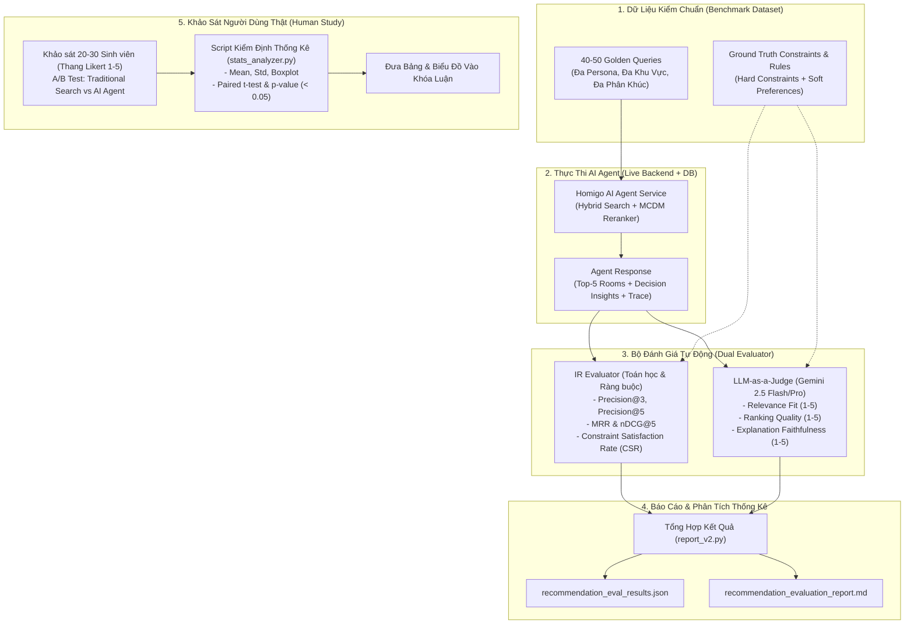
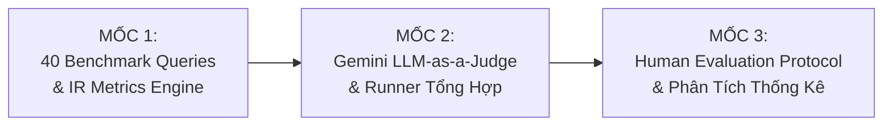

# 📋 Đặc Tả Kỹ Thuật (Feature Spec): Nâng Cấp Hệ Thống Đánh Giá Độ Phù Hợp Gợi Ý Của AI Agent (Recommendation & Relevance Evaluation v2)

- **Mã tính năng (Feature ID):** `FEAT-AI-AGENT-EVAL-V2`
- **Trạng thái:** ✅ COMPLETED (Đã triển khai & nghiệm thu toàn bộ 3 mốc)
- **Ngày tạo:** 06/11/2026
- **Tác giả:** Homigo AI Solution Architect & Research Team
- **Phạm vi tác động:** `ai-agent/eval/`, `ai-agent/eval_results/`, `docs/features/`, `docs/architecture/`

---

## 1. 🎯 Tổng Quan & Động Lực (Overview & Motivation)

### 1.1. Hiện trạng & Lỗ hổng trong Phương pháp Đánh giá Hiện tại

Hệ thống đánh giá của AI Agent hiện tại (tại [`ai-agent/eval/`](file:///c:/UIT/Lab/Đồ Án tốt nghiệp/ai-agent/eval/)) đã làm rất tốt ở mức độ **Kiểm thử Thành phần (Component Verification)** và **Kiểm tra An toàn (Guardrails & Faithfulness)**:
- Điểm Rubric Khóa luận đạt **100/100** trên bộ ca tĩnh (Hàm Haversine, L1-MCDM weights, State snapshot, Token compression).
- Bộ lọc Guardrail chặn **100% tấn công** Prompt Injection / Jailbreak trên 137 ca.
- Bộ lọc Self-RAG Grounding phát hiện **100% lỗi tiêm vào** trên 600 ca tổng hợp.

Tuy nhiên, đối với bài toán cốt lõi của một Hệ thống Hỗ trợ Ra Quyết định Tìm Kiếm Phòng Trọ (Housing Recommendation & Decision Support System), **hệ thống hiện tại vẫn chưa đo lường định lượng được chất lượng gợi ý phòng**:

1. **Bộ kịch bản Live Database quá nhỏ (Chỉ 8 test cases):**
   - 8 ca kiểm thử trong [`live_eval_results_real_db.json`](file:///c:/UIT/Lab/Đồ Án tốt nghiệp/ai-agent/eval_results/live_eval_results_real_db.json) chỉ tập trung quanh khu vực ĐHQG (UIT) và ĐH Bách Khoa, chưa bao quát sinh viên các trường khác (ĐH Kinh Tế, ĐH Sư Phạm Kỹ Thuật, ĐH Tôn Đức Thắng...) và các phân khúc phòng đa dạng (Sleepbox, Phòng ở ghép, Studio cao cấp, Nhà nguyên căn).
2. **Thiếu các chỉ số đo lường Chuẩn Quốc tế trong Tìm kiếm & Gợi ý (Information Retrieval & RecSys Metrics):**
   - Chưa tính toán **Precision@k** (Trong top 3 hoặc top 5 phòng gợi ý, có bao nhiêu phòng thực sự thỏa mãn yêu cầu?).
   - Chưa đo lường **nDCG@k** và **MRR** để đánh giá xem thuật toán MCDM Reranker có thực sự đưa những phòng tốt nhất lên Top 1 hay không.
3. **Chưa có LLM-as-a-Judge đánh giá ngữ nghĩa sâu:**
   - Bộ đánh giá hiện tại chủ yếu kiểm tra logic cứng (giá $\le$ budget, khoảng cách $\le$ max_km). Khi gặp các yêu cầu mang tính định tính (ví dụ: *"phòng yên tĩnh để ôn thi"*, *"khu vực an ninh cho nữ ở một mình"*), hệ thống chưa có trọng tài độc lập để chấm điểm mức độ thỏa mãn ngữ nghĩa.
4. **Thiếu số liệu Nghiên cứu Thực nghiệm trên Người Dùng Thật (Human Evaluation):**
   - Để bảo vệ luận văn tốt nghiệp trước Hội đồng với điểm số xuất sắc, cần có số liệu khảo sát thực tế trên sinh viên thật (A/B testing hoặc Blind test so sánh giữa Homigo AI Agent và Tìm kiếm lọc truyền thống).

---

### 1.2. Mục Tiêu Nâng Cấp (3 Trụ Cột Đánh Giá Hoàn Chỉnh)

1. **Trụ cột 1 — Mở rộng Bộ Benchmark lên 40 - 50 Câu Truy Vấn Đa Dạng (Golden Benchmark Dataset):**
   - Xây dựng tập test queries đại diện phủ kín 5 nhóm người dùng (Persona) với đầy đủ các cụm trường đại học lớn tại TP.HCM và đa dạng phân khúc từ giá rẻ đến cao cấp.
2. **Trụ cột 2 — Tự Động Hóa Bộ Chỉ Số IR Metrics & LLM-as-a-Judge (Automated IR & Semantic Scoring):**
   - Tự động đo đạc **Precision@3, Precision@5, MRR, nDCG@5, và Constraint Satisfaction Rate (CSR)**.
   - Tích hợp **Gemini 2.5 Flash / Pro** làm trọng tài độc lập (LLM-as-a-Judge) chấm điểm 3 chiều: Độ liên quan (Relevance Fit), Chất lượng xếp hạng (Ranking Quality), và Tính trung thực của lời giải thích (Explanation Faithfulness).
3. **Trụ cột 3 — Khung Đánh Giá Người Dùng Thật (Human Evaluation Protocol & Statistical Analysis):**
   - Cung cấp kịch bản khảo sát thực tế với sinh viên (Google Form / Blind Test UI) và script tự động tính toán kiểm định giả thuyết thống kê (Paired $t$-test, Wilcoxon signed-rank test, p-value) để đưa thẳng biểu đồ vào báo cáo luận văn.

---

## 2. 📐 Thiết Kế Kỹ Thuật Chi Tiết (Technical Design)

### 2.1. Sơ Đồ Kiến Trúc Hệ Thống Đánh Giá Mới (Evaluation Pipeline Architecture)



---

### 2.2. Phân Bổ 40 - 50 Câu Truy Vấn Kiểm Chuẩn (Benchmark Query Distribution)

Bộ dữ liệu kiểm chuẩn mới được thiết kế bao gồm **40 câu hỏi** chia đều vào 5 nhóm kịch bản thực tế:

| Nhóm Persona | Số lượng | Trường mục tiêu / Khu vực | Đặc điểm yêu cầu & Độ khó |
| :--- | :---: | :--- | :--- |
| **G1: Sinh viên tiết kiệm / Ngân sách thấp** | 8 | Làng ĐHQG, Thủ Đức, Quận 9 | Giá rẻ (< 2.5tr), tìm KTX, Sleepbox, ở ghép, không chung chủ. |
| **G2: Sinh viên nữ / An ninh & Tiện ích** | 8 | ĐH Bách Khoa, ĐH Kinh Tế, Quận 10 | Ưu tiên an ninh tuyệt đối (camera, khóa vân tay, bảo vệ), có máy lạnh, máy giặt. |
| **G3: Nhóm bạn sinh viên ở chung** | 8 | ĐH Sư Phạm Kỹ Thuật, ĐH Hutech, Bình Thạnh | Cần phòng rộng $\ge 30m^2$, có gác lửng hoặc 2 phòng ngủ, cho nuôi thú cưng, giờ giấc tự do. |
| **G4: Người mới đi làm / Studio cao cấp** | 8 | Quận 1, Quận 3, Quận 7, Phú Nhuận | Ngân sách 5 - 8 triệu, căn hộ dịch vụ full nội thất cao cấp, có thang máy, ban công thoáng. |
| **G5: Ca khó (Edge cases, Tiếng lóng & Đa lượt)** | 8 | Đa quận huyện (Dĩ An, Bình Chánh, Tân Bình...) | Dùng tiếng lóng ("3 củ rưỡi", "triệu hai"), phủ định phức tạp, hội thoại đa lượt thay đổi tiêu chí liên tục. |

---

### 2.3. Công Thức & Cách Tính Các Chỉ Số IR Metrics

1. **Constraint Satisfaction Rate (CSR):**
   Tỷ lệ phần trăm các phòng trong Top $k$ thỏa mãn $100\%$ các ràng buộc cứng:
   $$\text{CSR} = \frac{1}{k} \sum_{i=1}^k \mathbb{I}(\text{Phòng } i \text{ thỏa mãn Giá, Bán kính, Loại phòng})$$

2. **Precision@k (với $k = 3, 5$):**
   $$\text{Precision@k} = \frac{|\text{Phòng phù hợp trong Top } k|}{k}$$

3. **Mean Reciprocal Rank (MRR):**
   Vị trí xuất hiện của phòng phù hợp đầu tiên trong danh sách:
   $$\text{MRR} = \frac{1}{|Q|} \sum_{q=1}^{|Q|} \frac{1}{\text{rank}_q}$$
   *(Nếu phòng phù hợp nằm ngay Top 1 thì $\text{Reciprocal Rank} = 1.0$)*.

4. **Normalized Discounted Cumulative Gain (nDCG@k):**
   Đánh giá chất lượng xếp hạng với độ liên quan nhiều mức ($rel_i \in \{0, 1, 2, 3\}$):
   $$\text{DCG@k} = \sum_{i=1}^k \frac{2^{rel_i} - 1}{\log_2(i + 1)}, \quad \text{nDCG@k} = \frac{\text{DCG@k}}{\text{IDCG@k}}$$

---

### 2.4. Thiết Kế Trọng Tài Độc Lập (LLM-as-a-Judge)

Sử dụng **Gemini 2.5 Flash / Pro** (được tích hợp thông qua `google-genai` hoặc `langchain-google-genai` có sẵn trong môi trường của dự án) làm thẩm định viên độc lập.

**Cấu trúc Đánh giá 3 Chiều:**
1. **Relevance Fit (1 - 5 điểm):** Danh sách phòng gợi ý có giải quyết đúng nhu cầu và mong muốn tiềm ẩn của người dùng không?
2. **Ranking Consistency (1 - 5 điểm):** Phòng Top 1 có thực sự vượt trội hơn các phòng sau dựa trên tiêu chí người dùng ưu tiên không?
3. **Explanation Quality & Grounding (1 - 5 điểm):** Lời giải thích và phân tích so sánh (trade-offs) có trung thực với dữ liệu phòng và mang lại giá trị ra quyết định không?

**JSON Output Schema của LLM Judge:**
```json
{
  "query_id": "G1_QUERY_01",
  "relevance_score": 4.5,
  "ranking_score": 5.0,
  "explanation_score": 4.5,
  "overall_score": 4.67,
  "strengths": ["Bắt chính xác yêu cầu giá dưới 2.5tr", "Top 1 có an ninh cao và cách UIT chỉ 1.5km"],
  "weaknesses": ["Phòng số 3 tiện ích máy lạnh chưa rõ ràng"],
  "judge_rationale": "Agent đã cân đối tốt giữa khoảng cách và mức giá sinh viên..."
}
```

---

### 2.5. Khung Khảo Sát Người Dùng Thật (Human Evaluation Protocol)

1. **Thiết kế Blind Test (Thử nghiệm mù đôi):**
   - Người tham gia: 20 - 30 sinh viên UIT và các trường lân cận.
   - Mỗi sinh viên nhập 2 câu hỏi tìm phòng thực tế của bản thân.
   - Kết quả trả về gồm 2 cột ẩn danh: **Phương án A** (Tìm kiếm từ khóa + bộ lọc SQL cơ bản) vs **Phương án B** (Homigo AI Agent).
2. **Thang đo Likert (1 - 5):**
   - $Q_1$: Độ phù hợp của các phòng được đề xuất ($1 = \text{Rất tệ}, 5 = \text{Rất phù hợp}$).
   - $Q_2$: Độ tin cậy và hữu ích của lời giải thích/so sánh ($1 = \text{Không giúp ích}, 5 = \text{Rất hữu ích}$).
   - $Q_3$: Mức độ sẵn sàng sử dụng hệ thống để thuê phòng thật ($1 = \text{Không}, 5 = \text{Chắc chắn}$).
3. **Phân tích Thống kê:**
   - Sử dụng Script Python tính Mean, Median, Standard Deviation.
   - Chạy kiểm định **Paired Samples $t$-test** và **Wilcoxon Signed-Rank Test** để xác định giá trị $p$-value. Nếu $p < 0.05$, đề tài có đủ bằng chứng khoa học khẳng định AI Agent vượt trội so với tìm kiếm truyền thống.

---

## 3. 📋 Bảng Phân Công Checklist Công Việc (Progress Tracking Checklist)

Bảng checklist dưới đây theo dõi tiến độ thực hiện tính năng. Trạng thái sẽ được cập nhật liên tục từ `[ ]` sang `[x]` khi hoàn thành từng đầu việc:

### Module 1: Dữ liệu Kiểm chuẩn & Bộ đo IR Metrics (`ai-agent/eval/`)
- [x] Xây dựng bộ dữ liệu 40 câu truy vấn kiểm chuẩn [`eval/datasets/recommendation_benchmark.py`](file:///c:/UIT/Lab/Đồ Án tốt nghiệp/ai-agent/eval/datasets/recommendation_benchmark.py) (phân bổ đủ 5 nhóm persona).
- [x] Cài đặt module tính toán IR Metrics [`eval/ir_metrics.py`](file:///c:/UIT/Lab/Đồ Án tốt nghiệp/ai-agent/eval/ir_metrics.py) (Precision@3, Precision@5, MRR, nDCG@5, CSR).
- [x] Viết test kiểm chứng tính đúng đắn cho bộ đo IR Metrics [`tests/test_ir_metrics.py`](file:///c:/UIT/Lab/Đồ Án tốt nghiệp/ai-agent/tests/test_ir_metrics.py).

### Module 2: Trọng Tài Độc Lập LLM-as-a-Judge (`ai-agent/eval/`)
- [x] Xây dựng module LLM Judge [`eval/llm_judge.py`](file:///c:/UIT/Lab/Đồ Án tốt nghiệp/ai-agent/eval/llm_judge.py) tích hợp Gemini Flash-Lite với Structured Output JSON.
- [x] Xây dựng runner tổng hợp [`eval/run_recommendation_eval.py`](file:///c:/UIT/Lab/Đồ Án tốt nghiệp/ai-agent/eval/run_recommendation_eval.py) kết hợp cả IR Metrics và LLM Judge.
- [x] Tích hợp xuất báo cáo trực quan Markdown & JSON trong thư mục `eval_results/`.

### Module 3: Khung Khảo Sát Người Dùng Thật & Phân Tích Thống Kê
- [x] Soạn thảo tài liệu biểu mẫu khảo sát Người dùng thật [`docs/evaluation/human-eval-protocol.md`](file:///c:/UIT/Lab/Đồ Án tốt nghiệp/docs/evaluation/human-eval-protocol.md) (Google Form Template & kịch bản Blind Test).
- [x] Viết script phân tích thống kê định lượng [`ai-agent/eval/stats_analyzer.py`](file:///c:/UIT/Lab/Đồ Án tốt nghiệp/ai-agent/eval/stats_analyzer.py) (tính $t$-test, Wilcoxon, vẽ biểu đồ Boxplot dạng ASCII/Markdown cho luận văn).
- [x] Cập nhật tài liệu kiến trúc [`docs/architecture/system-principles.md`](file:///c:/UIT/Lab/Đồ Án tốt nghiệp/docs/architecture/system-principles.md) bổ sung mục "Chuẩn Đánh Giá Độ Phù Hợp Gợi Ý (Recommendation Evaluation)".

---

## 4. 🚀 Kế Hoạch Triển Khai Chia Mốc Tuần Tự (Milestones Roadmap)

Tuân thủ nghiêm ngặt quy định tại [`.gemini/rules/spec-and-milestones.md`](file:///c:/UIT/Lab/Đồ Án tốt nghiệp/.gemini/rules/spec-and-milestones.md), toàn bộ tính năng được chia thành **3 Mốc dọc hoàn chỉnh (Vertical Slices)**. Mỗi mốc có phần mềm chạy được ngay, gói gọn trong 1 phiên chat (tối đa 4-6 files):



---

### 📍 MỐC 1: Xây Dựng 40 Benchmark Queries & Bộ Đo IR Metrics (Precision@k, nDCG, MRR, CSR)

- **Mục tiêu:** Tạo bộ 40 ca kiểm chuẩn đa dạng các trường/quận và cài đặt bộ đo toán học IR Metrics độc lập, chạy kiểm tra nhanh không phụ thuộc LLM ngoài.
- **Phân công Sub-Agents:**
  - `[codebase-researcher]`: Khảo sát phân bố dữ liệu phòng trọ hiện có trong PostgreSQL để đảm bảo 40 queries sát với dữ liệu thực tế.
  - `[core-developer]`: Tạo [`eval/datasets/recommendation_benchmark.py`](file:///c:/UIT/Lab/Đồ Án tốt nghiệp/ai-agent/eval/datasets/recommendation_benchmark.py) và module tính toán [`eval/ir_metrics.py`](file:///c:/UIT/Lab/Đồ Án tốt nghiệp/ai-agent/eval/ir_metrics.py).
  - `[quality-tester]`: Viết unit tests kiểm thử bộ tính toán IR Metrics trong [`tests/test_ir_metrics.py`](file:///c:/UIT/Lab/Đồ Án tốt nghiệp/ai-agent/tests/test_ir_metrics.py) với 4 nhóm ca kiểm thử.
- **Các file chính tạo/sửa (3 files):**
  1. `ai-agent/eval/datasets/recommendation_benchmark.py` (Tạo mới)
  2. `ai-agent/eval/ir_metrics.py` (Tạo mới)
  3. `ai-agent/tests/test_ir_metrics.py` (Tạo mới)
- **Tiêu chí nghiệm thu (Acceptance Criteria):**
  - Chạy `.\ai-agent\.venv\Scripts\pytest.exe ai-agent/tests/test_ir_metrics.py -v` đạt 100% PASS.
  - Bộ tính toán IR Metrics xử lý chính xác các trường hợp biên ($k=0$, danh sách rỗng, danh sách không có phòng thỏa mãn).

---

### 📍 MỐC 2: Tích Hợp Gemini 2.5 LLM-as-a-Judge & Báo Cáo Đánh Giá Tự Động Toàn Diện

- **Mục tiêu:** Xây dựng trọng tài độc lập Gemini 2.5 Flash/Pro chấm điểm ngữ nghĩa 3 chiều (Relevance, Ranking, Faithfulness) và tạo runner chạy toàn bộ 40 queries trên backend live, xuất ra báo cáo `recommendation_evaluation_report.md`.
- **Phân công Sub-Agents:**
  - `[codebase-researcher]`: Rà soát cấu hình kết nối Gemini LLM trong `core/llm.py` và `eval/answer_relevance.py`.
  - `[core-developer]`: Cài đặt [`eval/llm_judge.py`](file:///c:/UIT/Lab/Đồ Án tốt nghiệp/ai-agent/eval/llm_judge.py) và script chạy toàn diện [`eval/run_recommendation_eval.py`](file:///c:/UIT/Lab/Đồ Án tốt nghiệp/ai-agent/eval/run_recommendation_eval.py).
  - `[quality-tester]`: Chạy thử nghiệm trên 5 queries đầu tiên, kiểm tra JSON output format và tính toàn vẹn của báo cáo.
- **Các file chính tạo/sửa (4 files):**
  1. `ai-agent/eval/llm_judge.py` (Tạo mới)
  2. `ai-agent/eval/run_recommendation_eval.py` (Tạo mới)
  3. `ai-agent/eval_results/recommendation_evaluation_report.md` (Tự động sinh khi chạy)
  4. `ai-agent/eval_results/recommendation_eval_results.json` (Tự động sinh khi chạy)
- **Tiêu chí nghiệm thu (Acceptance Criteria):**
  - Chạy lệnh: `.\ai-agent\.venv\Scripts\python.exe ai-agent/eval/run_recommendation_eval.py --limit 5`
  - Sinh thành công báo cáo Markdown và JSON với đầy đủ cột điểm IR Metrics và LLM Judge Scores.

---

### 📍 MỐC 3: Xây Dựng Khung Khảo Sát Người Dùng Thật (Human Study Protocol) & Đồng Bộ Kiến Trúc

- **Mục tiêu:** Thiết lập bộ câu hỏi khảo sát sinh viên thật, tạo script phân tích kiểm định thống kê ($t$-test, Wilcoxon, boxplot) và đồng bộ tài liệu kiến trúc đồ án.
- **Phân công Sub-Agents:**
  - `[core-developer]`: Soạn tài liệu [`docs/evaluation/human-eval-protocol.md`](file:///c:/UIT/Lab/Đồ Án tốt nghiệp/docs/evaluation/human-eval-protocol.md) và script phân tích số liệu [`ai-agent/eval/stats_analyzer.py`](file:///c:/UIT/Lab/Đồ Án tốt nghiệp/ai-agent/eval/stats_analyzer.py).
  - `[core-developer]`: Cập nhật tài liệu kiến trúc [`docs/architecture/system-principles.md`](file:///c:/UIT/Lab/Đồ Án tốt nghiệp/docs/architecture/system-principles.md).
  - `[quality-tester]`: Chạy thử script phân tích với dữ liệu khảo sát mẫu (mock data) để kiểm tra biểu đồ và giá trị $p$-value xuất ra.
- **Các file chính tạo/sửa (4 files):**
  1. `docs/evaluation/human-eval-protocol.md` (Tạo mới)
  2. `ai-agent/eval/stats_analyzer.py` (Tạo mới)
  3. `docs/architecture/system-principles.md` (Cập nhật)
  4. `docs/features/ai-agent-recommendation-eval.md` (Cập nhật checklist)
- **Tiêu chí nghiệm thu (Acceptance Criteria):**
  - Chạy `.\ai-agent\.venv\Scripts\python.exe ai-agent/eval/stats_analyzer.py --demo` xuất ra kết quả kiểm định thống kê $p$-value và bảng so sánh điểm Likert rõ ràng.
  - Tài liệu kiến trúc `system-principles.md` được đồng bộ chuẩn xác.
