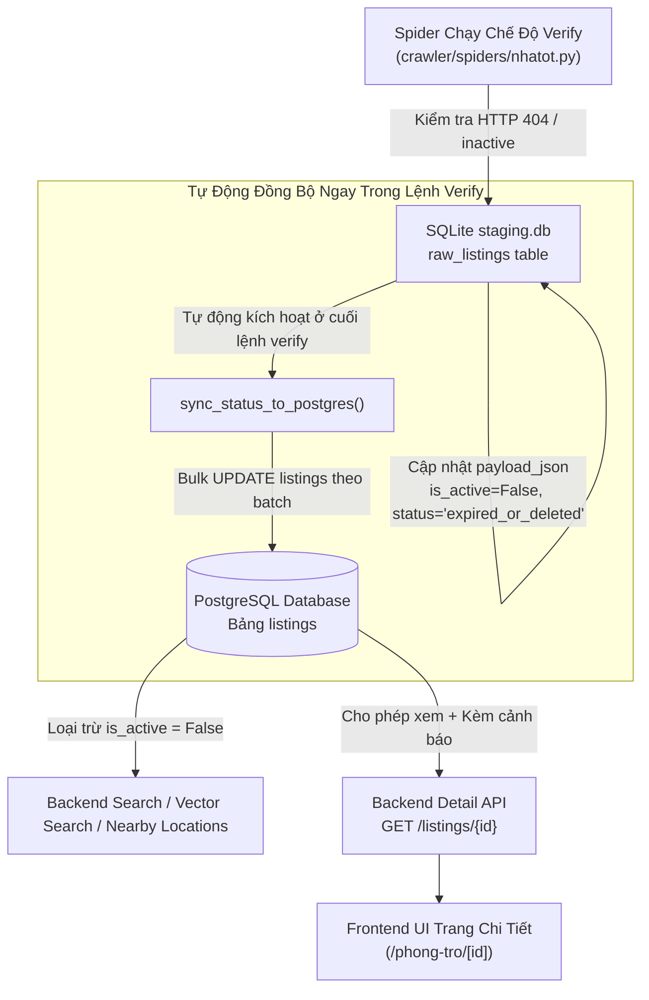

# 📋 Đặc Tả Kỹ Thuật (Feature Spec): Đồng Bộ Trạng Thái Vòng Đời Tin Đăng (Listing Lifecycle & Expired Status) Giữa SQLite Staging & PostgreSQL

- **Mã tính năng (Feature ID):** `FEAT-LISTING-LIFECYCLE-SYNC`
- **Trạng thái:** APPROVED / READY FOR IMPLEMENTATION
- **Ngày tạo:** 05/11/2026
- **Tác giả:** Homigo AI Solution Architect

---

## 1. 🎯 Tổng Quan & Động Lực (Overview & Motivation)

### 1.1. Hiện trạng vấn đề
1. **Đứt gãy chuỗi đồng bộ giữa Crawler và Production Database:**
   - Khi chạy chế độ kiểm tra tin cũ (`python crawler/main.py --mode verify`), Spider đã phát hiện tin bị gỡ/hết hạn trên trang gốc (HTTP 404, status $\neq$ `active`) và cập nhật `is_active = False`, `status = "expired_or_deleted"` vào SQLite Staging Database (`crawler/data/staging.db`).
   - Tuy nhiên, bảng `listings` trong cơ sở dữ liệu chính PostgreSQL **hoàn toàn chưa có cột `is_active`, `status` và `last_checked_at`** (tham khảo `backend/app/models/listing.py` và `crawler/etl/db_models.py`).
   - Khi chạy ETL Pipeline (`crawler/etl/pipeline.py`), cờ `active_only` đang mặc định là `False`, và câu lệnh `load_to_postgres()` trong `crawler/etl/load.py` chưa ghi nhận trạng thái hoạt động này. Dẫn đến tin đã chết trên web gốc vẫn tồn tại vĩnh viễn trên hệ thống và người dùng vẫn tìm thấy.
2. **Trải nghiệm tìm kiếm bị loãng bởi tin rác / tin ảo:**
   - Hệ thống Hybrid Search (Dense vector + FTS), bộ lọc tìm kiếm và truy vấn các khu vực lân cận (`LocationRepository.nearby_locations()`) vẫn trả về các tin phòng trọ đã cho thuê xong hoặc đã bị chủ nhà gỡ bài, gây lãng phí thời gian của người tìm trọ.
3. **Mất dấu lịch sử nếu xóa cứng (Hard Delete):**
   - Nếu xóa cứng bài đăng khỏi PostgreSQL, các liên kết chia sẻ cũ hoặc người dùng đã lưu ID/bookmark bài viết sẽ gặp lỗi `404 Not Found`. Thay vào đó, cần cho phép người dùng **vẫn truy cập được bằng ID** nhưng giao diện chi tiết phải có thông báo rõ ràng là **tin đăng này đã hết hạn / phòng đã được thuê**.

### 1.2. Mục tiêu kỹ thuật
1. **Migration PostgreSQL Database:** Bổ sung các cột trạng thái (`is_active`, `status`, `last_checked_at`) vào bảng `listings` với chỉ mục (Index) tối ưu.
2. **Tự động đồng bộ hóa SQLite $\rightarrow$ PostgreSQL:**
   - Tự động gọi hàm Fast Sync ngay khi kết thúc lệnh spider verify (`--mode verify`) mà người dùng không cần gõ lệnh riêng hay cấu hình cron job phức tạp.
   - Hỗ trợ đồng bộ trạng thái qua ETL Pipeline chuẩn (`transform -> load`).
3. **Cập nhật tầng Backend:**
   - **Tìm kiếm / Vector Search / Thống kê / Nearby Locations:** Tự động lọc bỏ các tin `is_active = False` khỏi kết quả tìm kiếm, bảng thống kê và gợi ý vị trí lân cận.
   - **Chi tiết tin đăng (`GET /api/v1/listings/{id}`):** Vẫn trả về thông tin bài đăng nếu có ID, đồng thời bổ sung cờ `is_active: false`, `is_expired: true`, `status: "expired_or_deleted"` và thông báo cảnh báo rõ ràng.
4. **Cập nhật tầng Frontend:**
   - Hiển thị Banner cảnh báo nổi bật màu cam/đỏ trên trang `/phong-tro/[id]` đối với tin đã hết hạn, vô hiệu hóa nút liên hệ.

---

## 2. 🗄 Thiết Kế Cơ Sở Dữ Liệu & Database Migration

### 2.1. Thay đổi cấu trúc bảng `listings` (PostgreSQL)
Bổ sung 3 trường mới vào bảng `listings`:

| Tên Cột | Kiểu Dữ Liệu | Ràng Buộc | Giá Trị Mặc Định | Mục Đích |
| :--- | :--- | :--- | :--- | :--- |
| `is_active` | `BOOLEAN` | `NOT NULL` | `TRUE` | Cờ nhanh xác định tin còn mở hay đã hết hạn/gỡ |
| `status` | `VARCHAR(50)` | `NOT NULL` | `'active'` | Trạng thái chi tiết: `active`, `expired_or_deleted`, `pending` |
| `last_checked_at`| `TIMESTAMP WITH TIME ZONE` | `NULLABLE` | `NULL` | Thời điểm gần nhất spider kiểm tra tính khả dụng |

### 2.2. Kịch bản SQL Migration (An toàn & Zero-Downtime)

```sql
-- 1. Thêm các cột mới với giá trị mặc định an toàn cho dữ liệu sẵn có
ALTER TABLE listings 
ADD COLUMN IF NOT EXISTS is_active BOOLEAN NOT NULL DEFAULT TRUE,
ADD COLUMN IF NOT EXISTS status VARCHAR(50) NOT NULL DEFAULT 'active',
ADD COLUMN IF NOT EXISTS last_checked_at TIMESTAMP WITH TIME ZONE NULL;

-- 2. Tạo Partial Index để tối ưu hóa cực đại tốc độ Hybrid Search và Bộ Lọc
CREATE INDEX IF NOT EXISTS idx_listings_is_active 
ON listings (is_active);

CREATE INDEX IF NOT EXISTS idx_listings_active_composite 
ON listings (region_id, district_id, room_type_id) 
WHERE is_active = TRUE;
```

---

## 3. 🔄 Quy Trình Tự Động Đồng Bộ Dữ Liệu (SQLite Staging $\rightarrow$ PostgreSQL)



---

## 4. ⚙️ Đặc Tả Cập Nhật Backend API (`backend/`)

### 4.1. Cập nhật Data Transfer Objects (Pydantic Schemas)
- Thêm `is_active: bool = True`, `status: str = "active"`, `last_checked_at: Optional[datetime] = None` vào `ListingResponse`.
- Thêm `is_expired: bool = False`, `status_notice: Optional[str] = None` vào `ListingDetailResponse`.
- Validator tự động sinh thông báo nếu tin không active.

### 4.2. Cập nhật Repositories
1. **`ListingRepository`:**
   - `filtered_query()`: thêm `Listing.is_active == True`.
   - `vector_search()`: thêm `Listing.is_active == True`.
   - `price_aggregates()`: thêm `Listing.is_active == True`.
2. **`LocationRepository` (`nearby_locations`):**
   - Thêm `Listing.is_active == True` vào cả query cấp Phường (`_build_wq`) và cấp Quận (`_build_dq`), cũng như câu lệnh tính tọa độ trung bình `avg(Listing.lat), avg(Listing.lng)`.

---

## 5. 🖥 Giao Diện Người Dùng (Frontend UI/UX)

* **File:** `frontend/src/app/phong-tro/[id]/page.tsx`
* **Xử lý hiển thị:**
  - Nếu `listing.is_expired || listing.is_active === false`:
    - Hiển thị Banner cảnh báo:
      > ⚠️ **Tin đăng đã hết hạn:** Phòng trọ này đã được gỡ hoặc ngừng cho thuê trên nguồn gốc. Thông tin chỉ mang tính chất lưu trữ, tham khảo.
    - Gắn nhãn badge `[ĐÃ HẾT HẠN]` ngay cạnh tiêu đề phòng.
    - Disable hoặc gắn cảnh báo trên nút gọi điện / liên hệ chủ trọ.
