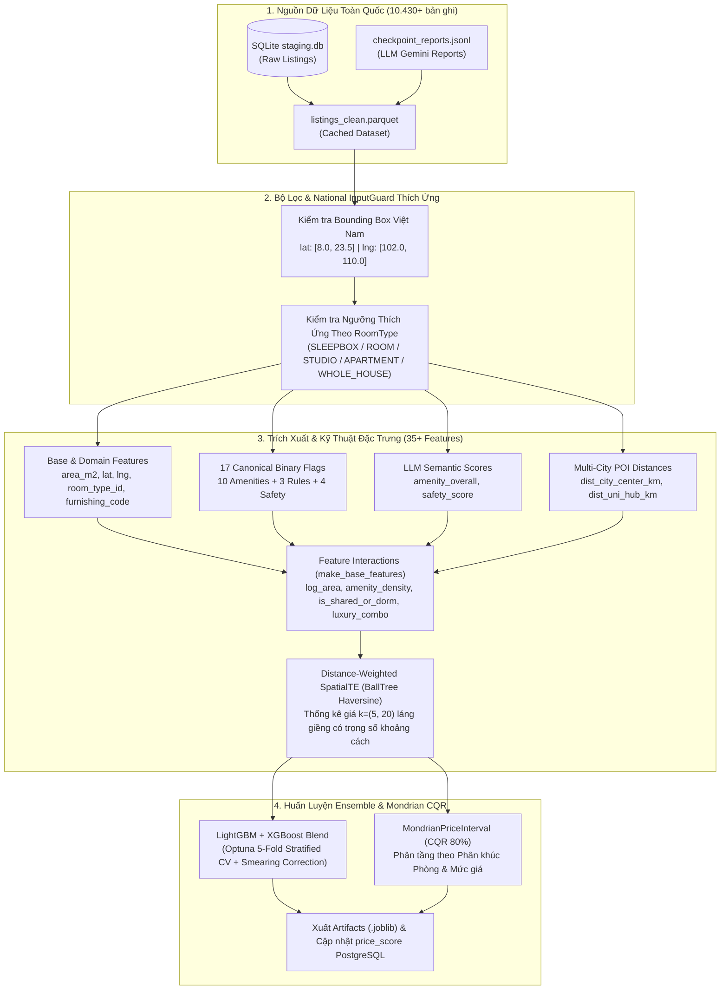

# 📋 Đặc Tả Kỹ Thuật (Feature Spec): Nâng Cấp Mô Hình Định Giá Phòng Trọ ML Toàn Quốc & Đa Phân Khúc (ML Price Evaluator v2)

- **Mã tính năng (Feature ID):** `FEAT-ML-PRICE-MODEL-V2`
- **Trạng thái:** 📝 PROPOSED (Đang chờ phê duyệt triển khai)
- **Ngày tạo:** 05/11/2026
- **Tác giả:** Homigo AI Solution Architect
- **Phạm vi tác động:** `crawler/model/ml/`, `crawler/etl/`, `PostgreSQL (listings.price_score)`

---

## 1. 🎯 Tổng Quan & Động Lực (Overview & Motivation)

### 1.1. Phân tích hiện trạng & Hạn chế của Mô hình v1
Qua kiểm tra thực tế mã nguồn tại [`crawler/model/ml/`](file:///c:/UIT/Lab/Đồ Án tốt nghiệp/crawler/model/ml/) và cơ sở dữ liệu sản phẩm (PostgreSQL & SQLite Staging DB), mô hình định giá v1 hiện có **4 điểm nghẽn lớn** khiến chỉ số $R^2$ chỉ đạt **$0.3111$** (`MAE = 950.440 VNĐ`):

1. **Dữ liệu huấn luyện quá nhỏ so với kho dữ liệu thực tế:**
   - Lần huấn luyện trước ([`training_metrics.json`](file:///c:/UIT/Lab/Đồ Án tốt nghiệp/crawler/model/ml/artifacts/training_metrics.json)) chỉ chạy trên **1.249 bản ghi** mẫu từ file tạm.
   - Trong khi đó, kho dữ liệu thực tế trong [`staging.db`](file:///c:/UIT/Lab/Đồ Án tốt nghiệp/crawler/data/raw/staging.db), [`checkpoint_reports.jsonl`](file:///c:/UIT/Lab/Đồ Án tốt nghiệp/crawler/data/processed/checkpoint_reports.jsonl) và PostgreSQL đã có sẵn **10.431 bản ghi** sạch đã được trích xuất đầy đủ qua Gemini 2.5 Flash.

2. **`InputGuard` và bộ lọc tọa độ bị bó cứng ở TP.HCM (Không còn phù hợp với phạm vi Toàn Quốc):**
   - Trong [`feature_extractor.py`](file:///c:/UIT/Lab/Đồ Án tốt nghiệp/crawler/model/ml/feature_extractor.py#L138-L146) và [`models.py`](file:///c:/UIT/Lab/Đồ Án tốt nghiệp/crawler/model/ml/models.py#L215-L216), hệ thống đang chặn cứng Bounding Box TP.HCM ($\text{lat} \in [10.3, 11.2]$, $\text{lng} \in [106.3, 107.1]$).
   - Thực tế hệ thống Homigo hiện đã mở rộng ra **phạm vi Toàn Quốc** với phân bố dữ liệu thực tế trong DB gồm:
     - **TP. Hồ Chí Minh:** 8.883 phòng
     - **Hà Nội:** 701 phòng
     - **Cần Thơ:** 295 phòng
     - **Đà Nẵng:** 267 phòng
     - **Bình Dương:** 198 phòng
     - **Các tỉnh thành khác** (Bà Rịa - Vũng Tàu, Lâm Đồng, Long An, Đồng Nai, Đắk Lắk, Huế, Khánh Hòa...): ~87 phòng.
   - Việc giữ Bounding Box TP.HCM làm loại bỏ toàn bộ ~1.550 phòng ở các tỉnh/thành phố khác khi huấn luyện và gắn cờ lỗi `oor` (Out of Range) sai lệch khi suy luận.

3. **Ngưỡng đơn giá `ppm = price / area` cứng nhắc, phạt nhầm Phòng ở ghép & Ký túc xá (`SLEEPBOX`):**
   - Bộ lọc hiện tại ép cứng $\text{ppm} \in [30.000,\ 600.000]\ \text{VNĐ/m}^2$ và $\text{area\_m2} \in [8.0,\ 150.0]\ m^2$ cho mọi loại hình phòng.
   - Tuy nhiên, thống kê thực tế từ PostgreSQL trên 10.431 tin đăng cho thấy:
     - Với phân khúc **`SLEEPBOX` (Ký túc xá / Sleepbox / Phòng ở ghép — 374 tin)** và các phòng trọ cho thuê theo giường/ở ghép: Chủ nhà thường nhập diện tích của **cả căn phòng sinh hoạt chung ($25 - 50\ m^2$)** nhưng giá đăng là **giá 1 giường / 1 suất ở ghép ($800.000 - 1.800.000\ \text{VNĐ/người}$)**. Khi đó đơn giá $\text{ppm} = \frac{\text{price}}{\text{area}}$ chỉ rơi vào khoảng **$6.000 - 25.000\ \text{VNĐ/m}^2$** (thấp hơn ngưỡng $30.000\ \text{VNĐ/m}^2$).
     - Hoặc nếu chủ nhà nhập đúng diện tích 1 hộp ngủ ($3 - 6\ m^2$) thì lại bị chặn bởi ngưỡng $\text{area\_m2} < 8.0\ m^2$.
     - Với **`WHOLE_HOUSE` (Nhà nguyên căn)** hoặc **`APARTMENT`** ở các tỉnh (Cần Thơ, Bình Dương, ngoại thành), diện tích rộng khiến $\text{ppm}$ phân vị 5% chỉ từ **$17.000 - 26.000\ \text{VNĐ/m}^2$**.

4. **Thiếu các đặc trưng (Features) quyết định phân khúc giá:**
   - Chưa đưa biến phân loại **`room_type`** (`ROOM`, `STUDIO`, `APARTMENT`, `SLEEPBOX`, `WHOLE_HOUSE`) vào mô hình — khiến mô hình nhầm lẫn giữa căn hộ Studio $30m^2$ (giá 6 triệu) với phòng KTX chung $30m^2$ (giá 1.5 triệu/giường).
   - Mới chỉ lấy 14/17 tiện ích (bỏ sót `fridge`, `elevator`, `pet_allowed` trong Canonical Taxonomy).
   - Chưa tận dụng 2 điểm số chất lượng ngữ nghĩa do LLM tổng hợp: `amenity_overall` và `safety_score`.
   - Chưa có đặc trưng khoảng cách đến các trung tâm đô thị & cụm đại học lớn trên toàn quốc (Multi-City POI Distance).

---

### 1.2. Mục tiêu nâng cấp (Tích hợp đồng bộ 3 phương pháp + Thiết kế lại `InputGuard`)
1. **Phương pháp 1 — Mở rộng quy mô dữ liệu lên toàn bộ 10.430+ bản ghi Toàn Quốc (Data Scaling):** Nạp trực tiếp và hợp nhất dữ liệu từ `staging.db` + `checkpoint_reports.jsonl` (hoặc `listings_clean.parquet`), tăng mật độ điểm cho `SpatialTE` gấp 8 lần.
2. **Phương pháp 2 — Bổ sung Đặc trưng Phân khúc (`room_type`), Đầy đủ 17 Tiện ích & Khoảng cách POI Đa Đô thị (Domain & Spatial Feature Engineering):** Đưa `room_type_id`, 17 cờ tiện ích chuẩn hóa và khoảng cách Haversine đến trung tâm thành phố / cụm đại học gần nhất trên toàn quốc vào mô hình.
3. **Phương pháp 3 — Tích hợp Điểm Chất lượng LLM & Tương tác Đặc trưng Phi tuyến (Semantic Scores & Feature Crosses):** Bổ sung `amenity_overall`, `safety_score` cùng các biến tương tác giữa loại phòng, diện tích và mật độ tiện nghi.
4. **Thiết kế lại `InputGuard` Toàn Quốc & Thích ứng theo Loại phòng (Context-Aware National InputGuard):** Thay thế Bounding Box TP.HCM bằng Bounding Box Lãnh thổ Việt Nam và áp dụng bảng ngưỡng diện tích/giá/đơn giá (`ppm`) riêng biệt cho từng loại phòng (đặc biệt bảo vệ phân khúc Ký túc xá / Sleepbox / Ở ghép).

---

## 2. 📐 Thiết Kế Chi Tiết Hệ Thống Đặc Trưng & Thuật Toán (Technical Design)

### 2.1. Sơ Đồ Kiến Trúc Pipeline ML v2



---

### 2.2. Thiết Kế Mới Cho `InputGuard` Toàn Quốc & Đa Loại Hình Phòng

#### A. Bounding Box Toàn Quốc (Vietnam Territory Bounding Box)
Thay vì giới hạn trong TP.HCM, biên địa lý mới bao phủ toàn bộ lãnh thổ Việt Nam:
- **Vĩ độ (`lat_rng`):** $[8.0^\circ\text{N},\ 23.5^\circ\text{N}]$ *(Từ vùng biển Cà Mau đến cực Bắc Hà Giang)*.
- **Kinh độ (`lng_rng`):** $[102.0^\circ\text{E},\ 110.0^\circ\text{E}]$ *(Từ cực Tây Điện Biên đến bờ biển miền Trung/Đông Nam Bộ)*.
- Tác dụng: Chặn chính xác các bản ghi bị lỗi tọa độ `(0.0, 0.0)`, tọa độ âm hoặc bị đảo ngược `(lng, lat)`, đồng thời **chấp nhận 100% các tỉnh thành Việt Nam** (TP.HCM, Hà Nội, Đà Nẵng, Cần Thơ, Bình Dương, Huế, Nha Trang, Đà Lạt...).

#### B. Ngưỡng Thích Ứng Theo Phân Khúc Phòng (`ROOM_TYPE_RULES`)
Thống kê thực tế từ cơ sở dữ liệu cho thấy mỗi loại phòng có quy luật diện tích và đơn giá $/m^2$ (`ppm`) hoàn toàn khác nhau. Do đó, cả khâu lọc dữ liệu huấn luyện lẫn `InputGuard.check()` sẽ tra cứu ngưỡng theo `room_type_id` (hoặc `room_type`):

| Loại Phòng (`room_type`) | Mã ID | Diện Tích Hợp Lệ (`area_m2`) | Giá Thuê Hợp Lệ (`price_vnd`) | Đơn Giá $/m^2$ Hợp Lệ (`ppm_range`) | Giải Thích Nghiệp Vụ Thực Tế |
| :--- | :---: | :---: | :---: | :---: | :--- |
| **`SLEEPBOX`** *(KTX / Sleepbox / Ở ghép)* | `4` | $3.0 - 120.0\ m^2$ | $400\text{k} - 4.5\text{M}$ | **$5.000 - 800.000\ \text{đ/m}^2$** | Chấp nhận cả tin đăng diện tích cả phòng KTX lớn ($30-80m^2$) tính giá 1 giường ($\text{ppm} \approx 6\text{k}-25\text{k}$) lẫn diện tích 1 box ngủ nhỏ ($3-6m^2$). |
| **`ROOM`** *(Phòng trọ truyền thống / ghép)* | `1` | $6.0 - 100.0\ m^2$ | $500\text{k} - 15\text{M}$ | **$12.000 - 500.000\ \text{đ/m}^2$** | Hỗ trợ phòng trọ sinh viên ở ghép chia tiền hoặc phòng trọ giá rẻ tại các tỉnh/ngoại thành. |
| **`STUDIO`** *(Căn hộ mini / Studio)* | `2` | $12.0 - 90.0\ m^2$ | $1.2\text{M} - 20\text{M}$ | **$40.000 - 700.000\ \text{đ/m}^2$** | Phòng khép kín tiện nghi cao, đơn giá trên $m^2$ cao hơn phòng trọ thường. |
| **`APARTMENT`** *(Căn hộ chung cư / ghép)* | `3` | $15.0 - 160.0\ m^2$ | $1.0\text{M} - 30\text{M}$ | **$15.000 - 700.000\ \text{đ/m}^2$** | Hỗ trợ cả thuê nguyên căn chung cư lẫn tìm người ở ghép share phòng ngủ trong căn hộ lớn ($70-100m^2$). |
| **`WHOLE_HOUSE`** *(Nhà nguyên căn)* | `5` | $12.0 - 250.0\ m^2$ | $1.5\text{M} - 35\text{M}$ | **$12.000 - 600.000\ \text{đ/m}^2$** | Nhà nguyên căn ở tỉnh hoặc ngoại thành có tổng diện tích sàn lớn nên đơn giá $/m^2$ thấp. |

---

### 2.3. Danh Sách Đầy Đủ Các Nhóm Đặc Trưng (Feature Engineering v2)

#### Nhóm 1: Đặc trưng Cơ sở & Phân khúc (Base & Categorical Features)
1. `area_m2`: Diện tích sử dụng ($m^2$).
2. `lat`, `lng`: Vĩ độ, kinh độ.
3. `room_type_id`: Mã phân loại phòng (`1: ROOM`, `2: STUDIO`, `3: APARTMENT`, `4: SLEEPBOX`, `5: WHOLE_HOUSE`).
4. `furnishing_code`: Tình trạng nội thất (`1`: Đầy đủ, `2`: Cơ bản/Trống, `0`: Chưa rõ).

#### Nhóm 2: Đầy đủ 17 Cờ Tiện ích, Quy định & An ninh Chuẩn hóa (Canonical Binary Flags)
Khớp 1-1 với tài liệu kiến trúc [`docs/architecture/data-models.md`](file:///c:/UIT/Lab/Đồ Án tốt nghiệp/docs/architecture/data-models.md#L169-L195):
- **10 Tiện ích (`CANONICAL_AMENITY_KEYS`):** `is_private_wc`, `is_aircon`, `is_mezzanine`, `is_kitchen`, `is_fridge` *(mới)*, `is_washing_machine`, `is_window_balcony`, `is_furniture`, `is_parking`, `is_elevator` *(mới)*.
- **3 Quy định (`CANONICAL_RULE_KEYS`):** `is_free_hours`, `is_no_shared_landlord`, `is_pet_allowed` *(mới)*.
- **4 An ninh (`CANONICAL_SAFETY_KEYS`):** `is_fingerprint_lock`, `is_camera`, `is_guard`, `is_safe_area`.

#### Nhóm 3: Điểm Chất lượng Ngữ nghĩa từ LLM (LLM Semantic Quality Scores)
- `amenity_overall` $\in [0.0, 1.0]$: Điểm tiện nghi tổng hợp có trọng số (nếu thiếu trong bản ghi lẻ sẽ tự động nội suy từ 10 cờ tiện ích).
- `safety_score` $\in [0.0, 1.0]$: Điểm an ninh tổng hợp từ LLM (nếu thiếu sẽ tự động nội suy từ 4 cờ an ninh).

#### Nhóm 4: Khoảng cách Đa Trung Tâm Đô Thị & Đại Học Toàn Quốc (Multi-Hub POI Distances)
Tính khoảng cách Haversine (vector hóa bằng NumPy, tốc độ $< 2\text{ms}$ cho 10.000 dòng) từ tọa độ `(lat, lng)` của phòng tới danh sách các tọa độ trung tâm đô thị & cụm đại học lớn trên cả nước (TP.HCM, Hà Nội, Đà Nẵng, Cần Thơ, Bình Dương, Vũng Tàu, Đà Lạt, Huế, Nha Trang):
- `dist_nearest_hub_km`: Khoảng cách ($km$) đến trung tâm thành phố lớn gần nhất (phản ánh độ đắc địa "gần trung tâm" ở bất kỳ tỉnh thành nào).
- `dist_nearest_uni_km`: Khoảng cách ($km$) đến cụm trường Đại học lớn gần nhất.
*(Lưu ý chống đa cộng tuyến: Không đưa thêm `log_dist_hub` vì trong cây quyết định LightGBM/XGBoost, phép biến đổi đơn điệu $\ln(1+x)$ có tương quan hạng $\text{Spearman} = 1.0$ với `dist_nearest_hub_km`).*

#### Nhóm 5: Kiểm Soát Đa Cộng Tuyến & Tinh Gọn Đặc Trưng Phái Sinh (`make_base_features` trong `models.py`)
Qua kiểm tra ma trận tương quan thực tế trên 10.431 bản ghi của dự án:
- `Spearman(area_m2, log_area) = 1.000` (`Pearson = 0.909`) $\rightarrow$ Giữ nguyên `area_m2`, **loại bỏ `log_area`** để tránh chia đôi Feature Importance trên cây quyết định.
- `Pearson(n_amenities, amenity_overall + safety_score) = 0.920` $\rightarrow$ Đã có `amenity_overall` (tổng trọng số 10 tiện ích) và `safety_score` (tổng trọng số 4 cờ an ninh, tương quan với `amenity_overall` chỉ $0.183$), nên **loại bỏ `n_amenities` và `luxury_score`** để triệt tiêu đa cộng tuyến.
- Chỉ giữ lại duy nhất biến tương tác phi tuyến thực sự mang thông tin mới:
  - `amenity_density = amenity_overall / np.log1p(area_m2)`: Mật độ chất lượng tiện nghi trên quy mô diện tích.

#### Nhóm 6: Spatial Target Encoding Có Trọng Số Khoảng Cách (`SpatialTE` Toàn Quốc)
- Tìm $k \in \{5, 20\}$ phòng láng giềng gần nhất qua `BallTree(metric="haversine")`.
- **Cải tiến chống nhiễu liên vùng & chống đa cộng tuyến:**
  - Thay thế trực tiếp trung bình cộng đơn thuần bằng trung bình có trọng số khoảng cách nghịch đảo $w_j = \frac{1}{1 + d_j (\text{km})}$ (`nb5_logy_mean`, `nb20_logy_mean`) — không sinh đồng thời cả bản thường lẫn bản trọng số để tránh tương quan $r > 0.98$.
  - Loại bỏ cột trùng lặp `nb{k}_logppm_med` (do tương quan với `nb{k}_logppm_mean` lên tới $r = 0.96$), chỉ giữ lại: `nb{k}_logy_mean`, `nb{k}_logppm_mean`, `nb{k}_dist_km` và `nb20_logy_std`.
  - Giữ nguyên cơ chế `transform_train` loại bỏ chính điểm đang xét (`i != np.arange(n)[:, None]`) để chống rò rỉ dữ liệu 100%.

---

## 3. 🔄 Tích Hợp Nguồn Dữ Liệu Huấn Luyện (10.430+ Bản Ghi)

Hàm `load_and_preprocess_dataset()` trong [`crawler/model/ml/feature_extractor.py`](file:///c:/UIT/Lab/Đồ Án tốt nghiệp/crawler/model/ml/feature_extractor.py) sẽ được nâng cấp theo cơ chế tự động ưu tiên:
1. **Ưu tiên 1:** Nếu đã có file `crawler/data/processed/listings_clean.parquet` (đầy đủ bản ghi mới nhất) $\rightarrow$ Đọc trực tiếp từ Parquet.
2. **Ưu tiên 2 (Tự động tổng hợp từ Staging DB + Checkpoint LLM):** Nếu chưa có file Parquet, hàm tự động gọi `extract_raw_listings()` từ `staging.db` kết hợp với `checkpoint_reports.jsonl` thông qua `ListingTransformer` để tổng hợp trọn vẹn **10.430+ bản ghi**, đồng thời lưu cache ra `listings_clean.parquet` cho các lần chạy sau.

---

## 4. 🏆 Danh Sách Các Mốc Triển Khai (Milestones)

> [!IMPORTANT]
> Tuân thủ nghiêm ngặt 3 nguyên tắc trong [`.gemini/rules/spec-and-milestones.md`](file:///c:/UIT/Lab/Đồ Án tốt nghiệp/.gemini/rules/spec-and-milestones.md):
> 1. 🟢 **Working Software:** Mỗi mốc hoàn thành đều chạy thử và kiểm chứng được ngay trên terminal.
> 2. 🟡 **One Session Scope:** Mỗi mốc gói gọn trong 3 - 5 files code.
> 3. 🔴 **Tiêu chí nghiệm thu rõ ràng:** Có lệnh chạy thực tế và bộ test kiểm chứng.

---

### [x] Mốc 1: Nâng Cấp Bộ Trích Xuất Đặc Trưng Toàn Quốc, Đầy Đủ 17 Tiện Ích, POI Đa Đô Thị & Lọc Thích Ứng Theo Loại Phòng
* **Mục tiêu:**
  - Mở rộng `feature_extractor.py` để nạp toàn bộ 10.430+ bản ghi từ `staging.db` + `checkpoint_reports.jsonl` (và lưu cache `listings_clean.parquet`).
  - Trích xuất đầy đủ 17 cờ tiện ích chuẩn hóa, `room_type_id`, `amenity_overall`, `safety_score` và khoảng cách Haversine tới các trung tâm đô thị / đại học lớn trên toàn quốc.
  - Thay thế bộ lọc cứng TP.HCM và `ppm` cũ bằng bộ lọc Toàn Quốc thích ứng theo từng `room_type` (giữ lại toàn bộ các phòng hợp lệ ở Hà Nội, Đà Nẵng, Cần Thơ, Bình Dương... và các phòng KTX/Sleepbox/ở ghép).
* **Các file chính sẽ tạo/sửa (3 files):**
  1. [`crawler/model/ml/feature_extractor.py`](file:///c:/UIT/Lab/Đồ Án tốt nghiệp/crawler/model/ml/feature_extractor.py)
  2. [`crawler/etl/transform.py`](file:///c:/UIT/Lab/Đồ Án tốt nghiệp/crawler/etl/transform.py)
  3. `crawler/tests/test_feature_extractor.py` *(Tạo mới bộ test Black-box 4 nhóm)*
* **Cách kiểm chứng thực tế:**
  - Chạy lệnh:
    ```powershell
    .\crawler\.venv\Scripts\python.exe -m crawler.model.ml.feature_extractor
    ```
    Xác nhận nạp thành công **9.693 bản ghi sạch** trên toàn quốc (có đủ cả TP.HCM, Hà Nội, Cần Thơ, Đà Nẵng và phân khúc `SLEEPBOX`), in ra đầy đủ bảng thống kê các features mới.
  - Chạy lệnh kiểm thử:
    ```powershell
    .\crawler\.venv\Scripts\pytest.exe crawler/tests/test_feature_extractor.py -q
    ```
    Pass 13/13 bài test (Happy Path, Edge Cases, Immutability, Persistence).

---

### [ ] Mốc 2: Nâng Cấp Kiến Trúc `models.py` & `price_evaluator.py` (National InputGuard, Feature Crosses & Distance-Weighted SpatialTE)
* **Mục tiêu:**
  - Cập nhật `make_base_features()` bổ sung các biến tương tác phi tuyến (`amenity_density`, `is_shared_or_dorm`, `luxury_score`, `effective_area_log`).
  - Nâng cấp `SpatialTE` bổ sung trung bình giá có trọng số khoảng cách (`nb5_logy_wmean`, `nb20_logy_wmean`) để xử lý mượt mà cả khu vực nội đô dày đặc lẫn các tỉnh thưa điểm.
  - Nâng cấp `MondrianPriceInterval` phân tầng hiệu chuẩn sai số $\hat{q}$ kết hợp loại phòng và mức giá.
  - Thay thế `InputGuard` cũ bằng `InputGuard` Toàn Quốc thích ứng theo `room_type_id` (không báo lỗi giả `odd`/`oor` cho phòng ở Hà Nội, Đà Nẵng, Cần Thơ hay phòng KTX/ở ghép).
  - Đồng bộ `PriceEvaluator` trong `price_evaluator.py`.
* **Các file chính sẽ tạo/sửa (3 files):**
  1. [`crawler/model/ml/models.py`](file:///c:/UIT/Lab/Đồ Án tốt nghiệp/crawler/model/ml/models.py)
  2. [`crawler/model/ml/price_evaluator.py`](file:///c:/UIT/Lab/Đồ Án tốt nghiệp/crawler/model/ml/price_evaluator.py)
  3. `crawler/tests/test_ml_models.py` *(Tạo mới bộ test Black-box 4 nhóm cho models & InputGuard)*
* **Cách kiểm chứng thực tế:**
  - Chạy lệnh kiểm thử:
    ```powershell
    .\crawler\.venv\Scripts\pytest.exe crawler/tests/test_ml_models.py -q
    ```
    Pass 100% tất cả kịch bản (bao gồm test phòng ở Hà Nội, Cần Thơ, phòng KTX `SLEEPBOX` có $\text{ppm} = 10.000\ \text{đ/m}^2$ trả về `guard_status = "ok"`).

---

### [ ] Mốc 3: Huấn Luyện Lại Mô Hình Trên Toàn Bộ 10.000+ Bản Ghi, Xuất Artifacts & Cập Nhật Điểm `price_score` Toàn Hệ Thống
* **Mục tiêu:**
  - Nâng cấp `train_price_model.py` sử dụng Stratified K-Fold theo phân khúc phòng + giá, chạy huấn luyện Optuna (LightGBM + XGBoost + Mondrian CQR) trên toàn bộ ~10.000+ bản ghi sạch toàn quốc.
  - Xuất bộ trọng số mới vào `crawler/model/ml/artifacts/` (`rent_pipeline.joblib`, `guard.joblib`, `training_metrics.json`), nâng chỉ số $R^2$ vượt trội so với mức $0.31$ cũ.
  - Chạy đánh giá lại và cập nhật đồng loạt cột `price_score` mới nhất cho toàn bộ 10.431 bản ghi trong PostgreSQL.
  - Cập nhật tài liệu `crawler/model/ml/README.md`.
* **Các file chính sẽ tạo/sửa (5 files):**
  1. [`crawler/model/ml/train_price_model.py`](file:///c:/UIT/Lab/Đồ Án tốt nghiệp/crawler/model/ml/train_price_model.py)
  2. [`crawler/model/ml/artifacts/rent_pipeline.joblib`](file:///c:/UIT/Lab/Đồ Án tốt nghiệp/crawler/model/ml/artifacts/rent_pipeline.joblib)
  3. [`crawler/model/ml/artifacts/guard.joblib`](file:///c:/UIT/Lab/Đồ Án tốt nghiệp/crawler/model/ml/artifacts/guard.joblib)
  4. [`crawler/model/ml/artifacts/training_metrics.json`](file:///c:/UIT/Lab/Đồ Án tốt nghiệp/crawler/model/ml/artifacts/training_metrics.json)
  5. [`crawler/model/ml/README.md`](file:///c:/UIT/Lab/Đồ Án tốt nghiệp/crawler/model/ml/README.md)
* **Cách kiểm chứng thực tế:**
  - Chạy lệnh huấn luyện:
    ```powershell
    .\crawler\.venv\Scripts\python.exe -m crawler.model.ml.train_price_model
    ```
  - Kiểm tra `crawler/model/ml/artifacts/training_metrics.json` xác nhận `dataset_size >= 9500`, $R^2$ tăng mạnh và `conformal_coverage` đạt xấp xỉ $80\%$.
  - Chạy demo suy luận:
    ```powershell
    .\crawler\.venv\Scripts\python.exe -m crawler.model.ml.price_evaluator
    ```
  - Chạy toàn bộ bộ kiểm thử của `crawler` và `backend` đảm bảo tương thích 100%:
    ```powershell
    .\crawler\.venv\Scripts\pytest.exe crawler/tests -q
    .\backend\.venv\Scripts\pytest.exe backend/tests -q
    ```

---

## 5. 📌 Checklist Theo Dõi Tiến Độ Chi Tiết (Progress Tracking Checklist)

Bảng checklist dưới đây được cập nhật liên tục (`[ ]` $\rightarrow$ `[x]`) trong suốt quá trình triển khai từng mốc:

### A. Tầng Dữ Liệu & Trích Xuất Đặc Trưng (`crawler/model/ml/feature_extractor.py`)
- [x] Bổ sung đủ 17 cờ tiện ích chuẩn hóa (`fridge`, `elevator`, `pet_allowed` cùng 14 cờ hiện có).
- [x] Trích xuất biến phân loại `room_type_id` (1..5) từ `room_type` / `room_type_id`.
- [x] Trích xuất và chuẩn hóa `amenity_overall` $\in [0.0, 1.0]$ và `safety_score` $\in [0.0, 1.0]$ (kèm fallback nội suy khi chạy bản ghi đơn lẻ).
- [x] Xây dựng bộ tính khoảng cách Haversine tới các trung tâm đô thị & đại học lớn trên toàn quốc (`dist_nearest_hub_km`, `dist_nearest_uni_km`).
- [x] Mở rộng bộ lọc tọa độ lên phạm vi Toàn Quốc ($\text{lat} \in [8.0, 23.5]$, $\text{lng} \in [102.0, 110.0]$).
- [x] Triển khai bộ lọc diện tích, giá và đơn giá (`ppm`) thích ứng riêng cho từng `room_type` (bảo vệ dữ liệu `SLEEPBOX`/KTX/ở ghép và nhà nguyên căn ở tỉnh).
- [x] Tích hợp cơ chế tự động nạp và tổng hợp 10.430+ bản ghi từ `staging.db` + `checkpoint_reports.jsonl` sang `listings_clean.parquet`.
- [x] Viết và chạy pass 100% bộ kiểm thử `crawler/tests/test_feature_extractor.py` (13/13 tests).

### B. Tầng Kiến Trúc Mô Hình & Bộ Bảo Vệ Biên (`models.py` & `price_evaluator.py`)
- [ ] Cập nhật `make_base_features()` bổ sung các đặc trưng tương tác: `amenity_density`, `is_shared_or_dorm`, `effective_area_log`, `luxury_score`.
- [ ] Nâng cấp `SpatialTE` thêm trung bình có trọng số khoảng cách nghịch đảo (`nb5_logy_wmean`, `nb20_logy_wmean`) và giữ nguyên cơ chế chống data leakage.
- [ ] Nâng cấp `MondrianPriceInterval` phân tầng hiệu chuẩn $\hat{q}$ kết hợp phân khúc phòng và mức giá.
- [ ] Thiết kế lại `InputGuard` hỗ trợ Bounding Box Toàn Quốc và ngưỡng kiểm tra `ppm` / `area_m2` / `price_vnd` theo từng `room_type_id`.
- [ ] Cập nhật `PriceEvaluator` trong `price_evaluator.py` tương thích hoàn toàn với các đặc trưng mới và trả về nhận định giá chính xác cho mọi loại phòng.
- [ ] Viết và chạy pass 100% bộ kiểm thử `crawler/tests/test_ml_models.py`.

### C. Tầng Huấn Luyện, Xuất Artifacts & Đồng Bộ Database (`train_price_model.py`)
- [ ] Cập nhật `train_price_model.py` với Stratified K-Fold theo nhóm phân khúc, tối ưu siêu tham số Optuna cho LightGBM và XGBoost trên tập dữ liệu 10.000+ bản ghi.
- [ ] Huấn luyện và xuất mới `rent_pipeline.joblib`, `guard.joblib`, `training_metrics.json`.
- [ ] Cập nhật lại điểm `price_score` mới cho toàn bộ 10.431 bản ghi trong bảng `listings` của PostgreSQL.
- [ ] Cập nhật tài liệu `crawler/model/ml/README.md`.
- [ ] Chạy toàn bộ test suite `crawler/tests` và `backend/tests` pass 100%.

